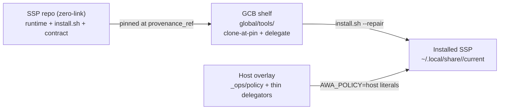

# Standalone System Paradigm — SSP + GCB (reusable)

> The general pattern for shipping a capability as a **self-contained product installed from its own
> repo at a pin**, bound into the ecosystem by a **thin host binding**. AWA is the worked example;
> the pattern is reusable for chaos-scheduler, chaos-labs, and any future standalone system.
>
> Read alongside `MANIFEST-CONTRACT.md` (the `record-only` vs `standalone-release` split) and
> `OPERATING-MANUAL.md` §10h (capability lifecycle) + §11 (AWA).

## The paradigm in one breath

A capability can outgrow a single-repo skill/tool and become a **product**: a generic runtime plus
a frozen behavioral contract. When it does, it should **ship and install itself** from its own repo,
not be vendored byte-by-byte into every host. Three roles, three one-way contracts:

| Role | Lives in | Owns | Must NOT contain |
|------|----------|------|------------------|
| **SSP** — Standalone System Package | its own repo (e.g. `KleinPerkins/awa`) | the generic runtime + `install.sh` + the frozen contract + freeze checker | any host/org literal (zero-link) |
| **GCB** — Global Capability Binding | `capabilities/skills/global/tools/<id>/` (a Flavor-2 shelf in `KleinPerkins/skills`) | the **pin** to the SSP release + a clone-at-pin `install.sh` | the runtime bytes (only a pointer) |
| **Host overlay** | the host repo (e.g. `~/dev/_ops/`) | the **policy literals** (org/host globs) + thin delegators to the installed SSP | a fork of the runtime |

The invariant that makes this safe: **the product ships a generic kernel; the host supplies only a
policy overlay.** Every org/host literal lives in exactly one place — the host overlay policy file —
and the SSP resolves it at runtime via an env var (`AWA_POLICY`), never a hard-coded path.



## 1. SSP — Standalone System Package

A self-contained product that installs itself from a fresh clone with **no sibling-repo dependency**.

**Install contract (verbs are frozen so every SSP is interchangeable):**

```
git clone git@github.com:<owner>/<id>.git && cd <id>
./install.sh                      # install (default; idempotent, backup-before-write)
./install.sh --repair             # force re-place the runtime at the current tree
./install.sh --doctor             # read-only health check (all-PASS or non-zero)
./install.sh --check              # CI-safe static preflight (no writes, no network)
./install.sh --uninstall [--keep-state]
```

**Required properties:**
- **Idempotent + backup-before-write** — a second `install.sh` is a no-op; any file it overwrites in
  `$HOME` is backed up first (never brick the host tool).
- **XDG layout, HOME/XDG-overridable** — runtime under `${XDG_DATA_HOME:-~/.local/share}/<id>/current`,
  config under `${XDG_CONFIG_HOME:-~/.config}/<id>/env`, durable state under
  `${XDG_STATE_HOME:-~/.local/state}/<id>` on **local disk** (never a synced/network path).
- **Self-describing pointer** — `…/<id>/release-pointer.json` records what is installed.
- **Zero-link runtime** — the shipped bytes carry no host/org literal; a preflight/test scans the
  runtime (both the interpreted engine *and* the shell kernel) for org tokens and fails if any appear.
- **Ships its own contract + freeze checker** — the frozen behavioral surface (CLI verbs, JSON
  shapes, permission/lease schemas) lives in the SSP repo, and the freeze checker runs there,
  resolving the CLI/hook paths **by role** (installed location), not by a hard-coded host path.
- **Contract is behavior-only** — folder locations are *informational / resolved_by_role*; moving the
  runtime is not a contract break, so the contract version does not bump when layout changes.

## 2. GCB — Global Capability Binding

The ecosystem enrolls an SSP as a global capability **without** copying its runtime. The GCB is a
Flavor-2 `kind: tool` shelf whose `meta.yml` declares `sync_policy: standalone-release`,
`shape: release-descriptor`, and pins the release via `provenance_source` @ `provenance_ref`.

Its `install.sh`:
1. reads the pin from `meta.yml`,
2. clones/updates `provenance_source` at exactly `provenance_ref` into a per-user checkout
   (`${XDG_DATA_HOME}/<id>/checkout`), SSH-first with an HTTPS fallback, degrading with an honest
   message when git/network is unavailable,
3. hands off to the checkout's **own** `install.sh` (`bash <checkout>/install.sh --repair`),
4. writes a **distinct** binding pointer (`<id>-gcb-pointer/v1`) that never clobbers the SSP's
   `release-pointer.json`.

It exposes the same `--repair | --doctor | --check | --print | --uninstall` verbs (delegating the
substantive ones to the checkout's installer) and is **WF1-enrolled** in the ecosystem orchestrator
(`config/registry.yml`). `manifest.sh validate` treats it as a first-class shape and, unlike a
`record-only` shelf, **exempts** it from the "no fetch / no exec" prohibition — clone-at-pin +
delegate is its entire contract.

## 3. Host overlay — policy only

A host (a laptop's `~/dev`, a governed sibling, a teammate's clone) binds the installed SSP to its
own reality by supplying **only** literals + thin delegators — never a fork of the runtime.

- **Overlay installer** (`_ops/bin/install-<id>-overlay.sh`): ensures the SSP is installed by
  delegating to the GCB shelf (`bash capabilities/skills/global/tools/<id>/install.sh --repair`),
  then writes the host policy overlay + points host-local surfaces (dashboards) at the installed
  runtime.
- **Host policy overlay** (`_ops/policy/<id>-policy.yml`): the org/host literals — governed-root
  globs, include/exclude lists, self-governed exclusions. The installed generic kernel reads these
  and **only** these for host specifics, via `AWA_POLICY` (or the SSP's equivalent).
- **Thin delegators**: the host keeps stable entry-point paths (because rules/hooks/muscle-memory
  reference them) but each is a **~10-line shim** that resolves the installed SSP (via the SSP config
  env / release pointer) and `exec`s the real implementation, passing the host policy. Delegators
  **degrade to allow** — if the SSP is not yet installed, a hook shim exits 0 (never blocks the host)
  and a CLI shim prints an honest "run the overlay installer" message.

## 4. AWA — the worked example

| Role | Concrete |
|------|----------|
| SSP | `KleinPerkins/awa` — `install.sh` (verbs above), `kernel/` (`bin/dev-worktree.sh`, `hooks/{worktree-guard,worktree-session,install-hooks}.sh`, `checks/awa-contract-freeze.sh`, `lib/{awa_policy.py,install-lib.sh}`, `policy/default-worktree-policy.yml`), `engine/`, `dashboard/{emitter.py,seed.canvas.tsx}`, `contracts/awa-contract.v1.json` (behavior-only). Installs to `~/.local/share/awa/current`, config `~/.config/awa/env` (`AWA_HOME`/`AWA_POLICY`/`AWA_GOVERNED_ROOT`), state `~/.local/state/awa`, merges `~/.cursor/hooks.json`, add-only `~/.cursor/mcp.json`. |
| GCB | `capabilities/skills/global/tools/awa/` — Flavor-2, `shape: release-descriptor`, `sync_policy: standalone-release`, pinned at `provenance_ref`; `install.sh` clones `github.com/KleinPerkins/awa` into `~/.local/share/awa/checkout` and hands off; writes `awa-gcb-pointer/v1`. |
| Host overlay | `~/dev/_ops/` — `bin/install-dev-awa-overlay.sh`, host policy `policy/worktree-policy.yml` (the `affirm/*` + cpp literals), and thin delegators at `bin/dev-worktree.sh`, `cursor-hooks/worktree-guard.sh`, `cursor-hooks/worktree-session.sh`, `checks/awa-contract-freeze.sh`. |

The `affirm/*` / cpp literals that used to live inside the kernel now live **only** in
`~/dev/_ops/policy/worktree-policy.yml`; the installed kernel is generic and reads them via
`AWA_POLICY`.

## 5. Adding a new standalone system (recipe)

1. Build the product in its own repo with the SSP `install.sh` verbs above; keep the runtime
   zero-link; ship its contract + freeze checker.
2. Scaffold the GCB shelf: `bash _ops/eco/manifest.sh scaffold-standalone-tool <id> --source
   github.com/<owner>/<id> --ref <sha>`, then fill in the clone-at-pin `install.sh` (copy AWA's).
3. Enroll it in the orchestrator (`config/registry.yml`) via WF1.
4. Add a host overlay installer + host policy + thin delegators in the host repo.
5. Wire the host's `bootstrap.sh`, `self-heal.sh`, and clean-room to install/heal/assert via the GCB
   shelf, and point the host's verify at the **installed** SSP (never an in-repo copy).

## 6. Verification (per role)

| Gate | SSP (own CI) | GCB (skills CI) | Host (dev CI) |
|------|--------------|-----------------|---------------|
| Install idempotency | `install.sh` twice in a tmp HOME | shelf `--repair` twice | clean-room double bootstrap |
| Doctor | `install.sh --doctor` | shelf `--doctor` | overlay `--check` |
| Contract freeze | in-repo checker (role-resolved) | — | delegate to installed |
| Zero-link | engine + kernel scan | shelf scan | `global/tools/<id>` scan |
| Guarantee holds engine-off | product test | — | host kernel-guarantee verify |
