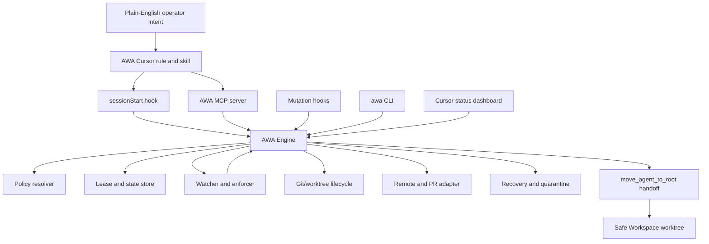

# Agent Worktree Automation: optimal end-state architecture

AWA is a **Safe Workspace control plane** for Cursor agents. It should make safe isolated
agent work happen automatically from plain-English operator intent, without requiring the
operator to understand git worktrees, branch choreography, cleanup rules, or Cursor API gaps.

This is the desired end state, not a scope-minimized MVP.

## Executive goal

When the operator says "fix this bug", "build this feature", "try three approaches", or
"bring that change into main", AWA should automatically:

1. detect that local mutation may happen;
2. resolve whether the workspace/repo/path is governed by AWA;
3. select or create the correct safe workspace;
4. move or bind the agent to that workspace;
5. preserve all work durably;
6. prevent collisions across concurrent tasks;
7. protect the primary checkout;
8. push/PR or apply-back through a verified reintegration path;
9. clean up only when safe;
10. surface status in Cursor in plain English.

## Quality scorecard target

This plan should be evaluated as a 5/5 across these dimensions:

| Dimension | 5/5 bar |
|---|---|
| Engineering | Implementation agents have concrete modules, APIs, state contracts, invariants, and testable transitions. |
| Product | Operator journeys, defaults, acceptance criteria, and success metrics are explicit and tied to the Safe Workspace promise. |
| Design | The Cursor status surface has clear states, copy, actions, empty/loading/error handling, and progressive disclosure. |
| Architecture | Authority, adapter boundaries, environment support, data ownership, and degradation behavior are unambiguous. |
| Usability | Operators use plain English; advanced git/worktree/daemon concepts stay hidden unless recovery/debugging requires them. |
| Availability | Engine, MCP, hook, watcher, GitHub, and network failures have explicit degraded-mode behavior and operator-visible status. |
| Reliability | No destructive operation can proceed without idempotent state, verified recovery, and exact lease/SHA checks. |
| Performance | Hooks, status, watcher scans, git calls, and dashboard refresh have budgets, backpressure, and large-repo behavior. |
| Simplicity | The product is simple for the operator, and the implementation is layered into mandatory core vs optional enhancements. |

## Operator acceptance criteria and journeys

AWA is successful when a non-technical operator can complete these journeys without knowing git worktrees:

| Journey | Expected outcome | Acceptance criteria |
|---|---|---|
| "Fix this bug" | Agent works in Safe Workspace automatically. | In `ON`, no primary checkout mutation occurs; in `ASK_ON`, one plain-English prompt defaults to Safe Workspace. |
| "Try three approaches" | Each approach runs in an isolated branch/worktree. | Three unique leases/branches/paths are created or adopted; no branch/index collisions are possible. |
| "Bring that change into main" | AWA previews and applies or routes through PR. | Target branch, base SHA, commit range, and recovery artifact are shown before any local apply-back. |
| "I already edited my main folder" | Existing work is rescued, not discarded. | Dirty primary is classified and offered: adopt into Safe Workspace, bundle/patch, continue manually, or cancel. |
| "The agent crashed" | Work remains discoverable and recoverable. | `awa recover list` and the dashboard show the interrupted lease, path, branch, diff, and recovery action. |
| "GitHub is down" | Work remains local and safe. | Push/PR steps pause with clear status; cleanup remains blocked; recovery artifacts are created if needed. |
| "Abandon this safely" | AWA preserves proof before deletion. | Work is retired, recovery is verified, then quarantined; prune only happens after blockers clear. |

Success metrics:

- zero AWA-pruned worktrees without a verified recovery artifact;
- zero unacknowledged primary-checkout mutations in `ON`;
- 100% of cleanup/apply-back actions have a decision receipt;
- p95 hook overhead within budget;
- p95 status refresh within budget;
- all recoverable work visible in dashboard and CLI;
- false-positive Safe Workspace prompts tracked and tunable.

## Operator contract

| Guarantee | Operator promise | Enforcement mechanism | Recovery if violated |
|---|---|---|---|
| Automatic from intent | The operator describes work; AWA handles safe workspace routing. | Intent-aware rules, session hook, MCP tool contract, mutation hooks, AWA engine policy. | If intent is ambiguous, AWA asks in user terms: "Use Safe Workspace?" |
| Nothing gets lost | Work is never deleted, forgotten, or silently reaped. | Durable state, pushed/WIP refs, recovery bundles, watcher audits, cleanup blockers, quarantine-before-prune. | `awa.recover` lists and restores orphaned, dirty, unpushed, or quarantined work. |
| Concurrent work is safe | Multiple agents can work on one repo without collisions. | Session/worktree lease, unique branch/path, common-dir locks, branch/PR ownership records, watcher conflict detection. | Stale/colliding leases require adopt/resume/new-workspace decision. |
| Primary checkout stays pristine | Local/main is not mutated by agent implementation work. | Worktree-first routing, primary mutation guards, post-edit detection, optional strict guard, clean-primary attestation. | Accidental primary edits are stopped, diffed, and moved to a recovery branch/patch. |
| Reintegration is safe | Finished work reaches local/remote main only through verified paths. | PR-first flow, SHA-bound apply-back preview, fast-forward checks, exact lease/path/branch/PR verification. | Conflicts or ambiguity block cleanup and provide explicit recovery steps. |

## Product model

User-facing concept: **Safe Workspace**.

Internal implementation: AWA engine + MCP server + watcher/enforcer + Cursor hooks + git worktrees.

The operator should see:

- "Safe Workspace active"
- "Working in isolated copy"
- "PR ready"
- "Main folder synced"
- "Cleanup blocked: unpushed work"
- "Recoverable work found"

The operator should not need to see:

- `git worktree add`
- `move_agent_to_root`
- git common-dir / git-dir checks
- branch collision mechanics
- cleanup heuristics
- raw hook output

## Modes

| Label | Internal mode | Behavior |
|---|---|---|
| Automatic | `ON` | Eligible mutation intent automatically enters Safe Workspace before local changes. |
| Ask first | `ASK_ON` | Install default. Ask once in plain English; visible timeout defaults to Safe Workspace. |
| Manual | `OFF` | Status quo unless the operator explicitly chooses Cursor Worktree or asks for Safe Workspace. |

`ASK_ON` should ask: "Use Safe Workspace so your main folder stays clean? Default: yes."
It should not ask the operator whether they want a git worktree.

## End-state architecture



## Bounded architecture

The engine is the authority, but it must be decomposed into bounded subsystems so each piece is testable and replaceable.

| Subsystem | Owns | Must not own |
|---|---|---|
| Policy resolver | Mode, eligibility, path rules, explainability receipts. | Git mutations or cleanup decisions. |
| Lease/state store | Durable records, locks, idempotency keys, schema migrations, audit log. | Cursor prompts or remote API calls. |
| Git/worktree adapter | Worktree allocation, branch naming, attestation, primary checks, git status. | Product copy or operator policy. |
| Cursor adapter | Rules, hooks, MCP registration, status projection, `move_agent_to_root` handoff. | Safety decisions or direct git mutations. |
| Remote/PR adapter | Push, upstream, PR metadata, merge-state checks, CI/branch-protection status. | Cleanup permission without engine approval. |
| Recovery manager | Bundles, patches, quarantine, restore verification, orphan adoption. | Deleting or pruning work without state-store approval. |
| Watcher/enforcer | Continuous observation, reconciliation jobs, drift alerts, health state. | Final allow/deny decisions. |
| Status/dashboard projector | Operator-facing state, actions, copy, refresh. | Source-of-truth policy or lifecycle transitions. |

Rule of thumb: **engine decides, adapters execute, watcher observes, dashboard explains.**

## Mandatory core vs optional layers

End-state includes every layer, but the plan distinguishes safety-critical kernel from enhancements.

| Layer | Required for safety? | Purpose | Can ship later? |
|---|---|---|---|
| Engine + state store | Yes | Authoritative policy, lease, transitions, cleanup/apply-back decisions. | No |
| Git/worktree adapter | Yes | Create/adopt/attest Safe Workspace and inspect git state. | No |
| Recovery manager | Yes | Preserve work before destructive transitions. | No |
| Minimal hook guard | Yes | Fail-closed protection and context injection at Cursor boundaries. | No |
| CLI wrapper | Yes | Admin/recovery fallback if Cursor/MCP is unavailable. | No |
| MCP server | Preferred for agent UX | Structured agent tools. | Only if CLI fallback and rule coverage are strong. |
| Watcher/enforcer | Preferred for trust | Continuous audit and orphan recovery. | Limited MVP can run reconciliation on lifecycle events, but end-state requires watcher. |
| Dashboard/status surface | Preferred for operator UX | Visual state, actions, health, recovery. | Can trail the engine, but must exist before broad rollout. |
| Strict primary guard | Optional | Read-only/snapshot/git-hook protection for high-safety repos. | Yes |
| cpp/team distribution | Optional gate | Multi-user bootstrap. | Yes, after local trust contract is proven. |

## Environment support matrix

| Environment | Support posture | Default behavior |
|---|---|---|
| Cursor Desktop, local repo | Full support target. | Engine + hooks + MCP + watcher + dashboard. |
| Cursor Agents Window Worktree dropdown | Adopt native worktree. | Record lease/state, verify setup, preserve Cursor UI lifecycle. |
| Cursor Editor Window | Supported through rules/hooks/MCP/CLI. | Use AWA engine; Editor `/worktree` remains explicit user path. |
| Cursor Cloud agent | Partial until local service bridge exists. | Prefer repo/remote-safe PR flow; no local daemon assumptions; show "local AWA unavailable" status. |
| CLI-only terminal | Supported for recovery/admin. | CLI talks to engine or uses local guard fallback. |
| Unsupported/non-git roots | Advisory only. | Explain why AWA is inactive; never mutate hidden state. |

## Control plane components

### AWA Engine

The AWA Engine is the central authority. It should run as a local service or daemon with a
stable socket/API and own:

- policy resolution and eligibility decisions;
- session/worktree leases;
- git/worktree lifecycle;
- safe workspace allocation/adoption;
- primary checkout protection state;
- watcher state;
- remote/PR metadata;
- apply-back previews;
- cleanup blockers;
- recovery/quarantine;
- audit logs;
- versioned repair and migrations.

The engine is the only component allowed to decide whether work may be cleaned, applied back,
or considered safe.

Recommended end-state defaults:

- service model: user-scoped systemd/launchd daemon with on-demand socket activation where available;
- API transport: local Unix domain socket by default, localhost only when required;
- state backend: SQLite with WAL under `~/.local/state/awa/state.db`;
- durable worktree root: `~/.local/share/awa/worktrees`;
- config root: `~/.config/awa`;
- audit/recovery root: `~/.local/state/awa`;
- lock model: per-common-git-dir advisory lock plus SQLite transaction;
- branch naming: `awa/<repo-key>/<yyyymmdd>/<session-slug>-<lease-short-id>`;
- schema migrations: forward-only with rollback backup and dry-run preview.

### Engine API and error contract

Every engine API, MCP tool, and CLI wrapper returns a typed decision:

| Decision | Meaning | May mutate? |
|---|---|---|
| `allow` | Operation is safe and within policy. | Yes, within returned constraints. |
| `ask` | Operator decision is required. | No until resolved. |
| `deny` | Operation violates policy or safety invariants. | No |
| `warn` | Operation is allowed but degraded/risky. | Only for non-destructive work. |
| `unavailable` | AWA cannot determine safety. | No for eligible mutation in `ON`/`ASK_ON`. |

All responses include:

- `decision`;
- `reason_code`;
- user-facing message;
- machine-readable blockers;
- lease id if applicable;
- recommended next action;
- idempotency key for lifecycle operations;
- audit event id.

Error taxonomy:

- `POLICY_UNKNOWN`
- `ENGINE_UNAVAILABLE`
- `MCP_UNAVAILABLE`
- `WATCHER_STALE`
- `HOOK_TIMEOUT`
- `DIRTY_PRIMARY`
- `ATTESTATION_FAILED`
- `LEASE_COLLISION`
- `UNPUSHED_WORK`
- `PR_STATE_UNKNOWN`
- `RECOVERY_UNVERIFIED`
- `REMOTE_UNAVAILABLE`
- `PERMISSION_DENIED`

### State invariants and idempotency

Lifecycle transitions are transactionally idempotent. Each transition has:

- preconditions;
- side effects;
- postconditions;
- idempotency key;
- recovery action if interrupted.

Required idempotency keys:

- `ensure_workspace(repo, base_sha, session_id, intent_id)`;
- `attest_workspace(lease_id, observed_root, observed_head)`;
- `finish_work(lease_id, head_sha)`;
- `apply_back(lease_id, target_root, target_head, preview_id)`;
- `cleanup_execute(lease_id, cleanup_plan_id)`;
- `recover_adopt(repo, worktree_path, branch, head_sha)`.

Stale locks:

- include owner pid/session, created time, last heartbeat, and operation;
- are never stolen silently;
- can be marked stale only after process-death or timeout verification;
- produce an audit event and recovery receipt.

State corruption:

- engine starts read-only if state validation fails;
- recovery scans `git worktree list`, known durable roots, and recovery bundles;
- repair writes a backup before any migration;
- cleanup/apply-back are fail-closed until state is healthy.

### AWA MCP server

The MCP server exposes structured, agent-invocable tools:

- `awa.resolve_context`
- `awa.ensure_workspace`
- `awa.attest_workspace`
- `awa.record_intent`
- `awa.finish_work`
- `awa.push_pr`
- `awa.apply_back_preview`
- `awa.apply_back`
- `awa.cleanup_plan`
- `awa.cleanup_execute`
- `awa.recover_list`
- `awa.recover_adopt`
- `awa.recover_bundle`
- `awa.status`
- `awa.doctor`
- `awa.configure`

MCP is one structured client API over the engine; the engine API remains the authoritative
control API, with CLI, hooks, watcher, and dashboard as adapters or fallbacks.

Every `awa.*` MCP, CLI, and engine operation must have a versioned JSON schema with required
inputs, outputs, error codes, and contract tests. Schema changes require compatibility notes,
migration tests, and updated examples.

### Watcher / enforcer

The watcher runs continuously for configured roots and observes:

- primary checkout dirty state;
- worktree dirty state;
- unpushed commits;
- branch/PR state;
- worktree path existence;
- Cursor-managed cleanup risk;
- orphaned worktrees;
- branch collisions;
- lease expiration;
- unexpected primary-tree mutation.

It can emit status, block cleanup, mark work recoverable, create safety bundles/patches,
quarantine worktrees, and optionally enforce stricter primary protection.

### Cursor hooks

Hooks are thin adapters into the engine:

- `sessionStart`: load AWA context and decision receipt.
- `beforeSubmitPrompt`: classify intent if available and inject Safe Workspace framing.
- `beforeShellExecution`: ask/deny/warn on primary-tree mutation and dangerous git commands.
- `afterFileEdit`: detect accidental primary checkout edits and trigger recovery.
- `beforeMCPExecution`: ensure relevant MCP calls comply with lease/context where supported.
- `stop/sessionEnd`: require a yield safety check.

Hooks should not embed policy.

### Availability and degraded-mode contract

AWA must never silently imply protection when a dependency is unavailable.

| Component/failure | `ON` behavior | `ASK_ON` behavior | `OFF` behavior | Operator-visible state |
|---|---|---|---|---|
| Engine unavailable | Deny eligible mutation; offer retry/manual Safe Workspace instructions. | Ask, but default to no primary mutation until engine returns or explicit override. | Advisory warning only. | "Protection unavailable - primary edits blocked." |
| MCP unavailable | Use CLI/local guard fallback; deny if attestation cannot be proven. | Use CLI/local guard fallback; ask with safe default. | Advisory warning. | "Agent API unavailable; using fallback." |
| Watcher stale | Allow already-attested work, block cleanup/apply-back. | Same. | Advisory warning. | "Watcher stale - cleanup blocked." |
| Hook timeout | Deny risky shell/git mutation in eligible primary checkout. | Ask/deny primary mutation; safe workspace remains default. | Allow with warning. | "Safety check timed out." |
| GitHub/remote unavailable | Continue local work; block PR/cleanup requiring remote proof. | Same. | Same. | "Remote unavailable - work preserved locally." |
| Dashboard unavailable | No impact on engine decisions. | No impact. | No impact. | CLI/status fallback. |
| State DB unhealthy | Read-only recovery mode; cleanup/apply-back denied. | Same. | Advisory for non-AWA work. | "Recovery mode active." |

Hook behavior matrix:

| Hook | Latency budget | Failure policy | Recovery action |
|---|---:|---|---|
| `sessionStart` | p95 < 200ms | Fail open with visible "AWA context unavailable"; agent rule must run CLI/MCP before mutation. | Retry engine status in background. |
| `beforeSubmitPrompt` | p95 < 150ms | Fail open; no mutation occurs at prompt submission. | Record missing intent classification. |
| `beforeShellExecution` | p95 < 100ms | Fail closed for mutating commands in eligible primary checkout under `ON`/safe-default `ASK_ON`. | Show command-specific safe workspace instruction. |
| `afterFileEdit` | p95 < 100ms | Cannot prevent write; immediately stop and create recovery diff if primary mutation detected. | Convert accidental edit into recovery patch/worktree. |
| `beforeMCPExecution` | p95 < 100ms | Deny destructive AWA MCP calls if lease/state cannot be verified. | Ask agent to run `awa.status`. |
| `stop/sessionEnd` | p95 < 300ms | Fail closed for cleanup; fail open for chat exit with recovery warning. | Create yield-safety receipt if possible. |

### Minimal local guard

Hooks must include a tiny local guard independent of the daemon. It can:

- read signed/atomic policy snapshots;
- read lease receipts written into the worktree;
- verify whether the current root is primary or an attested Safe Workspace;
- deny obvious primary mutations in `ON`;
- emit recovery instructions if the daemon is down.

This guard keeps AWA protective during daemon startup races, socket failures, MCP outages, and watcher lag.

### Cursor rule and skill

The always-applied rule tells agents to consult AWA before mutation in eligible roots, speak
in Safe Workspace language, avoid primary-checkout mutation, attest after relocation, and run
yield safety checks before stopping.

The skill is the human/agent guide for Safe Workspace. It explains modes in user language and
delegates to MCP/engine.

### CLI

The CLI is a thin wrapper around the engine:

```bash
awa status [--why|--json|--watch]
awa configure
awa doctor [--repair|--dry-run]
awa ensure
awa attest
awa finish
awa apply-back [--preview]
awa cleanup [--plan|--execute]
awa recover list|show|adopt|bundle|restore
awa service start|stop|restart|logs
```

The CLI is an admin/fallback interface, not the normal operator UX.

### Cursor status surface

The end state includes a Cursor-native status/dashboard surface backed by the engine API. It
should show Safe Workspace status, resolved mode/reason, repo/path, branch, PR status,
primary checkout health, blockers, recoverable work, and refresh/config controls.

Required dashboard states:

| State | Meaning | Primary action | Operator copy |
|---|---|---|---|
| Protected | AWA is active and current root is safe. | View details. | "Safe Workspace active." |
| Running in primary | Agent is in primary checkout while AWA may be needed. | Move to Safe Workspace. | "This task is not isolated yet." |
| Relocation pending | Worktree exists but agent move/attestation is incomplete. | Resume move. | "Safe Workspace is being prepared." |
| Cleanup blocked | Work exists that cannot be safely deleted. | Explain blockers. | "I am keeping this work because it is not safely landed yet." |
| Recovery needed | Orphaned, crashed, or accidental-primary work exists. | Recover work. | "Recoverable work found." |
| Protection unavailable | Engine/hook/MCP state is unhealthy. | Retry/diagnose. | "AWA cannot prove this workspace is protected." |
| Manual mode | AWA is configured off here. | Enable Safe Workspace. | "Safe Workspace is manual for this path." |

Dashboard views:

- current session receipt: mode, reason, root, branch, lease, PR;
- work inventory: active, retired, quarantined, orphaned;
- blocker list: user-readable reason and exact next action;
- recovery center: show diff/commits, adopt, restore bundle, create PR;
- settings: Automatic / Ask first / Manual for current path;
- health: engine, MCP, hooks, watcher, remote;
- refresh: in-canvas refresh without launching chat.

Dashboard states:

- empty: "No active Safe Workspaces" with action "Start protected work";
- loading: "Checking workspace safety..." with progressive details for local, watcher, and remote/PR checks;
- error: "AWA status is unavailable" with action "Retry" and "Open recovery tools";
- degraded: "Protection is limited" with exact unavailable component and safe next action;
- blocked: "Action blocked to protect your work" with blocker explanation and recovery route.

Copy rules:

- lead with safety outcome, not implementation;
- translate SHA/branch mismatch into human language;
- always answer "Where is my work?" and "How do I get it back?";
- hide raw logs behind "details".

## Policy and eligibility

Policy resolution:

1. built-in default: `ASK_ON`;
2. machine default;
3. workspace/repo path rule;
4. directory path rule;
5. session override;
6. explicit operator override.

Eligible by default:

- git repo with remote;
- branch/PR contribution expected;
- clean primary checkout;
- non-detached HEAD;
- repo root or known multi-root workspace;
- no conflicting governance marker.

Ineligible by default:

- vendor/reference/read-only clones;
- umbrella roots where real repos are nested;
- non-git dirs;
- no remote;
- dirty primary checkout;
- detached HEAD;
- foreign hook frameworks AWA cannot integrate safely;
- cpp control-plane paths until cpp-owned bootstrap support explicitly enables AWA.

## Intent detection

AWA should not require the operator to say "use AWA." Intent signals include:

- explicit implementation request: build/fix/change/add/update/refactor/test;
- agent mode transition into implementation;
- first planned file edit in an eligible repo;
- first shell command likely to mutate state;
- direct user phrases like "try", "ship", "make a PR", "implement";
- model self-declaration that it is about to mutate.

Mode behavior:

- `ON`: ensure Safe Workspace.
- `ASK_ON`: ask once in plain English, default yes.
- `OFF`: do nothing unless explicitly requested.

Intent decision protocol:

| Decision | When used | Behavior |
|---|---|---|
| `force_safe_workspace` | Eligible path, `ON`, mutation likely or imminent. | Ensure and attest Safe Workspace before any mutation. |
| `ask_safe_workspace` | Eligible path, `ASK_ON`, mutation likely or ambiguous. | Ask once in user terms; visible timeout defaults safe. |
| `observe_only` | Read-only/exploration intent. | Do not move; watcher/status remain advisory. |
| `manual_allowed` | `OFF` or explicit operator override. | Do not auto-isolate; record that AWA protection is inactive. |
| `deny_until_resolved` | Policy unknown, engine unavailable, dirty primary unclassified, or unsafe state. | Stop before mutation and explain the recovery/next action. |

Every decision creates a receipt with:

- detected intent;
- confidence;
- resolved mode;
- policy source;
- current root;
- next action;
- plain-English reason.

## Worktree strategy

### Cursor-native path

If the operator starts a new agent with the Agents Window Worktree dropdown:

- AWA adopts the Cursor-created worktree;
- records lease/state;
- verifies setup and safety;
- preserves Cursor-native UI benefits.

### Agent-created path

When the current agent needs to move mid-session:

- AWA creates a durable worktree;
- records lease/state before relocation;
- agent invokes `move_agent_to_root`;
- AWA attests the move.

Default durable root:

```text
~/.local/share/awa/worktrees/<repo-key>/<session-slug>/
```

Cursor-managed paths may be used only when Cursor created the worktree, work is already
protected by pushed branch/recovery bundle, or the operator explicitly chooses Cursor-managed
storage. Cursor cleanup by count/size conflicts with the no-lost-work guarantee.

Branch and path allocation:

- repo key is a stable hash of canonical repo root + remote URL;
- branch format: `awa/<repo-key>/<yyyymmdd>/<intent-slug>-<lease-short-id>`;
- path format: `<durable-root>/<repo-key>/<intent-slug>-<lease-short-id>`;
- branch/path collision always creates a new lease unless an existing lease is explicitly adopted;
- a branch cannot be reused by two active leases;
- base ref defaults to the repository's configured default branch unless the operator/task specifies another base;
- base SHA is pinned at allocation and stored in the lease;
- remote tracking is configured on first push, not assumed at allocation.

Dirty primary rescue:

- dirty primary blocks automatic isolation until classified;
- AWA must offer: adopt dirty primary changes into a new Safe Workspace, create patch/bundle and continue clean, continue manually with explicit override, or cancel;
- AWA never stashes, resets, cleans, or discards primary work automatically;
- ignored, untracked, nested-repo, submodule, and LFS dirtiness are included in the classification.

Relocation transaction:

1. write `relocation_started` state;
2. create worktree and branch;
3. write lease receipt into state DB and worktree-local `.awa/lease.json`;
4. create recovery instructions before handoff;
5. invoke `move_agent_to_root`;
6. run `awa attest`;
7. mark `attested` only after all checks pass.

Any lease stuck in `relocation_pending` is resumable or abortable without deleting the worktree.

Attestation verifies:

- actual workspace/tool root;
- repo root;
- `.git` file/gitdir relationship;
- common git dir;
- current branch;
- HEAD and base SHA;
- lease id;
- primary checkout path differs from worktree path;
- shell cwd and file-edit root agree where Cursor exposes them.

## Lease and state model

Every Safe Workspace has a lease record:

- lease id;
- session/chat id if available;
- operator id/machine id;
- repo root;
- common git dir;
- primary checkout path;
- worktree path;
- branch;
- base ref and SHA;
- current HEAD SHA;
- remote/upstream;
- PR URL/state;
- mode and policy source;
- timestamps;
- recovery bundle/ref path;
- cleanup blockers;
- watcher health.

State writes must be atomic, locked per repo common git dir, crash-safe, schema-versioned, and
auditable.

## Lifecycle state machine

```text
observed
  -> eligible
  -> intent_detected
  -> decision_resolved
  -> lease_allocated
  -> worktree_created_or_adopted
  -> relocation_pending
  -> attested
  -> working
  -> dirty
  -> committed
  -> pushed
  -> pr_open
  -> pr_merged | applied_back | abandoned_with_recovery
  -> reconciled
  -> retired
  -> quarantined
  -> pruned
```

No destructive transition may occur unless the prior state and safety checks are satisfied.

## Enforcement layers

AWA should use layered enforcement because Cursor does not expose a complete OS-level
pre-write sandbox:

1. policy engine;
2. MCP tools;
3. hooks;
4. rule;
5. watcher;
6. git invariants;
7. optional strict primary checkout guard.

AWA cannot guarantee perfect pre-write prevention for every Cursor mutation path unless Cursor
exposes stronger APIs. It can guarantee detection, recovery, cleanup refusal, and safe lifecycle
decisions under its engine.

## Reconciliation loops

The watcher/enforcer runs bounded reconciliation jobs:

| Loop | Trigger | Purpose |
|---|---|---|
| Lease-to-filesystem | lifecycle events, startup, periodic | Verify each lease path/branch/head still exists and matches state. |
| Git state | file events, debounce, periodic | Refresh dirty/untracked/ignored/submodule/LFS status. |
| Remote/PR state | push/PR events, periodic when online | Refresh upstream, PR head SHA, CI/merge state. |
| Primary checkout | session start, apply-back, finish, periodic | Verify primary cleanliness and default-branch fast-forward state. |
| Orphan discovery | startup, daily, manual recover | Find worktrees/branches/bundles outside current state DB. |
| Cleanup eligibility | retire/quarantine/prune requests, periodic | Recompute blockers before destructive action. |

## Performance and scalability budgets

Performance is part of the trust contract; AWA must not make Cursor feel slow.

| Operation | Budget / strategy |
|---|---|
| `sessionStart` hook | p95 < 200ms; use cached policy snapshot if engine is warm. |
| `beforeShellExecution` hook | p95 < 100ms; local guard fallback on daemon timeout. |
| `afterFileEdit` hook | p95 < 100ms; enqueue expensive diff/archive work asynchronously. |
| `awa.status` normal repo | p95 < 300ms from cache; stale marker if watcher data is old. |
| Dashboard refresh | p95 < 1s for normal repos; show progressive loading for remote/PR checks. |
| `awa ensure` | p95 < 5s excluding dependency setup; worktree creation progress streamed. |
| Watcher | Event-driven first, debounced scans second; no recursive vendor scans by default. |
| Large repos | Use `git status --porcelain=v2`, `git worktree list --porcelain`, and pathspecs; bounded file walks only for recovery manifests. |
| Remote calls | timeout, retry with backoff, cache PR state, never block local edit work on GitHub unless finishing/cleanup requires it. |
| CPU/battery | exponential backoff on idle/unchanged roots; pause deep scans on battery if configured. |

Watcher scale constraints:

- configured roots only;
- vendor/reference roots excluded unless explicitly enabled;
- max watched repos/worktrees configurable;
- filesystem events coalesced by repo;
- laptop sleep/resume triggers a reconciliation burst with rate limits;
- network/removable paths degrade to polling with clear status.

## Primary checkout protection

Primary checkout must be pristine by default:

- no setup/install/test/edit commands run in primary when AWA requires Safe Workspace;
- dirty primary blocks AWA start;
- unexpected primary edit triggers stop, diff capture, and recovery branch/patch proposal;
- reintegration requires clean primary and explicit target branch.

Optional strict protection can mark primary read-only, use git hooks to block primary commits,
require explicit override, or snapshot primary state.

## Finish, remote, and PR flow

Default finish path:

1. complete work inside Safe Workspace;
2. verify dirty state and tests/status;
3. commit;
4. push branch;
5. create/update PR;
6. record PR metadata;
7. monitor PR merge state;
8. reconcile primary via fetch/fast-forward;
9. retire/quarantine/prune when safe.

Remote safety checks include upstream existence, push success, no unpushed commits, PR head SHA
matching lease HEAD, correct PR target/base, and allowed remote-main movement.

## Apply-back

Apply-back is explicit and preview-first:

1. preview target checkout and branch;
2. verify primary clean;
3. compute exact base SHA and commit range;
4. create recovery branch/bundle/patch;
5. dry-run patch/cherry-pick;
6. present preview summary;
7. apply unstaged only if approved/configured;
8. stop on conflicts;
9. block cleanup until resolved.

No silent apply-back.

Apply-back target protection:

- target branch and target HEAD are shown before preview;
- apply range is SHA-bound, never branch-name-only;
- if target HEAD changes after preview, preview is invalidated;
- recovery branch/bundle/patch is created before mutation;
- successful apply-back records exact commits/diffs applied;
- cleanup remains blocked until target contains the intended diff or the PR merge SHA;
- failed/conflicted apply-back is recoverable and never pruned automatically.

## Cleanup and recovery

Cleanup stages:

- `retire`: work is no longer active, but intact;
- `quarantine`: work is preserved with recovery artifact and removed from normal selection;
- `prune`: worktree deletion after all blockers clear.

Cleanup blockers:

- dirty files;
- untracked files;
- unpushed commits;
- missing recovery artifact;
- open/unknown PR;
- PR head SHA mismatch;
- branch not merged/applied/abandoned;
- primary checkout not reconciled;
- lease/path/branch mismatch;
- watcher unhealthy.

No-lost-work scope:

- tracked changes;
- staged changes;
- untracked files;
- ignored files created or modified during the lease;
- stashes created during the lease;
- Git LFS pointer/content state;
- submodule dirtiness;
- nested git repos;
- generated artifacts explicitly marked by the agent/operator as work product;
- recovery instructions and state receipts.

Unsaved editor buffers and external OS-level deletion are outside AWA's direct control; AWA must state that boundary clearly and preserve/recover once content reaches disk or git state.

Recovery artifact requirements:

- committed work: git bundle or pushed/WIP ref;
- uncommitted tracked work: patch plus index/stage metadata;
- untracked/ignored work: manifest plus archive when operator permits file-content capture;
- LFS/submodules/nested repos: metadata sufficient to warn or restore;
- lease/state JSON and restore instructions;
- integrity check or restore test in a temporary worktree before prune.

Recovery supports listing orphaned work, showing exact diffs/commits, adopting a worktree,
restoring from a bundle, reopening branch/PR context, and converting accidental primary edits
into a Safe Workspace.

## Installation and bootstrap

AWA is a global capability containing:

- `meta.yml`;
- `SKILL.md`;
- MCP server;
- engine daemon;
- watcher;
- CLI;
- Cursor rules;
- hook templates;
- dashboard/status app;
- install/repair/uninstall scripts;
- migrations;
- tests.

Capability packaging matrix:

| Artifact | Kind/scope | Source location expectation | Installed surface |
|---|---|---|---|
| Safe Workspace skill | `kind: skill`, `scope: global` | Global skills capability repo | `~/.cursor/skills`, Claude/Codex mirrors as supported |
| AWA agent rule | `kind: rule`, `scope: global` | Global rules shelf | Cursor rules + mirrored blocks |
| AWA CLI/engine/watcher | `kind: tool`, `scope: global` | Global tools/capability repo | Local bin/service paths |
| AWA MCP server | `kind: mcp`, `scope: global` | MCP capability repo | Cursor MCP config, shareable descriptors |
| Dashboard/status app | `kind: tool` or UI asset | Global capability repo | Local app/canvas/status surface |
| Local config/state | local-only | `~/.config/awa`, `~/.local/state/awa`, `~/.local/share/awa` | Never source-tracked, never vendored |

AWA package code should not live in `KleinPerkins/dev/_ops` except for plans, runbooks, and verifier wrappers. This repo documents and bootstraps the operating model; capability source belongs in the appropriate capability repos.

Install behavior:

- default mode `ASK_ON`;
- no-clobber local config;
- managed blocks with version/checksum;
- dry-run before repair;
- rollback support;
- clean-machine bootstrap;
- explicit path eligibility setup.

No-clobber contract:

- package-owned files carry sentinels and checksums;
- byte-identical files may be adopted;
- differing files are backed up, never overwritten silently;
- foreign hook frameworks fail loudly with remediation;
- uninstall removes only managed blocks/symlinks/sentinel-owned files;
- local config always wins over package defaults;
- migrations are schema-versioned, idempotent, dry-run capable, and rollback capable;
- `awa doctor --repair --dry-run` is the required upgrade preview.

## Security and privacy

AWA observes sensitive local development state. Default posture is local-first and private.

Requirements:

- config/state/recovery dirs mode `700`; files mode `600`;
- local Unix socket preferred; localhost binding only when needed;
- no telemetry by default;
- no prompt/session transcript capture;
- no file-content logging except explicit recovery artifacts;
- secret/PII redaction in command logs, diffs, and dashboard details;
- recovery bundles stored outside repos and never committed;
- explicit confirmation before archiving ignored/untracked file contents beyond metadata;
- path canonicalization and symlink traversal protection;
- no execution of repo-controlled hooks/config during policy resolution;
- least-privilege GitHub tokens and read/write split where possible;
- audit-log retention and quarantine deletion policy configurable.

## Governance boundaries

- AWA upstream package is the source of truth.
- LD local install is a consumer/configured deployment.
- ecosystem-orchestrator is the only sanctioned writer for cpp vendored global capability payloads.
- cpp control-plane/bootstrap support is cpp-owned.
- Local operator config is never overwritten by package repair.
- Repo-owned policy must be explicit and marked.

cpp/team rollout is deferred until:

1. standalone package has no LD paths;
2. LD clean-room install passes;
3. global capability registration is correct;
4. ecosystem-orchestrator can vendor allowed payloads;
5. cpp-owned bootstrap/reconciler support is merged;
6. clean cpp clone can bootstrap AWA without `~/dev`;
7. no-clobber upgrade/repair is proven.

cpp/WF mechanics:

- WF1 registration applies only to global-scope AWA artifacts;
- `.eco-registry.lock` is CI inventory/parity, not cpp enrollment;
- WF2 uses ecosystem-orchestrator `cpp-sync`; no hand-vendoring;
- cpp payloads land only under governed vendored shelves such as `quiver/<cat>/<id>`;
- orchestrator never writes cpp `_ops/` or `.github/`;
- cpp install/repair/prune is cpp control-plane owned via cpp reconciler/bootstrap;
- MCP runtime source is not vendored into cpp unless cpp-owned runtime support exists;
- new `enabled_kinds` are flipped only after cpp reconciler support is green.

## Verification strategy

Adversarial tests must cover:

- intent detection;
- mode resolution;
- eligibility;
- worktree allocation and Cursor-created adoption;
- relocation and attestation;
- accidental primary edit detection;
- dirty primary refusal;
- concurrent sessions in one repo;
- branch/path collision;
- crashed agent recovery;
- watcher/engine restart;
- MCP unavailable fallback;
- hook failure visibility;
- unpushed work protection;
- Cursor cleanup risk;
- apply-back preview and conflict;
- cleanup quarantine/prune refusal;
- no-clobber repair;
- LD bootstrap;
- cpp clean-room bootstrap after gates.

Definition of done:

- no active work is deletable without recovery;
- primary checkout stays clean in `ON`;
- two concurrent agents in one repo cannot collide;
- interrupted relocation is recoverable;
- orphaned work is discoverable if git data remains;
- every AWA decision is explainable in plain English;
- install/repair/upgrade/remove never clobbers local operator choices.

## User-facing receipts and copy

Every major action produces a decision receipt with:

- what happened;
- where the work is;
- whether main is clean;
- what is blocked;
- how to recover;
- what the next safe action is.

Required copy examples:

| Situation | Copy |
|---|---|
| Starting safe work | "I am moving this task into a Safe Workspace so your main folder stays clean." |
| Ask first | "Use Safe Workspace for this task? Default: yes, to keep your main folder clean." |
| Dirty primary | "Your main folder already has changes. I can move them into a Safe Workspace, save a patch, continue manually, or stop." |
| Relocation failed | "I prepared a Safe Workspace but could not move the agent there. Your work is preserved; retry or recover from this path." |
| GitHub down | "Remote publishing is unavailable. I am keeping the work locally and cleanup is blocked until it is pushed or bundled." |
| Cleanup blocked | "I am not deleting this workspace because it has unpushed or unmerged work." |
| Recovery found | "I found recoverable work from an interrupted session. You can restore, adopt, or archive it." |
| Manual override | "Safe Workspace is off for this session; primary-folder changes are allowed until the session ends." |

## Implementation work packages

| Work package | Deliverables | Acceptance tests |
|---|---|---|
| Engine kernel | daemon/service, API transport, policy resolver, SQLite state, locks, audit log | mode resolution, state migration, stale lock recovery, unavailable behavior |
| Git/worktree adapter | durable root, branch/path allocation, worktree create/adopt, attestation | collision tests, dirty primary rescue, relocation crash recovery |
| Recovery manager | bundles, patches, manifests, quarantine, restore verification | untracked/ignored/LFS/submodule recovery, prune refusal |
| MCP server | typed tools, schemas, errors, status codes | tool contract tests, MCP unavailable fallback |
| Cursor adapters | rule, skill, hooks, local guard, MCP registration | hook failure matrix, primary mutation detection |
| Watcher/enforcer | event watch, reconciliation loops, health, backpressure | large repo scan, sleep/resume, orphan discovery |
| Status dashboard | status cards, actions, health, recovery, refresh | state/copy snapshot tests, blocked action flows |
| Packaging/bootstrap | install, repair, uninstall, migrations, no-clobber | clean-machine install, upgrade, rollback, cpp-gated clean-room |

## Recommended architectural decisions

| Decision | End-state recommendation | Rationale |
|---|---|---|
| Service model | user daemon with socket activation where available; CLI can start on demand | balances availability with low idle overhead |
| State DB | SQLite WAL under `~/.local/state/awa/state.db` | transactional, inspectable, portable |
| Durable worktree root | `~/.local/share/awa/worktrees` by default | avoids Cursor cleanup risk |
| Config root | `~/.config/awa` | standard user config location |
| API transport | Unix domain socket first, localhost fallback | local-only privacy and simple clients |
| Branch naming | `awa/<repo-key>/<yyyymmdd>/<intent-slug>-<lease>` | unique, readable, collision resistant |
| ASK_ON timeout | visible 60-second default-to-safe countdown | safe by default without silent surprise |
| Hook fail policy | fail closed for eligible destructive mutation, fail open for read-only/context | maximizes safety without blocking exploration |
| Strict primary guard | opt-in per repo/path | useful but potentially disruptive |
| Dashboard | Cursor-native read/control surface over engine API | operator trust and discoverability |

Remaining environment-dependent unknowns:

- exact Cursor SDK/plugin APIs available for the richest dashboard/control surface;
- robust Cursor agent/session identifiers across local, Cloud, and Agents Window contexts;
- exact cpp `enabled_kinds` needed once teammate rollout starts.

## End-state rollout

Rollout must preserve the mandatory safety kernel first: engine/state, git adapter, recovery
manager, minimal hook/local guard, and CLI fallback before optional MCP/dashboard enhancements.

1. Build engine core and state model.
2. Add git/worktree lifecycle and leases.
3. Add watcher/enforcer.
4. Add CLI wrapper and minimal local guard fallback.
5. Add Cursor hooks/rules/skill adapters.
6. Add MCP server.
7. Add status dashboard.
8. Dogfood locally in one repo.
9. Expand to governed `~/dev` roots.
10. Add optional strict primary guard.
11. Add LD global bootstrap.
12. Add clean-room packaging.
13. Add orchestrator enrollment.
14. Add cpp bootstrap/reconciler support via cpp PR.
15. Enable teammate bootstrap.
