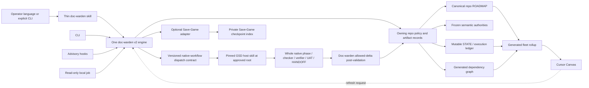
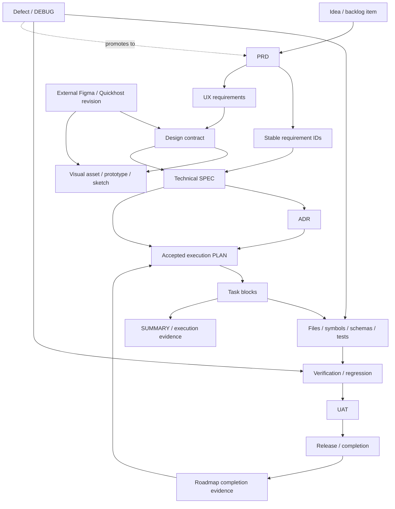
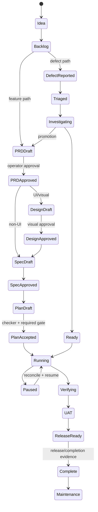
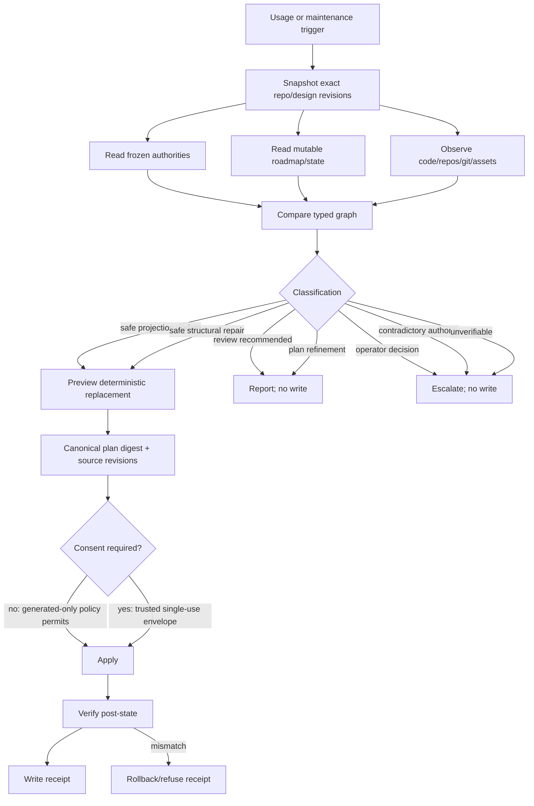
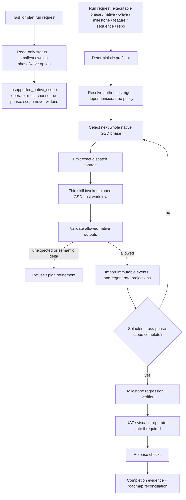
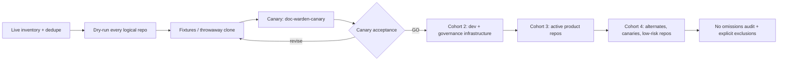

# `doc-warden` v2 — GSD-aligned repository governance (in-boundary scope)

**Version:** v2 (accepted revision 7 — scoped to in-boundary governance; the agentic-execution safety layer is deferred to [ADR 0010](../adr/0010-agentic-execution-safety-layer-deferred.md))
**Status:** ACCEPTED — 2026-08-28. Operator acceptance and implementation GO are granted.
**Date:** 2026-08-26
**Owning repository:** `KleinPerkins/dev` (`~/dev`)
**Plan-type:** agentic-execution
**Predecessor:** [`doc-warden-execution-plan-v1.md`](doc-warden-execution-plan-v1.md), which remains
accepted, active for v1 compatibility, and byte-identical until M6 proves retirement and updates only
its mutable index row to `SUPERSEDED`
**Governing decision:** [`ADR 0009`](../adr/0009-doc-warden-v2-gsd-aligned-governance.md), status
ACCEPTED — scoped, like this plan, to the reviewer-cleared **in-boundary governance** layer:
per-repository canonical roadmap, the typed artifact schema, referential integrity and code anchors,
deterministic dynamic-rigor selection, the canonical nontechnical PRD, migration of existing
repositories, new-repository instantiation, NLP-first operator verbs, and Save-Game/continuity for
authoring. Both artifacts were accepted through the §0 transaction.
**Deferred scope (do not silently drop):** The net-new **agentic-execution safety layer** —
autonomous, GSD-driven cross-phase execution wrapped in claimed hard-enforcement guarantees
(network-egress quarantine, unforgeable single-use operator consent, nested-dispatch closure, an
exclusive credential-owning delivery chokepoint, and a tamper-evident event chain) — is **removed
from this plan's scope and deferred** to [`ADR 0010`](../adr/0010-agentic-execution-safety-layer-deferred.md)
and its companion [`agentic-execution-safety-layer-deferred-v1.md`](agentic-execution-safety-layer-deferred-v1.md)
(DRAFT — not for implementation). §1.5 is the exact deferred-scope map. This plan retains **no**
hard-enforcement claim; every remaining reference to autonomous execution, the gateway lease, the
consent trust root, the delivery-permit chokepoint, or the event chain is an **out-of-scope pointer**
to that deferred initiative, not a v2 deliverable.
**Review provenance:** Authored from local and exact-pin upstream evidence, then hardened across
successive independent swarms (a critical-band probe-blind swarm on rev 3; a Deep-band `plan-refine`
swarm on rev 4; and two genuine top-level isolated re-verification swarms — four specialist reviewers
plus one gated verifier each — on rev 4 and rev 5). Those reviews **CLEARED the in-boundary governance
layer as sound and in-boundary**, and converged on a single root cause for the execution layer: a
same-user, in-repo, no-runners local tool cannot truly enforce those guarantees against the very agent
it constrains, because every control (consent signer, command allow-list, egress quarantine, delivery
permit, tamper-evident chain) runs inside the same OS/privilege domain as that agent — 1 P0 + 13 P1,
all reducing to that one truth (*you cannot sandbox yourself from yourself without an external
enforcement boundary*). Per the operator's pre-acceptance scope decision, the in-boundary value ships now and the
execution layer is deferred and re-chartered under ADR 0010 with its **complete finding inventory
preserved** (ADR 0010 Decision §5). This plan and ADR 0009 were accepted through the §0 transaction.
The separately required implementation GO was granted in the operator's delivery authorization;
acceptance alone does not authorize implementation or live installation.

**Goal:** Deliver doc-warden v2's **in-boundary governance**: keep one canonical roadmap per
repository, scale artifact burden deterministically, reconcile drift without changing approved
semantics, and expose a plain-language fleet view without creating a second authority. Running or
resuming work **autonomously is out of scope** here and is deferred to
[ADR 0010](../adr/0010-agentic-execution-safety-layer-deferred.md).

**Architecture:** Install an exact dependency-locked GSD Core release for **authoring and governance
context**. A deterministic `~/dev` overlay performs governance preflight, keeps the typed artifact
schema, referential integrity, and code anchors, selects dynamic rigor, reconciles drift within the
reconciliation boundary, and renders read-only fleet projections; it never reimplements GSD's
intra-phase loop and never becomes a second author of another repository's records. Canonical product
authorities and roadmaps stay in their owning repositories. The autonomous native-dispatch execution
plane — its gateway repository-lease, consent trust root, nested-dispatch closure, delivery-permit
chokepoint, and event chain — is **deferred to ADR 0010** and is not built by this plan.

**Tech stack:** GSD Core `@opengsd/gsd-core@1.11.0` plus a source-tracked exact npm production
closure (authoring/context use only); Python 3 standard library; Bash 3.2-compatible
delegators/guards; Git and GitHub CLI; runnerless PR automation v3; Markdown with JSON-compatible
YAML front matter; JSON Schema documents with dependency-free closed validators; Cursor skills,
command hooks, and Canvas; local-jobs/launchd; optional Save-Game adapter for authoring continuity.

> **For agentic workers:** after implementation GO, execute one work item at a time from the §5
> work-item sections. Every item is a zero-context contract with exact files, anchors, inputs/outputs,
> dependencies, requirements, commands, evidence, rollback, and escalation. Acceptance alone does
> not grant implementation permission.

---

## 0. Acceptance/bootstrap transaction

The active v1 engine has no semantic `accept` or `freeze` verb. Its `repair --approve` command
authorizes structural repair only and cannot truthfully issue a v2 acceptance receipt. Acceptance
therefore uses one explicit, one-time Git transaction before M1. This transaction is now
**satisfiable**: the classifier SIGPIPE defect that mis-classified this large plan as `DRIFTED` is
fixed and regression-guarded (§3.8), so direct classification of the slimmed ADR 0009 / plan v2
returns `CONFORMANT`; the frozen-hash set in Global Constraint 2 is the complete pre-§0 baseline;
and the mutable index rows already preserve v1's active compatibility role pending M6 retirement,
record ADR 0009's accepted status in its own row, and list the new ADR 0010 / deferred plan stub
authored in this same body of work. Per §0 Step 3, ADR 0001's historical index row is not changed by
the acceptance transaction; ADR 0009 is the authoritative supersession record.

0. **Identity preflight (before any commit).** Assert the in-repo local Git identity equals the
   KleinPerkins noreply identity — `git config user.name` = `KleinPerkins` and `git config
   user.email` = `49759187+KleinPerkins@users.noreply.github.com` — with no global override in
   effect for this repo. On mismatch, ABORT for operator remediation; never rewrite global Git
   config. (This precedes and complements the existing post-commit identity re-read in step 6.)
1. Refresh `HEAD`, `origin/main`, merge base, branch, dirty paths, the authoring paths, and the
   full pre-§0 frozen accepted-baseline hashes (Global Constraint 2 — plan v1 and accepted ADRs
   0001/0002/0003/0004/0005/0008). Any unrelated path or content drift stops the transaction.
2. Present the final ADR/plan semantic diff, exact blob digests, swarm findings/dispositions, the
   in-boundary-vs-deferred (ADR 0010) scope split, and remaining external dependencies. Obtain
   explicit operator decisions to accept both in-boundary artifacts and to record that acceptance.
   An implementation GO is separate. ADR 0010 and the deferred plan stub are **not** accepted here;
   they remain `PROPOSED`/`DRAFT`.
3. Change only ADR 0009 and this plan from `PROPOSED`/`DRAFT` to `ACCEPTED`, and update only their
   two index rows to `Accepted`. Do not create a synthetic v1 receipt, and do not flip ADR 0010 or
   the deferred stub.
4. Run direct ADR/plan classification (Body-1-fixed engine → `CONFORMANT`), current doc-warden
   checks, `make verify` / `make verify-ci`, placeholder and interface audits, and the full
   frozen-baseline hash checks (Constraint 2) against the final bytes.
5. Commit exactly the two accepted artifacts and their two index rows. The commit binds the accepted
   blobs and records the operator decision; no runtime, policy, template, skill, hook, config,
   migration, or implementation path lands in the acceptance commit.
6. Re-read the committed blobs and commit identity (must equal the step-0 KleinPerkins noreply
   identity). M1 later adopts those exact blob and commit digests into the first v2
   `accepted_freeze` migration record without rewriting either artifact.
7. Begin M1 only after a second, explicit implementation GO. Acceptance alone authorizes no live
   install, canary, runnerless-control-plane, or cross-repository mutation. **Satisfied for source
   implementation:** the operator's explicit end-to-end delivery authorization granted this
   separate GO; task-specific live-install, canary, cross-repository, and retirement gates remain.

This transaction must be re-run from live state. The branch and counts in §2.2 are historical
planning evidence, never acceptance inputs.

## Global Constraints

1. **This document change is authoring only.** Apart from the §0 acceptance-recording transaction,
   do not implement any v2 code, policy, template, skill, hook, config, runtime binding, migration,
   dashboard, or repo change until the operator accepts aligned ADR/plan bytes and gives the named
   implementation GO. **Satisfied for source implementation:** both prerequisites were explicitly
   granted; named task-specific live-operation gates remain in force.
2. **Frozen accepted bytes never change.** POLICY §9 freezes every accepted plan and ADR
   byte-identical-forever. The complete **pre-§0** frozen-baseline SHA-256 set (computed 2026-08-26
   from live bytes before §0) follows. ADRs 0006/0007 are `draft`, ADR 0010 remains `PROPOSED`, and
   the deferred plan stub remains `DRAFT`, so those artifacts are not frozen. This §0 transaction
   additionally freezes ADR 0009 and plan v2 at the exact Git blob IDs recorded by §0 step 6 and
   later adopted into the first v2 `accepted_freeze` record; a document cannot embed its own final
   SHA-256 digest without a recursive self-reference:
   - `_ops/plans/doc-warden-execution-plan-v1.md`:
     `fce433dcbcddd07423d485f67006a54976c02a3b09712b2826b4895f8d59b118`
   - `_ops/adr/0001-doc-warden-owning-subsystem.md`:
     `47db4505ef12233b711f088f37f1af5f54e168c2022dc52e26dc8142e24d89c4`
   - `_ops/adr/0002-doc-warden-reconciliation-doctrine.md`:
     `c556201f6e308282c1b51eb0e744291c61ed5c451e15c3e5e6f607a7e65efff7`
   - `_ops/adr/0003-doc-warden-local-only-no-cpp.md`:
     `ad38c07a8f963eec3fa59d6ebd7a8dc5fab3941e88901affeb3c45eb89fdac48`
   - `_ops/adr/0004-optimize-context-projections-without-moving-authority.md`:
     `77ddcd3b5e480b77cf283afd8e5593b08022483920ff55451bf5d79fcfc51060`
   - `_ops/adr/0005-harden-context-measurement-before-e09.md`:
     `65892b7bca6b3a80eed17e1da6ba7f79d5c96fb7e9d4108a749c3703f65b1abb`
   - `_ops/adr/0008-chaos-scheduler-doc-warden-docs-governance.md`:
     `3c3f7b476495c06f54f00c4ca57a13e14e15a2e1ddd22c717b43f6f2ee34db6a`
   No member of this pre-§0 frozen set is edited by this plan or its acceptance transaction.
3. **Exact upstream pin.** Runtime = `@opengsd/gsd-core@1.11.0`, commit
   `182f60b4c170785d96f1deb87fea8b108e9b985f`, npm integrity
   `sha512-z1RLWsQshYViJIk94SB0x9/AYPykj5LIuLxwjS0s+WgaCBgVtTknCsVR3x4itrBeqmiUEvGiN6cO/bOay0zOiQ==`.
   Moving branches/tags, `latest`, ranges, or an integrity mismatch are refused. Installation uses
   a source-tracked lock with exact production/optional dependency versions and registry
   integrities; resolving semver ranges during apply is forbidden.
4. **License.** Preserve the MIT notice and `Copyright (c) 2026 Open GSD` in every copied or
   substantially adapted upstream source/template. Prefer package consumption and references over
   copied bytes.
5. **One authority.** No skill, router, hook, local job, Canvas, GSD extension, index, graph, or
   fleet rollup owns product semantics. All delegate to or derive from the owning repository's
   records through one doc-warden engine.
6. **Semantic freeze.** Approved PRDs/requirements/design behavior/ADRs/accepted plans change only
   through successors. Roadmaps, indexes, dependency observations, execution state, progress,
   freshness, and rollups are mutable under schema.
7. **Reconciliation boundary.** Automation may update deterministic mutable/generated projections,
   exact references, freshness, derived status, and observed dependency edges. It never changes
   behavior, acceptance, approved design, architecture, or plan meaning.
8. **Governance ON, burden dynamic.** Every eligible migrated/new repository has v2 ON. Artifact
   burden is selected by deterministic signals; ON does not require every heavyweight artifact.
9. **UI invariant.** Any UI/visual work requires UX requirements, approved design contract,
   comprehensive state/accessibility/responsive coverage, visual assets/provenance, visual
   verification, and human UAT.
10. **No paid Actions.** Add no GitHub Actions CI workflow and no hosted/self-hosted Actions runner.
    GitHub Actions remains platform-enabled with zero committed CI workflows.
11. **Runnerless ownership.** Future agents may open coherent draft PRs and run Bugbot until clean.
    They never call an auto-merge arm operation, never mark protected work ready prematurely, and
    never merge outside the repository's governed path.
12. **Isolation.** One writer per working tree. Use each repository's worktree/branch policy.
    Configure GSD worktree creation off; AWA or repository policy remains the only isolation owner.
13. **Exclusions.** Preserve all live baseline/runnerless exclusions. `chaos-scheduler` remains
    documentation-only under ADR 0008 and is never targeted by this plan's fleet mutation,
    migration PR generation, GSD execution, or runnerless enrollment. Its row is an externally
    observed, explicit exclusion unless its own governance separately authorizes a successor plan.
14. **Data minimization.** Persist no raw transcript, prompt, source body, diff, log, credential,
    token, auth state, customer data, or unnecessary PII. Evidence records use only their closed
    sink-specific projection and immutable pointers/digests.
15. **No generic placeholders.** Every accepted work-item block must remain executable from that
    block alone and pass the plan's placeholder, interface, and requirement-coverage audits.
16. **Agentic-execution safety layer — DEFERRED to [ADR 0010](../adr/0010-agentic-execution-safety-layer-deferred.md).**
    The net-new autonomous-execution controls are **removed from this plan's scope** and
    re-chartered under ADR 0010 (see §1.5): the closed default-deny native-GSD command allow-list and
    origin-bound call-graph closure; the gateway-owned repository-scoped lease and transactional
    governance writes under one lease; single-use digest-bound operator consent used as an
    enforcement gate; the OS/host-enforced consent trust root, independently-protected event
    head-anchor, and fail-closed delivery-permit chokepoint; and the network-egress
    quarantine-before-delivery closure. None of these are v2 deliverables and none carry a retained
    hard-enforcement claim here; ADR 0010 documents why a same-user/in-repo/no-runners tool cannot
    truly enforce them without an external boundary.
17. **(Deferred — folded into Constraint 16 / [ADR 0010](../adr/0010-agentic-execution-safety-layer-deferred.md).)**
    Transactional governance writes under one repository-scoped lease with GSD as a subordinate
    writer are execution-layer scope and are not built here.
18. **(Deferred — folded into Constraint 16 / [ADR 0010](../adr/0010-agentic-execution-safety-layer-deferred.md).)**
    Single-use digest-bound consent as an enforcement gate is execution-layer scope. For in-boundary
    authoring, ordinary OS/Git/GitHub access and repository policy continue to determine actual
    authority; no consent-envelope enforcement is claimed.
19. **(Deferred — folded into Constraint 16 / [ADR 0010](../adr/0010-agentic-execution-safety-layer-deferred.md).)**
    Network-egress quarantine-before-delivery closure is execution-layer scope. In-boundary
    authoring outputs still use ordinary writable-path and data-minimization hygiene (Constraints
    12/14 and §3.15's containment guidance), which is drift/mistake hygiene, **not** a security
    boundary against a determined same-OS agent.
20. **Policy/runtime parity.** V2 policy remains clearly inactive while schemas and dormant code
    are built. The canonical policy changes only in the same atomic body that activates a
    compatible dispatcher and passes policy/schema/catalog/runtime parity.

## 1. Executive overview and measurable end state

### 1.1 Purpose

V1 normalized plans, ADRs, runbooks, glossary, AGENTS pointers, structural repair, and a small
cross-repository authority check. V2 turns that documentation governor into a complete,
right-sized product-development and execution system without recreating an upstream runtime.

The system must let a nontechnical operator say ordinary things such as:

- “Draft the PRD for this feature.”
- “Show me the repo roadmap and what is blocked.”
- “Move this above that, but do not change implementation order.”
- “Log this defect and continue the investigation.”
- “Reconcile what changed after that design update.”
- “Start the next roadmap item.”
- “Resume the paused milestone.”
- “Verify this release.”

The same authoritative engine maps those intents to governed artifacts, previews consequential
changes, executes approved work at the requested scope, verifies outcomes, and renders the
repository/fleet state in plain language and a Cursor-native Canvas.

### 1.2 Measurable end state

V2 is complete only when all of the following are true:

1. The exact dependency-locked GSD release and authoring/context interface are installed,
   integrity/license/rollback-qualified, and consumed through the deterministic import adapter;
   no GSD workflow source is vendored or reimplemented locally.
2. Every governed logical repository has one canonical identity, v2 enablement state, one canonical
   roadmap, a dynamic rigor profile, an artifact graph, mutable authoring state, and an explicit
   migration outcome.
3. New eligible repositories are born conformant with v2 write-enablement recorded,
   baseline/identity/data/session/worktree
   controls, initial project/roadmap/state, skill discovery, verification receipts, maintenance
   enrollment, and inert runnerless PR contracts—without heavyweight feature artifacts. V2
   authority writes require both central activation and repository write-enablement.
4. A standard feature can move end-to-end from idea -> approved nontechnical PRD -> UX/design when
   applicable -> SPEC/ADR -> accepted execution plan -> implementation -> verification/UAT ->
   release/completion -> maintenance.
5. A narrow defect can use a detailed defect record instead of a PRD, and deterministic promotion
   moves it to the feature path when scope/behavior/risk grows.
6. Any UI change is blocked before planning until its UX/design contract and immutable visual
   provenance are approved; visual verification and UAT are required before completion.
7. An accepted plan remains byte-stable while authoring state, task evidence, waits, handoffs, and
   completion progress evolve separately.
8. *(Deferred to [ADR 0010](../adr/0010-agentic-execution-safety-layer-deferred.md) — see §1.5.)*
   Autonomous start/resume of whole native phases and cross-phase composition is the
   agentic-execution safety layer and is **out of v2's in-boundary end state**. In-boundary, an
   operator authors and governs; pinned GSD phases provide authoring and context, not one-command
   autonomous execution.
9. Dependency reconciliation detects dangling, stale, missing, unmapped, cyclic, added, removed,
   superseded, inconsistent, and assumption-invalidating relations and uses preview ->
   operation-bound explicit confirmation when consequential -> atomic apply -> verify ->
   receipt/event.
10. The repo Canvas and fleet Canvas display priorities, sequence, milestones, progress,
    dependencies, blockers, defects, staleness, decisions, next actions, source revision, and
    refresh state from deterministic data; fleet rows are never directly editable authority.
11. Save-Game is optionally invoked through its stable CLI contract at authoring boundaries; its
    absence degrades to doc-warden authoring state without blocking or fabricating success.
12. Current v1 receipt/freeze defects are migrated: creation snapshots no longer freeze skeletons,
    policy/catalog/template versions are truthful and bound, and catalog/runtime parity is
    mechanically enforced.
13. Every governed repository has migrated or has a tracked reason, owner, and next action. No
    checkout, dirty repo, duplicate clone, remote-only repo, or carve-out disappears silently.
14. Local, migration, regression, UAT, security/provenance, rollback, and separately qualified
    runnerless acceptance rows in §6 all have immutable evidence receipts.

### 1.3 Scope

In scope:

- GSD runtime binding and release qualification;
- v2 policy/schema/engine/CLI;
- artifact graph, stable IDs, lifecycle and freeze;
- PRD-first product path and bounded defect exemption;
- deterministic rigor;
- canonical repo roadmaps and generated fleet rollup;
- detailed defect backlog/debugging;
- *(Deferred — [ADR 0010](../adr/0010-agentic-execution-safety-layer-deferred.md), §1.5)* autonomous
  cross-phase execution through a native GSD gateway and its verifier/UAT/HANDOFF enforcement is
  **not** in scope here;
- optional Save-Game adapter for authoring continuity;
- dependency observation and reconciliation;
- NLP/thin-skill/CLI/Canvas experience;
- event and routine triggers;
- new-repo defaults;
- full logical-fleet migration, rollout, rollback, receipts, verification, and closure.

### 1.4 Non-goals

- Editing or “upgrading” frozen v1 artifacts.
- Maintaining a local fork of GSD.
- Delivering doc-warden or its GSD binding into cpp.
- Replacing AWA, Save-Game, local-jobs, runnerless PR automation, or repository-specific governance.
- Making an LLM score authoritative for rigor, status, safety, or reconciliation.
- Auto-authoring semantic product decisions or approving subjective visual quality.
- Creating an MCP server without a later decision proving a unique UX gap.
- Migrating `chaos-scheduler` into baseline, runnerless PR automation, or fleet execution.
- The **agentic-execution safety layer** — autonomous GSD execution plus its hard-enforcement
  guarantees (egress quarantine, unforgeable consent, nested-dispatch closure, delivery chokepoint,
  tamper-evident chain): removed from this plan and re-chartered under
  [ADR 0010](../adr/0010-agentic-execution-safety-layer-deferred.md) (see §1.5).

### 1.5 Deferred scope map (agentic-execution safety layer → ADR 0010)

Nothing below is silently dropped: the agentic-execution safety layer is removed from this plan's
in-boundary scope and re-chartered under
[ADR 0010](../adr/0010-agentic-execution-safety-layer-deferred.md) and its companion deferred plan
stub [`agentic-execution-safety-layer-deferred-v1.md`](agentic-execution-safety-layer-deferred-v1.md)
(DRAFT — not for implementation). This map is the authoritative index of what moved. Any mechanism
prose that remains in the sections below (§2.3, §2.7, §3.11, §3.15's egress parts, **Milestone 1
Task M1-T04's gateway-lease / closed-allow-list / nested-dispatch-quarantine / egress / consent /
delivery-permit / event-chain steps and tests**, Milestone 3, and the enforcement acceptance rows)
is retained only as **historical design context, authoritatively superseded by ADR 0010**, and
carries no in-boundary v2 claim. M1-T04's **in-boundary** remainder — the authoring-phase adapter,
deterministic native-result import, byte-frozen accepted plans, artifact verification, HANDOFF
import, and Save-Game-for-authoring — stays in scope.

| Deferred item | Where it appeared in this plan | Now governed by |
|---|---|---|
| Autonomous cross-phase GSD execution (start/resume/compose whole phases) | §1.2(8), §1.3, §2.3, §2.7, §3.11, **Milestone 1 (M1-T04 execution/enforcement steps)**, Milestone 3 (M3-T01), M1 canary execution rows | ADR 0010 Decision §1–§6; stub D0–D5 |
| Closed default-deny native-GSD command allow-list + call-graph closure + auto-advance/chain pinning | Constraint 16, §2.3, §2.7, §3.11 | ADR 0010 Decision §5 "GSD command allow-list" |
| Gateway-owned repository lease + transactional writes under one lease + reclaim matrix | Constraint 17, §2.7, §3.11 | ADR 0010 Decision §5 "Gateway lease reclaim matrix (V1/V7)"; stub D4 |
| Single-use digest-bound operator consent as an enforcement gate + OS/host-enforced consent trust root | Constraint 18, §2.7, §3.11, AC-052/AC-071 | ADR 0010 Decision §5 "Consent signer…trust root (V4)"; stub D2 |
| Network-egress quarantine-before-delivery + delegated-phase egress default-deny | Constraint 19, §3.15, AC-073/AC-076, CG-new-2 | ADR 0010 Decision §5 "P0 network egress…" & "Delegated-phase egress default-deny (CG-new-2)"; stub D3 |
| Fail-closed delivery-permit chokepoint (exclusive credential-owning entrypoint) | §3.11, §3.15, AC-074 (V6) | ADR 0010 Decision §5 "delivery permit…(V6)"; stub D2 |
| Tamper-evident event chain + independently-protected head-anchor | §3.11, AC-072 (V5) | ADR 0010 Decision §5 "event-chain head anchor…(V5)"; stub D4 |
| Nested-dispatch closure interposition | §2.7, §3.11, AC-075 (V3) | ADR 0010 Decision §5 "Nested-dispatch closure…(V3)"; stub D3 |
| Rollback-vs-monotonic-immutability reconciliation; crash-atomic recovery/continuity (WAL + startup reconcile) | §3.11, recovery rows | ADR 0010 Decision §5 "Rollback vs…immutability" & "Recovery/continuity…"; stub D4 |
| `repository_key` transactional preview→apply rebind guard + malformed-config fail-closed re-mint refusal (V8, enforced form) | repo-key rows, §2.7, AC-068 | ADR 0010 Decision §5 "`repository-key-rebind-invalidates-preview` (V8)" — judgment call stated there |
| Catalog-downgrade / catalog-version-skew event compatibility | catalog rows | ADR 0010 Decision §5 "Catalog-downgrade event compatibility" |
| Live-install blast radius on global Cursor surfaces (bounded/reversible; fail-open global hooks) | AC-075 area, CG-new-1 | ADR 0010 Decision §5 "Live-install blast radius (CG-new-1)" — see §3.8/AC-075 hook-schema note |
| Enforcement-surface negative tests (signer-bound trust-root evidence, concrete PR-delivery entrypoint, real egress) | §6 enforcement AC rows | ADR 0010 Decision §5 "Testing gaps" |

**Retained in-boundary (this plan):** the typed artifact schema (UX requirements/designs/prototypes/
execution-plans/roadmap/defect-backlog), referential integrity and code anchors, deterministic
dynamic-rigor selection, the canonical nontechnical PRD, migration of existing repositories
(including the `repository_key` **identity**: mint-once/adopt-persisted, never split one repository
across two keys), new-repository instantiation, NLP-first operator verbs with a thin explicit skill
layer, the read-only fleet/Canvas projection, dependency observation/reconciliation within the
reconciliation boundary, and Save-Game/continuity **for authoring**.

## 2. Verified context and target architecture

### 2.1 Evidence classification

This plan uses three labels:

- **Observed:** directly read or executed against current local/upstream state.
- **Proposed:** the v2 design to implement after acceptance.
- **Inference:** a conclusion drawn from observed evidence; verification is named.

### 2.2 Verified current inventory

| Item | Classification | Evidence captured 2026-08-25 |
|---|---|---|
| Current branch at draft-revision-2 review | Observed | `fix/kernel-guarantee-unset-git-dir` at `c90b859f5ba622ef000581d96f1b5838719a3be7`; refresh under §0 |
| Authoring working set | Observed | only the new ADR, new plan, and their two index rows; no staged kernel-check edit exists |
| Root doc-warden check | Observed | `bash _ops/bin/doc-warden.sh check .` -> `Overall: CONFORMANT` |
| Baseline inventory | Observed | 13 eligible checkout rows, 154 excluded |
| Logical identity correction | Inference from observed rows | 12 unique eligible GitHub repos because `ai-analytics-context` appears twice; add `~/dev` and docs-only `chaos-scheduler` -> 14 currently governed logical identities |
| Runnerless fleet | Observed | 18 targets, five exclusions: `chaos-scheduler`, `cpp`, `duggan-bach`, `snowflake-permission-specs`, `archive-repos` |
| `chaos-scheduler` docs carve-out | Observed | direct check -> `Overall: CONFORMANT`; ADR 0008 and controller/fleet exclusions remain live |
| GSD latest stable | Observed upstream | `v1.11.0`, release 2026-08-19, not draft/prerelease |
| Local GSD clone | Observed local | clean detached `v1.10.0` at `68a04cc…`; tag `v1.11.0` resolves to `182f60b…` |
| GSD package | Observed registry | version `1.11.0`, matching `gitHead`, exact integrity above, Node >=24/npm >=10, MIT |
| GSD execution interface | Observed exact pin | `gsd-tools`/`gsd_run` are deterministic CLI utilities; execute/verify/ship are host-installed prompt workflows, not Python/CLI execution functions |
| GSD dependency closure | Observed exact pin | top-level package metadata contains semver-ranged runtime dependencies and the published package supplies no shrinkwrap; a local exact lock is required |
| Current policy | Observed | `_ops/doc-warden/POLICY.md:1-13` says active `1.3.0` |
| Receipt version defect | Observed | `_ops/bin/doc-warden-lib.sh:2568-2615` writes a hard-coded policy version `1.0.0` |
| Trigger divergence | Observed | `_ops/doc-warden/triggers.yml:26-51`; runtime only reads IDs at `doc-warden-lib.sh:1436-1463` and hard-codes actions at `1860-1961` |
| Creation/freeze defect | Observed | receipt digest comparison at `doc-warden-lib.sh:1389-1396` and `1420-1426`; DRIFTED-only repair refusal at `doc-warden-verify.sh:861-865` |
| Hook enforcement limits | Observed evidence | `_ops/plans/evidence/hooks-doc-2026-07-03.md:16-45`: only pre-events gate; `afterFileEdit`/`stop` cannot block; user hooks absent in cloud |
| New repo sequence | Observed | `_ops/bin/dev-new-repo.sh:202-255`: initial commit -> v1 greenfield docs/receipt -> remote -> inert runnerless staging |
| Runnerless constraints | Observed | `_ops/baseline/README.md:27-47,232-259`: no Actions CI; reviewer App alone may arm auto-merge |
| Runnerless custom-job state | Observed | `dev` has a repository `run-literal` recipe, but the active policy/qualification ledger still classifies the canonical lane as `canned_only`; v2-specific runnerless claims are blocked pending the separate protected recipe/lock/activation lifecycle |
| Save-Game authority | Observed | Save-Game `SKILL.md:96-122`: checkpoints are indexes, live authorities win, private-only, no Git delivery |
| Canvas constraint | Observed | Canvas `SKILL.md:50-66`: one inline-data `.canvas.tsx`, no network/fetch |
| Local-jobs constraint | Observed | local-jobs `SKILL.md:24-53,78-91`: generated live Canvas, validated verbs, serialized jobs, no hand-edited config |

The implementation must re-run inventory and revision checks at §0 and each milestone. These values
are a planning snapshot, not a migration target list or runnerless authorization frozen in time.

### 2.3 GSD assessment

> **DEFERRED — out of in-boundary v2 scope.** The GSD *execution* assessment below (autonomous
> phase/wave/cross-phase dispatch, the command allow-list, and the gateway lease) is part of the
> agentic-execution safety layer, **removed from this plan and re-chartered under
> [ADR 0010](../adr/0010-agentic-execution-safety-layer-deferred.md)** (see §1.5). The GSD
> artifact-shape rows that inform the in-boundary artifact schema are retained; the
> dispatch/enforcement prose is historical design context, authoritatively superseded by ADR 0010,
> and carries no v2 claim.

Pinned upstream references:

- phase loop:
  [the-phase-loop.md L9-L102](https://github.com/open-gsd/gsd-core/blob/182f60b4c170785d96f1deb87fea8b108e9b985f/docs/explanation/the-phase-loop.md#L9-L102)
- new project / PROJECT / REQUIREMENTS / roadmap:
  [new-project.md L213-L318](https://github.com/open-gsd/gsd-core/blob/182f60b4c170785d96f1deb87fea8b108e9b985f/gsd-core/workflows/new-project.md#L213-L318)
  and
  [L1058-L1295](https://github.com/open-gsd/gsd-core/blob/182f60b4c170785d96f1deb87fea8b108e9b985f/gsd-core/workflows/new-project.md#L1058-L1295)
- SPEC:
  [spec.md L1-L125](https://github.com/open-gsd/gsd-core/blob/182f60b4c170785d96f1deb87fea8b108e9b985f/gsd-core/templates/spec.md#L1-L125)
- CONTEXT:
  [context.md L1-L102](https://github.com/open-gsd/gsd-core/blob/182f60b4c170785d96f1deb87fea8b108e9b985f/gsd-core/templates/context.md#L1-L102)
- UI-SPEC and review:
  [UI-SPEC.md L1-L126](https://github.com/open-gsd/gsd-core/blob/182f60b4c170785d96f1deb87fea8b108e9b985f/gsd-core/templates/UI-SPEC.md#L1-L126),
  [ui-review.md L1-L12](https://github.com/open-gsd/gsd-core/blob/182f60b4c170785d96f1deb87fea8b108e9b985f/gsd-core/workflows/ui-review.md#L1-L12)
- roadmap:
  [roadmap.md L1-L127](https://github.com/open-gsd/gsd-core/blob/182f60b4c170785d96f1deb87fea8b108e9b985f/gsd-core/templates/roadmap.md#L1-L127)
- plan / waves / must-haves:
  [phase-prompt.md L15-L147](https://github.com/open-gsd/gsd-core/blob/182f60b4c170785d96f1deb87fea8b108e9b985f/gsd-core/templates/phase-prompt.md#L15-L147)
- summary:
  [summary.md L9-L179](https://github.com/open-gsd/gsd-core/blob/182f60b4c170785d96f1deb87fea8b108e9b985f/gsd-core/templates/summary.md#L9-L179)
- plan checker and verifier:
  [gsd-plan-checker.md L92-L220](https://github.com/open-gsd/gsd-core/blob/182f60b4c170785d96f1deb87fea8b108e9b985f/agents/gsd-plan-checker.md#L92-L220),
  [gsd-verifier.md L14-L70](https://github.com/open-gsd/gsd-core/blob/182f60b4c170785d96f1deb87fea8b108e9b985f/agents/gsd-verifier.md#L14-L70)
- verification / UAT:
  [verification-report.md L9-L197](https://github.com/open-gsd/gsd-core/blob/182f60b4c170785d96f1deb87fea8b108e9b985f/gsd-core/templates/verification-report.md#L9-L197),
  [UAT.md L9-L170](https://github.com/open-gsd/gsd-core/blob/182f60b4c170785d96f1deb87fea8b108e9b985f/gsd-core/templates/UAT.md#L9-L170)
- debugging:
  [DEBUG.md L9-L158](https://github.com/open-gsd/gsd-core/blob/182f60b4c170785d96f1deb87fea8b108e9b985f/gsd-core/templates/DEBUG.md#L9-L158)
- pause/resume:
  [pause-work.md L1-L249](https://github.com/open-gsd/gsd-core/blob/182f60b4c170785d96f1deb87fea8b108e9b985f/gsd-core/workflows/pause-work.md#L1-L249),
  [resume-project.md L1-L130](https://github.com/open-gsd/gsd-core/blob/182f60b4c170785d96f1deb87fea8b108e9b985f/gsd-core/workflows/resume-project.md#L1-L130)
- host command descriptors:
  [`gsd:discuss-phase`](https://github.com/open-gsd/gsd-core/blob/182f60b4c170785d96f1deb87fea8b108e9b985f/commands/gsd/discuss-phase.md),
  [`gsd:ui-phase`](https://github.com/open-gsd/gsd-core/blob/182f60b4c170785d96f1deb87fea8b108e9b985f/commands/gsd/ui-phase.md),
  [`gsd:plan-phase`](https://github.com/open-gsd/gsd-core/blob/182f60b4c170785d96f1deb87fea8b108e9b985f/commands/gsd/plan-phase.md),
  [`gsd:execute-phase`](https://github.com/open-gsd/gsd-core/blob/182f60b4c170785d96f1deb87fea8b108e9b985f/commands/gsd/execute-phase.md),
  [`gsd:verify-work`](https://github.com/open-gsd/gsd-core/blob/182f60b4c170785d96f1deb87fea8b108e9b985f/commands/gsd/verify-work.md),
  [`gsd:pause-work`](https://github.com/open-gsd/gsd-core/blob/182f60b4c170785d96f1deb87fea8b108e9b985f/commands/gsd/pause-work.md);
  [`gsd:resume-work`](https://github.com/open-gsd/gsd-core/blob/182f60b4c170785d96f1deb87fea8b108e9b985f/commands/gsd/resume-work.md),
  [`gsd:ship`](https://github.com/open-gsd/gsd-core/blob/182f60b4c170785d96f1deb87fea8b108e9b985f/commands/gsd/ship.md),
  [`gsd:autonomous`](https://github.com/open-gsd/gsd-core/blob/182f60b4c170785d96f1deb87fea8b108e9b985f/commands/gsd/autonomous.md),
  [`gsd:next`](https://github.com/open-gsd/gsd-core/blob/182f60b4c170785d96f1deb87fea8b108e9b985f/commands/gsd/next.md),
  [`gsd:phase`](https://github.com/open-gsd/gsd-core/blob/182f60b4c170785d96f1deb87fea8b108e9b985f/commands/gsd/phase.md),
  [`gsd:manager`](https://github.com/open-gsd/gsd-core/blob/182f60b4c170785d96f1deb87fea8b108e9b985f/commands/gsd/manager.md), and
  [`gsd:progress`](https://github.com/open-gsd/gsd-core/blob/182f60b4c170785d96f1deb87fea8b108e9b985f/commands/gsd/progress.md)
  are inspected and explicitly excluded under the closed default-deny allow-list
- sketches / spikes:
  [sketch.md L1-L130](https://github.com/open-gsd/gsd-core/blob/182f60b4c170785d96f1deb87fea8b108e9b985f/gsd-core/workflows/sketch.md#L1-L130),
  [spike.md L1-L160](https://github.com/open-gsd/gsd-core/blob/182f60b4c170785d96f1deb87fea8b108e9b985f/gsd-core/workflows/spike.md#L1-L160)
- capability overlay:
  [capability-overlay-model.md L49-L216](https://github.com/open-gsd/gsd-core/blob/182f60b4c170785d96f1deb87fea8b108e9b985f/docs/explanation/capability-overlay-model.md#L49-L216)
- license:
  [LICENSE L1-L21](https://github.com/open-gsd/gsd-core/blob/182f60b4c170785d96f1deb87fea8b108e9b985f/LICENSE#L1-L21)

#### Copy / Adapt / Reject implementation ledger

| Area | GSD default | Disposition | Blocking local constraint | Adaptation | Compatibility / maintenance cost | Implemented / proved by |
|---|---|---|---|---|---|---|
| Runtime | upstream package/install | **Adapt** | moving installer output and install-time semver resolution are not reproducible governance | exact version+commit+integrity plus exact lock, isolated XDG release, local host-overlay binding, offline run | small binding and per-release qualification | M1-T01 / AC-001–004 |
| Phase loop | `gsd:discuss-phase`, `gsd:ui-phase`, `gsd:plan-phase`, `gsd:execute-phase`, `gsd:verify-work`, `gsd:pause-work` | **Delegate whole units (closed allow-list)** | host skills, not `gsd-tools`, own agentic orchestration; only these six IDs are dispatchable | versioned dispatch/result manifest; local preflight/post-validation only; every write during the phase runs under the gateway lease | upstream qualification plus boundary tests | M1-T04 / AC-017, AC-052, AC-061, AC-062 |
| Native cross-phase / driver / router commands | `gsd:autonomous` (runs all remaining phases discuss/plan/execute, then milestone audit/complete/cleanup), `gsd:next` (state-aware router), `gsd:phase` (`ROADMAP.md` phase CRUD), `gsd:manager` (dispatches plan/execute across phases as background agents), `gsd:progress --next --auto` (chains plan→execute→verify→complete), `gsd:resume-work` (context-aware routes into plan/execute, writes `STATE.md`, auto-executes on "continue"/"go"), and every other non-allow-listed command | **Reject; keep governed local cross-phase selection** | doc-warden must interpose per-boundary governance—frozen-authority check, allowed-delta import, reconciliation/assumption-invalidation, single-use consent, named gate, quarantine—at every phase edge, which any driver that chains phases, routes context-aware, or writes `STATE.md`/`ROADMAP.md` directly would bypass; native `gsd:phase` is a competing direct writer to the gateway-managed `ROADMAP.md` authority | **closed default-deny allow-list**: inspect at the pin and never dispatch; the local executor only selects and sequences whole native phases under the lease and imports events through the transaction gateway, reconstructs resume locally from the native `.planning/HANDOFF.json` + `.continue-here.md` pointer plus its own event journal, and never schedules intra-phase tasks | dispatch allow-list plus full-inventory negative, command, and no-local-scheduler audits | M1-T04/M3-T01 / AC-035–036, AC-052, AC-062 |
| PROJECT | living identity | **Adapt** | approved product semantics freeze through successors | generate native current view over frozen project/PRD successors; reject uncontracted upstream deltas | moderate projection and parity tests | M1-T03 / AC-007 |
| REQUIREMENTS | stable IDs + phase traceability | **Adapt** | canonical nontechnical PRD must precede technical planning | derive from approved PRD IDs; block plan without PRD/exemption | moderate mapping/schema tests | M1-T03 / AC-008–010 |
| SPEC/CONTEXT | falsifiable what/why + implementation discretion | **Copy + extend** | technical artifacts need explicit frozen PRD/design provenance | preserve exact native paths/syntax; bind local IDs in qualified extra metadata or sidecars | low additive metadata/checker cost | M1-T03/M2-T01 / AC-011, AC-052 |
| UI-SPEC/review | design contract + six-pillar review | **Copy + strengthen** | local UI invariant requires all states, accessibility, responsive coverage, immutable asset provenance | require pre-plan approval and visual verification/UAT over immutable Figma/Quickhost revisions | moderate schema/checker/UAT cost | M2-T01 / AC-012–014 |
| ROADMAP/milestones | repo roadmap and releasable cycles | **Gateway-managed native authority** | priority differs from sequence; fleet rollup cannot become authority; GSD also writes progress | one native file; all local/GSD writes import through the transaction gateway and event history | moderate schema/import tests | M1-T03/T04 / AC-015–016, AC-052 |
| STATE | mutable navigation/execution state | **Native projection** | GSD writes navigation state; local immutable events own replay | import allowed native fields, append event, regenerate exact parser-compatible STATE | moderate compatibility/replay tests | M1-T04 / AC-018, AC-051–052 |
| PLAN/SUMMARY | waves, dependencies, must-haves, evidence | **Delegate + freeze** | zero-context tasks require local traceability without changing native parser contract | GSD authors native PLAN; local checker binds/freeze-adopts it; SUMMARY remains untrusted evidence | moderate gateway/checker cost | M1-T04 / AC-019–020, AC-052 |
| Verification/UAT | independent goal proof and human acceptance | **Copy + extend** | UI/sensitive work has explicit human/release gates | add rigor-specific checks and immutable run receipts | moderate test/evidence cost | M1-T04/M3-T01 / AC-021–022 |
| DEBUG | immutable symptoms; append-only evidence; mutable focus/resolution | **Adapt** | fleet needs durable, queryable one-record-per-defect lifecycle | retain GSD debug sections inside detailed defect record with READY gate | moderate schema/migration cost | M2-T02 / AC-023–025 |
| HANDOFF/resume | machine-readable pause + local resume reconstruction | **Copy + extend** | Save-Game already independently owns checkpoint indexes; `gsd:resume-work` is denied (§2.7) | pause imports the native `.planning/HANDOFF.json` (root) + phase `.continue-here.md`; resume is reconstructed locally from that pointer plus the event journal and dispatched as one fresh whole phase; adapter stores only its closed pointer projection | low adapter cost | M1-T04 / AC-026–027, AC-063 |
| Sketch/spike/backlog | optional discovery/parking primitives | **Copy** | artifact graph needs stable identity/relations | wrap with typed IDs and roadmap relations without changing workflow | low metadata cost | M2-T01 / AC-028 |
| Dependency waves | acyclic `depends_on`, file ownership | **Copy + extend** | dependencies span artifacts, code, repos, assets, releases | add typed graph and exact cycle/escalation behavior | moderate graph/reconciliation cost | M2-T03 / AC-029–032 |
| Capability overlay | extension hooks fail open if absent | **Adapt** | optional GSD extension cannot own mandatory governance | installed GSD capability contributes pre/post calls only; deterministic local CLI checks remain authoritative | two qualified integration boundaries | M1-T04 / AC-033, AC-052 |
| Worktrees | GSD may create worktrees | **Reject** | AWA/repository policy exclusively owns isolation | configure `use_worktrees=false`; start only in approved tree | small config pin and regression test | M1-T01 / AC-034 |
| `gsd:ship` / tags / ready PR | upstream workflow pushes, creates PRs, and tracks merge | **Reject** | runnerless reviewer owns merge arming; release gates are explicit | never dispatch `gsd:ship`; use this plan's Draft PR cadence; tags off; no merge/auto-merge call | closed default-deny allow-list plus full-inventory negative and command audit | M1-T01/M3-T01 / AC-035–036, AC-062 |
| Mutable plans | revise in place during execution | **Adapt** | accepted semantic authorities are byte-frozen | drafts change only pre-acceptance; successors change semantics; state carries progress | moderate lifecycle/checker cost | M1-T04 / AC-037 |
| Selected workflow vendoring | possible source reuse | **Reject** | package graph is cohesive; selected files become a local fork | consume the exact package and retain attribution; copy no workflow bytes | lowest legal/drift cost | M1-T01 / AC-004 |
| Local workflow reimplementation | custom equivalent | **Reject** | it duplicates the upstream phase/checker/executor/verifier runtime | implement only unique local governance and adapters | lowest long-term maintenance cost | architecture review / AC-038 |

### 2.4 ADR 0009 summary

Accepted ADR 0009 establishes:

- pinned GSD execution per repository;
- local doc-warden governance/fleet overlay;
- a dependency-locked `_ops` host-overlay binding and the exact native host-workflow
  dispatch/result contract in §§2.6–2.7 (revised 2026-08-26 from the earlier Flavor-2 framing); no
  WF1 registration or cpp/WF2 delivery;
- GSD `.planning/` defaults with explicit legacy ADR/plan adaptations;
- deterministic dynamic rigor;
- canonical repo roadmaps and generated fleet projection;
- typed dependency/reconciliation and immutable semantic authorities;
- one NLP/thin-skill/CLI/Canvas engine;
- optional Save-Game adapter;
- advisory hooks/read-only local-jobs;
- v2-on new repos and full receipt-backed fleet migration.

ADR 0009 was revised to match this boundary. Independent re-verification confirmed both candidate
blobs expressed one compatible decision, and both were accepted in the same §0 transaction. A
separate operator authorization granted source implementation GO; task-specific live installation,
canary, migration, release, runnerless-control-plane, and cross-repository gates remain.

### 2.5 Ownership and data flow



Authority arrows terminate at owning repository artifacts. Save-Game and fleet views are indexes or
projections. GSD controls intra-phase behavior at the pin but does not own local product semantics.
The dispatch contract is data, not an execution engine; the thin host skill invokes GSD and returns
its exact outputs to the deterministic post-validator.

### 2.6 Proposed component/file layout

`KleinPerkins/dev` host-overlay runtime binding:

```text
_ops/doc-warden/runtime/gsd-core/
  README.md
  gsd-core-pin.json
  package.json
  package-lock.json
  runtime-interface.v1.json
  install.sh
  tests/verify-binding.sh
```

`KleinPerkins/dev` overlay:

```text
_ops/doc-warden/
  POLICY.md                         # v1 active until atomic M1 activation
  drafts/POLICY-v2.md               # explicitly inactive; removed on activation
  triggers.yml                      # v1 compatibility until migration closure
  triggers.v2.json                  # typed v2 trigger authority
  schemas/v2/
    artifact.schema.json
    relation.schema.json
    roadmap.schema.json
    execution-state.schema.json
    execution-event.schema.json
    event-head-anchor.schema.json  # independently-protected monotonic head pointer (§3.1; tail-truncation defense)
    defect.schema.json
    external-asset.schema.json
    receipt.schema.json
    reconciliation.schema.json
    migration.schema.json
    intent.schema.json
    trigger.schema.json
    consent-envelope.schema.json
    egress.schema.json
    fleet-rollup.schema.json
    doc-warden-config.schema.json  # closes .planning/doc-warden.json incl. immutable repository_key (§3.1; malformed ⇒ fail-closed)
    call-graph-closure.schema.json # origin-bound transitive skill/agent/capability closure per allowed phase (§2.7 V3/CG-new-2)
    delivery-permit.schema.json    # fail-closed delivery permit gating every Draft-PR open/advance path (§3.15 V6)
  integrations/gsd/
    capability.json
    dispatch-contract.v1.json
    result-contract.v1.json
  v2/doc_warden/
    __init__.py
    cli.py
    canonical.py
    transactions.py
    authorization.py
    validators.py
    artifacts.py
    rigor.py
    roadmap.py
    receipts.py
    gsd_adapter.py
    save_game_adapter.py
    executor.py
    dependencies.py
    reconcile.py
    inventory.py
    migrate.py
    intents.py
    triggers.py
    render.py
    dashboard.py
  v2/tests/
    test_canonical.py
    test_transactions.py
    test_authorization.py
    test_validators.py
    test_artifacts.py
    test_rigor.py
    test_roadmap.py
    test_receipts.py
    test_gsd_adapter.py
    test_save_game_adapter.py
    test_executor.py
    test_dependencies.py
    test_reconcile.py
    test_inventory.py
    test_migrate.py
    test_intents.py
    test_triggers.py
    test_dashboard.py
  state/v2/                        # committed receipts/migration events/projections only
_ops/bin/doc-warden.sh             # thin compatibility/dispatch wrapper
_ops/checks/doc-warden-verify.sh   # v2 + v1 compatibility verification
_ops/skills/doc-warden/SKILL.md    # one thin generic skill
_ops/dashboards/doc-warden-roadmap.canvas.tsx
```

Per-repository v2 projection:

```text
.planning/
  doc-warden.json
  PROJECT.md
  REQUIREMENTS.md
  ROADMAP.md
  STATE.md
  HANDOFF.json                       # native machine-readable pause pointer at the .planning root (gsd:pause-work)
  artifacts/
    PROJECT-<repository-key>-<uuid>-vN.md
    PRD-<repository-key>-<uuid>-vN.md
    SPEC-<repository-key>-<uuid>-vN.md
    UXR-<repository-key>-<uuid>-vN.md
    DESIGN-<repository-key>-<uuid>-vN.md
    ASSET-<repository-key>-<uuid>-vN.md
    SKETCH-<repository-key>-<uuid>-vN.md
    SPIKE-<repository-key>-<uuid>-vN.md
    DEF-<repository-key>-<uuid>.md
    REL-<repository-key>-<uuid>-vN.md
  phases/<exact-native-phase-directory>/
    <exact pinned GSD-native filenames; qualified in runtime-interface.v1.json>
    .continue-here.md                # native context handoff in the phase/context dir (gsd:pause-work)
  events/
    <event-id>.json                 # immutable, hash-linked, exclusive-create records
  generated/
    graph.v2.json
    index.v2.json
```

ADRs remain at `docs/adr/` or the declared repository override. Existing frozen plans remain at
their current paths. A generated index can reference both legacy and v2 artifacts without copying
their semantic bodies.

### 2.7 Exact GSD host-workflow and projection contract

> **DEFERRED — out of in-boundary v2 scope.** This entire host-workflow *dispatch/projection writer*
> contract (the gateway lease, subordinate-writer events, consent-gated apply, nested-dispatch
> closure, and delivery permit) is the agentic-execution safety layer, **removed from this plan and
> re-chartered under [ADR 0010](../adr/0010-agentic-execution-safety-layer-deferred.md)** (see §1.5).
> The prose below is historical design context, authoritatively superseded by ADR 0010, and carries
> no in-boundary v2 claim.

`gsd-tools` and `gsd_run` are deterministic state/config/query utilities. They are never called as
though they execute an LLM workflow. Agentic execution uses the exact host-installed GSD skill at
the selected pin:

1. The deterministic engine validates policy, repository/root, frozen authorities, native path
   compatibility, selected whole phase, and allowed write set.
2. It emits `doc-warden/gsd-dispatch/v1` containing the exact host command/skill ID, arguments,
   repository root, pin/manifest digest, input file digests, allowed native outputs, and
   post-validation command. It does not execute the host skill.
3. Cursor exposes no generic nested-skill RPC. The qualified Cursor seam is descriptor composition:
   `runtime-interface.v1.json` maps the command ID to the exact installed descriptor/workflow path,
   content digest, argument grammar, and required host tools. The thin `/doc-warden` skill reads the
   digest-verified descriptor for **one allow-listed whole phase** into the current agent context and
   follows that single phase end-to-end in the already-approved worktree with the exact bound
   arguments, under the gateway-held repository lease (§3.1). GSD owns its internal agents, checker
   ordering, waves, task dispatch, commits, verifier, and phase state **as a subordinate writer under
   that lease and the same `operation_id`**. Only the six-command closed allow-list is loadable this
   way; a denied command—including `gsd:resume-work` and every phase-chaining driver—is never read
   into context or followed end-to-end. If the host cannot load or satisfy an allow-listed
   descriptor, return `operator_invoke_required` with the exact native command; never fall back to
   Python orchestration.
   Admitting a top-level command is **not** admitting everything it transitively invokes. At the pin,
   an allowed phase auto-dispatches nested skills, agents, and capabilities of its own — e.g.
   `execute-phase.md` auto-invokes the `code-review` capability (`/gsd:code-review <phase> --fix`,
   whose `gsd-code-fixer` agent mutates code) when `workflow.code_review` is on, and `verify-work`
   dispatches `secure-phase`/`gsd-security-auditor` when `workflow.security_enforcement` is on; both
   capability toggles default `true` at the pin, and other shipped capabilities (`external-job`'s SLURM
   adapter, `claude-orchestration`'s Workflow backend) can reach external/network resources. The
   allow-list therefore closes over an **origin-bound transitive call-graph closure** (§2.7 point 6):
   a phase may transitively invoke only the nested skills/agents/capabilities enumerated and classified
   `parent-scoped-allowed` at the pin, every unlisted nested skill/agent/capability is DENIED, and the
   capability toggles/defaults and auto-advance/chain flags are pinned so neither an upstream default
   flip nor an in-repo enable can widen the closure.
4. The skill returns the native result envelope, baseline/HEAD, commit range, and changed-file
   manifest. The engine rejects any path or semantic delta outside the contract, marks the operation
   quarantined, and imports no success event. Quarantine spans more than the file-output dimension: an
   out-of-closure transitive sub-dispatch (a nested skill/agent/capability outside the pinned
   parent-scoped set of §2.7 point 6), a **code-mutating** sub-dispatch beyond the qualified set
   (e.g. `gsd-code-fixer`/`/gsd:code-review --fix`), or any **network-reaching/external-egress**
   sub-dispatch (§3.15) likewise quarantines the operation. Because native GSD may have committed
   product code, it never resets history: compensation uses an ordinary reviewed revert/correction
   under the accepted rollback contract before retry. Allowed mutable planning deltas are imported as
   immutable events, projections regenerate, and the final tree verifies before success. Delivery is
   governed by **one fail-closed delivery-permit chokepoint** (§3.15): every Draft-PR open/advance
   path — the only delivery entrypoint, since runnerless is consume-not-own — must first obtain a
   delivery permit, and the engine issues that permit **only** on the operation's terminal success
   event plus a clean, chain-verified (head-anchored, §3.1) non-quarantined status. Absent a valid
   permit it refuses with `delivery_refused_quarantine`; the permit is checked at the actual delivery
   call, not merely recorded, so a quarantined or failed operation cannot reach a PR even if a caller
   skips the predicate.
5. The exact v1.11.0 execution unit is a phase, optionally narrowed by native `--wave N`.
   Doc-warden may select and sequence whole native phases across a roadmap, but never implements
   plan/task scheduling. A request to run one PLAN or task returns the owning phase/wave options or
   `unsupported_native_scope`; it never silently broadens execution. A **closed default-deny
   allow-list** admits only the six phase-producing/checkpoint commands (`gsd:discuss-phase`,
   `gsd:ui-phase`, `gsd:plan-phase`, `gsd:execute-phase`, `gsd:verify-work`, `gsd:pause-work`). Every
   phase-chaining or state-writing driver verified at the pin—`gsd:autonomous` (all remaining phases
   plus milestone audit/complete/cleanup), `gsd:next` (state router), `gsd:phase` (`ROADMAP.md` CRUD),
   `gsd:manager` (dispatches plan/execute across phases as background agents), `gsd:progress`
   (`--next --auto` chains plan→execute→verify→complete), and `gsd:resume-work` (context-aware routes
   into plan/execute, writes `STATE.md`, auto-executes on "continue"/"go")—plus the `gsd:ns-*`
   namespace routers and any unknown or future command are inspected and never dispatched, returning
   `operator_invoke_required` / `unsupported_native_scope`. Doc-warden owns cross-phase selection so
   per-boundary governance interposes at every phase edge, `ROADMAP.md` mutations flow only through
   the transaction gateway rather than native phase CRUD, and resume is reconstructed locally
   (§3.11/§3.13; M1-T04) from the native `.planning/HANDOFF.json` + `.continue-here.md` pointer and
   doc-warden's own event journal rather than by dispatching `gsd:resume-work`. Local resume is a
   **one-shot handoff**: after reconstructing the paused status the engine appends a
   `resume_consumed` event bound to the exact `.planning/HANDOFF.json` + `.continue-here.md` pointer
   digests and the paused phase identity, so the same native pointer cannot drive a second
   context-aware resume; consumed or stale native pointers are ignored thereafter. The native pause
   evidence is never deleted — the consumed marker lives only in doc-warden's own hash-chained event
   journal.

6. **Origin-bound transitive call-graph closure and auto-advance closure.** Admitting one of the six
   commands admits only the nested skills/agents/capabilities enumerated as `parent-scoped-allowed` in
   the pinned `call-graph-closure.schema.json` closure for that phase (qualified in M1-T01 against the
   exact pin and re-asserted by doctor and the canary). Every nested skill/agent/capability outside
   that set is DENIED; a phase that reaches for one quarantines the operation (§2.7 point 4). The
   capability toggles that gate default sub-dispatch are **pinned** in `runtime_defaults`, not left at
   upstream defaults: `workflow.code_review=false` and `workflow.security_enforcement=false` unless a
   phase's closure explicitly qualifies that nested reviewer/fixer, and `external_job.enabled=false`
   plus `claude_orchestration.enabled=false` always (default-deny network/external-egress sub-dispatch,
   §3.15; no permitted sub-dispatch may reach the network or external infrastructure, honoring the
   no-external-egress / no-paid-infrastructure constraints). Any qualified sub-dispatch that produces
   durable/operator/external output is brought under the §3.15 egress contract. Separately, native
   phase-chaining is closed as **defense-in-depth**: the argument grammar for every dispatched command
   rejects `--auto` and `--chain` (and any synonym) as `unsupported_native_scope`, and every preflight
   asserts `workflow.auto_advance=false` and `workflow._auto_chain_active=false` before dispatch,
   refusing to dispatch if either is set, so a phase can neither auto-advance to the next phase nor
   auto-chain a nested `Skill(..., "--auto")`. The binding verifier, doctor, and the M1-T04 gateway
   assert the closure, the pinned toggles, and the auto-advance/chain assertions against the full
   pinned inventory; drift in any of them fails closed.

The exact-pin qualification records this compatibility matrix; no generic JSON-front-matter claim
substitutes for parser proof:

| Qualified host command ID | Allowed invocation owned by doc-warden | Expected result boundary |
|---|---|---|
| `gsd:discuss-phase` | exact phase ID plus explicitly displayed upstream flags | native phase context artifacts |
| `gsd:ui-phase` | exact UI phase ID after local PRD/design preflight | native `UI-SPEC.md` contract |
| `gsd:plan-phase` | exact phase ID plus only qualification-approved flags | native phase PLAN and checker outcome |
| `gsd:execute-phase` | exact phase ID; optional explicit native `--wave N` only | native SUMMARY/progress and changed-file manifest |
| `gsd:verify-work` | exact phase ID | native conversational UAT/verification artifacts |
| `gsd:pause-work` | no synthesized arguments; exact native contract; within-phase checkpoint only | native `.planning/HANDOFF.json` (at the `.planning` root) plus `.continue-here.md` (in the phase/context dir), both imported as allowed native outputs under the lease |
| `gsd:resume-work` | **never dispatched**; inspected at the pin | context-aware descriptor routes into `plan-phase`/`execute-phase`, writes `STATE.md`, and auto-executes on "continue"/"go", bypassing the fresh per-phase dispatch+consent gateway; doc-warden reconstructs resume locally (§3.11/§3.13; M1-T04) with a one-shot `resume_consumed` event and dispatches the resumable whole phase through a fresh gateway+consent under the lease |
| `gsd:ship` | **never dispatched**; inspected at the pin | local Draft PR/Bugbot/runnerless governance remains sole delivery path |
| `gsd:autonomous` | **never dispatched**; inspected at the pin | native whole-milestone driver would run audit/complete/cleanup and write `STATE.md`/`ROADMAP.md` outside per-boundary governance; governed local cross-phase selection sequences whole native phases instead |
| `gsd:next` | **never dispatched**; inspected at the pin | native state-aware router; doc-warden preflight and intent routing own next-action selection |
| `gsd:phase` | **never dispatched**; inspected at the pin | native `ROADMAP.md` CRUD would be a competing writer; roadmap mutations flow only through the transaction gateway |
| `gsd:manager` | **never dispatched**; inspected at the pin | dispatches plan/execute across phases as background agents, chaining phase boundaries outside per-boundary governance |
| `gsd:progress` | **never dispatched**; inspected at the pin | `--next --auto` chains plan→execute→verify→complete, bypassing the per-phase gateway |
| Every other `commands/gsd/*` ID (the `gsd:ns-*` routers, milestone/lifecycle/utility commands, and any unknown or future command) | **denied by default**; not in the closed allow-list | returns `operator_invoke_required` / `unsupported_native_scope`; only the six allow-listed IDs above are dispatchable |
| **Transitive sub-dispatch of an allowed phase** (nested skills/agents/capabilities such as `code-review`/`gsd-code-fixer`, `secure-phase`/`gsd-security-auditor`, `external-job`, `claude-orchestration`) | governed by the **origin-bound call-graph closure** (§2.7 point 6): only `parent-scoped-allowed` nested units qualified at the pin; capability toggles pinned in `runtime_defaults`; `--auto`/`--chain` and `auto_advance`/`_auto_chain_active` rejected | an unlisted, code-mutating-beyond-qualified, or network/external-egress sub-dispatch quarantines the operation and blocks the delivery permit |

These IDs are authoring-time evidence from the pinned command family, not permission to assume
compatibility. M1-T01 verifies them against the exact `v1.11.0` package and records arguments,
required files, result paths, and exit/failure behavior; any mismatch blocks the pin rather than
being adapted through local orchestration.

Every write below occurs under the gateway-held repository lease and one `operation_id` (§2.7 point
5; §3.1). **Governed authority-of-record** means doc-warden is the sole importer/projector that
confers governed status — it is **not** necessarily the sole *physical* writer, because a delegated
native phase can itself write these files as a **subordinate writer** under the same lease. Every such
native write is recorded as a subordinate-writer event and is validated, quarantined, imported, or
compensated under the lease; it never silently becomes authoritative.

| Native surface | Physical writer during draft/execution | Doc-warden role | Allowed post-invocation delta |
|---|---|---|---|
| `.planning/PROJECT.md` | doc-warden projection from approved authorities, or a delegated native workflow as subordinate writer under the lease | sole **governed** projector/importer/authority-of-record | governed deltas only inside generated markers; native writes imported as subordinate-writer events or quarantined |
| `.planning/REQUIREMENTS.md` | doc-warden projection from approved requirement versions, or a delegated native planning workflow as subordinate writer under the lease | sole **governed** projector/importer/authority-of-record | governed trace/progress deltas when qualified; native writes imported as subordinate-writer events or quarantined |
| `.planning/ROADMAP.md` | gateway-managed local command, or a delegated native workflow as subordinate writer under the lease | one mutable **governed** authority with event history | only schema-valid status/progress/dependency deltas; competing native `gsd:phase` CRUD denied |
| `.planning/STATE.md` | delegated native workflow (subordinate writer), then gateway import/regeneration | parser-compatible **governed** projection over immutable events | only qualified navigation/progress fields; the full native delta is imported or quarantined under the lease |
| Native phase `CONTEXT`/`PLAN` | GSD planning workflow while draft (subordinate writer) | validate, bind local IDs through proven compatible metadata/sidecar, freeze on acceptance | no delta after accepted freeze |
| `SUMMARY`/`VERIFICATION`/`UAT` | delegated native workflow (subordinate writer) | import as evidence; independently verify claims | exact qualified files only |
| `.planning/HANDOFF.json` (`.planning` root) + phase `.continue-here.md` | native `gsd:pause-work` (subordinate writer) | read-only ingest for local resume reconstruction (§3.11/§3.13; M1-T04); doc-warden never writes these | imported as pause-pointer evidence; consumed once via a `resume_consumed` event; no governed semantic delta |

Unexpected writes, parser drift, or a required local field that cannot fit compatible metadata or a
sidecar stops qualification and requires plan/ADR refinement; local workflow reimplementation is
not a fallback. A subordinate-writer delta outside the allowed set marks the operation quarantined and
blocks delivery under the enforced quarantine gate (§2.7 point 4; §3.15).

## 3. Lifecycle, schemas, and operating contracts

### 3.1 Stable IDs and canonical front matter

Stable ID format:

```text
<TYPE>-<repository-key>-<canonical-uuid>
```

Versioned semantic artifacts add `-vN` in filenames and carry `version: N`; stable relations point
to the stable ID plus an exact version when semantics require it. Requirement IDs are
`REQ-<prd-stable-id>-<three-digit-sequence>`.

`repository_key` is a locally generated canonical UUID that is minted at most once per repository and
never changes. It lives in `.planning/doc-warden.json`, which is a **schema-closed** config governed by
`doc-warden-config.schema.json` (§2.6): the file is parsed and schema-validated on every read, and the
key must be a well-formed UUID. A first-time preview proposes a candidate key, but the binding key is
finalized by an **atomic check-and-set under the apply lease** (see the repository transaction below):
apply adopts an already-persisted `.planning/doc-warden.json` key when one is present — rebinding the
preview and its artifact IDs — and mints only when the field (and file) is **provably absent**. A file
that is present but unparseable, schema-invalid, or carries a malformed key is **never treated as
absent**: the check-and-set **fails closed with `repository_key_unreadable`** and mints nothing, so a
corrupted or tampered config can never cause a second immutable key and a split identity. Two concurrent
first-time previews therefore converge on one immutable key. `github_repository_id` is a separate
nullable SCM identity populated after remote creation or migration discovery. Artifact IDs use a full UUID generated once in the preview
transaction and are reused by every idempotent retry; they do not depend on a shared sequential
allocator, checkout path, remote creation order, or mutable repository slug.
Requirement sequences are allocated only inside one PRD preview under the same repository
transaction and are uniqueness-checked before that PRD is written.

Every v2 Markdown artifact begins with JSON that is also valid YAML 1.2:

```markdown
---
{
  "schema": "doc-warden/artifact/v2",
  "id": "PRD-4a63f58e-306a-4ae1-9379-3abca8176a60-9c3cab20-9ca2-46c6-a8ac-4c0fcc0c94f6",
  "type": "prd",
  "version": 1,
  "repository_key": "4a63f58e-306a-4ae1-9379-3abca8176a60",
  "github_repository_id": 123456789,
  "authority": "semantic",
  "mutability": "frozen_after_approval",
  "lifecycle": "draft",
  "supersedes": null,
  "relations": [],
  "provenance": [],
  "approval": null
}
---
```

The JSON block is machine metadata and the Markdown body is semantic content. Together they are one
artifact. GSD compatibility is proved per native artifact under §2.7; when extra front matter is not
parser-safe, the same metadata lives in a digest-bound sidecar. Doc-warden uses Python's standard
`json` module and does not depend on PyYAML. Generated human sections in mutable projection files
are delimited and replaced from the same metadata, never parsed as a second authority.

#### Repository transaction, lease, and event journal

Every doc-warden-owned governance mutation runs under the **repository-scoped exclusive lease** —
acquired at preflight for a native dispatch and held through native execution, post-validation,
import, and receipt (§2.7 point 5), or acquired by apply itself for a local-only mutation — and
starts from an exact preview carrying `operation_id`, repository key, canonical root, source
revision, preimage digests, output bytes, and action digest. **Lease acquisition is itself durable:**
the moment the lease is taken — at preflight, before the long native window, not only at apply — the
gateway writes a durable **lease record** in the operations dir binding `operation_id`, owner/session
class, canonical root, a liveness token (holder PID plus a monotonic heartbeat timestamp refreshed
across the native window), and the phase/scope, so a held lease is always scannable even if the
process dies before apply's WAL stage. During a delegated native phase GSD writes under this same
lease and `operation_id` as a subordinate writer; its deltas are imported through this transaction,
never as an independent commit. Apply is **write-ahead logged (WAL)** so no crash can strand an
operation:

1. holds the repository lease (or acquires it, writing the durable lease record, for a local-only
   mutation) and revalidates root,
   revision, preimages, consent bound to this exact `operation_id`, and operation replay state. For a
   first-time repository it performs an **atomic `repository_key` check-and-set** under the lease: it
   schema-parses the persisted `.planning/doc-warden.json`, ADOPTS a well-formed key — rebinding the
   preview and its artifact IDs — when one is already present, and mints a new key only when the file
   and field are **provably absent**. A present-but-unparseable/schema-invalid/malformed-key file
   **fails closed with `repository_key_unreadable`** and mints nothing, so two concurrent first-time
   previews cannot split one repository across two immutable keys and a corrupted file cannot force a
   re-mint.
2. **WAL-stages** the postimage into same-directory temporary regular files and writes a durable
   prepare record in the operations dir recording `operation_id`, postimage digests, the bound
   consent reference, the predecessor event ID/digest, and the **expected new head** (the event ID it
   is about to become).
3. **consumes the one-use consent, writes the immutable canonical event** at
   `.planning/events/<event-id>.json` (operation ID, event ID, predecessor event ID/digest, source
   revision, action/output digests, timestamp, outcome), and **advances the independently-protected
   head anchor** (§ head-anchor below) to that new event ID/digest — all durable **before** any
   authority file is replaced, so terminal evidence, consent-consumption, and the committed head
   precede the postimage rename.
4. creates new files exclusively and replaces existing files atomically from the WAL-staged
   same-directory temporary regular files;
5. **verifies the full event hash-chain against the head anchor** (every predecessor link and digest,
   plus an exact match between the anchored head and the newest event) and, only if the chain and head
   agree, regenerates `STATE.md` and other declared projections by replay; a broken chain **or a
   head/tail mismatch** fails closed with `event_chain_broken` and no projection is trusted;
6. writes the terminal receipt and verifies postimages before releasing the transaction and the lease.

Retries with the same operation ID either return the already-verified result or refuse if any bound
input differs. Because the durable canonical event, consent-consumption, and the committed head
precede the authority rename, every crash is recoverable. A startup **reconcile** scans the operations
dir over two classes of stranded state:

- **Post-WAL crashes** — an operation that is postimage-present and/or consent-consumed but lacks its
  terminal event/receipt. Reconcile deterministically rolls it **forward** (idempotently complete the
  authority rename from the recorded postimage, advance the head anchor if needed, then write the
  terminal event/receipt) when the durable canonical event, committed head, and consumed consent are
  present, or **back** (unlink the orphan staged postimage and re-arm the consent) when they are not.
- **Native-window crashes (V1/V7)** — a **durable lease record whose holder is no longer live** (the
  recorded PID is dead / the heartbeat is older than the configured stale-lease TTL) **and which has no
  ops-dir prepare record**, i.e. the process died in the long native window before apply's WAL stage.
  Reconcile treats this as an explicit **stale lease**: it rolls the pre-WAL operation **fully back**
  (no postimage was staged, no consent was consumed, no head was advanced, so there is nothing to
  complete), records a `lease_reclaimed` event, and **releases the lease** so the repository is not
  stranded. Liveness is decided by the PID+heartbeat token, never by wall-clock age alone; a live
  holder (fresh heartbeat) is never broken, and breaking a lease requires the recorded holder to be
  provably dead or past TTL. This replaces the earlier bare "stale lock" notion with explicit
  liveness/break semantics.

So no crash — whether inside the native window or across the WAL boundary — strands an operation with
a held lease, a consumed consent, a half-applied authority file, or a missing terminal event.

**Independently-protected event head anchor (V5).** Predecessor-only links cannot detect
tail-truncation: deleting the newest event(s) plus their receipt leaves an internally consistent
prefix. Doc-warden therefore commits the **expected latest head** in a separate authority — a
monotonic head anchor (`event-head-anchor.schema.json`) recording the newest event ID, its digest, and
a monotonically increasing sequence number — stored and integrity-protected **separately from the
event log directory** (its own file with its own digest, advanced under the lease in step 3 above and
never rewritten backward). Before trusting any `STATE.md`, rollup, or projection on READ, the engine
re-verifies the full hash-chain **and** checks that the newest on-disk event exactly equals the
anchored head (ID, digest, and sequence); it **fails closed (`event_chain_broken`)** on a deleted,
edited, reordered, **or truncated/rolled-back** event set — including the case where the newest event
and its receipt are deleted together, which the anchor still reports as a missing head. Temporary
files and unlinked events never count as success.

Tests inject failure before and after each durability boundary (including the crash window between the
authority rename and the terminal event **and the native window before the WAL stage**), startup
reconcile (roll-forward, roll-back, and **native-window lease reclamation/release**), concurrent
writers, concurrent first-time `repository_key` mint, **malformed/unparseable config fail-closed
re-mint refusal**, replay, collision, **stale-lease liveness/break semantics**, predecessor tampering,
**head-anchor tail-truncation (delete newest event + receipt) fail-closed**, and full-chain read-side
tamper detection.

### 3.2 Typed artifact graph



### 3.3 Artifact schema matrix

| Artifact | Stable type | Default location | Authority/mutability | Required relations | Approval/freeze rule |
|---|---|---|---|---|---|
| Project charter | `project` | `.planning/artifacts/PROJECT-…-vN.md` | semantic; frozen after approval | repo, successor | approval creates frozen version; `.planning/PROJECT.md` is current projection |
| Nontechnical PRD | `prd` | `.planning/artifacts/PRD-…-vN.md` | semantic; frozen | project, requirements, roadmap | operator approval before technical planning |
| Requirement | `requirement` | IDs inside approved PRD; active projection in `REQUIREMENTS.md` | semantic; frozen with PRD | PRD, design/spec/plan/verification | successor PRD or explicit requirement successor |
| Technical SPEC | `spec` | `.planning/artifacts/SPEC-…-vN.md` | semantic; frozen | PRD/REQ, design, ADR/plan | approved before plan acceptance |
| UX requirements | `uxr` | `.planning/artifacts/UXR-…-vN.md` | semantic; frozen | PRD/REQ, design | required for any UI/visual work |
| Design contract | `design` | `.planning/artifacts/DESIGN-…-vN.md` | semantic; frozen | UXR, assets, external revisions | subjective operator approval before planning |
| Visual asset/prototype/sketch/spike | `asset`, `prototype`, `sketch`, `spike` | `.planning/artifacts/…` or immutable external ref | immutable referenced revision; spike verdict frozen | design/requirement/roadmap | provenance must verify; unresolved prototype precedes design approval |
| ADR | `adr` | `docs/adr/NNNN-<slug>.md` or override | semantic; frozen after accepted | spec/project/plan, supersession | successor ADR only |
| Execution plan | `plan` | exact pinned GSD-native phase PLAN path; local ID/version in qualified metadata or sidecar; legacy path preserved | semantic; frozen after accepted | REQ/design/ADR/dependencies/tasks | native plan checker + local policy check + operator gate as required |
| Execution state | `execution_state` | `.planning/STATE.md` | parser-compatible mutable projection | active plan/task, revisions | regenerated from verified native deltas and immutable events |
| Execution event | `execution_event` | `.planning/events/<event-id>.json` | immutable/exclusive-create | operation/predecessor/plan/task/evidence | canonical JSON event; hash-linked replay; no rewrite |
| Summary | `summary` | phase directory | immutable run evidence | plan/tasks/commits/deviations | written after execution, never used as proof alone |
| Verification/regression | `verification` | phase directory | immutable run evidence; current status derived | REQ/plan/code/tests | independent verifier; exact revision |
| UAT | `uat` | phase directory | append-only attempts; final verdict immutable | verification/REQ/design | human gate where matrix requires |
| Roadmap/milestone | `roadmap`, `milestone` | `.planning/ROADMAP.md` | mutable repository authority | artifacts/dependencies/status/evidence | CLI-managed; history records changes |
| Defect/debug | `defect` | `.planning/artifacts/DEF-….md` | immutable symptoms; append-only evidence/eliminated; mutable focus/resolution | code/tests/requirements/releases | READY gate before autonomous fix |
| Release/completion | `release` | `.planning/artifacts/REL-…-vN.md` | immutable evidence | plan/verification/UAT/commits/PR | explicit release gate where policy requires |
| Code path/symbol/schema/test | `code_anchor` relation | artifact metadata / generated graph | planned or observed relation, not semantic authority | exact repo revision and path/symbol | observations refresh; planned edges need review if contradicted |
| Commit/PR/repository | `scm_anchor` relation | artifact metadata / generated graph | immutable identifier; status projection mutable | artifact/task/release | exact SHA/PR/repo ID |
| External asset | `external_asset` | `ASSET-…-vN.md` | immutable pointer record | design/source commit/export | immutable revision + digest required |
| Index/graph/fleet rollup | `projection` | `.planning/generated/` or XDG fleet state | generated, replaceable | source IDs/revisions | never directly editable |

### 3.4 Required PRD contract

A feature PRD must contain:

- problem and affected users;
- user value and why now;
- verified current behavior and target behavior;
- end-to-end journeys, including failure/recovery;
- stable requirement IDs;
- non-goals;
- constraints;
- measurable success and guardrails;
- dependencies;
- assumptions and risks;
- UX/design coverage;
- open decisions;
- provenance;
- approval record.

Technical SPECs, ADRs, plans, tasks, verification, and UAT trace to PRD requirement IDs. A plan
checker fails when a required ID is uncovered or when an implementation task introduces behavior
not authorized by an approved PRD/spec/design.

#### Narrow defect/hotfix exemption

A defect record may replace a PRD only when all are true:

1. The intended result restores existing approved behavior rather than defining new behavior.
2. The change is bounded to one logical repository and at most two tightly-coupled components.
3. No new user journey, UI design, public contract, state machine, schema migration, sensitive-data
   decision, or cross-repository dependency is introduced.
4. The defect record carries intent, exact expected/actual behavior, acceptance, evidence, and
   verification.
5. The fix is reversible through the repository's normal Git path.

Automatic promotion to the feature path occurs when any condition fails, investigation discovers
new behavior/acceptance, more than two components or one repository are affected, UI design changes,
data/security/privacy/money movement enters scope, a new dependency/schema/state transition appears,
or the work is forecast beyond one focused implementation session.

### 3.5 Dynamic rigor matrix

Rigor is deterministic and compositional. Base class is selected from explicit change signals;
`ui_visual` and `sensitive` are additive dimensions that impose their own requirements. The
strictest applicable review/gate wins. An agent may recommend signals, but only recorded facts and
operator selections feed the rules.

| Class | Deterministic signals | Mandatory artifacts | Optional artifacts / exemption | Promotion triggers | Reviews and verification | UAT and operator gates |
|---|---|---|---|---|---|---|
| `trivial_maintenance` | no behavior change; one repo; <=3 files; docs/dependency pin/mechanical refactor; reversible | roadmap item or maintenance intent; exact acceptance; verification receipt | PRD/SPEC/ADR/plan exempt | behavior, public interface, state/schema, >3 files, failed assumption | local targeted check + regression selector; ordinary code review | no UAT unless user-visible; no operator gate |
| `hotfix_defect` | restores approved behavior; defect exemption conditions all true | detailed defect record; acceptance; code/test anchors; rollback; verification | PRD exempt while bounded; PLAN optional for one-task fix | exemption failure; scope/behavior/risk growth | reproducer, failing test where feasible, targeted + regression verification, root-cause review | human verification when automated proof cannot reproduce impact; release gate only if repo requires |
| `small_change` | one repo, <=2 components, user-visible or contract-affecting but bounded, <=1 milestone | lightweight PRD with stable REQs; SPEC/CONTEXT; accepted plan; verification | ADR optional if no durable architectural choice | cross-component duration, new architecture, UI, sensitive data, cross-repo | plan checker, task tests, regression, verifier | focused UAT for user-visible behavior; operator approves PRD |
| `standard_feature` | new user value/journey or material behavior; one repo; multi-task | full PRD; SPEC; accepted plan; roadmap milestone; verification; UAT | ADR only when durable choice; design artifacts only when non-UI evidence needs them | >1 repo, foundational contract, sensitive/UI dimensions | independent plan checker/verifier; full affected regression | operator approves PRD; UAT required; release gate per repo |
| `multi_session_cross_component` | >=2 sessions, >2 components, multiple milestones, shared state/contracts | full PRD; SPEC; CONTEXT; accepted multi-wave plan; dependency graph; milestone verification/UAT | spikes/sketches optional when uncertainty exists | cross-repo/foundational or sensitive/UI dimension | checker per plan revision; task/regression/milestone verifier; dependency reconciliation | PRD and milestone UAT gates; operator gate for changed acceptance |
| `foundational_cross_repo` | >1 repo, platform/foundation, durable public contract, migration, irreversible compatibility decision | full PRD; versioned SPEC; ADR; cross-repo plan(s); dependency/migration/rollback; release evidence | no PRD/plan exemption; spike encouraged for uncertain interfaces | sensitive/UI dimensions add requirements | independent architecture review; per-repo checks; cross-repo integration/regression; migration canary | operator approves architecture, canary, and release; cross-org authority escalates |
| `sensitive` | security, privacy, customer data, PII, credentials, financial/data correctness, money movement, irreversible action | base-class artifacts + threat/privacy/data-flow decision, closed evidence-egress policy, explicit acceptance/rollback, security verification | no defect exemption for new sensitive behavior | any unresolved risk/authority/credential decision | security review, negative tests, data-guard/provenance checks, independent verifier | explicit operator gate for sensitive decision and release; credentials supplied only by operator |
| `ui_visual` | any user-facing screen/component/layout/copy/state/responsive/accessibility/visual asset change | base-class PRD + UXR + approved design contract + visual assets/provenance + all states + accessibility + responsive matrix + visual verification/UAT | prototype required when interaction or visual behavior unresolved; no UI artifact exemption | design change after approval creates successor and plan refinement | design-system review, visual diff, state matrix, accessibility and responsive checks | subjective visual approval before planning; visual UAT before completion |

Exemptions are explicit records with reason, source requirements, approver if required, expiry or
promotion condition, and receipt. Silence is never an exemption.

### 3.6 Lifecycle state machines



Semantic artifact lifecycle:

```text
draft -> in_review -> approved -> superseded
                   \-> rejected
draft/in_review -> cancelled
```

Only `draft`/`in_review` semantic artifacts may change in place. `approved` artifacts freeze.

Roadmap item lifecycle:

```text
idea -> backlog -> ready -> active -> verifying -> complete
                      \-> blocked -> active
idea/backlog/ready/active -> deferred
idea/backlog/ready/active -> cancelled
any nonterminal -> superseded
```

Execution lifecycle:

```text
planned -> preflight -> running -> verifying -> uat -> release_ready -> complete
                          |-> paused -> running
                          |-> waiting -> running
                          |-> blocked
```

### 3.7 Canonical roadmap and fleet rollup

Every roadmap item contains:

```json
{
  "id": "ROAD-example-0001",
  "kind": "product|defect|maintenance",
  "outcome": "plain-language outcome",
  "priority": "P0|P1|P2|P3",
  "sequence": 10,
  "wave": "W1",
  "status": "ready",
  "dependencies": {
    "planned": [],
    "observed": []
  },
  "required_artifacts": [],
  "active_versions": {},
  "active_plan": null,
  "blockers": [],
  "next_action": "stable-id or plain action",
  "completion_evidence": [],
  "freshness": {
    "source_revision": "git-sha",
    "observed_at": "RFC3339"
  }
}
```

Priority answers “how important”; sequence/wave answers “when/after what.” Changing one never
silently changes the other. Completion requires outcome evidence, not merely merged code.

Fleet projection generation:

1. Resolve logical repository identities from immutable repo ID/remote, not checkout path.
2. Select the policy-designated current checkout or remote revision.
3. Read each canonical roadmap/STATE/graph at an exact revision.
4. Emit rows with source revision, observed time, freshness, and exclusion/unavailable reason.
5. Refuse direct projection edits; refresh replaces the whole deterministic snapshot.

### 3.8 Defect record and READY gate

One detailed record per defect includes:

- identity, kind, lifecycle status, severity, priority, owner, created/updated dates;
- report provenance and record version;
- environment, preconditions, synthetic or closed-projection test data;
- exact reproduction steps;
- expected and actual behavior;
- exact error text/reference;
- frequency;
- known-good/known-bad revisions;
- impact and timestamped evidence;
- immutable symptoms;
- mutable current focus and next action;
- hypotheses with status;
- append-only eliminated hypotheses/evidence;
- files, symbols, schemas, tests, and dependencies;
- workaround;
- root cause;
- fix commit/PR/plan refs;
- acceptance;
- automated and human verification;
- related artifacts;
- duplicate, waived, wont-fix, recurrence, and supersession relations.

Lifecycle:

```text
reported -> triaged -> investigating -> ready -> fixing -> verifying -> resolved
reported/triaged/investigating -> duplicate|waived|wont_fix
resolved -> recurred -> investigating
any nonterminal -> superseded
```

`ready` requires zero-context reproduction, evidence, current focus, next action, bounded root-cause
hypotheses, relevant anchors/dependencies, acceptance, verification plan, and exemption/promotion
decision. An autonomous fix refuses a defect that is not READY.

#### 3.8.1 Recorded defect DW-DEF-001 — classifier SIGPIPE false-`DRIFTED` on large agentic plans

- **Identity / kind:** `DW-DEF-001`, classifier correctness defect (v1 engine).
- **Lifecycle / severity / priority:** `resolved` (fix landed in the Body-1 engine PR); severity
  **high**, priority **P1** — it was the hard §0 precondition (this very plan mis-classified).
- **Owner / dates:** Laurence Duggan; created 2026-08-26, updated 2026-08-26.
- **Provenance / record version:** three independent review rounds plus direct reproduction; v1.
- **Reproduction (zero-context):** classify any `agentic-execution` plan whose `## 5. Work items`
  section exceeds the OS pipe buffer (~64 KiB) under `set -o pipefail`, e.g.
  `bash _ops/bin/doc-warden.sh check <repo-with-large-agentic-plan>`.
- **Expected vs actual:** expected `CONFORMANT` (markers present); actual `DRIFTED`. Under
  `pipefail`, `printf '%s\n' "$workitems" | grep -qE 'MARKER'` lets `grep -q` exit on the first
  match, `printf` is then killed by SIGPIPE (141), `pipefail` propagates 141, and `if ! …` reads the
  marker as ABSENT.
- **Exact error text:** `printf: write error: Broken pipe`; classifier returns `DRIFTED`.
- **Impact:** any large conformant agentic plan (including this ~300 KiB plan) is falsely `DRIFTED`,
  failing §0 classification and blocking acceptance and any READY autonomous-fix gate.
- **Code anchor:** `_ops/bin/doc-warden-lib.sh` — `dwl_classify_plan_file()` work-items marker grep
  pipelines (header-area probe and the three `**Files:**` / `**Interfaces:**` / `- [ ]` probes),
  plus the same anti-pattern in `dwl_classify_adr_file()` and `dwl_render_template()`.
- **Root cause:** SIGPIPE + `pipefail` on a `printf … | grep -q` pipe reading a >pipe-buffer variable.
- **Fix:** replace each susceptible pipe with a here-string (`grep -qE 'PAT' <<<"$VAR"`), preserving
  regexes/anchors and the trailing newline. Landed in the Body-1 engine PR (branch
  `fix/doc-warden-classifier-sigpipe`).
- **Acceptance criterion:** a large (>128 KiB work-items) conformant agentic plan classifies
  `CONFORMANT` under `set -o pipefail`, and a companion missing one marker still classifies
  `DRIFTED`.
- **Regression-test pointer:** Fixture 5 in the `doc-warden-lib.sh --self-test` harness (run by
  `_ops/checks/doc-warden-verify.sh` and `make verify`); FAILED pre-fix, PASSES post-fix.
- **§0 relation:** this defect was the §0 acceptance precondition; it is now **resolved by Body 1's
  PR**, which is why §0 is now satisfiable (direct classification of the slimmed plan returns
  `CONFORMANT`).

### 3.9 Referential integrity and code anchors

Closed relation vocabulary:

`contains`, `derives_from`, `satisfies`, `implements`, `verifies`, `depends_on_planned`,
`depends_on_observed`, `blocks`, `supersedes`, `invalidates`, `references_asset`, `affects_code`,
`released_by`, `duplicates`, `recurs_as`, `waives`.

Every relation has source ID/version, target kind/ID/version or exact external anchor, authority
(`planned` or `observed`), provenance, observed revision/time, and lifecycle.

Code anchor:

```json
{
  "repository_key": "uuid",
  "github_repository_id": 123456789,
  "revision": "40-char-git-sha",
  "path": "src/example.py",
  "kind": "file|symbol|schema|test|commit|pull_request",
  "symbol": "module.Class.method",
  "line_hint": "120-168"
}
```

`line_hint` is advisory; repository ID + revision + path + symbol/kind are the stable observation.
Missing symbols or changed paths become stale/unmapped observations and never silently retarget.

### 3.10 Reconciliation contract



Natural recheck points:

- view/draft/log/update/prioritize/sequence/reconcile/doctor/run/pause/resume/verify;
- before execution;
- after requirement/design/code changes;
- task and milestone boundaries;
- merge/release;
- defect transitions;
- external design revision refresh;
- repository dependency changes;
- routine read-only maintenance.

Plan assumption invalidation compares exact requirement/design/dependency versions bound at plan
acceptance. A changed assumption yields `plan_refinement_required`; dispatch pauses before the next
native phase/wave. A change observed during a native unit causes result import to stop and the unit
to be treated as unaccepted evidence pending reconciliation/refinement.

Receipt v2 binds:

- immutable repository key, nullable GitHub repository ID, and canonical checked-out root at
  execution time;
- operation/event IDs and predecessor event digest;
- source HEAD plus preimage/action/output/result-tree digests;
- nullable `delivery_commit`; a later `delivery_observed` event binds the actual commit/PR/default
  branch only after it exists;
- policy, schema, trigger catalog, template, GSD pin, and plan digests;
- lifecycle transition (`creation_snapshot`, `draft_update`, `accepted_freeze`,
  `projection_update`, `migration_adoption`, `supersession`);
- approved typed actions;
- verification results;
- observed outcome;
- actor/session class without credentials or personal data;
- timestamp and prior receipt link.

Only `accepted_freeze` binds semantic bytes forever. `creation_snapshot` proves what was created and
must not classify later authoring as drift.

#### Consent and authorization contract

Read-only commands and policy-declared deterministic generated-only refreshes need no consent
challenge. Every semantic, structural, lifecycle, migration, release, external, or otherwise
consequential mutation emits a displayed preview and requires
`doc-warden/consent-envelope/v1`, issued by the trusted session bridge and bound to:

- `operation_id`, repository key, canonical root, source revision, exact action/output digest, and
  consequence class;
- session and dialogue generation, a unique nonce, issue time, expiry, and one-use state;
- the exact operator choice, without credentials, raw prompt, or free-form sensitive text.

The engine atomically consumes the envelope before writing and **rejects any envelope whose
`operation_id` does not equal the invoked `--operation-id`** (in addition to the digest, revision,
nonce, expiry, and one-use checks), so a captured envelope cannot be replayed against a different
operation. `consent-envelope.schema.json` (M1-T02) carries `operation_id` as a required field. A
Boolean, reusable token, copied `--approve`, router result, green check, or agent assertion is
refused. If the trusted issuer is unavailable, the engine returns the exact direct-operator
command/challenge and performs no consequential action. The envelope proves fresh consent only:
filesystem, Git, GitHub, repository policy, branch protection, and external-service permissions still
decide authorization and may deny the action.

#### Trusted consent-issuer / session-bridge trust model

The consent envelope is only as trustworthy as its issuer. A Cursor agent runs as the **same OS user**
as the operator, with broad `Read`/shell, so **mere path placement cannot hide the signing capability**
— a key stored "outside the worktree" is still readable by that user. The trust root is therefore
grounded in an **OS/host-enforced signer isolation**, specified concretely and fail-closed rather than
assumed:

- **OS-enforced signing capability (the mechanism).** The consent signing key is never a plain file the
  operator's user can read. It is held by a **host signer** — a separate, minimal, signed helper — whose
  private key material is gated by the operating system so the in-repo executing agent (same user, full
  repo read/shell) provably **cannot obtain it or drive it to sign an agent-fabricated confirmation**.
  The qualified LOCAL mechanism (no paid infrastructure, no network egress) is, in order of preference:
  (1) a macOS **Keychain** item whose **ACL is bound to the signed host-signer binary** and gated by a
  user-presence check (**Touch ID / Secure Enclave**-backed key where available), so only that exact
  code path — after an operator presence gesture — can produce a signature and the raw key is
  non-exportable; or (2) the signer running under a **separate OS user / login context** whose keychain
  and home the in-repo user cannot read. The in-repo agent holds none of these — no ACL entitlement, no
  separate-user credential, no presence gesture — so full repo read/shell yields neither the key nor a
  signature.
- **Authenticated, tamper-evident trust-anchor registration/bootstrap.** The engine verifies each
  envelope's signature against a **registered trust anchor** (the host signer's public key). That anchor
  is established by an authenticated one-time bootstrap and stored **tamper-evidently under the host
  signer's protection with its own integrity digest**, not in any agent-writable path (never
  `.planning/`, the worktree, an env var, or a doc-warden artifact). **Anchor substitution fails
  closed:** an anchor the bootstrap did not register — e.g. an agent swapping in its own public key so
  its own key becomes "trusted" — is rejected, and a missing/edited anchor yields
  `consent_issuer_unqualified` with no consequential action.
- **Genuine operator confirmation vs. an in-repo signing request.** The host signer signs **only** after
  a genuine **out-of-band operator confirmation** (the OS presence prompt / separate-user interaction)
  that the bridge gathers; it encodes that confirmation, not a flag the agent sets. A **direct signing
  request originating from the in-repo agent context** (no operator presence gesture, or an
  agent-supplied "approved" value) is refused by the signer. The agent may display a preview and *ask*
  for consent; it can never *produce* one.
- **Why an in-repo agent cannot obtain, forge, or replay one.** It cannot read the OS-gated key; it
  cannot make the signer sign without the operator presence gesture; it cannot substitute the trust
  anchor; and it cannot replay a prior envelope, because each is single-use, nonce- and expiry-bound,
  digest-bound to exact bytes, and `operation_id`-bound, with atomic consumption non-transferable across
  operations. This mirrors the kernel-first pattern: the guarantee holds with the engine off the
  critical path, and (as with the server-guard owner-lock precedent) the boundary is an in-repo agent
  running as the ordinary user — it does not claim to defend against root or a compromise of the signed
  helper itself.
- **Fail-closed on an absent or unqualified signer, and a live-apply qualification gate.** If the host
  signer is absent, unreachable, not the ACL-bound/separate-user qualified component, or its anchor
  cannot be verified, apply performs **no** consequential action and returns the exact
  direct-operator command/challenge (`consent_issuer_unavailable` / `consent_issuer_unqualified`).
  Absence never degrades to an implicit or agent-supplied approval. **Live consequential apply is gated
  on the host signer being qualified** — M1-T02/M1-T05 qualify the OS-enforced signer and register the
  anchor, and the M1-T06 canary proves it; until the signer is qualified, consequential apply is
  blocked rather than falling back to a weaker consent.

Tests cover: an in-repo agent with full repo read/shell attempting to **obtain the key or mint a valid
envelope** (MUST fail); a **trust-anchor substitution** (MUST fail closed); a **direct in-repo-agent
signing request** without an operator presence gesture (MUST refuse); a **forged/unsigned** envelope; an
**absent/unreachable/unqualified signer** ⇒ apply blocked; a **replayed** (already-consumed or expired)
envelope; and an **`operation_id`-mismatched** envelope — each MUST refuse with no consequential action.

### 3.11 Agentic execution and escalation

> **DEFERRED — out of in-boundary v2 scope.** This whole section (autonomous execution flow, the
> gateway repository-lease, the tamper-evident event chain and head-anchor, single-use consent as an
> enforcement gate, the fail-closed delivery-permit chokepoint, rollback/recovery, and escalation) is
> the agentic-execution safety layer, **removed from this plan and re-chartered under
> [ADR 0010](../adr/0010-agentic-execution-safety-layer-deferred.md)** (see §1.5). The prose below is
> historical design context, authoritatively superseded by ADR 0010, and carries no in-boundary v2
> claim or hard-enforcement promise.



Execution and status selectors:

```text
view task <task-id>
view plan <plan-id>
run phase <phase-id> [--wave N]
run milestone <milestone-id>
run feature <roadmap-id>
run sequence <roadmap-id>..<roadmap-id>
run roadmap --repo <repo-id>
```

The deterministic CLI prepares and validates dispatches but does not execute LLM workflows.
`/doc-warden` is the explicit host orchestration surface. Plan/task execution requests return
read-only status plus the smallest native phase/wave option and require the operator to choose it;
they fail closed rather than introducing a local scheduler or silently widening scope.

Preflight checks exact tree/worktree policy, clean or intentionally dirty state, canonical
authorities/versions, plan freeze and checker result, dependency cycles/blockers, required
credentials/approvals, GSD pin, the pinned capability toggles and origin-bound call-graph closure
(§2.7 point 6), the **`workflow.auto_advance=false` and `workflow._auto_chain_active=false`
assertions** (refusing dispatch if either is set), Save-Game availability, test commands, rollback,
and release gate.

**Local resume reconstruction (one-shot).** `resume` never dispatches `gsd:resume-work`. The engine
performs a read-only ingest of the native `.planning/HANDOFF.json` (root) + phase `.continue-here.md`
pointer and its own event journal, reconstructs the paused status, reconciles live authorities
(§3.10 recheck points), then dispatches the resumable **whole phase** through a fresh gateway+consent
under the lease. To make the handoff one-shot, the engine appends a `resume_consumed` event bound to
the exact `.planning/HANDOFF.json` + `.continue-here.md` pointer digests and the paused phase
identity; a pointer already marked consumed (or whose digests no longer match the current native
pause evidence) is ignored, so the same native pointer cannot drive a second context-aware resume. The
native pause evidence is never deleted — only doc-warden's own hash-chained journal records the
consumption.

Ordinary implementation friction—test failures, compilation errors, local refactors within accepted
semantics, dependency installation already authorized by the plan, merge-base refresh, and
non-semantic file movement—does not require operator interruption.

### 3.12 Save-Game seam

Adapter events:

| Event | Save-Game call | Doc-warden behavior if unavailable |
|---|---|---|
| plan start | `flush` then `index` after adoption check | record `adapter_unavailable`; continue with STATE |
| task completion | `flush` delta; `index` at natural stopping boundary | retain task evidence + STATE |
| milestone completion | `flush` + `index` | retain verifier/UAT + HANDOFF |
| explicit pause | `flush` + `index` | GSD HANDOFF + STATE is sufficient |
| defect checkpoint | `flush` + `index` when investigation pauses | defect record remains authority |
| external wait | `flush` + `index` | waiting event + next check recorded |
| roadmap handoff | `flush` + `index` | roadmap/STATE next action retained |
| resume/reconciliation | `reconcile` read-only before execution | live sources win; report adapter absence |

The adapter emits exactly one closed pointer projection, `doc-warden/save-game-pointer/v1`, and never
free-form fields:

```json
{
  "schema": "doc-warden/save-game-pointer/v1",
  "checkpoint_id": "save-game checkpoint id",
  "checkpoint_digest": "sha256:<64-lowercase-hex>",
  "status": "created|updated|reconciled|unavailable",
  "artifact_ids": ["<stable-id>"],
  "next_action_code": "bounded-enum",
  "blocker_ids": ["<stable-id>"],
  "authority_pointers": ["<authority-id-or-path>"]
}
```

These are the only fields written, and `checkpoint_id`, `checkpoint_digest`, and `status` are
explicitly in scope for the closed §3.15 egress projection (resolving the earlier field-list
contradiction). The adapter never reads or copies Save-Game private payloads, never emits
prompts/transcripts/source/diffs/logs, and never makes Save-Game mandatory for independent use.
Adapter negative tests are bound to this schema: any field outside it, or a free-form/secret value in
a bounded field, is refused.

### 3.13 NLP, thin skill, CLI, and Canvas

All consequential mutation verbs share one two-command contract:

```text
doc-warden.sh <draft|log|update|prioritize|sequence|reconcile|migrate|runtime> ... --preview
doc-warden.sh apply --operation-id <canonical-uuid> \
  --action-digest sha256:<64-lowercase-hex> \
  [--consent-envelope <regular-file-path>]
```

Preview prints the exact proposed bytes/diff and returns `operation_id`, `action_digest`,
`consequence`, `consent_required`, and `expires_at`. It stores only a mode-`0600` machine-local
operation specification under `$XDG_STATE_HOME/doc-warden/operations/`: closed input references and
digests, template/policy/runtime bindings, generated IDs, allowed output paths, and expiry—never
source bodies, diffs, prompts, or logs. Apply acquires the repository lock, reloads original inputs,
recomputes the exact output bytes/action digest, validates the optional-or-required single-use
consent envelope, applies transactionally, verifies, and prints the receipt/event path. Missing,
expired, already-consumed, revision-drifted, or digest-mismatched operations write nothing. Every
artifact, roadmap, reconciliation, migration, live-runtime, and generated-only apply uses this
grammar; generated-only policy may set `consent_required=false` but never bypasses recomputation.

Intent map:

| Ordinary language | Engine intent | Explicit equivalent | Mutation/gate |
|---|---|---|---|
| “What are we working on?” | view repo roadmap/state | `view repo` | read-only |
| “Show everything across repos.” | view fleet projection | `view fleet` | read-only |
| “Draft the PRD/spec/plan.” | create draft artifact | `draft prd|spec|plan` | preview then create draft; semantic approval separate |
| “Log this bug.” | create defect record | `log defect` | preview then create |
| “Update the design/requirements.” | successor or draft update | `update <id>` | approved authority -> successor; operator gate where matrix requires |
| “Make this P0.” | change priority only | `prioritize <road-id> P0` | preview; exact roadmap write |
| “Do this after X.” | change sequence/dependency only | `sequence <road-id> --after <id>` | preview; cycle check |
| “What drifted?” | compare authorities/projections/observations | `reconcile --preview` | read-only |
| “Apply the safe repairs.” | apply digest-bound reconciliation | generic `apply --operation-id … --action-digest … --consent-envelope …` | fresh consequence-bound consent |
| “Is governance healthy?” | doctor | `doctor repo|fleet` | read-only |
| “Start/resume the work.” | run: dispatch the selected native phase; resume: reconstruct paused status locally, then dispatch the resumable whole phase | `/doc-warden run …` / `/doc-warden resume …` | CLI preflight + fresh gateway+consent + host workflow + named gates; never dispatches `gsd:resume-work` |
| “Pause here.” | durable pause/handoff | `pause <scope>` | writes event/STATE; imports native `.planning/HANDOFF.json` + `.continue-here.md`; optional Save-Game |
| “Verify this.” | verifier/regression/UAT routing | `verify <scope>` | read-only tests plus immutable evidence write |

One generic skill documents these mappings, calls the deterministic CLI for pre/post operations,
and invokes only the exact native GSD host workflow named by a validated dispatch. Agent routing may
discover the skill but may only propose an intent; it never authorizes. The CLI returns structured
JSON plus terse operator-facing English from the same result.

Canvas contract:

- repo and fleet modes;
- deterministic inline snapshot only; no `fetch` or network;
- priorities, sequence/waves, milestones, progress, dependencies, blockers, defects, staleness,
  decisions, next actions, source revision, generated time, and refresh status;
- an in-canvas refresh action uses the optional read-only local bridge to invoke
  `doc-warden view ... --canvas`; without the bridge it opens a prefilled “refresh governance
  view” chat action;
- refresh replaces the generated snapshot; Canvas holds no mutation logic;
- configuration changes route to “Manage in chat” and validated CLI verbs;
- tracked seed renders a safe explanation on a fresh machine; generated machine-local snapshot is
  ignored and never committed.

No MCP is added. A later successor decision must identify a complete UX capability that CLI,
skill, Canvas, and local bridge cannot provide.

### 3.14 Event and routine triggers

| Event | Actual capability | V2 behavior | Enforcement truth |
|---|---|---|---|
| session start | Desktop user hook only; absent in cloud | inject short stale/next-action context; schedule no mutation | advisory, fail-open |
| artifact/status transition | engine-owned command | validate state machine, graph, receipt | authoritative because transition is through engine |
| pre-execution | `/doc-warden run` plus deterministic CLI preflight | checker, authority/version/dependency/gate checks and native dispatch | authoritative pre/post boundary; GSD owns intra-phase flow |
| significant file edit | `afterFileEdit` observation only | mark projection potentially stale; no deny | cannot block |
| pre-commit | repo hook/guard chain | validate changed governed artifacts, refs, schema, freeze | blocking local gate; cloud may bypass |
| PR verification | currently qualified runnerless mode only | v2-specific sandbox only after protected recipe/lock/activation qualification | required Check where enrolled; otherwise local v2 test only and M4 blocked |
| merge/release | explicit command + observed Git/GitHub state | refresh dependencies, receipts, completion evidence | no hook claim; exact observed revision |
| completion | executor boundary | verification/UAT/release/reconcile | authoritative within engine |
| defect transition | engine command | enforce lifecycle/READY requirements | authoritative |
| external design revision | explicit refresh or read-only local job | compare immutable revision/export digest; mark stale/unverifiable | no silent semantic update |
| repository dependency change | exact Git/code observation | update observed edge; classify impact | projection update only |
| routine maintenance | one serialized local job | read-only doctor/reconcile preview/rollup refresh | never repairs or commits |

Routine maintenance checks conformance, refs, roadmap freshness, dependency drift, execution state,
stale defects, fleet rollup, migration status, and GSD/schema/policy version drift. It produces a
report/Canvas snapshot and a proposed repair digest only.

### 3.15 Security and external asset provenance

> **PARTIALLY DEFERRED.** External-asset revision/source-commit/export-digest **provenance** and
> writable-path containment for authoring outputs are **retained in-boundary**. The
> **network-egress quarantine-before-delivery**, delegated-phase egress default-deny, and the
> exclusive credential-owning delivery-permit chokepoint are the agentic-execution safety layer,
> **deferred to [ADR 0010](../adr/0010-agentic-execution-safety-layer-deferred.md)** (see §1.5). Any
> "quarantine"/"delivery chokepoint" wording below is design context superseded by ADR 0010, not an
> in-boundary v2 guarantee; in-boundary containment is drift/mistake hygiene, not a security boundary
> against a determined same-OS agent.

External asset record required fields:

```json
{
  "provider": "figma|quickhost|local",
  "canonical_url": "https://…",
  "immutable_revision": "provider revision or version",
  "source_repository_key": "uuid",
  "source_github_repository_id": 123456789,
  "source_commit": "40-char-sha or null",
  "export_sha256": "64-char-hex",
  "captured_at": "RFC3339",
  "owner": "canonical owner id",
  "license": "license or internal-use classification",
  "egress_projection": "external_asset_pointer/v1"
}
```

A moving URL alone never satisfies approval. If the provider cannot expose an immutable revision,
the record is `unverifiable`; the operator may choose a local export with source commit and digest
or withhold approval. Tokens/cookies never enter records or logs.

Writable authority paths are relative to a canonical repository or declared XDG install root.
Before preview and again under the transaction lock, the engine rejects absolute/escaping paths,
symlinked writable components, special files, devices, sockets, FIFOs, and roots whose identity
changed. Reads that intentionally follow an external pointer are separate and read-only. Writes use
regular same-directory temporary files, no-follow/exclusive opens where available, `fstat`
verification, and atomic replacement. Uninstall removes only manifest-owned regular files/links
whose current identity matches the receipt.

Durable outputs use closed projections:

- receipts/events: IDs, enums, digests, revisions, bounded error codes, and allow-listed pointers;
- Save-Game: the closed `doc-warden/save-game-pointer/v1` schema only — bounded `checkpoint_id`,
  `checkpoint_digest`, and `status`, plus artifact IDs, next-action code, blocker IDs, and authority
  pointers; no free-form or payload fields (schema defined in §3.12);
- Canvas/hooks/jobs: deterministic roadmap/state fields and bounded operator copy;
- external URLs: approved scheme/host/path plus immutable provider revision; query/fragment data is
  dropped unless a provider-specific schema explicitly allows a non-secret field.

Free-form prompt, transcript, source body, diff, raw log/error payload, environment, credential,
customer data, and arbitrary URL fields are denied at every sink. Positive/negative fixtures prove
each projection independently.

#### Delegated-phase / GSD sub-agent egress (CG-new-2)

The §3.15 egress contract above governs doc-warden's **own** durable/operator/external writes. A
delegated native phase can additionally reach the network or external infrastructure through its own
sub-agents/capabilities — e.g. `external-job`'s SLURM scheduler adapter or `claude-orchestration`'s
Workflow backend — entirely outside doc-warden's own sinks. That path is **default-denied**: within a
delegated phase every network-reaching / external-egress GSD capability is off by pinned toggle
(`external_job.enabled=false`, `claude_orchestration.enabled=false`, §2.7 point 6) and is not in any
phase's `parent-scoped-allowed` closure, so a phase that attempts such a sub-dispatch is **quarantined**
(§2.7 point 4) and blocked from the delivery permit. No paid infrastructure and no external network
egress is introduced by this plan; a capability toggle flipping on upstream cannot silently enable
egress because the pin fails closed on toggle drift. If a future sub-dispatch is ever explicitly
qualified, its durable/operator/external output is brought **under this same §3.15 egress contract**
with its own positive/negative fixtures; an unqualified network reach is never permitted.

#### Delivery-permit chokepoint (V6)

Delivery of any native-execution outcome happens exactly one way — the agent opening or advancing a
**Draft PR** (§7.6) — because runnerless PR automation is **consume-not-own** (doc-warden neither owns
nor arms it). To make quarantine enforceable *at* that boundary rather than merely recorded, delivery
is gated by **one fail-closed delivery permit**:

- The engine mints a `doc-warden/delivery-permit/v1` for an operation **only** when it has a terminal
  success event **and** a clean, chain-verified (head-anchored, §3.1) **non-quarantined** status; a
  quarantined or failed operation is never issued a permit.
- **Every** Draft-PR open/advance path must present a valid permit for the exact operation/head before
  it proceeds; the permit is checked **at the actual delivery entrypoint** (the PR-open/advance call),
  so a caller that skips the predicate still cannot deliver. Absent or mismatched permit ⇒
  `delivery_refused_quarantine`, no PR is opened or advanced.
- The permit is a **doc-warden precondition to the agent opening the PR**, not doc-warden owning or
  arming the runnerless lane or auto-merge. Where runnerless verification is separately qualified, its
  v2-specific check additionally **requires the permit** to be present and valid for the head under
  review, so the enforcement holds on both the local delivery path and the qualified remote check
  without doc-warden taking ownership of that lane.
- The negative test traverses the **real delivery entrypoint**: it attempts a PR-open/advance on a
  quarantined/failed operation and asserts refusal, not merely that the predicate returns false.

### 3.16 New-repository default

Exact future `dev-new-repo` order:

1. validate name/visibility/path and preview;
2. create local repo on `main`;
3. apply local noreply identity;
4. install identity/session/data guards and worktree policy;
5. apply repo baseline without any Actions workflow;
6. mint the immutable local repository key and render the proportional v2 scaffold, empty-work
   rigor profile, AGENTS pointer, and generated indexes;
7. run local v2 verification and commit the verified baseline/scaffold through guards;
8. create the remote and resolve the separate immutable GitHub repository ID;
9. write the remote-identity observation/receipt, update only fields that explicitly store the
   nullable GitHub ID, reverify, and create a second guarded commit;
10. stage inert runnerless v3 contracts when eligible through the current baseline lifecycle;
    never qualify/activate a custom verifier or arm merge from this transaction;
11. push through the existing path if requested;
12. apply existing greenfield GitHub ruleset/settings path;
13. write the `~/dev` inventory observation after the remote/default branch is observable;
14. enroll the logical repo in read-only maintenance/fleet projection;
15. run doctor and print exact next action.

Any failure before remote creation leaves a verified local repository plus a recovery/delete choice
and creates no remote. Any failure after remote creation records a resumable operation state; it
never rewrites artifact IDs because those use the permanent local repository key.

The existing `.doc-warden.yml` remains a v1 path-override input during migration. New repos use
`.planning/doc-warden.json`.

### 3.17 Fleet migration and rollout

Inventory captures each logical repository once by immutable repository ID and records all
checkouts as observations. For every repository:

- repo identity, owner, default branch, current revision, checkout/worktree state;
- eligibility and every exclusion/carve-out;
- dirty/branch/foreign-hook constraints;
- baseline/runnerless/release path;
- v1 receipts and freeze bindings;
- plans, ADRs, roadmaps, project docs, PRDs/requirements, designs/assets/prototypes, incidents,
  defects/debug records, releases, and local conventions;
- cross-repo references and dependency seeds;
- GSD/doc-warden config/version;
- proposed v2 scaffold, stable IDs, legacy mappings, supersession links, dynamic rigor profile,
  maintenance enrollment, rollup row, verification, rollback.

Migration never rewrites accepted/frozen artifacts. Legacy mapping records point to their exact
path/digest/status and make them first-class graph nodes.



M5-T01 produces one exact child-plan proposal per mutation-eligible repository after reading its
live governance. Each child becomes executable only after it is accepted in that repository and
contains literal paths, source revision, policy, changed files, branch/PR path, verification,
rollback, and operation ID. The central task never substitutes placeholders for those contracts.
`chaos-scheduler` receives no child plan or write; its exclusion is observed read-only.

Each cohort:

1. refreshes live inventory;
2. records exact starting revisions and frozen digests;
3. produces per-repo preview/digest;
4. uses one writer/tree and each repo's worktree/branch/PR path;
5. migrates one canary within the cohort first;
6. runs local verification, Bugbot review, governed merge, post-merge observation;
7. records target `awaiting_merge`; after observing the exact merged default branch, writes a
   separate central projection update through `~/dev`'s governed path;
8. writes migration/rollback events and refreshes the fleet projection;
9. reconciles interrupted operations idempotently before new work;
10. stops on semantic conflict, unexplained omission, frozen-byte drift, or rollback failure.

Attempt events use
`inventoried|previewed|approved|applying|awaiting_merge|merged_unverified|migrated|
rollback_pending|rolled_back|failed|explicitly_excluded|blocked`. The migration ledger is a
replaceable projection over those events, and target receipts share the same operation ID. Every
logical repository ends visible as `migrated`, `explicitly_excluded`, or `blocked` with reason,
owner, next action, and `v1_write_required`. `not_seen` is a failed fleet acceptance state.
`blocked` satisfies no-omissions visibility but is not terminal for v1-writer retirement.

### 3.18 Rollout and rollback

Feature controls:

- v1 compatibility reader remains available until the no-omissions audit is complete;
- **central activation** (fleet-wide v2 POLICY / governance-evaluation becoming active) is distinct
  from **per-repo write-enablement** (a repository's v2 artifact/authority writes becoming permitted):
  central activation turns on policy evaluation fleet-wide and does NOT write-enable any repository;
  per-repo write-enablement is repository-scoped, starts off, and is granted only by that repository's
  approved migration transaction or a born-v2 new-repo transaction;
- GSD runtime is pinned and rollback switches the stable shim to the retained previous release;
- migration writes additive `.planning` records/projections first; legacy artifacts remain;
- engine receipts bind source/action/output digests; post-merge delivery events bind the exact
  resulting revision and support ordinary `git revert` on shared changes;
- machine-local generated rollups/Canvases are disposable and regenerated;
- no rollback uses destructive history rewrite.

Rollback levels:

1. task: restore files through the task's ordinary commit/revert path;
2. repository migration: revert the migration PR, restore prior config mode, verify frozen artifacts;
3. runtime: atomically repoint stable shim to prior qualified release, run doctor;
4. cohort: stop further repos, keep successful prior repos on v2, drive interrupted rows through
   `rollback_pending -> rolled_back|failed`, and record the shared operation evidence;
5. full program: keep v1 reader and frozen artifacts; disable v2 writes per repo; never erase
   evidence needed to diagnose the failure.

## 4. Delivery roadmap and acceptance strategy

### 4.1 Milestones

| Milestone | Production step forward | Exit evidence | Operator gate |
|---|---|---|---|
| **M1 — minimum viable end-to-end** | Exact dependency-locked GSD install; native host-workflow dispatch; transaction/event/consent foundation; canary v2 ON; NLP route; PRD or valid defect exemption; canonical roadmap item; frozen plan + replayable state; optional Save-Game; verification; reconciliation; generated Canvas; new-repo fixture; fleet preview | `doc-warden-canary` completes one small native phase lifecycle and rollback; M1 acceptance rows pass | accept aligned ADR/plan before work; GO for canary mutation and M1 release |
| **M2 — complete artifact graph** | Full project/PRD/SPEC/UX/design/assets/sketch/spike/ADR/plan/release graph; dynamic rigor; defect backlog; dependency graph | schema/property/round-trip tests and UI/defect UAT fixtures | subjective design gate in UI canary; sensitive fixture uses synthetic data |
| **M3 — autonomous execution and operator UX** | Cross-phase scope selection around whole native GSD units; Save-Game/HANDOFF; one thin skill; intent map; triggers/local-jobs/refreshable Canvas | interruption/resume, plan invalidation, ordinary-friction autonomy, escalation matrix, ordinary-language UAT, live Canvas refresh | GO for live external wait/release canary |
| **M4 — born-v2 and delivery hardening** | `dev-new-repo` creates v2-on repos; local/pre-commit verification; no Actions; draft-PR/Bugbot cadence; v2-specific runnerless verification only after the separately governed lane is qualified | throwaway private repo creation/rollback; current runnerless authority disposition and, if available, qualified exact-head result | GO before creating/deleting throwaway remote; separate GO under pr-automation authority for any custom-job qualification |
| **M5 — fleet migration** | live deduped inventory, exact per-repo child plans, canary/cohorts, compensating attempt events, every governed repo migrated/excluded/blocked explicitly | target and central receipts sharing operation IDs, frozen hashes, restart/rollback proof, no-omissions ledger | GO per child plan/cohort; cross-repo/release gates as declared |
| **M6 — GA and residue removal** | steady-state maintenance, policy/trigger/runtime upgrade process, v1 write path retired after proof, docs/skills/indexes current | full acceptance ledger, security/Bugbot clean, operator UAT, kitchen-clean audit | explicit GA/retirement GO |

M1 is not framework-only. Its canary must prove the complete operator-to-release loop, dashboard,
new-repo path, and migration preview in production-shaped code.

### 4.2 Requirement catalog

| ID | Requirement |
|---|---|
| `DWV2-GSD-001` | Consume exact dependency-locked GSD runtime and whole native host workflows; no moving reference, selected workflow vendoring, or local intra-phase reimplementation |
| `DWV2-AUTH-001` | One semantic authority; frozen authorities use successors |
| `DWV2-LIFE-001` | Complete idea-to-maintenance lifecycle |
| `DWV2-GRAPH-001` | Typed/versioned artifact graph with immutable repository keys, collision-independent stable IDs, provenance, relations, validation, conflict behavior |
| `DWV2-PRD-001` | Canonical nontechnical PRD precedes feature technical planning |
| `DWV2-DEF-001` | Bounded defect exemption and complete READY record/lifecycle |
| `DWV2-RIGOR-001` | Deterministic dynamic rigor; no authoritative LLM score |
| `DWV2-UI-001` | Mandatory UX/design/visual/state/accessibility/responsive approval and verification |
| `DWV2-ROAD-001` | One canonical repo roadmap; generated freshness-stamped fleet projection |
| `DWV2-EXEC-001` | Immutable accepted plan; hash-linked execution events; replayed state; native phase/wave start/resume and cross-phase composition without local plan/task scheduling |
| `DWV2-SAVE-001` | Optional stable Save-Game adapter; independent ownership and safe degradation |
| `DWV2-DEP-001` | Typed dependency graph and bounded reconciliation |
| `DWV2-UX-001` | NLP-first one-skill/one-engine UX and explicit CLI equivalents |
| `DWV2-DASH-001` | Deterministic refreshable repo/fleet Canvas, never authority |
| `DWV2-TRIG-001` | Typed trigger/runtime parity and truthful hook/local-job capabilities |
| `DWV2-NEW-001` | Eligible new repos born v2 ON and proportionally scaffolded |
| `DWV2-MIG-001` | Full logical-fleet migration with no omissions |
| `DWV2-REC-001` | Separate creation snapshot from accepted freeze; truthful bound receipt versions/digests |
| `DWV2-SEC-001` | No secrets/raw transcripts/PII; immutable external asset provenance |
| `DWV2-DELIV-001` | No paid Actions; draft PR + local checks + Bugbot; never self-arm auto-merge |
| `DWV2-COMPAT-001` | Preserve frozen v1 artifacts and read them during migration |
| `DWV2-TXN-001` | Repository-scoped locking, atomic writes, immutable events, crash recovery, idempotent operation replay, and truthful pre-delivery receipts |
| `DWV2-CONSENT-001` | Trusted single-use consent bound to exact consequence/action/session while real access policy remains authoritative |
| `DWV2-PATH-001` | Canonical path containment and closed sink-specific egress projections |
| `DWV2-POLICY-001` | Inactive v2 policy staging and atomic policy/runtime activation with parity |
| `DWV2-RUNNERLESS-001` | V2-specific runnerless verification uses only a separately qualified protected recipe/lock/activation lane; otherwise it remains an explicit external blocker |

### 4.3 Full end-state backlog

M1–M6 work items below cover:

- host-overlay package/lock/interface qualification;
- transaction, schema, inactive-policy, consent, path/egress, event, and receipt foundation;
- minimum v2 engine and canary;
- complete product/design artifact graph;
- defect/debug lifecycle;
- dependency/reconciliation engine;
- autonomous execution, Save-Game/HANDOFF, verification/UAT/release;
- one-skill NLP UX, triggers, local-jobs, Canvas;
- born-v2 new repos and separately governed runnerless dependency;
- fleet inventory, exact child plans, compensating migration attempts, and cohorts;
- GA, v1 retirement, documentation closure, and residue removal.

No milestone leaves an end-state requirement unassigned.

## 5. Work items

### Milestone 1 — minimum viable end-to-end

### Task M1-T01: Bind and qualify the exact GSD Core runtime

**Objective:** Install GSD Core `v1.11.0` through the `~/dev` doc-warden host overlay, prove the
exact top-level package and resolved production/optional closure, extract the native host-workflow
interface, disable conflicting SCM/worktree behavior, and prove clean-room rollback without copying
workflow bytes or creating a separate capability-lifecycle product.

**Files:**
- Create: `_ops/doc-warden/runtime/gsd-core/README.md`
- Create: `_ops/doc-warden/runtime/gsd-core/gsd-core-pin.json`
- Create: `_ops/doc-warden/runtime/gsd-core/package.json`
- Create: `_ops/doc-warden/runtime/gsd-core/package-lock.json`
- Create: `_ops/doc-warden/runtime/gsd-core/runtime-interface.v1.json`
- Create: `_ops/doc-warden/runtime/gsd-core/install.sh`
- Create: `_ops/doc-warden/runtime/gsd-core/tests/verify-binding.sh`
- Test: `_ops/doc-warden/runtime/gsd-core/tests/verify-binding.sh`
- Evidence: `_ops/doc-warden/state/v2/runtime/gsd-core-v1.11.0-qualification.json`

**Code anchors:**
- `_ops/POLICY.md` and `OPERATING-MANUAL.md` — `~/dev` host-overlay and local-only boundaries
- `affirm/vendor/gsd-core/package.json:1-60` and `LICENSE:1-21` — local reference only
- pinned upstream `bin/install.js`, package lock, host commands, CLI tools, capability manifests,
  planning-artifact contracts, and package metadata at commit
  `182f60b4c170785d96f1deb87fea8b108e9b985f`

**Required reading:**
- revised/accepted ADR 0009 §§1–2 and GSD ledger
- this plan §§2.3–2.7 and Global Constraints 3, 16
- pinned GSD `LICENSE`, `package.json`, package lock, install guide, command/CLI references,
  execute-phase workflow, planning-artifact reference, and capability descriptor

**Interfaces:**
- Consumes:
  - package pin `{name, version, git_commit, npm_integrity, license, node_min, npm_min}`
  - committed npm lock with exact production/optional versions and registry integrities
- Produces:
  - `install.sh --apply|--repair|--doctor|--check|--uninstall|--print-pin`
  - stable shims `~/.local/bin/gsd-core`, `~/.local/bin/gsd-tools`, `~/.local/bin/gsd_run`
  - isolated release root
    `~/.local/share/gsd-core/releases/182f60b4c170785d96f1deb87fea8b108e9b985f/`
  - `runtime-interface.v1.json` enumerating exact native host skill IDs/arguments, deterministic
    utility commands, native discovery paths/syntax, result artifacts, and supported scope
  - qualification receipt `doc-warden/gsd-runtime-qualification/v2`

**Dependencies:** none; first implementation body.

**Requirement IDs:** `DWV2-GSD-001`, `DWV2-SEC-001`, `DWV2-PATH-001`

**Operator gate:** implementation may start only after ADR/plan acceptance. This task installs only
inside test-owned HOME/XDG roots. The displayed, consent-bound live installation is deferred to
M1-T05 Step 9 after the authorization/runtime path exists.

- [ ] **Step 1 — Write the binding contract and failing verifier**

  `gsd-core-pin.json` must contain exactly the pin in Global Constraint 3 plus MIT attribution.
  `package-lock.json` must resolve every installed production/optional package to exact version and
  integrity. `verify-binding.sh` must fail independently for a version, `gitHead`, package or lock
  integrity, dependency/license, lifecycle-script-policy, moving reference, native authoring
  interface, non-isolated destination, enabled worktree, enabled tag, or enabled GSD-owned branch
  behavior. It records the exact authoring/context artifact interfaces used by M1-T04 and does not
  expose an autonomous execution API.

  Core assertion shape:

  ```bash
  jq -e '
    .package == "@opengsd/gsd-core"
    and .version == "1.11.0"
    and .git_commit == "182f60b4c170785d96f1deb87fea8b108e9b985f"
    and .npm_integrity == "sha512-z1RLWsQshYViJIk94SB0x9/AYPykj5LIuLxwjS0s+WgaCBgVtTknCsVR3x4itrBeqmiUEvGiN6cO/bOay0zOiQ=="
    and .runtime_defaults[\"workflow.use_worktrees\"] == false
    and .runtime_defaults[\"git.branching_strategy\"] == \"none\"
    and .runtime_defaults[\"git.create_tag\"] == false
    and ((.authoring_interfaces | type) == \"object\")
    and ((.authoring_interfaces | keys | length) > 0)
  ' gsd-core-pin.json
  ```

- [ ] **Step 2 — Prove the verifier fails before the binding exists**

  Run:

  ```bash
  bash _ops/doc-warden/runtime/gsd-core/tests/verify-binding.sh
  ```

  Expected: exit `1`, naming `gsd-core-pin.json` or `install.sh` as missing; no file outside the
  test fixture changes.

- [ ] **Step 3 — Implement isolated install/doctor/rollback**

  `--apply` obtains the exact package, verifies package integrity/`gitHead`, installs only through
  `npm ci` from the committed lock with lifecycle scripts disabled, reviews any explicitly required
  upstream installer as a separate direct command, runs upstream doctor/check, and atomically
  promotes the release plus stable shims. It merges upstream-managed Cursor entries in the supplied
  isolated HOME/XDG roots first and emits the exact prospective live diff. `--uninstall` removes
  only manifest-owned entries whose identities still match. Runtime config keeps GSD-owned
  worktree/branch/tag behavior disabled:

  ```json
  {
    "workflow.use_worktrees": false,
    "git.branching_strategy": "none",
    "git.create_tag": false
  }
  ```

  Draft PR behavior is owned by §7.6, outside GSD. No fabricated ship config key or native ship
  invocation exists. The installer verifies but does not invoke agentic workflows.

- [ ] **Step 4 — Run clean-room and rollback qualification**

  Run:

  ```bash
  TEST_HOME="$(mktemp -d)"
  trap 'rm -rf "$TEST_HOME"' EXIT
  export HOME="$TEST_HOME"
  export XDG_CONFIG_HOME="$TEST_HOME/.config"
  export XDG_DATA_HOME="$TEST_HOME/.local/share"
  export XDG_STATE_HOME="$TEST_HOME/.local/state"
  export XDG_CACHE_HOME="$TEST_HOME/.cache"
  bash _ops/doc-warden/runtime/gsd-core/tests/verify-binding.sh
  bash _ops/doc-warden/runtime/gsd-core/install.sh --apply
  bash _ops/doc-warden/runtime/gsd-core/install.sh --doctor
  bash _ops/doc-warden/runtime/gsd-core/install.sh --uninstall
  ```

  Capture real-HOME sentinels before export and recheck afterward. Expected: all binding/interface
  tests `PASS`; doctor reports package and lock digests; uninstall restores the isolated manifest
  byte-for-byte; real HOME sentinels and the GSD vendor clone stay unchanged.

- [ ] **Step 5 — Record qualification and deliver the body**

  Write a canonical JSON receipt containing package/lock/interface digests, resolved dependency
  licenses, lifecycle-script disposition, isolated-home before/after digests, real-home sentinels,
  rollback proof, Node/npm versions, and upstream URLs. Open one **Draft** `KleinPerkins/dev` PR,
  run local verification, security review, and Bugbot until clean, leave it unarmed, and wait for
  the governed merge before M1-T02 consumes the binding.

**Verification commands:**

```bash
bash _ops/doc-warden/runtime/gsd-core/tests/verify-binding.sh
bash _ops/doc-warden/runtime/gsd-core/install.sh --print-pin
git -C affirm/vendor/gsd-core status --short
```

Expected: verifier exit `0`; printed pin matches all three immutable values plus the exact lock and
interface digests; vendor status empty.

**Evidence:** qualification receipt, package-lock and interface manifests, isolated-home
hook/skill diff, real-home sentinel proof, dependency/license/script inventory, test output, Draft
PR URL, security/Bugbot-clean head SHA.

**Rollback:** revert the binding PR; run binding-owned `--uninstall`; verify the previous
hook/skill manifest digest and stable shim target. Do not edit global hooks by hand.

**Escalation:** stop for package metadata mismatch, unreviewed transitive license restriction,
upstream installer mutation outside the isolated manifest, live hook collision, or inability to
disable GSD worktree/SCM behavior. Routine Node/npm setup within declared floors is ordinary
friction.

**Definition of done:** the exact dependency closure and native host-workflow interface are
reproducibly installable, inspectable, and removable in an isolated root; all pin, license,
isolation, containment, interface, conflict, and rollback tests pass; no upstream workflow source
is copied; the host-overlay PR is merged. No live host installation is claimed before M1-T05.

### Task M1-T02: Define v2 schemas, canonical bytes, receipts, and v1 adoption

**Objective:** Establish inactive v2 policy/schema, canonical records, operationally atomic
operation/receipt handling, explicit-confirmation and path/schema controls, truthful pre-delivery
receipts, and v1 adoption before any active v2 write path exists. No security-grade lease, consent
signer, tamper-evident chain, or delivery chokepoint is implemented.

**Files:**
- Create: `_ops/doc-warden/drafts/POLICY-v2.md` (explicitly non-authoritative until M1-T05)
- Create: `_ops/doc-warden/schemas/v2/artifact.schema.json`
- Create: `_ops/doc-warden/schemas/v2/relation.schema.json`
- Create: `_ops/doc-warden/schemas/v2/roadmap.schema.json`
- Create: `_ops/doc-warden/schemas/v2/authoring-state.schema.json`
- Create: `_ops/doc-warden/schemas/v2/operation-event.schema.json`
- Create: `_ops/doc-warden/schemas/v2/defect.schema.json`
- Create: `_ops/doc-warden/schemas/v2/external-asset.schema.json`
- Create: `_ops/doc-warden/schemas/v2/receipt.schema.json`
- Create: `_ops/doc-warden/schemas/v2/reconciliation.schema.json`
- Create: `_ops/doc-warden/schemas/v2/migration.schema.json`
- Create: `_ops/doc-warden/schemas/v2/intent.schema.json`
- Create: `_ops/doc-warden/schemas/v2/trigger.schema.json`
- Create: `_ops/doc-warden/schemas/v2/egress.schema.json`
- Create: `_ops/doc-warden/schemas/v2/fleet-rollup.schema.json`
- Create: `_ops/doc-warden/schemas/v2/doc-warden-config.schema.json`
- Create: `_ops/doc-warden/v2/doc_warden/__init__.py`
- Create: `_ops/doc-warden/v2/doc_warden/canonical.py`
- Create: `_ops/doc-warden/v2/doc_warden/validators.py`
- Create: `_ops/doc-warden/v2/doc_warden/transactions.py`
- Create: `_ops/doc-warden/v2/doc_warden/bootstrap.py` (one-time §0 adoption entry point)
- Create: `_ops/doc-warden/v2/doc_warden/receipts.py`
- Create: `_ops/doc-warden/v2/tests/test_canonical.py`
- Create: `_ops/doc-warden/v2/tests/test_validators.py`
- Create: `_ops/doc-warden/v2/tests/test_transactions.py`
- Create: `_ops/doc-warden/v2/tests/test_bootstrap.py`
- Create: `_ops/doc-warden/v2/tests/test_receipts.py`
- Create: `_ops/doc-warden/v2/tests/test_config_schema.py`
- Create: `_ops/doc-warden/v2/tests/fixture_factory.py`
- Create from the accepted §0 commit: transaction-returned immutable adoption event and receipt
  paths under `_ops/doc-warden/state/v2/`; exact filenames come from the operation preview
- Test: `_ops/checks/doc-warden-verify.sh`

**Code anchors:**
- `_ops/doc-warden/POLICY.md:182-206,258-293,295-315` — provenance, digest, receipt, freeze
- `_ops/bin/doc-warden-lib.sh:102-130,1389-1426,2568-2618` — v1 receipt reads/classification/writer
- `_ops/doc-warden/state/` — immutable v1 inputs, never rewritten
- Save-Game `engine/canonical.py` — canonical JSON precedent; consume behavior, do not copy bytes
- AWA one-use envelope behavior — pattern evidence only; do not couple runtimes or copy bytes

**Required reading:**
- revised/accepted ADR 0009 §§3–7
- this plan §§3.1–3.10 and §3.15
- `_ops/doc-warden/POLICY.md`
- all v1 receipt shapes under `_ops/doc-warden/state/`
- Save-Game canonical/index/reconcile module contracts

**Interfaces:**
- Consumes:
  - Markdown JSON-compatible front matter
  - v1 YAML receipts as read-only legacy evidence
  - closed schema documents above
- Produces:
  - `canonical_json(value: object) -> bytes`
  - `sha256_bytes(value: bytes) -> str`
  - `parse_artifact(path: Path) -> ArtifactRecord`
  - `validate_record(schema_name: str, value: object) -> list[ValidationIssue]`
  - `preview_transaction(request: MutationRequest) -> TransactionPreview`
  - `apply_transaction(preview: TransactionPreview, confirmation: ExplicitConfirmation | None) -> ReceiptV2`
  - `replay_operation_events(repo: RepoRef) -> ProjectionState`
  - `validate_egress(sink: EgressSink, value: object) -> EgressProjection`
  - `read_v1_receipt(path: Path) -> LegacyReceipt`
  - `write_receipt_v2(event: ReceiptEvent, destination: Path) -> ReceiptV2`
  - `adopt_accepted_authorities(commit: str, blobs: list[AcceptedBlob]) -> TransactionPreview`
  - `python -m doc_warden.bootstrap adopt-section0 --preview|--apply ...`, restricted to the two
    accepted §0 blobs and the shared operation/confirmation path
  - `FixtureFactory.create(scenario: str) -> FixtureContext` for test-owned temporary repositories,
    generated IDs, native-result envelopes, and cleanup
  - lifecycle events `creation_snapshot|draft_update|accepted_freeze|projection_update|
    migration_adoption|supersession`

**Dependencies:** M1-T01 merged; exact GSD pin is recorded but no GSD call is required here.

**Requirement IDs:** `DWV2-AUTH-001`, `DWV2-GRAPH-001`, `DWV2-REC-001`,
`DWV2-COMPAT-001`, `DWV2-SEC-001`, `DWV2-PATH-001`, `DWV2-POLICY-001`

**Operator gate:** revised ADR 0009 and this plan accepted. The inactive policy-v2 semantic diff is
an explicit operator review gate, but this task may not replace canonical `POLICY.md` or redirect
the active dispatcher.

- [ ] **Step 1 — Freeze fixtures and write failing lifecycle tests**

  Create test fixtures in Python temporary directories at runtime, not source-tracked customer
  content. Required tests:

  ```python
  def test_creation_snapshot_does_not_freeze_authored_semantics(): ...
  def test_accepted_freeze_detects_one_byte_change(): ...
  def test_receipt_uses_live_policy_schema_catalog_template_and_gsd_versions(): ...
  def test_v1_receipt_adopts_without_rewriting_source(): ...
  def test_section0_adoption_records_both_accepted_freeze_bindings(): ...
  def test_section0_bootstrap_refuses_any_path_or_blob_outside_acceptance_commit(): ...
  def test_canonical_json_is_order_independent_and_byte_stable(): ...
  def test_repository_key_and_artifact_uuid_survive_remote_id_observation(): ...
  def test_retry_reuses_preview_id_and_receipt(): ...
  def test_interrupted_atomic_write_leaves_preimage_or_complete_postimage(): ...
  def test_schema_invalid_repository_config_is_reported_without_writing(): ...
  def test_receipt_allows_null_delivery_commit_then_delivery_event(): ...
  def test_stale_or_mismatched_explicit_confirmation_is_refused(): ...
  def test_containment_rejects_traversal_symlink_swap_fifo_and_changed_root(): ...
  def test_each_persisted_projection_rejects_unknown_or_sensitive_fields(): ...
  def test_canonical_policy_remains_v1_until_atomic_activation(): ...
  ```

- [ ] **Step 2 — Run tests and confirm the v1 defect is reproduced**

  Run:

  ```bash
  PYTHONPATH=_ops/doc-warden/v2 python3 -m unittest discover \
    -s _ops/doc-warden/v2/tests -p 'test_*.py'
  ```

  Expected before implementation: failures for missing `doc_warden` modules and no change to v1
  receipts.

- [ ] **Step 3 — Implement closed schemas and stdlib validation**

  Schemas close unknown fields except declared extension maps. `validators.py` implements exact
  types/enums/relations without a third-party validator. Implement §3.1's UUID identity,
  schema-validated `.planning/doc-warden.json`, stable `repository_key` adoption/minting, canonical
  root/path checks, same-directory temporary writes plus atomic rename, idempotent operation retry,
  operation-bound explicit confirmation, and sink-specific schema validation. A malformed config is
  reported as unreadable and writes nothing; this is operational validation, not a same-user
  tamper-resistance claim. Front matter parser accepts one JSON object between the first `---` pair
  only where §2.7 qualification permits it and rejects duplicate keys, non-canonical numbers,
  unknown schemas, or content before metadata.

  Receipt v2 canonical identity:

  ```json
  {
    "schema": "doc-warden/receipt/v2",
    "repository_key": "4a63f58e-306a-4ae1-9379-3abca8176a60",
    "github_repository_id": 123456789,
    "operation_id": "uuid",
    "event_id": "uuid",
    "prior_event_digest": "sha256-or-null",
    "source_revision": "40-char-sha-or-no-head",
    "action_digest": "sha256",
    "preimages": {},
    "postimages": {},
    "result_tree_digest": "sha256",
    "delivery_commit": null,
    "transition": "accepted_freeze",
    "bindings": {
      "policy_version": "2.0.0",
      "policy_digest": "sha256",
      "schema_digest": "sha256",
      "trigger_catalog_digest": "sha256",
      "template_digests": {},
      "gsd_pin_digest": "sha256",
      "approved_plan_digest": "sha256"
    },
    "actions": [],
    "verification": [],
    "outcome": "applied",
    "confirmation_digest": "sha256-or-null"
  }
  ```

- [ ] **Step 4 — Implement v1 adoption and freeze migration**

  V1 receipts remain bytes-on-disk. `read_v1_receipt` maps them to legacy evidence. A migration
  adoption event records whether a content digest represented a creation skeleton, an accepted
  semantic artifact, or an unresolved legacy binding. Unresolved cases classify
  `operator_decision_required`; no digest is silently promoted to accepted freeze.

  Adopt the exact §0 acceptance commit and ADR/plan blob digests as the first known accepted
  semantic authorities. Use the restricted bootstrap entry point to derive those two blobs from
  the clean acceptance commit, preview the exact event/receipt paths and bytes, display them, obtain
  explicit confirmation, and apply through the shared operation engine. The one real
  source-tracked operation contains two `accepted_freeze` bindings, a conventional operation event, and a
  receipt. Because v1 had no acceptance verb, the record cites the Git-bound operator decision
  rather than inventing a historical v1 receipt. The bootstrap refuses every other path,
  transition, dirty tree, commit, or action.

- [ ] **Step 5 — Verify schemas, hashes, and frozen v1 bytes**

  Run:

  ```bash
  PYTHONPATH=_ops/doc-warden/v2 python3 -m unittest discover \
    -s _ops/doc-warden/v2/tests -p 'test_*.py'
  shasum -a 256 \
    _ops/plans/doc-warden-execution-plan-v1.md \
    _ops/adr/0001-doc-warden-owning-subsystem.md \
    _ops/adr/0002-doc-warden-reconciliation-doctrine.md \
    _ops/adr/0003-doc-warden-local-only-no-cpp.md \
    _ops/adr/0004-optimize-context-projections-without-moving-authority.md \
    _ops/adr/0005-harden-context-measurement-before-e09.md \
    _ops/adr/0008-chaos-scheduler-doc-warden-docs-governance.md
  ```

  This is the complete pre-§0 accepted baseline POLICY §9 freezes (plan v1 + accepted ADRs
  0001/0002/0003/0004/0005/0008). ADRs 0006/0007 are `draft`; ADR 0010 remains `PROPOSED`; ADR 0009
  and plan v2 are additionally frozen by the committed §0 Git blob IDs without recursive
  self-digests. Also verify the real adoption event/receipt resolve to those §0 blobs and commit,
  replay idempotently, and contain no synthetic v1 acceptance claim. Expected: tests exit `0`; the
  seven pre-§0 hashes equal Global Constraint 2; no v1 receipt file changes.

- [ ] **Step 6 — Deliver inactive policy/schema/transaction body**

  Open a **Draft** `KleinPerkins/dev` PR containing only the explicitly inactive policy draft,
  schema/canonical/operation/receipt work, the real §0 adoption event/receipt, and
  tests. Run local sandbox, `make verify-ci`, security review, and Bugbot until clean. Do not arm
  auto-merge, alter frozen artifacts, change canonical `POLICY.md`, or redirect active CLI behavior.

**Verification commands:**

```bash
PYTHONPATH=_ops/doc-warden/v2 python3 -m unittest discover \
  -s _ops/doc-warden/v2/tests -p 'test_*.py'
bash _ops/checks/doc-warden-verify.sh --sandbox
make verify-ci
```

Expected: all exit `0`; sandbox needs no PyYAML/network; v1 fixtures still pass; canonical policy
and active CLI digests remain their pre-task values.

**Evidence:** inactive-policy/schema digest manifest, atomic-write/interruption/idempotent-retry
matrix, stable `repository_key` behavior, malformed-config no-write proof, explicit-confirmation and
path/schema negative tests, fixture-factory contract, v1 fixtures, real §0 adoption event/receipt,
creation-vs-freeze/pre-delivery regressions, frozen hashes, Draft PR URL, security/Bugbot-clean SHA.

**Rollback:** revert the body PR, including the adoption event/receipt, before any dependent M1
body begins. V1 code/receipts remain usable because this task adds a reader and schemas before
redirecting the CLI; accepted ADR/plan bytes remain frozen historical authorities.

**Escalation:** stop for an ambiguous accepted-vs-skeleton v1 digest, schema field requiring
sensitive data, inability to validate in the stdlib sandbox, or policy semantics conflicting with
ADR 0009. Naming/serialization implementation friction is autonomous.

**Definition of done:** inactive v2 policy and schemas cover all declared records; canonical bytes,
stable repository identity, atomic writes, idempotent operation retry, explicit-confirmation/path/
schema controls, and truthful pre-delivery receipts pass; creation and accepted freeze are distinct;
v1 and §0 evidence are adopted read-only; canonical v1 policy/runtime remain active and all frozen
hashes pass.

### Task M1-T03: Build the minimum v2 artifact, rigor, roadmap, and CLI path

**Objective:** Let a canary create a v2-on repository profile, canonical roadmap item, full PRD or
valid defect exemption, technical SPEC, and accepted plan metadata through one preview-bound CLI.

**Files:**
- Create: `_ops/doc-warden/v2/templates/project-authority.md`
- Create: `_ops/doc-warden/v2/templates/prd.md`
- Create: `_ops/doc-warden/v2/templates/spec.md`
- Create: `_ops/doc-warden/v2/templates/plan-governance-sidecar.json`
- Create: `_ops/doc-warden/v2/doc_warden/artifacts.py`
- Create: `_ops/doc-warden/v2/doc_warden/rigor.py`
- Create: `_ops/doc-warden/v2/doc_warden/roadmap.py`
- Create: `_ops/doc-warden/v2/doc_warden/cli.py`
- Modify: `_ops/bin/doc-warden.sh` (add explicit dormant `v2-preview` dispatch only; retain v1 as
  default until M1-T05)
- Create: `_ops/doc-warden/v2/tests/test_artifacts.py`
- Create: `_ops/doc-warden/v2/tests/test_rigor.py`
- Create: `_ops/doc-warden/v2/tests/test_roadmap.py`
- Create: `_ops/doc-warden/v2/tests/test_cli.py`
- Test: `_ops/checks/doc-warden-verify.sh`

**Code anchors:**
- `_ops/bin/doc-warden.sh:41-75,122-141` — current grammar and classifications
- `_ops/doc-warden/POLICY.md:317-359` — v1 naming/task shape
- pinned GSD PROJECT/REQUIREMENTS/SPEC/roadmap templates cited in §2.3
- this plan §§3.1–3.7

**Required reading:**
- ADR 0009 §§3–6, 8
- M1-T02 schema contracts
- this plan required PRD, defect exemption, rigor matrix, roadmap schema, intent map
- pinned GSD PROJECT, REQUIREMENTS, SPEC, CONTEXT, ROADMAP

**Interfaces:**
- Consumes:
  - `ArtifactRecord`, `ReceiptV2`, repository identity/config
  - explicit rigor signals and requested intent
  - M1-T02 `FixtureFactory` for deterministic temporary CLI repositories and generated IDs
- Produces:
  - `compute_rigor(signals: RigorSignals) -> RigorDecision`
  - `draft_artifact(kind: ArtifactKind, inputs: dict) -> Preview`
  - `apply_preview(preview: Preview, consent: ConsentEnvelope | None) -> ReceiptV2`
  - `roadmap_view(repo: RepoRef) -> RoadmapView`
  - `roadmap_prioritize(id: str, priority: str) -> Preview`
  - `roadmap_sequence(id: str, relation: SequenceChange) -> Preview`
  - CLI verbs `view|draft|log|update|prioritize|sequence|apply|doctor`
  - v1 `check|repair` remains active default; v2 verbs require explicit `v2-preview` until M1-T05

**Dependencies:** M1-T02 merged; M1-T01 runtime available for later tasks.

**Requirement IDs:** `DWV2-LIFE-001`, `DWV2-PRD-001`, `DWV2-DEF-001`,
`DWV2-RIGOR-001`, `DWV2-ROAD-001`, `DWV2-UX-001`, `DWV2-TXN-001`,
`DWV2-CONSENT-001`, `DWV2-POLICY-001`

**Operator gate:** artifact drafts and roadmap mechanics need no extra gate after plan acceptance.
Approving a PRD or design remains a semantic operator gate enforced by lifecycle.

- [ ] **Step 1 — Write failing PRD/exemption/rigor/roadmap tests**

  Required exact tests:

  ```python
  def test_feature_plan_refused_without_approved_prd(): ...
  def test_hotfix_exemption_requires_all_five_conditions(): ...
  def test_scope_growth_promotes_defect_to_feature(): ...
  def test_ui_signal_always_requires_ux_design_visual_uat(): ...
  def test_sensitive_dimension_stacks_on_base_class(): ...
  def test_priority_change_does_not_change_sequence(): ...
  def test_sequence_change_rejects_cycle_without_changing_priority(): ...
  def test_fleet_projection_cannot_be_used_as_update_target(): ...
  def test_uuid_artifact_id_is_bound_in_preview_and_reused_on_retry(): ...
  def test_consequential_apply_requires_fresh_exact_consent_envelope(): ...
  def test_v2_preview_cannot_replace_active_v1_dispatch(): ...
  ```

- [ ] **Step 2 — Run the focused suite and observe missing interfaces**

  Run:

  ```bash
  PYTHONPATH=_ops/doc-warden/v2 python3 -m unittest \
    discover -s _ops/doc-warden/v2/tests -p 'test_artifacts.py'
  PYTHONPATH=_ops/doc-warden/v2 python3 -m unittest \
    discover -s _ops/doc-warden/v2/tests -p 'test_rigor.py'
  PYTHONPATH=_ops/doc-warden/v2 python3 -m unittest \
    discover -s _ops/doc-warden/v2/tests -p 'test_roadmap.py'
  ```

  Expected before implementation: import/interface failures; repository tree unchanged.

- [ ] **Step 3 — Implement v2 profile and artifact writers**

  `.planning/doc-warden.json` contains schema version, immutable local repository key, nullable
  GitHub repository ID, `enabled: true`, dynamic defaults, legacy roots, GSD pin/interface digest,
  and maintenance status. It is **schema-validated on every read** against `doc-warden-config.schema.json`
  (§2.6/§3.1); a present-but-unparseable/schema-invalid/malformed-key file **fails closed with
  `repository_key_unreadable`** and never re-mints (V8). Implement project, PRD, SPEC, and
  plan-governance contracts required by the M1 canary now; M2 extends them with UX/design/assets/release.
  Artifact writers use §2.7's proven native metadata/sidecar form. Draft previews bind operation ID,
  exact source revision, generated UUIDs, and output bytes.

- [ ] **Step 4 — Implement deterministic rigor and roadmap operations**

  Encode every row and promotion rule in §3.5 as closed predicates with explainable matched signals.
  UI and sensitive dimensions stack. Roadmap operations update only the requested field plus
  derived freshness/history; cycle detection runs before sequence/dependency changes.

- [ ] **Step 5 — Implement the thin CLI dispatch**

  CLI syntax:

  ```text
  doc-warden.sh view repo|fleet [--json|--canvas]
  doc-warden.sh draft project|prd|spec|uxr|design|adr|plan ...
  doc-warden.sh log defect ...
  doc-warden.sh update <artifact-id> ...
  doc-warden.sh prioritize <roadmap-id> <P0|P1|P2|P3>
  doc-warden.sh sequence <roadmap-id> --before|--after <roadmap-id>
  doc-warden.sh apply --operation-id <uuid> --action-digest sha256:<hex> \
    [--consent-envelope <regular-file>]
  doc-warden.sh doctor repo|fleet
  ```

  Every mutation defaults to preview JSON and emits an operation/action digest. Apply requires the
  exact preview and, where §3.10 requires it, a trusted consent envelope; approved semantic
  artifact update produces a successor, not in-place bytes. No reusable `--approve` grammar exists.

- [ ] **Step 6 — Verify one synthetic feature and one exempt defect**

  Run:

  ```bash
  PYTHONPATH=_ops/doc-warden/v2 python3 -m unittest discover \
    -s _ops/doc-warden/v2/tests -p 'test_cli.py'
  ```

  `test_cli.py` uses `FixtureFactory` and invokes the real wrapper as a subprocess. Expected:
  feature preview lists PRD/REQ requirements; defect preview records exemption; promoted defect
  refuses exemption and requires PRD; the helper emits/cleans every temporary path and ID.

- [ ] **Step 7 — Deliver the engine body**

  Open a **Draft** PR, run focused/full/local-sandbox verification, security review, and Bugbot
  until clean, leave merge arming to the reviewer App, and wait for governed merge before M1-T04.
  The merged body remains dormant behind explicit v2-preview dispatch.

**Verification commands:**

```bash
PYTHONPATH=_ops/doc-warden/v2 python3 -m unittest discover \
  -s _ops/doc-warden/v2/tests -p 'test_*.py'
bash _ops/bin/doc-warden.sh v2-preview doctor repo --repo .
bash _ops/checks/doc-warden-verify.sh --sandbox
```

Expected: tests `OK`; the dormant `v2-preview` dispatch reports v1 repository with v2 migration
status rather than mutating (a bare v2 verb before M1-T05 activation is not available); sandbox exit
`0`.

**Evidence:** rigor decision fixtures for all eight classes, PRD/exemption previews and receipts,
roadmap priority/sequence/cycle tests, CLI golden output, Draft PR/Bugbot evidence.

**Rollback:** revert the body PR; wrapper retains v1 dispatch. No real repo has v2 write mode yet.

**Escalation:** stop for opaque/non-explainable rigor outcomes, a semantic in-place write, roadmap
dual authority, or inability to preserve v1 verbs. Ordinary CLI/parser issues are autonomous.

**Definition of done:** minimum project/PRD/SPEC/plan, rigor, and roadmap flow is deterministic,
transaction/consent-bound, traceable, and fully tested; feature planning requires PRD; valid defect
exemption works and promotes on scope growth; priority and sequence are independent; active v1
policy/dispatch remain untouched.

### Task M1-T04: Integrate GSD authoring, immutable plans, validation, and Save-Game

> **PARTIALLY DEFERRED — [ADR 0010](../adr/0010-agentic-execution-safety-layer-deferred.md) (see §1.5).**
> **Retained in-boundary:** the exact-pin GSD **adapter** that imports a pinned *authoring/context*
> result **deterministically**, keeps accepted plans **byte-frozen**, verifies the authored artifacts,
> and checkpoints **Save-Game for authoring
> continuity**. **Deferred (not a v2 hard guarantee):** every *security-enforcement* property layered
> on the gateway — the repository lease **as a security boundary**, the closed default-deny command
> **allow-list** and origin-bound call-graph **closure**, nested-dispatch **quarantine**, in-phase
> **network-egress** refusal, the **delivery-permit chokepoint**, and the **tamper-evident event
> chain** — together with the `DWV2-DELIV-001` / `DWV2-TXN-001` requirement IDs and the `V1`–`V9` /
> `CG-new-*` enforcement test contracts below. In a same-user/in-repo/no-runners tool these are
> **advisory / best-effort**, not hard enforcement; their hard-enforcement acceptance is re-chartered
> under ADR 0010. Those steps and tests are retained only as **historical design context**, not
> in-boundary v2 hard-guarantee acceptance.

**Objective:** Integrate one zero-context canary with exact-pin GSD authoring/context output through
a deterministic import boundary, keeping accepted authorities frozen, authoring state reproducible,
and Save-Game optional. V2 does not dispatch implementation or chain native phases.

**Files:**
- Create: `_ops/doc-warden/v2/doc_warden/gsd_adapter.py`
- Create: `_ops/doc-warden/v2/doc_warden/save_game_adapter.py`
- Create: `_ops/doc-warden/v2/tests/test_gsd_adapter.py`
- Create: `_ops/doc-warden/v2/tests/test_save_game_adapter.py`
- Create: `_ops/doc-warden/integrations/gsd/capability.json`
- Create: `_ops/doc-warden/integrations/gsd/authoring-import-contract.v1.json`
- Create: `_ops/doc-warden/integrations/gsd/result-contract.v1.json`
- Modify: `_ops/doc-warden/v2/doc_warden/cli.py` (add deterministic
  `prepare-authoring|validate-authoring|checkpoint|resume-authoring|verify` verbs)
- Test: `_ops/checks/doc-warden-verify.sh`

**Code anchors:**
- M1-T01 native runtime-interface manifest, stable shims, and qualification receipt
- pinned GSD project/requirements/spec/context/UI-spec and plan-checker references in §2.3
- Save-Game `SKILL.md:80-122` and CLI contract
- this plan §§3.11–3.12

**Required reading:**
- revised/accepted ADR 0009 §§9, 12
- M1-T02 receipt/event schema
- M1-T03 artifact/roadmap/rigor interfaces
- pinned GSD PLAN/SUMMARY/checker/executor/verifier/UAT/HANDOFF files and explicit
  `gsd:ship` exclusion
- Save-Game client/doctor references and privacy boundary

**Interfaces:**
- Consumes:
  - frozen `PhasePlanSet` with exact plan digests, task blocks, requirements/design IDs,
    waves/dependencies
  - mutable `AuthoringState`
  - stable GSD shims from M1-T01
  - M1-T02 `FixtureFactory` with recorded exact-pin authoring-result envelopes
  - optional Save-Game CLI
- Produces:
  - `prepare_authoring_import(scope: AuthoringScope) -> AuthoringImportPreview`
  - `validate_authoring_result(preview: AuthoringImportPreview, result: AuthoringResult) -> ImportPlan`
  - `apply_authoring_result(import_plan: ImportPlan) -> ReceiptV2`
  - `prepare_checkpoint|prepare_authoring_resume|prepare_verify(...) -> Preview`
  - `SaveGameAdapter.available()`, `.checkpoint(event)`, `.reconcile()`
  - thin-skill sequence: deterministic prepare -> operator/host obtains exact-pin authoring result ->
    deterministic validate/apply

**Dependencies:** M1-T01, M1-T02, M1-T03 merged.

**Requirement IDs:** `DWV2-SAVE-001`, `DWV2-GSD-001`, `DWV2-AUTH-001`,
`DWV2-PATH-001`

**Operator gate:** accepted artifact semantics and any subjective authoring decision use their
existing gates. Importing a conforming exact-pin authoring result requires only the normal
operation-bound explicit confirmation.

- [ ] **Step 1 — Write failing authoring-adapter tests**

  Required tests:

  ```python
  def test_adapter_refuses_wrong_gsd_pin(): ...
  def test_gsd_run_and_gsd_tools_are_never_used_as_agentic_workflow_apis(): ...
  def test_import_preview_names_exact_root_pin_inputs_and_allowed_outputs(): ...
  def test_local_code_contains_no_implementation_or_cross_phase_scheduler(): ...
  def test_unexpected_authoring_result_path_is_refused(): ...
  def test_project_requirements_roadmap_state_and_plan_projection_matrix_matches_exact_pin(): ...
  def test_accepted_plan_bytes_unchanged_after_task_progress(): ...
  def test_checker_failure_prevents_plan_acceptance(): ...
  def test_authoring_checkpoint_precedes_optional_save_game(): ...
  def test_authoring_resume_reconciles_live_authorities(): ...
  def test_missing_save_game_degrades_without_blocking(): ...
  def test_save_game_adapter_emits_only_closed_pointer_schema(): ...
  def test_plan_assumption_change_pauses_for_refinement(): ...
  def test_no_merge_auto_merge_or_tag_command_is_emitted(): ...
  ```

- [ ] **Step 2 — Run focused tests and confirm missing modules**

  Run:

  ```bash
  PYTHONPATH=_ops/doc-warden/v2 python3 -m unittest discover \
    -s _ops/doc-warden/v2/tests -p 'test_*adapter.py'
  ```

  Expected before implementation: import/interface failures; no GSD process starts.

- [ ] **Step 3 — Implement the exact-pin authoring import boundary**

  Read M1-T01's interface manifest and §2.7 matrix. Deterministic prepare emits the approved root,
  exact pin, input digests, allowed authoring paths/deltas, and post-validator. The caller supplies
  the authoring result; Python never invokes a prompt workflow, implementation phase, or local task
  scheduler. Post-validation checks the changed-file manifest, frozen bytes, schema, native syntax,
  baseline/HEAD/commit range, and prohibited SCM output before importing anything. Unsupported host
  composition returns `operator_invoke_required`, never a Python execution fallback.

- [ ] **Step 4 — Implement authoring receipts and immutable-plan guard**

  Before/after import, hash accepted plans/frozen authorities and allowed authoring files. Import
  each allowed delta through the operational transaction and conventional receipt/event records,
  then regenerate parser-compatible authoring-state/roadmap projections. An out-of-contract path or
  accepted-byte change refuses import with `contradictory_authority` or
  `unexpected_authoring_delta`. Return an ordinary correction plan and never reset history.

- [ ] **Step 5 — Implement optional Save-Game adapter**

  Resolve the installed Save-Game CLI through its documented discovery contract. Emit only the closed
  `doc-warden/save-game-pointer/v1` schema (§3.12) — bounded `checkpoint_id`, `checkpoint_digest`,
  `status`, artifact IDs, next-action code, blocker IDs, authority pointers — and refuse any other
  field or free-form value. `checkpoint` failure writes `adapter_unavailable|adapter_failed` to
  authoring evidence and continues after the conventional receipt and regenerated authoring state
  exist.

- [ ] **Step 6 — Prove authoring continuity and validation end to end**

  Run:

  ```bash
  PYTHONPATH=_ops/doc-warden/v2 python3 -m unittest discover \
    -s _ops/doc-warden/v2/tests -p 'test_gsd_adapter.py'
  ```

  The tests use `FixtureFactory` to create the repository/IDs and invoke the real wrapper with a
  recorded exact-pin authoring-result envelope rather than simulating GSD's internals. Expected:
  prepare names allowed authoring outputs; unexpected paths are refused; authoring checkpoint and
  optional Save-Game pointer preserve continuity; resume reconciles live authorities; accepted plan
  digest remains constant; all temporary paths are removed.

- [ ] **Step 7 — Deliver the execution body**

  Open a **Draft** PR, run full local verification, architecture/security review, and Bugbot until
  clean, and leave it unarmed. Do not perform a live authoring import until M1-T06's operator gate.
  Active v1 dispatch still remains unchanged.

**Verification commands:**

```bash
PYTHONPATH=_ops/doc-warden/v2 python3 -m unittest discover \
  -s _ops/doc-warden/v2/tests -p 'test_*.py'
bash _ops/checks/doc-warden-verify.sh --sandbox
make verify-ci
```

Expected: all exit `0`; no fixture leaks; no plan byte drift; no prohibited SCM operation appears.

**Evidence:** exact-pin authoring import/result traces, path/parser compatibility matrix,
out-of-contract refusal proof, no-local-execution-scheduler source audit, checker/verifier independent
outputs, plan/receipt hash timeline, authoring checkpoint/resume evidence, Save-Game pointer-schema
matrix, PR/reviews.

**Rollback:** revert execution body; stable GSD binding remains installed but unused by doc-warden.
Generated fixture state is deleted by tests.

**Escalation:** stop for behavior/requirement change, conflicting authority, irreversible command,
sensitive decision, credential, cross-org authority, cycle, subjective visual approval without
rubric, or explicit release/merge gate. Continue autonomously through ordinary implementation
friction.

**Definition of done:** a frozen canary plan can import exact-pin GSD authoring/context output,
post-validate it, checkpoint and resume authoring, and preserve reproducible state; exact GSD pin and
native compatibility are enforced; Save-Game is optional and emits only the closed pointer schema;
local code contains no implementation/cross-phase scheduler or prohibited SCM behavior.

### Task M1-T05: Add reconciliation, Canvas, new-repo fixture, and fleet migration preview

**Objective:** Complete M1's visible loop, then atomically activate v2 policy and compatible
dispatch: detect safe/unsafe drift, render repo/fleet views, prove a born-v2 fixture, preview every
logical repo, and record the separately governed runnerless disposition without claiming an
unqualified custom-job lane.

**Files:**
- Create: `_ops/doc-warden/v2/doc_warden/dependencies.py`
- Create: `_ops/doc-warden/v2/doc_warden/reconcile.py`
- Create: `_ops/doc-warden/v2/doc_warden/inventory.py`
- Create: `_ops/doc-warden/v2/doc_warden/migrate.py`
- Create: `_ops/doc-warden/v2/doc_warden/render.py`
- Create: `_ops/doc-warden/v2/doc_warden/dashboard.py`
- Create: `_ops/doc-warden/triggers.v2.json` (minimal M1 engine-owned catalog)
- Create: `_ops/doc-warden/v2/doc_warden/triggers.py` (matching minimal registry)
- Create: `_ops/doc-warden/v2/tests/test_dependencies.py`
- Create: `_ops/doc-warden/v2/tests/test_reconcile.py`
- Create: `_ops/doc-warden/v2/tests/test_inventory.py`
- Create: `_ops/doc-warden/v2/tests/test_migrate.py`
- Create: `_ops/doc-warden/v2/tests/test_dashboard.py`
- Create: `_ops/doc-warden/v2/tests/test_triggers.py`
- Create: `_ops/dashboards/doc-warden-roadmap.canvas.tsx`
- Modify: `_ops/doc-warden/POLICY.md` (atomic activation from reviewed inactive draft)
- Delete on activation: `_ops/doc-warden/drafts/POLICY-v2.md`
- Modify: `_ops/bin/doc-warden.sh` (activate compatible v2 verbs; retain explicit legacy aliases)
- Modify: `_ops/bin/dev-new-repo.sh` (anchors: dry-run sequence L84-110; real sequence L202-255)
- Modify: `_ops/checks/doc-warden-verify.sh` (anchors: structure list, sandbox suite, new-repo tests)

**Code anchors:**
- `_ops/bin/dev-new-repo.sh:67-110,202-255`
- `_ops/checks/doc-warden-verify.sh:43-139,846-865`
- `_ops/baseline/README.md:27-47,189-199,209-259`
- local-jobs and Canvas contracts cited in §2.2
- this plan §§3.7, 3.9–3.10, 3.13–3.18

**Required reading:**
- ADR 0009 §§6–12
- M1-T02–T04 interfaces
- Canvas SDK declarations before writing the Canvas
- local-jobs operator/bridge contract
- baseline hard exclusions, current runnerless recipe/lock/qualification ledger, and control-plane
  lifecycle; this task does not mutate that authority
- ADR 0008

**Interfaces:**
- Consumes:
  - artifact/roadmap/state records and exact repository revisions
  - `repo-baseline.sh list` observations
  - GitHub repository ID/remote metadata
  - v1 receipts/configs as read-only migration inputs
- Produces:
  - `build_graph(repo) -> GeneratedGraph`
  - `reconcile(repo, mode="preview") -> ReconciliationPlan`
  - `apply_reconciliation(preview, explicit_confirmation) -> ReceiptV2`
  - `inventory_fleet() -> list[LogicalRepository]`
  - `migration_preview(repo) -> MigrationPlan`
  - `render_repo_snapshot(repo) -> CanvasData`
  - `render_fleet_snapshot(repos) -> CanvasData`
  - minimal one-to-one trigger detector/action/template/verifier registry for artifact transition,
    pre-import, authoring-result import, completion, defect transition, and reconciliation preview
  - fixture-only born-v2 scaffold through `dev-new-repo.sh --dry-run/--fixture-root`
  - live GSD install/doctor receipt and digest-verified Cursor descriptor availability before T06

**Dependencies:** M1-T01–T04 merged.

**Requirement IDs:** `DWV2-DEP-001`, `DWV2-DASH-001`, `DWV2-NEW-001`,
`DWV2-MIG-001`, `DWV2-TRIG-001`, `DWV2-POLICY-001`,
`DWV2-RUNNERLESS-001`

**Operator gate:** no gate for read-only fleet preview. Any real repo/new remote/canary mutation is
reserved for M1-T06 or M4. Canvas bridge installation and the post-merge live GSD install each
require a displayed machine-local diff, operation-bound explicit confirmation, and operator GO.

- [ ] **Step 1 — Write failing reconciliation/inventory/new-repo/Canvas tests**

  Required tests:

  ```python
  def test_inventory_deduplicates_two_checkouts_by_repository_id(): ...
  def test_inventory_keeps_unavailable_repo_with_reason_owner_next_action(): ...
  def test_chaos_scheduler_is_docs_only_and_never_mutation_eligible(): ...
  def test_safe_projection_update_never_changes_frozen_body(): ...
  def test_conflicting_authority_writes_nothing(): ...
  def test_cycle_is_reported_with_exact_path(): ...
  def test_migration_preview_maps_v1_receipt_without_rewriting_it(): ...
  def test_new_repo_fixture_starts_enabled_without_heavy_artifacts(): ...
  def test_canvas_snapshot_is_deterministic_and_contains_source_revision(): ...
  def test_fleet_canvas_rows_are_read_only(): ...
  def test_policy_runtime_schema_catalog_and_dispatch_activate_atomically(): ...
  def test_activation_rollback_restores_v1_policy_and_dispatch_pair(): ...
  def test_minimal_m1_trigger_catalog_and_registry_have_exact_field_handler_parity(): ...
  def test_runnerless_v2_claim_is_blocked_while_dev_is_canned_only(): ...
  def test_live_install_preview_writes_nothing_and_refuses_fail_closed_global_hook(): ...  # CG-new-1
  def test_live_install_then_uninstall_is_idempotent_back_to_real_home_sentinels(): ...    # CG-new-1
  def test_live_install_blocked_until_isolated_home_and_host_signer_qualified(): ...        # CG-new-1/V4
  def test_doc_warden_global_blocking_hooks_are_fail_open(): ...                            # CG-new-1
  ```

- [ ] **Step 2 — Run focused tests and capture the expected failures**

  Run:

  ```bash
  PYTHONPATH=_ops/doc-warden/v2 python3 -m unittest discover \
    -s _ops/doc-warden/v2/tests -p 'test_reconcile.py'
  PYTHONPATH=_ops/doc-warden/v2 python3 -m unittest discover \
    -s _ops/doc-warden/v2/tests -p 'test_inventory.py'
  PYTHONPATH=_ops/doc-warden/v2 python3 -m unittest discover \
    -s _ops/doc-warden/v2/tests -p 'test_dashboard.py'
  PYTHONPATH=_ops/doc-warden/v2 python3 -m unittest discover \
    -s _ops/doc-warden/v2/tests -p 'test_triggers.py'
  ```

  Expected before implementation: missing module/interface failures; no repository mutation.

- [ ] **Step 3 — Implement logical inventory and reconciliation classifications**

  Dedupe by immutable local repository key when enrolled and GitHub repository ID during initial
  discovery; preserve every checkout observation and select a designated current source without
  treating its path as identity. Implement all §3.10 classes and dependency defects. Generated-only
  updates follow policy; every structural/state change uses §3.1 operation and explicit-confirmation
  rules.

- [ ] **Step 4 — Implement deterministic Canvas generation**

  Read actual `cursor/canvas` declarations. The tracked seed contains no live repository data.
  `dashboard.py` emits one generated machine-local `.canvas.tsx` with inline canonical snapshot,
  theme tokens, no fetch/network, and a refresh/manage action. Type-check output using Cursor's
  Canvas diagnostic and snapshot tests.

- [ ] **Step 5 — Add a fixture-safe born-v2 new-repo path**

  Refactor shared sequencing so real and fixture modes use the same ordered steps. Fixture mode
  creates no GitHub remote/settings and writes only under its temporary root. Assert baseline,
  guards-as-fixture records, initial project/roadmap/STATE, v2 ON, dynamic empty-work profile,
  receipts, skill pointer, and no heavyweight PRD/SPEC/design/plan.

- [ ] **Step 6 — Produce the full read-only migration preview**

  This step runs before the Step 7 activation, so every v2 verb is invoked only through the dormant
  `v2-preview` dispatch (a bare v2 verb is not yet available):

  ```bash
  bash _ops/bin/doc-warden.sh v2-preview view fleet --json
  bash _ops/bin/doc-warden.sh v2-preview reconcile --fleet --preview
  bash _ops/bin/doc-warden.sh v2-preview doctor fleet
  ```

  Expected against the 2026-08-25 snapshot: 13 eligible checkout observations deduped to 12 remote
  identities, plus `~/dev` and docs-only `chaos-scheduler`; every unavailable/excluded observation
  includes reason. Live counts may change; the invariant is no silent omission.

- [ ] **Step 7 — Create the minimal trigger authority, then activate policy/runtime atomically**

  Create catalog `2.0.0` containing only the M1 engine-owned events named in Interfaces, with a
  closed primitive registry and no hook/job detectors. In one PR body, replace canonical
  `POLICY.md` from the reviewed inactive draft, activate only the compatible v2 dispatcher/
  handlers/catalog, remove the inactive draft, and assert exact policy/schema/catalog/template/
  runtime parity. Failure restores the v1 policy/dispatcher pair. Do not edit
  `.github/pr-recipe.json`, its lock, assignments, qualification ledger, or controller. Observe the
  live pr-automation state: while `dev` remains `canned_only`, record
  `runnerless_v2=blocked_external_dependency` and rely on local networkless sandbox evidence.

- [ ] **Step 8 — Deliver the body**

  Open a **Draft** PR, run local/sandbox/full checks, security review, and Bugbot until clean, leave
  unarmed, and wait for governed merge before M1-T06. The existing required Check may validate its
  currently qualified contract; do not claim that it executed v2-specific tests unless exact
  Check evidence proves the protected custom-job lane.

- [ ] **Step 9 — Install and prove the live GSD descriptor before the canary (bounded, reversible,
  blast-radius-contained; CG-new-1)**

  The live install touches **global Cursor skill/agent/hook surfaces** in the real HOME, so it is
  bounded and reversible in a fixed order:

  1. **Isolated-HOME qualification first (already present).** M1-T01's clean-room proves the exact
     binding in an isolated HOME/XDG root before any real-HOME change; the live step may not begin
     until that qualification passes.
  2. **Dry-run/preview against the real HOME.** `runtime install-gsd --preview` computes the exact
     prospective live diff against the real HOME — every machine-local path/digest/owner change, every
     global Cursor skill/agent/hook entry it would add or merge, and the rollback plan — and **writes
     nothing**. Capture real-HOME sentinels (existing global skills/agents/hooks) before and after.
  3. **Explicitly confirmed live apply with an explicit real-HOME rollback.** Bind confirmation to
     the displayed preview and apply through §3.13's generic command. The install is
     **manifest-owned and additive**: it only
     adds/merges doc-warden-owned entries, records each in a machine-local install receipt with prior
     identity, and never overwrites a non-doc-warden global entry. `runtime uninstall-gsd` is a
     separately previewed/confirmed rollback that removes only manifest-owned, identity-matching entries
     and restores the captured sentinels, and it is **idempotent** (re-running install then uninstall
     returns the real HOME to its pre-install sentinels byte-for-byte).
  4. **Safe interaction with global hooks (fail-OPEN).** Any **global BLOCKING Cursor hook** doc-warden
     introduces or touches on a global surface (`beforeShellExecution`/`beforeMCPExecution`/
     `beforeReadFile`) MUST **explicitly set `failClosed: false`** (the real Cursor hook schema field —
     there is no `failOpen` key) — per the ecosystem rule, a global fail-closed hook once bricked the
     shell across every workspace. Global hooks remain advisory/fail-open.
     The preview parses the production installer output and **refuses any doc-warden-owned global blocking
     hook entry that sets `failClosed: true` or omits an explicit `failClosed: false`**.

  Run `runtime doctor-gsd` and resolve each retained authoring/context interface to its installed
  path and M1-T01 digest. Write a machine-local install receipt plus source-tracked non-sensitive
  qualification observation. M1-T06 may not start without this proof.

**Verification commands:**

```bash
PYTHONPATH=_ops/doc-warden/v2 python3 -m unittest discover \
  -s _ops/doc-warden/v2/tests -p 'test_*.py'
bash _ops/bin/dev-new-repo.sh doc-warden-v2-fixture --dry-run
bash _ops/bin/doc-warden.sh reconcile --fleet --preview
bash _ops/checks/doc-warden-verify.sh --sandbox
make verify-ci
```

Expected: all local tests/checks exit `0`; policy/runtime parity is exact; activation/rollback
fixture passes; dry-run has no writes; fleet preview has no omitted identities; no
`.github/workflows` or runnerless control-plane file is changed. The live-install blast-radius
fixture passes: isolated-HOME qualification precedes any real-HOME change, the preview writes
nothing and refuses any fail-closed global hook entry, install→uninstall is idempotent back to the
captured real-HOME sentinels, and any doc-warden-introduced global blocking hook is
`failClosed: false`. Before T06, live runtime doctor resolves all retained authoring/context
interface digests.

**Evidence:** inventory identity map, migration-preview digest, reconciliation fixtures, Canvas
type-check/snapshot, new-repo fixture manifest, minimal trigger parity, policy/runtime activation+
rollback manifest, live GSD install/descriptor receipt, blast-radius preview + real-HOME sentinel
before/after + install→uninstall idempotence + global-hook fail-open proof, live runnerless
disposition, Draft PR/security/Bugbot evidence.

**Rollback:** preview/confirm the binding-owned live GSD uninstall, revert the body PR, and
regenerate/delete machine-local Canvas. No real repo migration has occurred. Existing new-repo v1
behavior remains behind compatibility dispatch until M4.

**Escalation:** stop for duplicate identity with conflicting remotes, unknown carve-out, semantic
diff in a safe-update class, policy/runtime parity failure, Canvas needing network/credentials, or
an attempt to claim/alter an unqualified runnerless lane. Ordinary rendering/test fixes are
autonomous.

**Definition of done:** M1 has an atomically active v2 policy/runtime pair, exact logical inventory,
minimal trigger parity, safe reconciliation, deterministic repo/fleet Canvas, fixture-born-v2 path,
full read-only migration preview, a live digest-verified GSD descriptor installation, zero Actions
workflows, and an honest runnerless disposition with no control-plane mutation.

### Task M1-T06: Prove the production-shaped canary end to end

**Objective:** Turn the existing `KleinPerkins/doc-warden-canary` into the first v2-on repository
and prove NLP routing, PRD or valid exemption, roadmap, accepted plan/mutable authoring state,
exact-pin authoring import, Save-Game degradation, validation/UAT where applicable, reconciliation,
Canvas, rollback, and post-merge evidence.

**Files:**
- Modify in canary: `.planning/doc-warden.json`
- Create in canary: `.planning/PROJECT.md`
- Create in canary: `.planning/REQUIREMENTS.md`
- Create in canary: `.planning/ROADMAP.md`
- Create in canary: `.planning/STATE.md`
- Create in canary: exact project, PRD-or-defect, SPEC, native PLAN, sidecar, and event paths emitted
  by the accepted migration/artifact previews; UUID filenames are never guessed in this task
- Produce in canary: authoring validation, approval, checkpoint/resume, and reconciliation evidence
- Create in `~/dev`: exact operation event and migration projection paths emitted by the accepted
  preview
- Create in `~/dev`: `_ops/doc-warden/state/v2/acceptance/m1-canary.json`
- Test: canary repository local checks plus `~/dev` v2/full/sandbox checks

**Code anchors:**
- M1-T01–T05 merged interfaces
- canary's current `main` HEAD, remote ID, worktree policy, baseline/runnerless state—re-read at start
- this plan M1 measurable outcomes and §6 acceptance rows

**Required reading:**
- accepted ADR 0009 and this accepted plan
- canary AGENTS/policy/current docs/branch rules
- migration preview and exact starting revision
- all M1 task evidence
- Save-Game installed client contract and GSD runtime qualification receipt

**Interfaces:**
- Consumes:
  - approved canary scope and starting revision
  - `migration_preview`, artifact/roadmap/rigor, exact-pin GSD authoring import, reconciliation, Canvas
- Produces:
  - one migrated repository with v2 ON
  - one accepted roadmap item and complete authoring evidence chain
  - one tested authoring checkpoint/resume or Save-Game-absent degradation
  - migration/acceptance/rollback receipts

**Dependencies:** M1-T01–T05 merged; M1-T05 live GSD install/doctor receipt resolves the exact
authoring/context interface digests; canary clean/current; operator available for gates.

**Requirement IDs:** all requirement IDs, with M1 depth limited to one small non-UI,
non-sensitive canary while preserving the full interfaces.

**Operator gate:** required before canary branch/worktree mutation, before accepting its PRD/plan,
before any subjective UAT, before marking the canary PR ready, and before M1 release acceptance.

- [ ] **Step 1 — Recheck live canary state and obtain migration GO**

  Run read-only:

  ```bash
  git -C /Users/laurence.duggan/dev/personal/doc-warden-canary status --short --branch
  bash _ops/bin/doc-warden.sh doctor repo \
    --repo /Users/laurence.duggan/dev/personal/doc-warden-canary
  bash _ops/bin/doc-warden.sh reconcile \
    --repo /Users/laurence.duggan/dev/personal/doc-warden-canary --preview
  ```

  Expected: exact current revision/identity and migration digest; no writes. Present scope,
  consequences, rollback, and changed files; obtain explicit GO.

- [ ] **Step 2 — Migrate and author the smallest real outcome**

  Apply the migration through §3.13's operation ID/action digest command with explicit confirmation,
  then route one ordinary-language request through the thin skill to create the roadmap item and
  either a full PRD or a defect exemption that passes all five conditions. Accept semantic artifacts
  only through their named gates. Import exact-pin GSD authoring/context output through M1-T04 and
  require the native plan checker to accept the zero-context plan.

- [ ] **Step 3 — Validate, checkpoint/resume authoring, and reconcile**

  Import one exact-pin authoring/context result. Force one controlled authoring checkpoint and resume;
  exercise Save-Game if installed and the absent/failure path in a fixture. Validate the result,
  conventional receipts, independent verifier evidence, approval/UAT where applicable, and
  reconciliation. Assert accepted plan/PRD/SPEC hashes and out-of-contract paths never change.

- [ ] **Step 4 — Render repo and fleet Canvas**

  Regenerate snapshots and verify the canary's priority, sequence, milestone, progress,
  dependencies, blocker state, next action, completion evidence, source revision, and freshness
  appear once in repo and fleet views. Fleet view must link to the repo authority and reject edits.

- [ ] **Step 5 — Prove rollback before final delivery**

  In a disposable clone at the exact canary head, revert the migration/outcome commits, verify the
  pre-migration tree and v1 docs digests, then reapply via the governed branch. No force push or hard
  reset.

- [ ] **Step 6 — Deliver through Draft PR and Bugbot**

  Open a **Draft** canary PR after local verification and a clean authoring/reconciliation status.
  Run canary local verification and Bugbot until clean. Do not arm auto-merge. Present the exact-head
  evidence and obtain the repository's ready/release gate before changing PR state. Observe the
  governed merge; do not perform it through doc-warden.

- [ ] **Step 7 — Close M1 evidence**

  Reconcile the merged default branch, write immutable M1 acceptance receipt, verify all §6 rows
  assigned to M1, and record any failed row as an explicit blocker rather than changing this
  accepted plan.

**Verification commands:**

```bash
bash _ops/bin/doc-warden.sh doctor repo \
  --repo /Users/laurence.duggan/dev/personal/doc-warden-canary
bash _ops/bin/doc-warden.sh verify roadmap \
  --repo /Users/laurence.duggan/dev/personal/doc-warden-canary
bash _ops/bin/doc-warden.sh reconcile \
  --repo /Users/laurence.duggan/dev/personal/doc-warden-canary --preview
bash _ops/checks/doc-warden-verify.sh --sandbox
make verify-ci
```

Expected: canary `v2 ON / CONFORMANT / roadmap complete`; reconciliation empty except freshness
projection; all local/sandbox checks exit `0`.

**Evidence:** starting/ending revisions, artifact hashes, accepted gates, plan-checker output,
authoring receipts, checkpoint/resume, Save-Game status, validation/UAT where applicable, rollback
clone proof, Canvas snapshot digest, PR/Bugbot/merge observation, M1 acceptance receipt.

**Rollback:** governed `git revert` in the canary and corresponding migration receipt reversal in
`~/dev`; regenerate rollups. Preserve evidence and frozen source artifacts.

**Escalation:** all §8.2 classes plus unexpected canary governance, dirty tree, receipt mismatch,
frozen-byte drift, or rollback failure. Ordinary implementation/test friction remains autonomous.

**Definition of done:** M1's canary proves the full operator-to-accepted-authoring loop, migration
preview, new-repo fixture, dashboard, reconciliation, and rollback with complete receipts;
implementation does not proceed to M2 until operator accepts M1 evidence.

## 5.1 Work items — complete artifact graph through GA

### Milestone 2 — complete artifact graph

### Task M2-T01: Complete product, UX/design, asset, and release artifact contracts

**Objective:** Extend M1's already durable project/PRD/SPEC/plan contracts with UX/design,
asset/prototype/sketch/spike, and release artifacts, enforcing comprehensive UI coverage and
immutable local/external asset provenance.

**Files:**
- Create: `_ops/doc-warden/v2/templates/ux-requirements.md`
- Create: `_ops/doc-warden/v2/templates/design-contract.md`
- Create: `_ops/doc-warden/v2/templates/external-asset.md`
- Create: `_ops/doc-warden/v2/templates/release.md`
- Modify: `_ops/doc-warden/v2/doc_warden/artifacts.py` (anchors: artifact registry and renderers)
- Modify: `_ops/doc-warden/v2/doc_warden/validators.py` (anchor: type-specific validators)
- Modify: `_ops/doc-warden/v2/doc_warden/gsd_adapter.py` (anchor: PROJECT/REQUIREMENTS/SPEC/CONTEXT/UI-SPEC projection)
- Create: `_ops/doc-warden/v2/tests/test_product_lifecycle.py`
- Create: `_ops/doc-warden/v2/tests/test_ui_contract.py`
- Create: `_ops/doc-warden/v2/tests/test_external_assets.py`
- Test: `_ops/checks/doc-warden-verify.sh`

**Code anchors:**
- M1 artifact/schema/rigor interfaces
- pinned GSD PROJECT, REQUIREMENTS, SPEC, CONTEXT, UI-SPEC, sketch, spike, verification/UAT
- this plan §§3.2–3.6 and §3.15

**Required reading:**
- accepted ADR 0009 artifact/rigor/security decisions
- M1 acceptance evidence
- pinned GSD templates/workflows listed in §2.3
- Figma revision/export capabilities and Quickhost immutable-version behavior as observed at task start
- repository-specific design-system rules for the UI fixture

**Interfaces:**
- Consumes:
  - M1 `ArtifactRecord`, `RigorDecision`, GSD adapter, external-asset schema
  - M1 `FixtureFactory` for deterministic temporary lifecycle repositories
- Produces:
  - new type handlers for `uxr|design|asset|prototype|sketch|spike|release`
  - `project_current_view()`, `requirements_current_view()`
  - `validate_design_coverage(design) -> list[CoverageIssue]`
  - `verify_external_asset(record) -> ProvenanceVerdict`
  - GSD-compatible projections without copied upstream templates

**Dependencies:** M1 accepted; exact GSD pin still qualified.

**Requirement IDs:** `DWV2-LIFE-001`, `DWV2-GRAPH-001`, `DWV2-PRD-001`,
`DWV2-UI-001`, `DWV2-SEC-001`

**Operator gate:** approve the synthetic UI fixture's design contract before implementation-plan
generation. External live Figma/Quickhost writes are not required; read-only revision evidence is
enough for this task.

- [ ] **Step 1 — Write failing lifecycle and UI coverage tests**

  Required tests:

  ```python
  def test_project_and_requirements_views_derive_from_approved_versions(): ...
  def test_spec_requires_every_prd_requirement_or_explicit_nonimplementation(): ...
  def test_ui_plan_refused_without_uxr_and_approved_design(): ...
  def test_design_requires_loading_empty_error_success_disabled_and_recovery_states(): ...
  def test_design_requires_keyboard_screen_reader_contrast_motion_and_focus_coverage(): ...
  def test_design_requires_phone_tablet_desktop_breakpoints_when_web_responsive(): ...
  def test_unresolved_interaction_requires_prototype(): ...
  def test_moving_external_url_without_revision_and_export_digest_is_unverifiable(): ...
  def test_design_successor_invalidates_bound_plan_until_refined(): ...
  ```

- [ ] **Step 2 — Run focused tests and verify expected interface failures**

  Run:

  ```bash
  PYTHONPATH=_ops/doc-warden/v2 python3 -m unittest discover \
    -s _ops/doc-warden/v2/tests -p 'test_*.py'
  ```

  Expected before implementation: missing handlers/validators; no source repository changes.

- [ ] **Step 3 — Implement semantic contracts and GSD projections**

  Extend M1's project/PRD/SPEC/plan handlers; do not redefine them. Local templates cover only
  fields unique to doc-warden. Native SPEC/CONTEXT/UI-SPEC files follow the qualified §2.7
  metadata/sidecar and gateway contract. Current PROJECT/REQUIREMENTS views include source artifact
  IDs/versions/digests and refuse manual edits outside generated markers.

- [ ] **Step 4 — Implement comprehensive UI/design validation**

  Require journeys, information hierarchy, interaction/copy, component/state matrix, responsive
  behavior, accessibility, design tokens/system refs, visual assets, prototype decision,
  requirement mapping, approval, and verification rubric. A missing category returns explicit
  field-level issues and blocks plan acceptance.

- [ ] **Step 5 — Implement immutable asset provenance**

  Local assets require repository ID, exact source commit, relative path, and export SHA-256.
  Figma/Quickhost records require immutable revision/version, canonical URL, export digest,
  capture time, owner, license/use classification, and optional source commit. Refresh compares
  revision/digest and marks bound designs/plans stale without changing them.

- [ ] **Step 6 — Run synthetic end-to-end UI lifecycle**

  Exercise the real CLI through the fixture-owned lifecycle tests:

  ```bash
  PYTHONPATH=_ops/doc-warden/v2 python3 -m unittest discover \
    -s _ops/doc-warden/v2/tests -p 'test_product_lifecycle.py'
  PYTHONPATH=_ops/doc-warden/v2 python3 -m unittest discover \
    -s _ops/doc-warden/v2/tests -p 'test_ui_contract.py'
  ```

  `FixtureFactory` owns and cleans every path/input/ID while tests invoke the wrapper as a
  subprocess. Expected: plan preview is refused until all design coverage and approval evidence
  exists; accepted fixture then projects a GSD UI-SPEC and visual UAT contract.

- [ ] **Step 7 — Deliver as a Draft PR**

  Run full checks, security review of provenance/data minimization, and Bugbot until clean. Leave
  merge unarmed and obtain the synthetic design-approval gate before ready state.

**Verification commands:**

```bash
PYTHONPATH=_ops/doc-warden/v2 python3 -m unittest discover \
  -s _ops/doc-warden/v2/tests -p 'test_*.py'
bash _ops/checks/doc-warden-verify.sh --sandbox
make verify-ci
```

Expected: all exit `0`; moving URL fixture remains `unverifiable`; no token/PII patterns in output.

**Evidence:** artifact round trips, requirement coverage map, UI state/accessibility/responsive
matrix, provenance positive/negative fixtures, plan invalidation proof, PR/Bugbot/security review.

**Rollback:** revert the body PR; M1 non-UI path remains functional. Remove only generated fixture
artifacts.

**Escalation:** subjective visual approval without rubric, external revision that cannot be made
immutable, license/use ambiguity, or changed product behavior. Parser/template friction is
autonomous.

**Definition of done:** every semantic artifact type is implemented; UI work cannot reach planning
without approved comprehensive design/provenance; GSD projections remain derived; all tests pass.

### Task M2-T02: Implement the detailed defect backlog and GSD DEBUG adaptation

**Objective:** Make every defect a durable, zero-context record with lifecycle gates, append-only
investigation evidence, autonomous READY execution, recurrence, and feature-path promotion.

**Files:**
- Create: `_ops/doc-warden/v2/templates/defect.md`
- Create: `_ops/doc-warden/v2/doc_warden/defects.py`
- Modify: `_ops/doc-warden/v2/doc_warden/artifacts.py` (anchor: defect type registration)
- Modify: `_ops/doc-warden/v2/doc_warden/roadmap.py` (anchor: product/defect kind)
- Modify: `_ops/doc-warden/v2/doc_warden/validators.py` (anchor: READY validation)
- Create: `_ops/doc-warden/v2/tests/test_defects.py`
- Create: `_ops/doc-warden/v2/tests/test_defect_promotion.py`
- Test: `_ops/checks/doc-warden-verify.sh`

**Code anchors:**
- pinned GSD `DEBUG.md` L9-L158
- this plan §§3.4, 3.5, 3.8
- M1 defect exemption implementation

**Required reading:**
- accepted ADR 0009 defect/dynamic-rigor decisions
- `defect.schema.json`
- GSD debugger/DEBUG template
- M1 exemption fixtures

**Interfaces:**
- Consumes:
  - `DefectRecord`, rigor signals, code/dependency anchors, plan/import validation
  - M1 `FixtureFactory` for deterministic temporary defect repositories and generated IDs
- Produces:
  - `create_defect(input) -> Preview`
  - `append_evidence(id, evidence) -> ReceiptV2`
  - `eliminate_hypothesis(id, result) -> ReceiptV2`
  - `transition_defect(id, target) -> Preview`
  - `defect_ready_check(id) -> ReadyVerdict`
  - `promote_defect(id) -> PrdSeed`

**Dependencies:** M1 accepted; M2-T01 may proceed in parallel only in a separate worktree because
files overlap in `artifacts.py`.

**Requirement IDs:** `DWV2-DEF-001`, `DWV2-RIGOR-001`, `DWV2-GRAPH-001`

**Operator gate:** none for logging/investigation/READY transition when semantics restore approved
behavior. Promotion PRD approval and any sensitive/behavior decision use their existing gates.

- [ ] **Step 1 — Write failing schema/lifecycle/append-only tests**

  ```python
  def test_ready_requires_every_zero_context_field(): ...
  def test_symptoms_cannot_change_after_triage(): ...
  def test_evidence_and_eliminated_hypotheses_are_append_only(): ...
  def test_current_focus_and_resolution_are_mutable_with_history(): ...
  def test_duplicate_waived_wontfix_recurrence_and_supersession_relations_validate(): ...
  def test_plan_validation_refuses_non_ready_defect(): ...
  def test_scope_growth_produces_prd_seed_and_pauses_fix(): ...
  ```

- [ ] **Step 2 — Run tests and confirm missing defect interfaces**

  Run:

  ```bash
  PYTHONPATH=_ops/doc-warden/v2 python3 -m unittest discover \
    -s _ops/doc-warden/v2/tests -p 'test_*.py'
  ```

  Expected before implementation: import/interface failures; no fixture writes outside temporary
  directories.

- [ ] **Step 3 — Implement record sections and lifecycle**

  Implement every field in §3.8. Immutable symptoms are hash-bound at `triaged`; evidence and
  eliminated entries carry timestamp/source/author class and prior event link; mutable focus and
  resolution write events and regenerate current view.

- [ ] **Step 4 — Implement READY and promotion gates**

  READY returns all missing fields/anchors and refuses a generic “investigate” next action.
  Promotion emits a PRD seed containing problem, current/target behavior, evidence, affected users,
  requirements candidates, dependencies, risk, and open decisions; defect remains linked and
  paused.

- [ ] **Step 5 — Exercise reproducer-to-recurrence fixture**

  Run:

  ```bash
  PYTHONPATH=_ops/doc-warden/v2 python3 -m unittest discover \
    -s _ops/doc-warden/v2/tests -p 'test_defects.py'
  PYTHONPATH=_ops/doc-warden/v2 python3 -m unittest discover \
    -s _ops/doc-warden/v2/tests -p 'test_defect_promotion.py'
  ```

  Tests invoke the real wrapper and use IDs returned by `FixtureFactory`. Expected: incomplete
  report cannot become READY; completed report can; resolution requires automated/human
  verification fields; recurrence reopens investigation without rewriting history.

- [ ] **Step 6 — Deliver as a Draft PR**

  Run full regression and Bugbot. Keep the PR draft/unarmed until the defect lifecycle fixture and
  M2 requirement audit pass.

**Verification commands:**

```bash
PYTHONPATH=_ops/doc-warden/v2 python3 -m unittest discover \
  -s _ops/doc-warden/v2/tests -p 'test_*.py'
make verify-ci
```

Expected: exit `0`; append-only tamper cases fail validation with exact event ID.

**Evidence:** positive/negative READY fixtures, append-only tamper proof, promotion PRD seed,
recurrence trace, PR/Bugbot evidence.

**Rollback:** revert the body PR; existing M1 defect records remain readable through base schema
but advanced transitions are disabled.

**Escalation:** ambiguous expected behavior, conflicting approved requirements, sensitive data in
evidence, or scope promotion. Routine root-cause experimentation is autonomous.

**Definition of done:** defect records are zero-context executable at READY, preserve immutable and
append-only sections, support all lifecycle outcomes, and promote deterministically.

### Task M2-T03: Complete typed dependencies and assumption-aware reconciliation

**Objective:** Expand M1 reconciliation to the full artifact/code/repo/roadmap/asset/release graph,
classify every drift type, and invalidate plans whose accepted assumptions changed.

**Files:**
- Modify: `_ops/doc-warden/v2/doc_warden/dependencies.py`
- Modify: `_ops/doc-warden/v2/doc_warden/reconcile.py`
- Modify: `_ops/doc-warden/v2/doc_warden/validators.py` (anchor: relation validation)
- Modify: `_ops/doc-warden/v2/doc_warden/gsd_adapter.py` (anchor: pre-import assumption check)
- Modify: `_ops/doc-warden/v2/doc_warden/roadmap.py` (anchor: planned/observed edges)
- Create: `_ops/doc-warden/v2/tests/test_dependency_property_cases.py`
- Create: `_ops/doc-warden/v2/tests/test_plan_invalidation.py`
- Create: `_ops/doc-warden/v2/tests/test_cross_repo_dependencies.py`
- Test: `_ops/checks/doc-warden-verify.sh`

**Code anchors:**
- relation schema and §3.9 vocabulary
- reconciliation schema/receipt and §3.10 pipeline
- GSD wave/depends_on/must_haves adapter from M1-T04

**Required reading:**
- accepted ADR 0009 dependency/reconciliation decision
- M1/M2 artifact and defect interfaces
- pinned GSD dependency/wave/checker semantics
- current cross-repo authority profiles

**Interfaces:**
- Consumes:
  - artifact records, exact Git/code/asset observations, roadmap planned edges, accepted plan bindings
  - M1 `FixtureFactory` for deterministic graph, confirmation, and repository observations
- Produces:
  - `resolve_graph(repo_set) -> GeneratedGraph`
  - `detect_cycles(graph) -> list[CyclePath]`
  - `compare_dependencies(planned, observed) -> list[DependencyFinding]`
  - `classify_finding(finding) -> ReconciliationClass`
  - `plans_invalidated(findings) -> list[PlanRefinement]`

**Dependencies:** M2-T01 and M2-T02 merged.

**Requirement IDs:** `DWV2-DEP-001`, `DWV2-AUTH-001`, `DWV2-ROAD-001`

**Operator gate:** required only for unresolvable cycle, contradictory authority, semantic
dependency decision, or cross-org ownership. Safe projection updates follow policy.

- [ ] **Step 1 — Add failing graph/property cases**

  Cases must cover dangling, stale, missing, unmapped, cyclic, added, removed, superseded,
  inconsistent, and changed-assumption findings across each node type.

  ```python
  def test_cycle_reports_stable_ids_in_order(): ...
  def test_observed_edge_never_overwrites_planned_edge(): ...
  def test_superseded_requirement_invalidates_bound_plan(): ...
  def test_external_asset_revision_invalidates_design_and_plan(): ...
  def test_safe_file_rename_updates_observation_only_after_symbol_match(): ...
  def test_cross_repo_unavailable_source_stays_unverifiable(): ...
  ```

- [ ] **Step 2 — Run focused tests and record baseline failures**

  Run:

  ```bash
  PYTHONPATH=_ops/doc-warden/v2 python3 -m unittest discover \
    -s _ops/doc-warden/v2/tests -p 'test_*.py'
  ```

  Expected before implementation: unsupported finding/node cases fail.

- [ ] **Step 3 — Implement complete graph comparison**

  Keep planned and observed edge sets separate. Observers bind exact revision/provider revision.
  Symbol/path retarget requires deterministic match evidence; ambiguous matches remain unmapped.
  Cycle output is canonical and stable.

- [ ] **Step 4 — Implement assumption invalidation**

  Accepted plans bind requirement/design/ADR/dependency versions and code/schema preconditions.
  Any changed binding blocks the next authoring import and emits a plan-refinement record
  containing the exact changed assumption, affected plans/tasks/requirements, and smallest
  successor-plan action.

- [ ] **Step 5 — Prove preview/apply/verify/receipt**

  Run:

  ```bash
  PYTHONPATH=_ops/doc-warden/v2 python3 -m unittest discover \
    -s _ops/doc-warden/v2/tests -p 'test_dependency_property_cases.py'
  PYTHONPATH=_ops/doc-warden/v2 python3 -m unittest discover \
    -s _ops/doc-warden/v2/tests -p 'test_plan_invalidation.py'
  PYTHONPATH=_ops/doc-warden/v2 python3 -m unittest discover \
    -s _ops/doc-warden/v2/tests -p 'test_cross_repo_dependencies.py'
  ```

  The tests use fixture-issued IDs and explicit confirmations, invoke the real wrapper, and reconcile
  twice. First preview shows safe observation updates and unsafe semantic findings; apply uses
  §3.13's operation ID/action digest command; second preview is empty for safe rows while unsafe
  rows remain report-only. Verify source/action/output bindings and the later delivery-observed
  event rather than requiring a commit before it exists.

- [ ] **Step 6 — Deliver as a Draft PR**

  Run full suite, mutation/property cases, and Bugbot; keep unarmed. Obtain operator decision only
  for any real cross-repo assumption conflict surfaced during read-only tests.

**Verification commands:**

```bash
PYTHONPATH=_ops/doc-warden/v2 python3 -m unittest discover \
  -s _ops/doc-warden/v2/tests -p 'test_*.py'
make verify-ci
```

Expected: all tests exit `0`; second safe preview empty; contradictory/unverifiable rows unchanged.

**Evidence:** graph fixtures, cycle paths, finding-class matrix, plan-refinement receipt,
idempotence proof, PR/Bugbot evidence.

**Rollback:** revert body PR; M1 limited reconciliation remains. Never rewrite graph evidence.

**Escalation:** unresolvable cycle, contradictory authority, cross-org owner, ambiguous symbol
retarget, or changed accepted semantics. Observer/parser friction is autonomous.

**Definition of done:** every graph node/relation and drift class is covered; plan assumptions are
enforced before tasks; safe reconciliation is idempotent and receipt-bound; semantics never mutate.

### Milestone 3 — operator UX (autonomous execution deferred)

> **SCOPE NOTE.** Milestone 3's **autonomous-execution** work item (M3-T01 below) is **removed from
> in-boundary v2 scope and re-chartered under
> [ADR 0010](../adr/0010-agentic-execution-safety-layer-deferred.md)** (see §1.5); it is **not
> authorized** and no agentic worker may execute it. The **operator-UX** work item (M3-T02 — NLP
> skill, trigger parity, hooks, local-jobs, live Canvas refresh) is **retained in-boundary**.

### Deferred context M3-X01: Autonomous scopes, verification/UAT, release, and maintenance

> **DEFERRED / NOT AUTHORIZED — [ADR 0010](../adr/0010-agentic-execution-safety-layer-deferred.md).**
> This work item is the deferred agentic-execution safety layer. It is retained only as historical
> design context and is superseded by ADR 0010; it is not part of v2's actionable §5 worklist and
> must not be executed.

**Objective:** Extend M1 from one native phase to optional native wave and cross-phase
milestone/feature/sequence/repository scopes without reimplementing GSD's intra-phase loop, adding
plan/task status views, regression, UAT, release, completion, maintenance, waits, and escalation.

**Files:**
- Modify: `_ops/doc-warden/v2/doc_warden/executor.py`
- Modify: `_ops/doc-warden/v2/doc_warden/gsd_adapter.py`
- Modify: `_ops/doc-warden/v2/doc_warden/save_game_adapter.py`
- Modify: `_ops/doc-warden/v2/doc_warden/roadmap.py`
- Create: `_ops/doc-warden/v2/tests/test_execution_scopes.py`
- Create: `_ops/doc-warden/v2/tests/test_execution_escalation.py`
- Create: `_ops/doc-warden/v2/tests/test_verification_uat_release.py`
- Create: `_ops/doc-warden/v2/tests/test_wait_resume.py`
- Test: `_ops/checks/doc-warden-verify.sh`

**Code anchors:**
- M1 executor/GSD/Save-Game interfaces
- M2 dependency/plan invalidation
- pinned GSD execute/verify/UAT/pause/resume plus explicit `gsd:ship` exclusion
- this plan §§3.11–3.12 and §8.2

**Required reading:**
- accepted ADR 0009 execution/delivery boundaries
- M1/M2 acceptance evidence
- each pinned GSD workflow used
- repository runnerless/release policies in test fixtures

**Interfaces:**
- Consumes:
  - `RunScope`, roadmap/phase graph, exact-pin supported-scope matrix, rigor
    verification/UAT/release requirements, repository policy
- Produces:
  - native `phase [--wave]` and cross-phase milestone/feature/sequence/repository selectors
  - read-only task/plan status and `unsupported_native_scope` guidance
  - task/regression/milestone/feature/release/completion records
  - external wait schedule and resume receipt
  - post-completion maintenance/defect routing

**Dependencies:** M2-T03 merged.

**Requirement IDs:** `DWV2-EXEC-001`, `DWV2-SAVE-001`, `DWV2-DEP-001`,
`DWV2-LIFE-001`, `DWV2-DELIV-001`

**Operator gate:** only §8.2 escalation classes. Explicit release/merge/ready gates remain
repository-specific and cannot be inferred from green tests.

- [ ] **Step 1 — Write failing scope and escalation tests**

  ```python
  def test_task_and_plan_run_refuse_without_silent_scope_widening(): ...
  def test_task_and_plan_views_return_owning_native_phase_and_wave(): ...
  def test_phase_and_native_wave_delegate_without_ordering_tasks(): ...
  def test_milestone_stops_before_next_milestone(): ...
  def test_feature_completes_only_one_roadmap_outcome(): ...
  def test_sequence_respects_priority_independent_sequence(): ...
  def test_repo_stops_at_explicit_release_gate(): ...
  def test_ordinary_compile_and_test_failures_do_not_escalate(): ...
  def test_every_policy_escalation_class_pauses_with_handoff(): ...
  def test_ui_and_sensitive_uat_requirements_stack(): ...
  def test_external_wait_checkpoint_and_resume_reconcile_live_state(): ...
  ```

- [ ] **Step 2 — Run tests and confirm unsupported scopes**

  Run focused execution suites. Expected before implementation: only M1 phase scope passes; other
  scopes fail explicitly rather than falling through.

- [ ] **Step 3 — Implement cross-phase scope selector**

  Resolve selected scope to a bounded roadmap/phase DAG and choose the next whole native GSD phase
  or explicitly selected native wave.
  For each phase, emit M1's dispatch contract and let GSD enforce its own waves, file ownership,
  checker, ready tasks, and deviations. Import allowed results, reconcile at phase boundaries, and
  stop precisely at selected cross-phase completion or a named gate. Task/plan requests return
  status and the owning phase/wave; they never execute or widen scope without a new choice.

- [ ] **Step 4 — Implement verification/UAT/release/completion**

  Verification proves observable requirement truths against exact revision; SUMMARY claims are
  untrusted inputs. UAT requirements derive from rigor. Release checks inspect repository policy
  and emit `release_ready` without merging/arming. Completion updates roadmap only after outcome
  evidence and post-completion reconciliation.

- [ ] **Step 5 — Prove waits and cross-session resume**

  Simulate a dependency wait whose source advances between sessions. Pause writes STATE/HANDOFF,
  optional Save-Game checkpoint, and next observation. Resume reconciles live source and either
  continues or invalidates the plan.

- [ ] **Step 6 — Deliver as a Draft PR**

  Run full regression, Bugbot, and a zero-context execution-reader review. Keep unarmed until
  operator accepts M3 execution/UAT evidence.

**Verification commands:**

```bash
PYTHONPATH=_ops/doc-warden/v2 python3 -m unittest discover \
  -s _ops/doc-warden/v2/tests -p 'test_*.py'
make verify-ci
```

Expected: all exit `0`; no merge/auto-merge/tag command; every escalation receipt includes exact
reason/next action.

**Evidence:** cross-phase DAGs, phase/wave and refused task/plan matrix, no-local-scheduler audit, native dispatch
traces, ordinary-friction trace, escalation matrix, wait/resume timeline,
verification/UAT/release records, PR/Bugbot/reader review.

**Rollback:** revert body PR; M1 phase-level execution remains. Existing execution events remain
readable.

**Escalation:** exactly §8.2. Any new class requires policy/plan successor, not an ad hoc prompt.

**Definition of done:** all autonomous scopes work, ordinary friction stays autonomous, exact gates
pause, verification/UAT/release/completion are evidenced, waits resume safely.

### Task M3-T02: Finish NLP skill, trigger parity, hooks, local-jobs, and live Canvas refresh

**Objective:** Make the complete system discoverable through ordinary language and one thin skill,
with typed trigger parity, truthful advisory hooks, serialized read-only maintenance, and
refreshable repo/fleet Canvas.

**Files:**
- Modify: `_ops/doc-warden/triggers.v2.json` (extend M1 catalog through versioned parity update)
- Modify: `_ops/doc-warden/POLICY.md` (activate only the same trigger expansion)
- Create: `_ops/doc-warden/v2/doc_warden/intents.py`
- Modify: `_ops/doc-warden/v2/doc_warden/triggers.py`
- Modify: `_ops/doc-warden/v2/doc_warden/dashboard.py`
- Modify: `_ops/doc-warden/v2/doc_warden/cli.py`
- Modify: `_ops/skills/doc-warden/SKILL.md`
- Modify: `_ops/bin/install-skills.sh` (anchor: installed `_ops/skills` allow-list)
- Create: `_ops/bin/install-doc-warden-hooks.sh`
- Create: `_ops/cursor-hooks/doc-warden-session.sh`
- Create: `_ops/cursor-hooks/doc-warden-observe.sh`
- Modify: `_ops/dashboards/doc-warden-roadmap.canvas.tsx`
- Create: `_ops/doc-warden/v2/tests/test_intents.py`
- Modify: `_ops/doc-warden/v2/tests/test_triggers.py`
- Create: `_ops/doc-warden/v2/tests/test_hook_contract.py`
- Modify: `_ops/doc-warden/v2/tests/test_dashboard.py`
- Test: `_ops/checks/doc-warden-verify.sh`

**Code anchors:**
- current `_ops/doc-warden/triggers.yml` and runtime divergence evidence
- current `_ops/skills/doc-warden/SKILL.md`
- `~/.cursor/hooks.json` observed registrations; preserve unrelated entries
- hook evidence `_ops/plans/evidence/hooks-doc-2026-07-03.md:16-45`
- local-jobs/Canvas contracts

**Required reading:**
- accepted ADR 0009 UX/triggers decision
- this plan intent/event maps
- current Cursor hook schema and live hook file
- local-jobs skill and exact CLI help at execution time
- Canvas SDK declarations

**Interfaces:**
- Consumes:
  - closed intent/trigger schemas, CLI result, Canvas snapshot, existing hook registry
- Produces:
  - `map_intent(utterance, context) -> ProposedIntent` with no authorization
  - one-to-one trigger detector/action/template/verifier handler registry
  - installed `/doc-warden` thin skill
  - fail-open session/observation hook shims calling read-only CLI
  - one serialized local job `doc-warden-maintenance`
  - Canvas refresh bridge or chat fallback

**Dependencies:** M2-T03 merged and M1-T04 authoring adapter accepted.

**Requirement IDs:** `DWV2-UX-001`, `DWV2-TRIG-001`, `DWV2-DASH-001`,
`DWV2-POLICY-001`

**Operator gate:** live user-hook and local-job installation require exact diff/command preview and
GO. Read-only intent/trigger tests do not.

- [ ] **Step 1 — Write failing intent/parity/hook/Canvas tests**

  ```python
  def test_every_intent_has_one_cli_equivalent(): ...
  def test_router_proposes_but_never_authorizes(): ...
  def test_consequential_intent_requires_operation_bound_explicit_confirmation(): ...
  def test_read_only_intent_does_not_nag(): ...
  def test_plain_language_failure_names_checked_uncertain_and_next_action(): ...
  def test_trigger_catalog_fields_have_exact_runtime_handlers(): ...
  def test_unknown_trigger_writes_nothing_and_escalates(): ...
  def test_global_blocking_hook_registration_is_fail_open(): ...
  def test_after_file_edit_and_stop_are_never_claimed_as_blocking(): ...
  def test_cloud_report_uses_project_hook_capabilities_only(): ...
  def test_canvas_refresh_invokes_read_only_engine_or_chat_fallback(): ...
  def test_local_job_command_contains_no_apply_commit_push_or_merge(): ...
  ```

- [ ] **Step 2 — Run tests and confirm current parity/discovery gaps**

  Expected: M1's active minimal v2 catalog/registry parity passes; fixtures still reproduce the
  legacy-v1 divergence; full intent/hook/job trigger cases and skill-install discovery fail; no
  live hook/job changes.

- [ ] **Step 3 — Extend the typed catalog and handler parity atomically**

  Advance the M1 catalog to `2.1.0` with only the full event/hook/job primitives implemented here.
  Catalog permits closed detector/action/template/verifier names only; the engine registry is
  generated/validated from catalog records and every field is consumed or rejected. Update active
  policy, catalog, registry, handlers, and tests in the same PR with forced-failure rollback proof.
  Arbitrary shell is disallowed. Migration maps v1 trigger IDs and records incompatibilities.

- [ ] **Step 4 — Implement intent map and thin skill**

  The skill contains plain-language examples, exact CLI equivalents, confirmation semantics,
  failure/escalation copy, and no policy logic. `install-skills.sh` exposes it through existing
  managed conventions. Router output remains a proposal passed to engine preflight.

- [ ] **Step 5 — Implement truthful advisory hooks**

  Installer performs backup-first idempotent merge, registers only command shims, sets global
  entries `failClosed:false`, and prints cloud limitations. Session shim runs short read-only
  `view/doctor`; observation shim marks freshness only. No hook applies repairs.

- [ ] **Step 6 — Register serialized read-only maintenance**

  Preview then use local-jobs CLI to create one interval job invoking:

  ```bash
  bash /Users/laurence.duggan/dev/_ops/bin/doc-warden.sh doctor fleet --refresh-projections
  ```

  Job output passes the hook/job egress schema; the job cannot call reconcile apply, Git mutation,
  GitHub mutation, or semantic authoring. Run local-jobs doctor after registration.

- [ ] **Step 7 — Implement and test live Canvas refresh**

  Generated Canvas invokes the optional read-only bridge; fallback opens a prefilled chat action.
  Refresh regenerates inline snapshot and source timestamps. Manage actions always route to chat/CLI.

- [ ] **Step 8 — Deliver as Draft PR and perform live installation gate**

  Merge source through Draft PR/Bugbot first. Then present live hook/job diff and obtain GO. Run
  hook probe, local-jobs doctor, Canvas type-check, refresh, and uninstall/restore proof. Conduct
  ordinary-language operator UAT covering roadmap view, PRD draft, defect logging, design
  successor, priority/sequence change, reconciliation, run/resume proposal, ambiguous intent,
  consequence confirmation, refusal, and recovery copy; compare every route with its explicit
  CLI/native-dispatch equivalent.

**Verification commands:**

```bash
PYTHONPATH=_ops/doc-warden/v2 python3 -m unittest discover \
  -s _ops/doc-warden/v2/tests -p 'test_*.py'
bash _ops/bin/install-doc-warden-hooks.sh --dry-run
bash _ops/checks/doc-warden-verify.sh --sandbox
make verify-ci
```

Expected: all tests exit `0`; dry-run shows only owned additions; no mutation before GO.

**Evidence:** intent/CLI/native-dispatch matrix, proposal-only and consent traces, ordinary-language
operator UAT, failure-copy golden outputs, catalog-handler manifest, skill discovery, hook
before/after digests/probe, local-job registration/doctor, Canvas refresh/type-check, PR/Bugbot.

**Rollback:** run hook installer `--uninstall` restoring backup-owned entries, delete the
doc-warden local job through validated local-jobs delete confirmation, regenerate static Canvas,
revert source PR.

**Escalation:** hook collision, unsupported event semantics, local-job command gaining mutation,
intent ambiguity with different consequences, or Canvas requiring network/credentials. Copy/UI
polish is autonomous within approved contract.

**Definition of done:** ordinary language and explicit skill/CLI/native dispatch reach the same
governed result; routing proposes but never authorizes; consent and plain-language failure behavior
pass operator UAT; trigger catalog/runtime cannot diverge; hooks/jobs are truthful and safe; Canvas
refresh works with fallback.

### Milestone 4 — born-v2 and delivery hardening

### Task M4-T01: Make eligible new repositories born-v2 and qualify their delivery evidence

**Objective:** Promote the fixture path into the real `dev-new-repo` flow and prove a private
throwaway repository is born conformant, guarded, v2 ON, reversible, and v2-specifically
runnerlessly verifiable only through a separately qualified canonical lane.

**Files:**
- Modify: `_ops/bin/dev-new-repo.sh` (anchors: plan output, dry-run order, real order, rollback)
- Modify: `_ops/doc-warden/v2/doc_warden/cli.py` (anchor: greenfield command)
- Modify: `_ops/doc-warden/v2/doc_warden/receipts.py` (anchor: remote-identity observation)
- Modify: `_ops/checks/doc-warden-verify.sh` (anchor: new-repo integration tests)
- Modify: `_ops/checks/verify-operating-model.sh` (anchor: doc-warden verifier invocation)
- Modify: `Makefile` (anchors: verify/doctor targets)
- Create: `_ops/doc-warden/v2/tests/test_new_repo_e2e.py`
- Create: `_ops/doc-warden/v2/tests/test_delivery_contract.py`
- Test: existing `dev-new-repo`/baseline checks and read-only runnerless authority inspection

**Code anchors:**
- exact new-repo sequence in §3.16
- `_ops/bin/dev-new-repo.sh:67-110,202-280`
- baseline hard exclusions/new-repo/runnerless sections
- M1 fixture manifest/evidence

**Required reading:**
- accepted ADR 0009 new-repo/security/delivery boundaries
- current dev-new-repo, baseline, identity/session/data/worktree guard paths
- pr-automation v3 stage/verify/qualification/lock lifecycle, current recipe, assignment, and exact
  image ledger; treat as external authority
- M1/M3 acceptance evidence

**Interfaces:**
- Consumes:
  - validated new-repo request and current baseline/pr-automation contracts
  - `greenfield_v2(repo, repository_key) -> Preview`
- Produces:
  - real born-v2 repository with permanent local repository key and separate remote-ID observation
  - deterministic rollback manifest
  - local v2 sandbox evidence and, only when externally qualified, exact runnerless Check evidence

**Dependencies:** M3 accepted; operator available for throwaway remote gate. M4's source body may
land while runnerless is `canned_only`, but M4 cannot exit until pr-automation's separately accepted
plan has qualified/activated either the exact protected `run-literal` recipe+lock or a
controller-owned v2 mode. This task never edits that control plane.

**Requirement IDs:** `DWV2-NEW-001`, `DWV2-DELIV-001`, `DWV2-SEC-001`,
`DWV2-REC-001`, `DWV2-TXN-001`, `DWV2-RUNNERLESS-001`

**Operator gate:** create/delete throwaway private GitHub repository, apply GitHub-side greenfield
ruleset/settings, and final GA of new-repo default.

- [ ] **Step 1 — Write failing sequence/identity/rollback tests**

  ```python
  def test_guard_and_baseline_precede_initial_commit(): ...
  def test_v2_scaffold_is_verified_in_initial_commit_before_remote_creation(): ...
  def test_remote_id_observation_does_not_change_repository_or_artifact_ids(): ...
  def test_remote_id_second_commit_is_resumable_and_receipt_bound(): ...
  def test_pr_automation_stage_is_inert_and_no_auto_merge_is_armed(): ...
  def test_no_workflow_file_is_created(): ...
  def test_failed_doc_warden_scaffold_aborts_before_remote_creation(): ...
  def test_full_throwaway_rollback_restores_dev_receipts_and_removes_remote_only_after_gate(): ...
  ```

- [ ] **Step 2 — Refactor real flow to consume the proven shared sequence**

  Implement §3.16 exactly: guards/baseline + repository key + v2 scaffold + local verification in
  the initial commit; remote creation second; remote-ID observation and re-verification in a second
  guarded commit; inert baseline contracts after identity is known. Retain v1 only for explicit
  legacy mode. Any pre-remote failure leaves no remote; any post-remote failure emits resumable
  operation state and never changes stable IDs.

- [ ] **Step 3 — Extend local checks and inspect the runnerless authority**

  Verify born-v2 scaffold, schema, frozen authority, roadmap/state, GSD pin, no secrets, no
  workflows, and inert runnerless contract. Local sandbox remains networkless and stdlib-only.
  Read the current assignment, recipe, lock, qualification ledger, and active controller release.
  If the v2-specific lane is not qualified/active, record `waiting_external` with owner and exact
  required external plan; do not edit or stage control-plane files here.

- [ ] **Step 4 — Run clean-room local throwaway**

  Create under a temporary HOME/root without remote. Expected tree includes baseline, AGENTS,
  `.planning` minimal files, guards/receipts, and no feature PRD/SPEC/design/plan.

- [ ] **Step 5 — Obtain GO and run private remote canary**

  Display exact name, remote visibility, operations, GitHub settings, receipts, and delete
  consequence. After GO, create one private throwaway and open a Draft PR. Prove no auto-merge arm.
  If the canonical v2-specific lane is externally qualified, bind its exact-head Check; otherwise
  record that the existing Check covered only its qualified canned contract and keep M4 open. Delete
  the throwaway only with the explicit cleanup gate.

- [ ] **Step 6 — Deliver source body**

  Open Draft PR, run local/Bugbot checks and any actually qualified runnerless mode, leave unarmed,
  and obtain new-repo-default approval. Do not describe a canned Check as v2 test evidence.

**Verification commands:**

```bash
PYTHONPATH=_ops/doc-warden/v2 python3 -m unittest discover \
  -s _ops/doc-warden/v2/tests -p 'test_*.py'
bash _ops/bin/dev-new-repo.sh doc-warden-v2-cleanroom --dry-run
bash _ops/checks/doc-warden-verify.sh --sandbox
make verify-ci
```

Expected: all exit `0`; dry-run no writes; no `.github/workflows/*.yml`.

**Evidence:** local/remote tree manifests, two guarded commit proofs, repository-key/remote-ID
receipt chain, live runnerless authority and exact-head disposition, ruleset/settings observation,
cleanup receipt, PR/Bugbot evidence.

**Rollback:** revert source PR; restore v1 legacy mode only for unmigrated repositories; delete
throwaway remote/local path only under explicit cleanup gate; preserve receipts.

**Escalation:** credential/auth denial, remote visibility mismatch, irreversible settings conflict,
foreign hook framework, runnerless ruleset conflict, or cleanup gate. Routine scaffold/test fixes
are autonomous.

**Definition of done:** new eligible repos are born v2 ON and conformant, have stable IDs, no
heavyweight artifacts or Actions workflows, pass local and separately qualified v2-specific
runnerless verification, and have proven recovery/cleanup. A `canned_only` lane leaves M4 open,
not falsely green.

### Milestone 5 — full fleet migration

### Task M5-T01: Freeze the live logical inventory and qualify migration cohorts

**Objective:** Produce the authoritative execution-time migration ledger from live state, with one
row per logical repository, all checkouts/remote-only observations, exact previews, cohort/risk,
owner, rollback, and no silent omission.

**Files:**
- Modify: `_ops/doc-warden/v2/doc_warden/inventory.py`
- Modify: `_ops/doc-warden/v2/doc_warden/migrate.py`
- Create: `_ops/doc-warden/state/v2/migration-ledger.json`
- Create: immutable operation-named preview and attempt-event files at paths returned by the
  migration transaction; filenames are not guessed in this task
- Create: `_ops/doc-warden/state/v2/migration-plan-proposals/` (generated proposals only; never
  accepted target authority)
- Create: `_ops/doc-warden/v2/tests/test_live_inventory_contract.py`
- Create: `_ops/doc-warden/v2/tests/test_migration_cohorts.py`
- Create: `_ops/doc-warden/v2/tests/test_migration_recovery.py`
- Test: `_ops/checks/doc-warden-verify.sh`

**Code anchors:**
- live `repo-baseline.sh list`
- current runnerless fleet/controller files
- ADR 0008 carve-out
- M1 inventory and migration preview
- this plan §3.17

**Required reading:**
- accepted migration/new-repo/security decisions
- live AGENTS/POLICY in every candidate repo before classification
- each repo's worktree/branch/PR/release rules
- all v1 receipts and frozen hashes

**Interfaces:**
- Consumes:
  - live baseline list, runnerless fleet, Git remotes/IDs/default revisions, checkout status
- Produces:
  - generated migration ledger projected from immutable attempt events using §3.17 states
  - exact per-repo preview digest, shared operation ID, rollback, and target child-plan proposal
  - cohort membership/risk rationale

**Dependencies:** M4 accepted.

**Requirement IDs:** `DWV2-MIG-001`, `DWV2-COMPAT-001`, `DWV2-SEC-001`,
`DWV2-ROAD-001`, `DWV2-TXN-001`

**Operator gate:** approve final cohort membership/order and one canary per cohort. Inventory and
previews are read-only.

- [ ] **Step 1 — Write failing no-omission/cohort tests**

  ```python
  def test_every_baseline_row_maps_to_logical_repo_or_explicit_nonrepo_reason(): ...
  def test_duplicate_checkouts_share_one_repository_row(): ...
  def test_remote_only_and_dirty_nonmain_repos_remain_visible(): ...
  def test_every_repo_has_owner_reason_next_action_and_rollback(): ...
  def test_chaos_scheduler_is_explicit_read_only_exclusion_with_no_child_plan(): ...
  def test_cohort_order_is_deterministic_and_risk_bounded(): ...
  def test_child_plan_has_literal_target_paths_revision_policy_delivery_and_rollback(): ...
  def test_restart_reconciles_applying_awaiting_merge_and_rollback_states(): ...
  def test_target_and_central_events_share_operation_id(): ...
  def test_blocked_row_records_v1_write_requirement_and_blocks_retirement(): ...
  ```

- [ ] **Step 2 — Refresh live sources**

  Run:

  ```bash
  bash _ops/bin/repo-baseline.sh list
  bash _ops/bin/doc-warden.sh view fleet --json
  bash _ops/bin/doc-warden.sh reconcile --fleet --preview
  python3 -c 'import json; d=json.load(open("_ops/baseline/profiles/pr-automation/v3/fleet.json")); print(len(d["targets"]), len(d["excluded"]))'
  ```

  Expected: exact current counts and rows; no writes until ledger preview is approved.

- [ ] **Step 3 — Build ledger and per-repo previews**

  Each preview includes all inventory fields in §3.17, exact frozen digests, legacy mapping, v2
  paths/IDs, dependency seed, maintenance/rollup plan, verification, rollback, consequence class,
  shared operation ID, and `v1_write_required`. No row may use only a checkout basename as
  identity. Generate a target-governance-aware child-plan proposal with literal paths/revision/
  branch/PR/checks/rollback for every mutation-eligible row; do not accept or execute it here.

- [ ] **Step 4 — Dry-run every logical repository**

  Execute previews read-only, including unavailable/dirty/remote-only rows. Unavailable rows become
  `blocked` with reason/owner/next action and v1-write dependency; they are not skipped.

- [ ] **Step 5 — Present cohort plan and obtain GO**

  Show one canary, exact repository list, child-plan proposal links, changed files, risk,
  dependencies, release path, and rollback. Operator approves/resequences the cohort only; each
  target plan still follows its own acceptance lifecycle before mutation.

- [ ] **Step 6 — Deliver ledger tooling as Draft PR**

  Run full checks/Bugbot, leave unarmed, and merge before any cohort mutation.

**Verification commands:**

```bash
PYTHONPATH=_ops/doc-warden/v2 python3 -m unittest discover \
  -s _ops/doc-warden/v2/tests -p 'test_*.py'
bash _ops/bin/doc-warden.sh doctor fleet
make verify-ci
```

Expected: all exit `0`; ledger count equals deduped logical set plus explicit carve-outs; no
`not_seen` state.

**Evidence:** source inventory snapshots, identity mapping, per-repo operation/preview digests,
child-plan structural checks, migration restart/failure-injection matrix, cohort approval,
PR/Bugbot evidence.

**Rollback:** revert ledger/tooling PR; source repositories were not mutated. Preserve raw
read-only inventory evidence.

**Escalation:** unresolved repository identity, unknown owner, contradictory policy, unavailable
rollback, foreign/cross-org authority, or hidden repository. Counting/path issues are autonomous.

**Definition of done:** every logical repository is visible exactly once with complete preview,
attempt state, cohort, owner, reason, next action, rollback, v1-write dependency, and either an
exact target child-plan proposal or explicit read-only exclusion; cohort order is approved, but no
target mutation is implied.

### Task M5-T02: Accept and execute target child plans, then prove no omissions

**Objective:** Route each generated proposal through the target repository's plan lifecycle,
execute only accepted child plans, reconcile target and central events across merges/restarts,
preserve frozen bytes/exclusions, and close with no unaccounted repository.

**Files:**
- Modify: `_ops/doc-warden/state/v2/migration-ledger.json`
- Create: immutable central attempt/cohort events at transaction-returned operation paths
- Create in each mutation-eligible target before execution: its convention-governed accepted child
  plan with exact files generated by M5-T01; that child plan, not this parent block, names target
  mutation paths and commands
- Test: child-plan checker, each repository's own verification, migration reconciliation/recovery,
  and doc-warden fleet verification

**Code anchors:**
- approved M5-T01 ledger and exact per-repo previews
- each target's live AGENTS/POLICY/worktree/branch/PR/release rules
- migration engine and rollback contract

**Required reading:**
- this task block
- accepted child plan, approved ledger row, and preview for the current repository
- current target repo governance files
- frozen artifact digest manifest
- prior cohort receipt and lessons before next cohort

**Interfaces:**
- Consumes:
  - one approved repository operation ID/action digest and exact source revision
- Produces:
  - target attempt states and receipts sharing one operation ID with central events
  - separately delivered central projection transitions after observing target merges
  - refreshed fleet projection

**Dependencies:** M5-T01 merged and cohort GO recorded.

**Requirement IDs:** `DWV2-MIG-001`, `DWV2-COMPAT-001`, `DWV2-AUTH-001`,
`DWV2-DELIV-001`

**Operator gate:** accept each target child plan under that repository's policy and give cohort GO.
Additional gates remain for cross-repo authority, sensitive repo, subjective design, explicit
release, or repository policy. Cohort GO does not substitute for target plan acceptance or consent.

- [ ] **Step 1 — Finalize and accept exact target child plans**

  Re-read each target's live policy and convert its proposal into that repository's exact governed
  plan. Confirm repository key/remote ID, source revision, tree/worktree, policy, frozen digests,
  preview/operation ID, files, dependencies, delivery path, and rollback. Run its plan checker and
  obtain target acceptance. Any drift regenerates the preview/proposal and leaves the row
  `previewed`; never edit an accepted child plan.

- [ ] **Step 2 — Migrate the cohort canary**

  Use one writer/tree and §3.13's generic apply command with operation-bound explicit confirmation to execute the
  accepted child plan. Record `applying`, run checks, open Draft PR, run Bugbot, leave unarmed,
  and record `awaiting_merge`. After observing the exact merged default branch, verify and record
  `migrated`; prove rollback in a disposable clone. Deliver the corresponding central event through
  a separate `~/dev` PR after target observation.

- [ ] **Step 3 — Migrate remaining cohort rows serially**

  Repeat each accepted child plan. On restart, reconcile source/PR/default-branch state and drive
  `applying|awaiting_merge|merged_unverified|rollback_pending` idempotently before new work. A
  successful repository does not wait for an unrelated blocked row unless the graph requires it.

- [ ] **Step 4 — Handle exclusions and unavailable rows explicitly**

  `chaos-scheduler` receives no write, child plan, fleet execution, or runnerless enrollment; its
  docs-only governance is checked read-only under ADR 0008. Other exclusions record reason, owner,
  next action, verification, and v1-write dependency. Dirty/non-main rows are not cleaned/reset;
  select an approved clean worktree or remain blocked.

- [ ] **Step 5 — Verify cohort and rollback proof**

  Rehash frozen artifacts, run repo-local and only actually qualified runnerless checks, refresh
  graph/Canvas, inject one interrupted attempt and reconcile it, and execute disposable-clone
  rollback for the canary. Write cohort receipt only after all attempt events reconcile to an
  allowed cohort state.

- [ ] **Step 6 — Advance only after cohort acceptance**

  Present migrated/blocked/excluded rows and exact next actions. Obtain next-cohort GO. Record
  lessons as mutable execution evidence, never by editing this accepted plan.

- [ ] **Step 7 — Run final no-omissions audit**

  Refresh baseline/GitHub/runnerless/inventory sources and compare with ledger. Expected: every
  logical repo is `migrated`, `explicitly_excluded`, or `blocked` with owner/next action; no
  active attempt state or `not_seen` row. Report blocked rows with `v1_write_required`; do not treat
  them as retirement-ready.

**Verification commands:**

Per repository:

```bash
bash /Users/laurence.duggan/dev/_ops/bin/doc-warden.sh doctor repo --repo "$REPO"
bash /Users/laurence.duggan/dev/_ops/bin/doc-warden.sh reconcile --repo "$REPO" --preview
git -C "$REPO" status --short --branch
```

Then in `~/dev`:

```bash
bash _ops/bin/doc-warden.sh doctor fleet
bash _ops/checks/doc-warden-verify.sh --sandbox
make verify-ci
```

Expected: migrated repos v2 ON/conformant; reconciliation empty except known freshness; all checks
exit `0`; frozen hashes unchanged.

**Evidence:** accepted child plans, shared operation-ID target/central events, restart reconciliation,
per-repo/cohort receipts, PR/Bugbot/merge observations, frozen hashes, rollback proofs, final
identity/ledger diff, fleet Canvas digest.

**Rollback:** per-repo governed revert and config mode restoration; stop cohort; keep prior
successful repositories and evidence; never rewrite history or delete frozen authorities.

**Escalation:** only policy classes plus preview/revision mismatch, frozen-byte drift, rollback
failure, or newly discovered repo. Ordinary migration friction within preview is autonomous.

**Definition of done:** every logical repository has an explicit visible outcome; every migrated
repo executed an accepted target plan and passes verification/rollback; attempt events reconcile,
exclusions remain intact, blocked v1 dependencies are explicit, and no omission exists.

### Milestone 6 — GA, maintenance, and v1 residue removal

### Task M6-T01: Close acceptance, retire v1 writes, and leave one maintained system

**Objective:** Prove the full acceptance ledger, establish upgrade/maintenance operations, retire
obsolete v1 write/runtime paths only after migration proof, update discoverability, and leave all
repositories/worktrees/branches/evidence clean.

**Files:**
- Modify: `_ops/doc-warden/POLICY.md` (anchor: v2 steady-state and upgrade/maintenance)
- Modify: `_ops/bin/doc-warden.sh` (remove v1 write dispatch; retain explicit read-only legacy audit)
- Delete after proof: `_ops/bin/doc-warden-lib.sh`
- Move after proof: `_ops/doc-warden/triggers.yml` -> `_ops/doc-warden/archive/v1/triggers.yml`
- Move after proof: v1-only templates -> `_ops/doc-warden/archive/v1/templates/`
- Preserve: `_ops/doc-warden/state/` v1 receipts unchanged
- Modify: `_ops/checks/doc-warden-verify.sh` (steady-state/no-residue assertions)
- Modify: `_ops/skills/doc-warden/SKILL.md`
- Modify: `AGENTS.md` pointer block if generated steady-state path changes
- Modify: `OPERATING-MANUAL.md` §9/§12 pointers only; no duplicated product contract
- Modify: `_ops/POLICY.md` §9 pointer only
- Modify: `_ops/plans/README.md` (set the v1 plan's mutable index row to `SUPERSEDED` only after
  retirement proof; never edit the v1 plan bytes)
- Create: `_ops/doc-warden/state/v2/acceptance/ga.json`
- Create: `_ops/doc-warden/state/v2/acceptance/v1-retirement.json`
- Create: `_ops/doc-warden/v2/tests/test_v1_retirement.py`
- Test: full local, separately qualified runnerless v2 Check, fleet doctor/reconcile, and
  skill/hook/job/Canvas doctor

**Code anchors:**
- completed M1–M5 receipts and final migration ledger
- all references to `doc-warden-lib.sh`, v1 triggers/templates, old CLI/help
- frozen v1 plan/ADRs—read-only historical references

**Required reading:**
- accepted ADR 0009/plan
- every §6 acceptance row and evidence pointer
- final migration/no-omissions ledger
- current POLICY/AGENTS/manual/skill/help
- GSD binding upgrade/rollback contract

**Interfaces:**
- Consumes:
  - complete acceptance evidence and migration ledger
- Produces:
  - one v2 CLI/engine/write path
  - `legacy-audit` read-only v1 receipt/artifact reader
  - GSD pin upgrade preview/qualify/rollback procedure
  - steady-state maintenance and GA receipts

**Dependencies:** all M1–M5 acceptance rows pass; no active migration attempt remains; every row is
either `migrated` or `explicitly_excluded` with `v1_write_required=false`. A `blocked` row or any
row requiring v1 writes blocks retirement even though it satisfied M5 visibility.

**Requirement IDs:** all requirement IDs.

**Operator gate:** explicit GA and v1-retirement GO after evidence review. Deleting/moving v1
runtime/catalog/template files is not authorized by earlier milestone acceptance.

- [ ] **Step 1 — Run acceptance and residue audit**

  Verify every §6 row has immutable evidence, all governed repos have terminal migration state,
  frozen hashes match, no duplicate policy/engine/skill logic exists, and v1 writer references are
  enumerated. Assert no blocked or excluded row still needs v1 writes.

- [ ] **Step 2 — Prove legacy read-only audit without v1 Bash runtime**

  In a branch/fixture, remove the v1 Bash library and run legacy receipt/artifact audits through the
  Python reader. Expected: all v1 evidence remains readable and frozen classifications remain
  correct; no v1 mutation command exists.

- [ ] **Step 3 — Obtain retirement GO and remove/move residue**

  Show exact deletes/moves, historical references, rollback, and verification. After GO, delete the
  duplicate v1 runtime, archive catalogs/templates required for historical inspection, and update
  all active pointers. Update the v1 plan's mutable index row from `ACCEPTED` to `SUPERSEDED` in this
  same retirement PR. Do not edit frozen artifacts that mention old paths.

- [ ] **Step 4 — Prove GSD/policy/schema/trigger upgrade workflow**

  Preview a no-op same-version qualification and a fixture next-version mismatch. Upgrade requires
  exact new pin, license/dependency review, isolated-home qualification, compatibility matrix,
  canary, rollback, policy/adapter decision, and no automatic adoption.

- [ ] **Step 5 — Run full GA verification and operator UAT**

  Exercise NLP, CLI, skill discovery, repo/fleet Canvas refresh, local-job doctor, hook truth,
  all execution scopes, defect flow, UI flow, reconciliation, new repo, migration audit, security,
  the separately qualified runnerless v2 lane, and rollback. Repeat the dedicated ordinary-language
  operator UAT and review plain-language failures/next actions.

- [ ] **Step 6 — Deliver closure PR and kitchen-clean audit**

  Open Draft PR, run Bugbot and security review until clean, obtain GA/retirement GO, leave merge
  unarmed, observe governed merge, delete working branches through normal cleanup, and verify no
  dirty/untracked worktree or background process remains.

**Verification commands:**

```bash
PYTHONPATH=_ops/doc-warden/v2 python3 -m unittest discover \
  -s _ops/doc-warden/v2/tests -p 'test_*.py'
bash _ops/checks/doc-warden-verify.sh --sandbox
make verify-ci
bash _ops/bin/doc-warden.sh doctor fleet
bash _ops/bin/doc-warden.sh reconcile --fleet --preview
```

Expected: all exit `0`; reconciliation empty/known freshness only; v1 write verbs absent; legacy
audit passes; no forbidden Actions/auto-merge behavior.

**Evidence:** complete acceptance manifest, no-omissions ledger, v1 retirement proof, upgrade
fixture, security/Bugbot results, operator UAT, post-merge fleet doctor, kitchen-clean status.

**Rollback:** revert closure PR; restore archived/deleted v1 runtime/catalog/templates from Git and
stable GSD prior release. No evidence or frozen artifact is deleted.

**Escalation:** missing acceptance evidence, active/blocked/v1-dependent migration row,
unqualified runnerless v2 lane, frozen-byte drift, legacy audit loss, operator UAT failure,
security finding, or rollback failure. Documentation/pointer cleanup is autonomous after
retirement GO.

**Definition of done:** one v2 system owns all active behavior; every row is migrated or proven
write-independent; v1 evidence remains readable but v1 writes/duplicate runtime are gone; full
fleet, qualified runnerless verification, and operator UAT pass; upgrade/rollback is proven; the
kitchen is clean.

## 6. Acceptance ledger

### 6.1 Ledger rules

This accepted plan, once approved, remains immutable. The rows below define proofs; pass/fail
status and evidence pointers live in versioned receipts under
`_ops/doc-warden/state/v2/acceptance/`, not in-place edits here.

No row passes from a claim in SUMMARY, a green pill, or an agent statement alone. Evidence binds
exact source/runtime revisions and the command or human UAT that proved the condition.

| ID | Acceptance condition | Proof procedure | Milestone | Evidence record |
|---|---|---|---|---|
| `AC-001` | `v1.11.0` is still the selected stable GSD release at implementation start | query upstream stable release; compare tag/version/date/prerelease | M1 | runtime qualification |
| `AC-002` | Package version, `gitHead`, npm integrity, exact dependency closure, and native interface match the pin | inspect downloaded metadata/lock/interface before promotion; refuse install-time range resolution | M1 | runtime qualification |
| `AC-003` | MIT attribution/legal boundary is preserved | license/dependency inventory and copied-byte scan | M1 | license ledger |
| `AC-004` | No selected GSD workflow/template/agent bytes are vendored locally | source-tree manifest and provenance scan | M1 | runtime/content manifest |
| `AC-005` | Every semantic claim has one owning authority | graph duplicate-authority fixtures + fleet audit | M1/M5 | authority audit |
| `AC-006` | Approved PRD/requirements/design/ADR/plan bytes change only through successors | one-byte tamper tests and successor flow | M1/M2 | freeze receipts |
| `AC-007` | PROJECT current view derives from approved project/PRD versions | regenerate twice; compare source IDs/digests | M1 | projection proof |
| `AC-008` | Feature technical planning is refused without approved PRD | negative CLI/checker fixture | M1 | PRD gate test |
| `AC-009` | Requirement IDs trace through SPEC/plan/tasks/verification/UAT | full requirement coverage query | M1/M2 | coverage graph |
| `AC-010` | Defect PRD exemption is bounded and auto-promotes on scope growth | five-condition positive/negative fixtures | M1/M2 | exemption/promotion tests |
| `AC-011` | SPEC/CONTEXT preserve exact-pin GSD semantics and bind PRD/design IDs through qualified metadata/sidecars | native parser/discovery golden and round-trip test | M1/M2 | projection manifest |
| `AC-012` | UI planning requires UXR and approved design | negative UI fixture | M2 | UI gate test |
| `AC-013` | UI contract covers all states, accessibility, responsive behavior, assets | field/state matrix validator | M2 | design coverage report |
| `AC-014` | Visual assets have immutable revision/source/export provenance and visual UAT | moving-URL negative + immutable-ref positive + human UAT | M2 | asset/UAT receipts |
| `AC-015` | Each repo has one canonical roadmap separating priority/sequence and product/defect | schema/operation tests and fleet audit | M1/M5 | roadmap audit |
| `AC-016` | Fleet rollup is generated, freshness-stamped, and rejects edits | deterministic render + mutation-refusal test | M1 | rollup receipt |
| `AC-017` | Exact-pin GSD authoring/context output is accepted only through the validated import adapter; v2 exposes no autonomous implementation or cross-phase execution API | recorded authoring-result import plus source audit proving no local execution scheduler or autonomous dispatch API | M1 | authoring-adapter trace |
| `AC-018` | Authoring-state/progress updates preserve accepted plan bytes and remain reproducible from conventional receipts/events | interruption/retry timeline and hash test | M1 | plan/state receipt |
| `AC-019` | Every plan task is zero-context and has all required fields | per-task structural/semantic checker and fresh-reader test | M1/M6 | plan-check report |
| `AC-020` | Plan checker blocks missing coverage, wiring, dependencies, must-haves | negative checker fixtures | M1 | checker results |
| `AC-021` | Independent verifier proves requirements against code, not SUMMARY claims | falsified SUMMARY fixture | M1/M3 | verifier record |
| `AC-022` | Rigor-specific regression/UAT/release checks run before completion | class matrix execution | M1–M3 | verification/UAT/release receipts |
| `AC-023` | A READY defect is executable from its record alone | fresh-agent reader/executor test | M2 | READY report |
| `AC-024` | Symptoms freeze, evidence/eliminated append, focus/resolution retain history | tamper/property tests | M2 | defect history proof |
| `AC-025` | Duplicate/waived/wont-fix/recurrence/supersession behave as defined | lifecycle transition matrix | M2 | defect lifecycle receipt |
| `AC-026` | Save-Game receives only its closed egress projection and live sources win | present/absent/failure/privacy negative fixtures | M1/M3 | adapter matrix |
| `AC-027` | Authoring pause/resume stores only governed state plus the closed optional Save-Game pointer projection; live authorities win on resume | authoring interruption/restart test | M1/M3 | handoff timeline |
| `AC-028` | Sketch/spike/backlog artifacts use GSD behavior and typed relations | artifact lifecycle fixtures | M2 | discovery artifact report |
| `AC-029` | Graph supports all artifact/code/repo/asset/release nodes and relation vocabulary | schema/round-trip/property suite | M2 | graph manifest |
| `AC-030` | All required drift/dependency classes are detected | finding-class matrix | M2 | reconciliation matrix |
| `AC-031` | Cycles report exact stable-ID path and never auto-resolve | cycle fixtures | M2 | cycle report |
| `AC-032` | Changed accepted assumptions block authoring-result import and require plan refinement | requirement/design/dependency change fixtures | M2 | plan-refinement receipt |
| `AC-033` | Missing GSD extension cannot disable authoritative checks | extension-absent integration test | M1 | fail-open/hard-check matrix |
| `AC-034` | GSD never creates worktrees under the overlay | config pin + emitted-command scan + live canary | M1 | runtime trace |
| `AC-035` | GSD/doc-warden emits no merge, auto-merge arm, force-push, or tag command | static/dynamic command audit | M1/M3 | SCM audit |
| `AC-036` | Implementation uses Draft PR/local checks/Bugbot, only actually qualified runnerless modes, and no Actions workflow | per-PR evidence + live mode/lock evidence + workflow scan | all | delivery ledger |
| `AC-037` | Accepted plans freeze; mutable authoring state and receipts carry progress/deviations | hash/receipt history test | M1 | authoring receipt |
| `AC-038` | No local GSD phase/checker/executor/verifier workflow reimplementation exists | code ownership/source manifest review | M1/M6 | duplication audit |
| `AC-039` | At every active catalog version, trigger catalog and runtime registry have one-to-one field/handler parity; M1 supplies the minimal engine-owned set before M3 extends it | generated manifest, activation rollback, and mutation tests at both versions | M1/M3 | trigger parity report |
| `AC-040` | Hooks/local-jobs report real capabilities and never perform unattended semantic mutation | hook probe + job command audit + uninstall | M3 | trigger/maintenance receipt |
| `AC-041` | New eligible repo verifies baseline+v2 scaffold before remote creation; remote ID never changes stable IDs; no Actions | local and private-remote two-commit canary | M4 | new-repo receipt |
| `AC-042` | Every logical repo is migrated/excluded/blocked explicitly; `chaos-scheduler` is read-only excluded with no child plan/write | refreshed no-omissions and no-touch audit | M5 | final migration ledger |
| `AC-043` | Receipt versions/digests are live, creation is not freeze, the §0 ADR/plan blobs receive explicit `accepted_freeze` adoption, and pre-delivery writes do not claim a nonexistent commit | v1 defect + §0 adoption + nullable-delivery + observed-delivery tests | M1 | receipt suite |
| `AC-044` | No secrets/raw transcripts/customer data/unnecessary PII enter durable outputs | fixture scans + security review | all | security receipt |
| `AC-045` | Frozen v1 hashes remain exact; legacy evidence is readable after v1 writer retirement | pre/post hashes + legacy audit without Bash lib | M1–M6 | freeze/retirement receipts |
| `AC-046` | Repo/fleet Canvas shows all required fields, exact source revision/refresh, and no authority writes | SDK type-check + snapshot + refresh/mutation tests | M1/M3 | Canvas receipt |
| `AC-047` | **DEFERRED — not a v2 acceptance criterion.** Autonomous phase/wave/cross-phase dispatch belongs to ADR 0010 | none in this plan | deferred | ADR 0010 |
| `AC-048` | M1 canary proves NLP -> governed artifact -> exact-pin GSD authoring/context import -> validation -> acceptance -> reconciliation/dashboard | production-shaped authoring canary and rollback | M1 | M1 acceptance receipt |
| `AC-049` | V2-specific runnerless verification uses a protected, lock-bound, qualified mode in a credential-free/no-network VM | live assignment/recipe/lock/release/Check evidence; `canned_only` fails | M4 | runnerless qualification + Check evidence |
| `AC-050` | GA leaves clean repos/worktrees/branches, stopped temporary processes, current docs/skills/hooks/jobs, and no duplicate runtime | final doctor/status/resource audit | M6 | GA/kitchen-clean receipt |
| `AC-051` | UUID identities, schema validation, same-directory atomic writes, idempotent operation retry, interruption diagnosis, and truthful delivery observation work as operational correctness controls | concurrency/collision/failure-injection/retry suite | M1 | transaction/event receipt |
| `AC-052` | Exact GSD package/interface paths and digests are qualified for authoring/context import; unexpected or out-of-contract result bytes are refused without reset; `gsd_run` is never an agentic API | native discovery/parser plus authoring-result import positive/negative tests and source audit | M1 | GSD interface manifest |
| `AC-053` | Consequential actions require operation-bound explicit confirmation as an operator-experience guardrail; writable paths and persisted schema fields are closed | stale/root/action mismatch + traversal/symlink/special-file + schema-field negative tests | M1/M3 | confirmation/path receipt |
| `AC-054` | Target/central migration events share operation IDs, recover across interruption, and blocked v1 dependencies prevent retirement | failure-injection/restart + child-plan + retirement-negative tests | M5/M6 | migration recovery manifest |
| `AC-055` | Ordinary language, thin skill, deterministic CLI, and native dispatch have intent parity, proposal-only routing, consequence-appropriate confirmation, and plain-language failures | scripted matrix plus nontechnical operator UAT | M3/M6 | operator-UX receipt |
| `AC-056` | V2 policy is inactive during build and canonical policy/runtime/schema/catalog activate or roll back atomically | pre/post digests, parity manifest, forced activation failure | M1 | policy activation receipt |
| `AC-057` | ADR 0009 and this plan state the same host-overlay, native-workflow, writer, consent, trigger, migration, and runnerless boundaries | independent zero-context cross-document contradiction review against final blobs | pre-M1 | §0 review disposition |
| `AC-058` | A live exact-pin GSD install resolves the authoring/context interface digests before canary authoring and can be manifest-safely removed | displayed confirmed install, live doctor/discovery, and uninstall fixture | M1 | live runtime receipt |
| `AC-059` | Every mutation-producing operator verb uses the same operation-ID/action-digest/explicit-confirmation apply contract | exhaustive CLI verb matrix; reject direct per-verb writes and stale previews | M1/M3 | mutation grammar receipt |
| `AC-060` | Every executable fixture proof creates its own repository, inputs, IDs, envelopes, and cleanup without undeclared source paths or shell state | run each work-item proof from a clean checkout and empty temporary root | all | fixture reproducibility manifest |
| `AC-061` | **DEFERRED — not a v2 acceptance criterion.** Exclusive gateway lease across autonomous native execution belongs to ADR 0010 | none in this plan | deferred | ADR 0010 |
| `AC-062` | **DEFERRED — not a v2 acceptance criterion.** Closed autonomous-execution command allow-list belongs to ADR 0010 | none in this plan | deferred | ADR 0010 |
| `AC-063` | **DEFERRED — not a v2 acceptance criterion.** Native execution resume reconstruction belongs to ADR 0010 | none in this plan | deferred | ADR 0010 |
| `AC-064` | **DEFERRED — not a v2 acceptance criterion.** OS/host-enforced consent signer belongs to ADR 0010 | none in this plan | deferred | ADR 0010 |
| `AC-065` | **DEFERRED — not a v2 acceptance criterion.** Independently protected event head anchor belongs to ADR 0010 | none in this plan | deferred | ADR 0010 |
| `AC-066` | **DEFERRED — not a v2 acceptance criterion.** Credential-owning delivery-permit chokepoint belongs to ADR 0010 | none in this plan | deferred | ADR 0010 |
| `AC-067` | **DEFERRED — not a v2 acceptance criterion.** Durable native-window lease and security-grade WAL recovery belong to ADR 0010 | none in this plan | deferred | ADR 0010 |
| `AC-068` | **DEFERRED — not a v2 acceptance criterion.** Security-grade repository-key rebind guard belongs to ADR 0010; ordinary schema validation remains covered by AC-051 | none in this plan | deferred | ADR 0010 |
| `AC-069` | The Save-Game adapter emits only the closed `doc-warden/save-game-pointer/v1` schema (bounded `checkpoint_id`, `checkpoint_digest`, `status`, artifact IDs, next-action code, blocker IDs, authority pointers) and refuses any other field or free-form value | adapter schema positive/negative fixtures bound to the pointer schema | M1/M3 | save-game-pointer receipt |
| `AC-070` | **DEFERRED — not a v2 acceptance criterion.** Security-grade single-use consent envelope belongs to ADR 0010 | none in this plan | deferred | ADR 0010 |
| `AC-071` | **DEFERRED — not a v2 acceptance criterion.** Consent trust-anchor bootstrap belongs to ADR 0010 | none in this plan | deferred | ADR 0010 |
| `AC-072` | **DEFERRED — not a v2 acceptance criterion.** Origin-bound transitive call-graph closure belongs to ADR 0010 | none in this plan | deferred | ADR 0010 |
| `AC-073` | **DEFERRED — not a v2 acceptance criterion.** Autonomous-execution capability-toggle containment belongs to ADR 0010 | none in this plan | deferred | ADR 0010 |
| `AC-074` | **DEFERRED — not a v2 acceptance criterion.** Native phase-chaining containment belongs to ADR 0010 | none in this plan | deferred | ADR 0010 |
| `AC-075` | *(Live-GSD-install blast-radius is deferred — [ADR 0010](../adr/0010-agentic-execution-safety-layer-deferred.md); the **global-hook fail-open schema** below is a RETAINED in-boundary ecosystem-safety invariant that governs any doc-warden install, including in-boundary migration/new-repo.)* Any doc-warden-introduced/-touched **global blocking Cursor hook explicitly sets `failClosed: false`** — the real Cursor hook schema field (there is no `failOpen` key); a global fail-closed hook once bricked the shell across every workspace | global-hook-schema negative that **parses the production installer preview** and **refuses any doc-warden-owned global blocking hook entry that sets `failClosed: true` or omits an explicit `failClosed: false`** | M1 (in-boundary) | installer-preview hook-schema receipt |
| `AC-076` | **DEFERRED — not a v2 acceptance criterion.** Delegated native-phase network-egress containment belongs to ADR 0010 | none in this plan | deferred | ADR 0010 |

### 6.2 Brief coverage audit

| Brief condition | Plan coverage | Acceptance |
|---|---|---|
| A. End-to-end lifecycle | §§1.2, 3.6; M1/M2/M3 | AC-007–022, AC-048 |
| B. Typed versioned artifact graph | §§3.1–3.3, 3.9 | AC-005–006, AC-029–032, AC-051 |
| C. Prefer GSD names/layout | §§2.5–2.7, 3.1–3.3; GSD ledger | AC-004, AC-011, AC-017, AC-038, AC-052 |
| D. PRD-first and hotfix exemption | §3.4; M1-T03/M2-T02 | AC-008–010 |
| E. Dynamic rigor/UI requirements | §3.5; M1-T03/M2-T01 | AC-012–014, AC-022 |
| F. Canonical repo roadmap/fleet rollup | §§3.7, 3.17 | AC-015–016, AC-042, AC-046 |
| G. Detailed defect backlog | §3.8; M2-T02 | AC-010, AC-023–025 |
| H. Immutable plan and authoring-state separation | §§2.7, 3.11; M1-T04 | AC-018–022, AC-037, AC-051–052 |
| I. Save-Game authoring seam | §3.12; M1-T04 | AC-026–027, AC-069 |
| J. Dependency graph/reconciliation | §§3.9–3.10; M2-T03 | AC-029–032 |
| K. NLP/thin skill/CLI | §§3.10, 3.13; M3-T02 | AC-039–040, AC-053, AC-055 |
| L. Cursor-native Canvas | §3.13; M1-T05/M3-T02 | AC-016, AC-046 |
| M. Event/routine triggers | §3.14; M3-T02 | AC-039–040, AC-055 |
| N. New repo default | §3.16; M1-T05/M4-T01 | AC-041, AC-049, AC-051 |
| O. Full fleet migration | §§3.17–3.18; M5-T01/T02 | AC-042, AC-045, AC-054 |
| P. M1 production step and later end state | §4.1; all work items | AC-048–050 |
| GSD release/license/strategy comparison | §§2.2–2.4; M1-T01 | AC-001–004, AC-038 |
| V1 receipt/freeze/trigger defects | §§2.2, 3.10; M1-T02/M1-T05/M3-T02 | AC-039, AC-043, AC-045 |
| Operational transactions/confirmation/path containment | §§3.1, 3.10, 3.15; M1-T02/T03 | AC-043–044, AC-051, AC-053 |
| Policy/runtime activation and live binding | Global Constraint 20; M1-T02/T05 | AC-039, AC-052, AC-056, AC-058 |
| ADR/plan consistency and executable proof inputs | §0, §§2.4, 7.1; every work item | AC-057, AC-060 |
| Universal mutation grammar | §§3.10, 3.13; M1-T02/T03/M3-T02 | AC-053, AC-055, AC-059 |
| Runnerless/no auto-merge/no paid Actions | Global Constraints; M4 and delivery steps | AC-035–036, AC-049 |

### 6.3 M1 release gate

M1 passes only when `AC-001`–`AC-011`, `AC-015`–`AC-022`,
`AC-026`–`AC-027`, `AC-033`–`AC-039`, `AC-043`–`AC-046`, `AC-048`, `AC-051`–`AC-053`,
`AC-056`–`AC-060`, `AC-069`, and `AC-075` have evidence appropriate to M1's small
non-UI/non-sensitive authoring canary. For mixed milestone rows, only their M1 scope is required
here. `AC-047`, `AC-061`–`AC-068`, `AC-070`–`AC-074`, and `AC-076` are deferred to ADR 0010 and do
not gate v2. `AC-049` is explicitly M4 and cannot block honest M1 local qualification or be falsely
claimed from a canned Check. M2 fills UI/full-graph/defect depth; M3 fills live operator surfaces.

## 7. Tests, regression, verification, and UAT

### 7.1 Test layers

1. **Canonical/schema/operation unit tests:** duplicate keys, enum/type closure, canonical bytes,
   UUID/repository identities, stable repository keys, same-directory atomic writes, interruption
   boundaries, idempotent retry, malformed-config no-write behavior, lifecycle transitions, and
   receipt/delivery observation bindings.
2. **Rigor decision table tests:** one positive and every boundary/promotion case for all eight
   classes; stacked UI/sensitive dimensions.
3. **Artifact round trips:** render -> parse -> validate -> canonical digest for every type.
4. **Graph/property tests:** relation closure, dangling/stale/unmapped, cycles, supersession,
   idempotent generation, changed assumptions.
5. **GSD authoring-import contract tests:** exact package/lock/interface pin, native
   discovery/parser paths, recorded authoring-result validation, allowed-path refusal,
   checker/verifier role separation, upstream file ownership, and no local implementation scheduler.
6. **Authoring integration:** governed artifact validation, accepted-plan freeze, authoring
   checkpoint/resume, Save-Game present/absent/failure, and UAT/approval where selected by rigor.
7. **Migration fixtures:** v1 skeleton/freeze receipts, legacy overrides, duplicate checkouts,
   dirty/non-main/remote-only, exact child plans, shared operation IDs, interruption/restart/
   rollback states, blocked v1 dependency, read-only carve-out.
8. **New-repo clean-room:** local and gated private remote, guards, baseline, proportional scaffold,
   receipts, inert runnerless contracts, rollback.
9. **Runnerless dependency:** read-only authority/assignment/recipe/lock/qualification checks;
   when externally qualified, exact-head credential-free/no-network execution and Check binding.
10. **Hook/local-job/Canvas:** actual event capability probe, fail-open truth, serialized read-only
    command, SDK type-check, deterministic refresh, and live-install blast-radius
    (isolated-HOME qualification first; preview writes nothing; install→uninstall is idempotent to
    captured sentinels; any doc-warden global blocking Cursor hook is `failClosed: false`).
11. **Security/privacy/provenance:** operation-bound explicit-confirmation mismatch,
    path traversal/symlink swap/special files, closed persisted schemas, Save-Game pointer-schema
    negatives, secret/PII fixtures, malicious metadata, and external revision/digest.
12. **Mutation/property review:** target high-consequence canonicalization, freeze, receipt,
    cycle, and reconciliation predicates.

### 7.2 Standard local commands

```bash
PYTHONPATH=_ops/doc-warden/v2 python3 -m unittest discover \
  -s _ops/doc-warden/v2/tests -p 'test_*.py'
bash _ops/bin/doc-warden.sh doctor repo --repo .
bash _ops/bin/doc-warden.sh reconcile --repo . --preview
bash _ops/checks/doc-warden-verify.sh --sandbox
make verify-ci
```

Expected at each merged implementation body: all exit `0`; reconciliation has no unexplained
finding; source worktree contains only the body's intended diff.

### 7.3 Plan checker

Before accepting any implementation plan:

- every requirement/design ID is covered or explicitly out of scope with authority;
- each work item is zero-context and names exact files/anchors/required reading/interfaces/deps;
- produced/consumed names and types match;
- waves/dependencies are acyclic and file ownership does not conflict;
- actions are specific and bounded;
- commands and expected results are runnable;
- acceptance, rollback, evidence, and escalation are explicit;
- no generic placeholder or cross-task “see above” exists;
- no task instructs merge/auto-merge arm/force push or GitHub Actions workflow creation.

### 7.4 Independent verification

Verifier receives:

- exact requirement/design/plan versions;
- exact source revision and generated graph;
- code/tests/build outputs;
- no privileged reliance on SUMMARY claims.

It proves observable truths, substantive artifacts, wiring, requirement coverage, regression, and
human-needed gaps. A failed truth reopens implementation or plan refinement; it never gets waived by
rewriting the verifier report.

### 7.5 UAT

UAT is selected by rigor:

- trivial maintenance: only when user-visible;
- hotfix: human reproduction when automation cannot establish outcome;
- small/standard feature: journey-focused UAT;
- multi-session/cross-repo: milestone and end-to-end UAT;
- sensitive: explicit operator/security release gate with synthetic or closed-projection data;
- UI: visual comparison, all states, keyboard/screen-reader, responsive breakpoints, copy,
  recovery, and subjective approval against the accepted rubric.

Attempts append; the final verdict is immutable and binds exact source/design revisions.

### 7.6 Delivery cadence

Each coherent task body:

1. completes local tests and evidence;
2. opens or updates a Draft PR only after local verification and a clean governance status;
3. runs Bugbot until no actionable finding remains;
4. runs security review where sensitive/provenance/runtime/install surfaces changed;
5. leaves auto-merge unarmed;
6. obtains only the named operator/release gate;
7. waits for the repository's governed merge path;
8. reconciles merged default branch before the next dependent body.

No GitHub Actions CI workflow is introduced.

## 8. Risks and escalation

### 8.1 Risks and mitigations

| Risk | Consequence | Mitigation / proof |
|---|---|---|
| Upstream release/tag/package/dependency mismatch | non-reproducible or compromised runtime | triple pin + exact lock/interface manifest + isolated qualification + retained rollback release |
| Qualified binding exists only in a test HOME | canary cannot resolve native host workflows | post-merge consented live install/doctor receipt is a hard M1-T06 dependency |
| GSD/local overlay drift or local loop reimplementation | duplicate/contradictory behavior | whole native host-workflow dispatch, no-local-scheduler audit, exact compatibility matrix per pin |
| Cursor cannot programmatically invoke a nested skill | false adapter API or stalled execution | digest-verified descriptor composition in the current agent context; explicit `operator_invoke_required` fallback; canary proof |
| `.planning` has competing writers | semantic divergence or lost progress | gateway-held repository lease across the whole native dispatch with GSD as subordinate writer, §2.7 writer/allowed-delta gateway, immutable import events, generated markers, quarantine on unexpected writes |
| Native GSD commits an out-of-contract delta | branch contains unaccepted changes | baseline/commit-range validation, quarantine, no success import, ordinary revert/correction; never reset history |
| Native driver chains phases or writes state outside the gateway | per-boundary governance bypassed | closed default-deny allow-list (six IDs only); binding verifier/doctor assert the full deny-set; `gsd:resume-work`/`autonomous`/`next`/`phase`/`manager`/`progress`/`ship` denied; **closed `--auto`/`--chain` argument grammar + `auto_advance`/`_auto_chain_active` preflight assertions (V2)**; resume reconstructed locally |
| Allowed phase transitively auto-dispatches an unlisted or code-mutating/network sub-agent | governance closed at top-level command only; a nested fixer/overlay drifts in | **origin-bound transitive call-graph closure** (only `parent-scoped-allowed` nested units) + **pinned capability toggles** (`code_review`/`security_enforcement`/`external_job`/`claude_orchestration` fail-closed) re-verified by verifier/doctor/canary; unlisted/code-mutating-beyond-qualified/network sub-dispatch quarantines the op and blocks the delivery permit (V3/CG-new-2) |
| Concurrent/retried write or a crash in the long native window corrupts state or strands a lease | duplicate IDs, partial claims, unreplayable STATE, stranded op **with a held lease** | UUID IDs, repository lease with a **durable preflight lease record + liveness token**, WAL ordering (durable event + consent-consumption + head-anchor advance before/atomic-with the authority rename) + startup reconcile (roll-forward/back **and native-window stale-lease reclamation/release with liveness/break semantics**), atomic `repository_key` check-and-set **that fails closed on a malformed/unparseable config**, atomic/exclusive writes, hash-linked events, idempotency and crash injection (V1/V7/V8) |
| Consent token is forged/replayed or the issuer is untrusted | unintended semantic or cross-repo mutation | **OS/host-enforced signer isolation** (key gated by macOS Keychain-ACL-bound signed helper / Secure-Enclave/Touch-ID / separate OS user — the same-OS in-repo agent provably cannot obtain the key or drive a signature), **authenticated tamper-evident trust-anchor registration (anchor-substitution fails closed)**, host signer distinguishing a genuine out-of-band operator confirmation from an in-repo signing request, kernel signature verification, one-use root/revision/action/session/expiry/`operation_id` envelope, **failure-closed and live-apply blocked when the signer is absent/unqualified** (V4); access policy remains authoritative |
| Event journal is tail-truncated or tampered on read | forged/rolled-back STATE trusted; deleting the newest event + receipt undetected | full hash-chain verification **plus an independently-protected monotonic head anchor** checked on read; fail closed (`event_chain_broken`) on deleted/edited/reordered **or truncated/rolled-back** events, including deleting the newest event together with its receipt; tail-truncation negative test (V5) |
| Quarantined/failed branch reaches delivery | unvalidated native output shipped | **single fail-closed delivery-permit chokepoint**: a `doc-warden/delivery-permit/v1` is minted only on the terminal success event + clean chain-verified (head-anchored) non-quarantined status, and **every** Draft-PR open/advance path must present it **at the real delivery entrypoint**, else `delivery_refused_quarantine`; permit is a precondition to the agent opening the PR, not doc-warden owning/arming the runnerless lane; negative test traverses the real PR-open (V6) |
| Mutation verbs bypass one another | inconsistent preview/consent enforcement | one universal operation-ID/action-digest `apply` command and exhaustive direct-write refusal matrix |
| Path or output escapes boundary | overwrite or privacy leakage | canonical no-follow containment plus closed per-sink egress schemas and negative tests |
| Dynamic rigor becomes subjective | inconsistent burden/unsafe exemption | closed signal predicates, explain output, promotion tests |
| V1 skeleton digest remains freeze | authored docs classify drift | explicit transition schema and regression AC-043 |
| Trigger catalog/runtime drift recurs | policy says one thing, code does another | minimal M1 authority before activation, atomic M3 extension, typed registry, one-to-one parity manifest |
| Proof commands depend on hidden fixtures | a later implementer cannot reproduce acceptance | one fixture factory, subprocess tests from clean checkout, undeclared-path/state scan |
| Checkout inventory duplicates/omits repos | incomplete migration/fleet view | immutable local repository key + GitHub ID discovery, all observations retained, no-omissions audit |
| External design link moves | plan built against unknown design | immutable revision/source/export digest or `unverifiable` block |
| Save-Game unavailable/leaks data | continuity loss or privacy breach | optional adapter, closed egress projection only, durable event/STATE/HANDOFF first |
| Hooks imply enforcement they lack | false safety | capability-tested copy; commit/runnerless checks own enforcement |
| Live install on global Cursor surfaces has an unbounded blast radius | a bad global skill/agent/hook change breaks every workspace (a global fail-closed hook once bricked the shell) | isolated-HOME + host-signer qualification precede any real-HOME change; dry-run preview writes nothing; manifest-owned additive install with an explicit real-HOME rollback and install→uninstall idempotence to captured sentinels; **any doc-warden global blocking Cursor hook is `failClosed: false`** (CG-new-1) |
| Canvas/local job mutates authority | hidden control path | read-only engine command, no fetch, manage-in-chat, command audit |
| Autonomous execution crosses semantics | unintended product change | accepted authority bindings, plan checker, assumption invalidation, escalation |
| Runnerless lane is unqualified or self-referential | false remote test claim or trust-boundary expansion | separate protected qualification/lock/activation authority; `canned_only` stays blocked; never edit it from this plan |
| Runnerless reviewer merges too early | partial stack lands | Draft PRs; never ready/arm before named gate |
| Policy activates before compatible runtime | declared behavior does not exist | inactive policy draft; atomic policy/dispatcher activation and rollback parity manifest |
| ADR and plan diverge before acceptance | incompatible authorities freeze together | final zero-context cross-document review over exact §0 candidate blobs |
| V1 removal loses history | evidence unreadable | M6 legacy reader proof before deletion/move; Git revert rollback |
| Large migration produces broad blast radius | multi-repo disruption or split central/target state | exact accepted child plans, shared operation events, awaiting-merge/restart reconciliation, one canary/cohort |

### 8.2 Escalation policy

Escalate—and pause before the affected action—only for:

1. product behavior or requirement change;
2. conflicting semantic authorities;
3. irreversible/destructive action;
4. sensitive security/privacy/data/money-movement decision;
5. missing credential or authentication only the operator can supply;
6. cross-org or external owner authority;
7. dependency cycle that deterministic policy cannot resolve;
8. subjective visual approval without an accepted rubric;
9. explicit release, ready-for-review, or merge gate;
10. migration preview/revision mismatch, frozen-byte drift, or rollback failure.

The escalation record states observed evidence, affected IDs/tasks, consequence, smallest options,
recommendation, and exact answer needed.

Do not escalate ordinary implementation friction: test/build errors, local refactors within
approved semantics, plan-authorized dependency setup, non-semantic path changes, retryable tool
failures, or code review fixes. Diagnose, fix, re-run, and record evidence autonomously.

### 8.3 Conflicting authority behavior

Precedence:

1. approved current PRD/requirements/design behavior/ADR/accepted plan;
2. repository policy/AGENTS and exact governing contract for the domain;
3. current code/schema/test observation;
4. immutable release/commit/PR evidence;
5. mutable roadmap/state/projection;
6. historical/legacy material;
7. transcript-derived evidence as last-resort private pointer only.

Precedence does not permit silently discarding a conflict between two active semantic authorities.
That is `contradictory_authority`, zero writes, operator decision.

### 8.4 External waits

A wait is a valid state, not a blocker claim. Record:

- awaited authority/event;
- last observed revision/time;
- next observation method/time;
- work that can continue independently;
- pause/HANDOFF and optional Save-Game checkpoint.

Resume re-observes rather than trusting elapsed time or stale checkpoint state.

## 9. Rollback, decisions, and plan governance

### 9.1 Program rollback

No rollback rewrites shared history.

- Source changes: ordinary governed revert PR.
- Per-repo migration: revert exact migration commits, restore prior mode, verify frozen digests.
- Runtime: atomically repoint to retained qualified release and run doctor.
- Hook/job: source-owned uninstall/delete verbs restore previous manifest/registration.
- Canvas/rollup: delete/regenerate machine-local projection.
- Cohort: stop later rows, preserve prior successful rows/evidence, record blocked state.
- V1 retirement: revert closure PR and restore archived/deleted bytes from Git.

Rollback itself produces a receipt and post-rollback verification.

### 9.2 Pre-acceptance status and operator decisions

This plan and companion ADR 0009 have been through a genuine top-level independent re-verification
swarm — four isolated specialist reviewers plus one isolated gated verifier — that **FAILED clearance
on draft revision 4**. The blocking and load-bearing findings were:

- **P1 blocker:** `gsd:resume-work` routes context-aware into plan/execute phases, writes `STATE.md`,
  and auto-executes on "continue"/"go" (pinned `commands/gsd/resume-work.md` →
  `gsd-core/workflows/resume-project.md`), bypassing the fresh per-phase dispatch+consent gateway even
  though revision 4 still listed it in the positive allow-list;
- **load-bearing P2/P3s:** the import-time-only transaction did not own native writes that happen
  inside execution; the open command enumeration was not a closed deny-set and omitted
  `gsd:manager`/`gsd:progress` as phase-chaining drivers; fleet "activation" conflated policy
  evaluation with per-repo write-enablement; the `HANDOFF.json` path, the §3.11 flowchart run inputs,
  the pre-activation dormancy of M1-T05 Step 6 and M1-T03 verification, the Save-Game egress field
  list, the apply crash window, the consent-envelope `operation_id` binding, the `repository_key`
  first-mint race, the SR-13 anchor, and the `trigger.schema.json` layout entry were all defective;
- **three uncovered high-risk areas** never reviewed: the trusted consent-issuer/session-bridge trust
  root, event hash-chain read-side verification, and quarantine-enforced-before-delivery.

Revision 5 closes all of them through **one coordinated plan+ADR change** so both artifacts express
one compatible decision:

1. a gateway-owned repository lease spanning the whole native dispatch (preflight → receipt) with GSD
   demoted to a subordinate writer under one `operation_id`; the "sole physical writer" claim is
   corrected to "sole governed projector/importer/authority-of-record";
2. `gsd:resume-work` moved to the closed deny-set and resume reconstructed locally from the native
   `.planning/HANDOFF.json` + `.continue-here.md` pointer plus the event journal, then dispatched as
   one fresh whole phase through the gateway+consent;
3. a closed default-deny command allow-list (only the six phase/checkpoint IDs) with a binding
   verifier/doctor that assert the full closed deny-set, plus exhaustive full-inventory negative
   tests;
4. distinct central-activation vs per-repo write-enablement terms; corrected `HANDOFF.json` root path
   + `.continue-here.md`; corrected flowchart run inputs; v2-preview-prefixed pre-activation commands;
   the Save-Game pointer schema; WAL ordering + startup reconcile; consent-envelope `operation_id`
   binding; atomic `repository_key` check-and-set; the SR-13 fix; and the `trigger.schema.json` entry;
5. new specifications and tests for the consent-issuer trust model, event-chain read verification, and
   quarantine-before-delivery, with acceptance rows AC-061–AC-070 and updated test layers.

**Second independent re-verification (FAILED on revision 5).** A second genuine top-level independent
swarm — again four isolated specialist reviewers plus one isolated gated verifier — **FAILED clearance
on draft revision 5**. Architecture and plan↔ADR consistency were re-confirmed **SOUND (no
regression)**; every open finding was an **enforceable-specification gap** on a load-bearing safety
control — a prose assertion whose acceptance test could pass without the mechanism actually being
present/wired:

- **P1:** the consent trust root was not mechanically grounded against a same-OS in-repo agent (V4);
  event-chain **tail-truncation** was undetectable because no independently-protected head was committed
  (V5); the closed allow-list closed only top-level command IDs, not the **transitive**
  skill/agent/capability sub-dispatch an allowed phase auto-invokes at the pin (V3); the quarantine
  predicate was not wired to the real Draft-PR **delivery** entrypoint (V6).
- **Load-bearing P2:** the held lease was not durably recorded at preflight and could be stranded by a
  crash in the native window (V1/V7); `--auto`/`--chain` auto-advance was not closed as defense-in-depth
  (V2); the `repository_key` config had no schema and a malformed file re-minted a split identity (V8).
- **P3 + coverage gaps:** local resume lacked an explicit one-shot handoff event (V9); a stale
  cross-reference pointed resume reconstruction at §3.10 (V10); and two uncovered gaps — live-install
  blast radius on global Cursor surfaces (CG-new-1) and GSD sub-agent network/external egress via
  toggleable capabilities inside a delegated phase (CG-new-2).

**Remediation #2 (revision 6)** closes every one of them to an **enforceable bar** — a concrete
enforceable mechanism, an acceptance criterion, and a negative test that traverses the real enforcement
surface and fails if the mechanism is absent or bypassed — through one coordinated plan+ADR change:
an **OS/host-enforced consent trust root** (§3.10; anchor-registration/substitution/direct-signing/
live-gate), an **independently-protected monotonic head anchor** for tail-truncation (§3.1), an
**origin-bound transitive call-graph closure with pinned capability/auto-advance toggles** (§2.7 point
6; M1-T01/M1-T04), a **single fail-closed delivery-permit chokepoint** at the real PR entrypoint
(§3.15), a **durable preflight lease record with native-window reclamation** (§3.1), **closed
`--auto`/`--chain` grammar + preflight assertions** (§3.11/M1-T04), a **schema-validated config with
malformed-key fail-closed** (§3.1/§2.6), the **one-shot `resume_consumed` event** (§2.7/§3.11), the
**§3.10 cross-reference fix**, a **bounded/reversible live-install blast-radius contract with
fail-open global hooks** (M1-T05 Step 9), and **delegated-phase egress default-deny** (§3.15) — with
acceptance rows **AC-071–AC-076 added** and **AC-052/AC-064/AC-065/AC-066/AC-067/AC-068 strengthened**,
and §6.2/§6.3/§7.1/§8.1 updated consistently.

At revision 6, the remaining pre-acceptance gate was:

6. a **third, fresh, independent zero-context re-verification** (a new swarm, not this remediation #2)
   confirms both candidate blobs agree and that every revision-4 and revision-5 finding and coverage gap
   is genuinely closed to the enforceable bar (AC-057 plus the strengthened/new rows); only then does
   the operator accept, revise, or reject both artifacts through §0.

That pre-acceptance review and §0 decision are complete. The operator separately granted M1 source
implementation GO; the later task-specific gates listed below remain.

The runnerless implementation choice—protected qualified canned-command recipe/lock versus a
controller-owned v2 mode—is intentionally owned by the separate pr-automation control plane.
Doc-warden may wait on and consume its accepted outcome; this plan does not choose or implement it.

Later gates are consequences of accepted policy, not missing design:

- live GSD hook/skill installation;
- canary mutation/PRD-plan acceptance/M1 release;
- subjective UI design/UAT;
- sensitive decisions;
- private throwaway remote create/delete;
- separately governed runnerless custom-job qualification/activation;
- migration cohort starts;
- GA and v1 retirement.

### 9.3 Plan immutability and progress

Before acceptance, revise this draft in place. After acceptance:

- this file's bytes freeze;
- implementation progress lives in `.planning/STATE.md`, execution events, PRs, and acceptance
  receipts;
- a material plan-semantic change creates `doc-warden-execution-plan-v3.md` with explicit
  supersession;
- index rows may change status; this file does not.

### 9.4 Authoring-task boundary

This plan and ADR 0009 decide and specify future work only. Their creation:

- does not install GSD;
- does not modify policy, engine, templates, skills, hooks, config, baseline, runnerless recipes,
  local jobs, Canvas, Save-Game, or any repository other than the two new docs and indexes;
- does not migrate or execute a repository;
- does not begin v2 implementation.

### 9.5 Pre-acceptance document audit

Before presenting this draft:

1. classify the ADR and plan directly, including the untracked plan path;
2. confirm every task has Files, Code anchors, Required reading, Interfaces, Dependencies,
   Requirement IDs, Operator gate, checkbox steps, verification, evidence, rollback, escalation,
   and definition of done;
3. scan for unresolved template markers and generic implementation placeholders;
4. verify all produced/consumed interface names agree;
5. map every brief condition to a section/task/acceptance row;
6. run a fresh-reader ambiguity/contradiction review;
7. validate every swarm finding disposition and run a focused consistency check against revised
   ADR 0009, exact-pin GSD interfaces, and live runnerless authority;
8. run doc-warden subsystem and repo checks;
9. rehash frozen v1 artifacts;
10. confirm the authoring working set contains only ADR 0009, this plan, and their index rows—no
    stale or unrelated edit is assumed;
11. execute the live-state and final-blob steps in §0 before recording acceptance.

### 9.6 Source-requirement traceability

Atomic crosswalk from the originating product requirements to their governing plan anchor,
acceptance proof, and ADR 0009 decision. No requirement is waived or folded away; each is
`covered` unless marked otherwise. This durable table lets a zero-context reviewer confirm
coverage without re-deriving the brief.

| Req ID | Source requirement (bounded) | Plan anchor | Acceptance | ADR 0009 | Status |
|---|---|---|---|---|---|
| `SR-01` | Canonical nontechnical PRD before technical planning | §2.3 REQUIREMENTS; M1-T03 | AC-008–010 | §5, ledger REQUIREMENTS | covered |
| `SR-02` | product → design → technical spec → accepted plan; autonomous execution portion deferred | §2.3; M1-T03/M2-T01; ADR 0010 | AC-011, AC-019–022; AC-047 deferred | §4, §9 | in-boundary covered; execution deferred |
| `SR-03` | UX requirements, approved design, prototypes, visual verification/UAT | §2.3 UI-SPEC; M2-T01 | AC-012–014 | §5 UI gate | covered |
| `SR-04` | Deterministic dynamic rigor + bounded hotfix exemption | §3.5 dynamic rigor; §2.7; narrow-defect exemption | AC-023–025 | §5 | covered |
| `SR-05` | One canonical repository roadmap per repo | §2.7 writer table; §3 ROADMAP | AC-015–016 | §6 | covered |
| `SR-06` | Generated read-only fleet view/rollup | §2.5; §3 rollup | AC-015–016 | §6 rollup | covered |
| `SR-07` | Durable zero-context executable defect backlog | §2.3 DEBUG; M2-T02 | AC-023–025 | §9, ledger DEBUG | covered |
| `SR-08` | Typed referential integrity + code-change detection | §3.1 IDs; §2.3 dependency waves; M2-T03 | AC-029–032 | §4, §7 | covered |
| `SR-09` | Proactive dependency maintenance, reconciliation, conflict escalation | §3 reconciliation; M2-T03 | AC-029–032 | §7 | covered |
| `SR-10` | NLP-first operator UX + one thin skill + deterministic CLI (+ Canvas) | §2.5; §3.11; M3-T01 | AC-053–056 | §8 | covered |
| `SR-11` | Optional Save-Game without transferring its authority | §3.12 pointer schema; §2.3 HANDOFF | AC-026–027, AC-069 | §9 Save-Game | covered |
| `SR-12` | Accurate autonomous execution, verification, regression, UAT, recovery, bounded escalation | ADR 0010; deferred context M3-X01 | AC-047 and AC-061–074/076 deferred | §9 | deferred |
| `SR-13` | Migration of every governed logical repository; born-v2 defaults | M4-T01 (born-v2 defaults); M5-T01/M5-T02 (fleet migration); §2.6 | AC-039–046 | §11 | covered |
| `SR-14` | Exact-pinned supply-chain runtime binding (version/commit/integrity/lock, isolated, offline) | §2.6 host overlay; M1-T01; M1-T05 Step 9 bounded live install | AC-001–004, AC-075 | §1–2, ledger Install | covered |
| `SR-15` | Operational atomicity/idempotency/path validation retained; security-grade consent, containment, closed egress deferred | §3.1 retained operation contract; ADR 0010 | AC-051/053 retained; AC-061/064–068/070–073/076 deferred | §7, §9 | in-boundary covered; enforcement deferred |
| `SR-16` | Runnerless-only delivery; draft-PR cadence; reviewer-App-owned merge; credential chokepoint deferred | §9.2 and global constraints; ADR 0010 for chokepoint | AC-035–036 retained; AC-066 deferred | §12 | in-boundary covered; chokepoint deferred |
| `SR-17` | Semantic freeze / successor-only change for approved authorities | §3.1; §9.3 | AC-037 | §4 | covered |
| `SR-18` | Strong GSD alignment without blind adoption or local reimplementation | §2.3 ledger; exact-pin authoring import in M1-T04; ADR 0010 for autonomous containment | AC-004, AC-017, AC-038, AC-052 retained; AC-062–063/072–074 deferred | §1 and ledger | in-boundary covered; execution deferred |
| `SR-19` | Plan↔ADR express one compatible decision (no cross-doc contradiction) | §2.4; §9.2; header provenance | AC-057 | whole ADR | covered |
