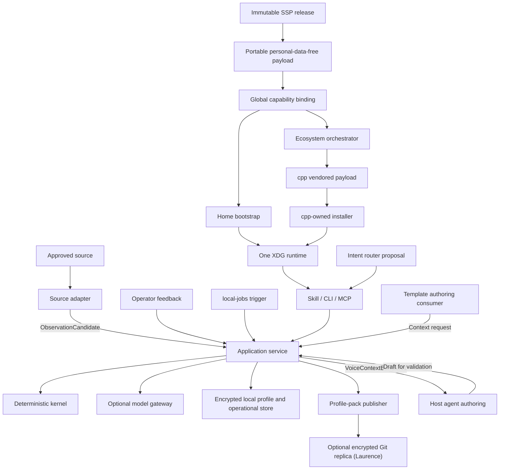

# Operator Voice Toolkit — Build Plan v4

**Version:** v4
**Status:** v3 was revised 2026-07-30 through `/plan-refine` + a fresh bounded swarm, with packaging facts re-verified against the default branches of `skills`, `ecosystem-orchestrator`, and `card-platform-product`; v3 was **not verifier-cleared and not approved for implementation** by that swarm process. The operator then explicitly authorized and directed M1 implementation to proceed under v3 notwithstanding the absent verifier clearance, and separately, on the same date, issued a **v4 clarification checkpoint** (§18.3) removing ambiguity about OVT's ecosystem-delivery route. v4 makes only the smallest material edits needed to state that ambiguity-removal precisely; it changes no vision, architecture, milestone, or acceptance content beyond it. Formal verifier/swarm clearance remains outstanding for both v3 and the v4 delta.
**Date:** 2026-07-30
**Owning repository:** `KleinPerkins/dev` (`~/dev`)
**Plan-type:** standard
**Depends on:** `operator-voice-toolkit-forensic-audit-v1.md` (same directory), especially its exact evidence index (§2.5), component decisions (§4), and score rationale (§5.1).
**Constraint honored:** No implementation code was written or modified as part of the v3→v4 plan edit itself (implementation proceeds separately, under explicit operator direction, in `KleinPerkins/operator-voice`/`KleinPerkins/operator-voice-profile`, never in a vendor repo). v3 resolved cpp multi-operator distribution, per-user profile isolation, dual-bootstrap convergence, and the remaining material v2 review findings without adding a second runtime or profile service; v4 additionally makes explicit that OVT's only path to cpp is the standard global-capability lifecycle (§8.1, §14 D22).

---

## 1. Vision: durable voice memory for every agent

OVT becomes the operator's trusted **voice memory and application layer**:

- observe only approved sources and separate the operator's writing from AI, quoted, forwarded, or third-party text;
- accumulate evidence across time and contexts, learn from direct corrections, and become measurably better rather than merely larger;
- give an approved agent a small, task-specific, versioned `VoiceContextBundle` instead of dumping a monolithic profile into context;
- validate authored text against the operator's real patterns without changing facts or manufacturing quirks;
- inspect a separately enrolled person's communication patterns for analysis, while refusing to generate or impersonate that person's voice;
- run fully with encrypted local-only state for every operator, while Laurence explicitly opts into a separate encrypted private Git profile replica for clean-machine recovery;
- work through ordinary language, `/operator-voice`, CLI, and MCP without requiring infrastructure vocabulary.

End-state requests should be as simple as:

- “Make this executive Slack sound like me.”
- “That is too formal; remember I do not say ‘delve’.”
- “What have you learned about how I open decision memos?”
- “Use my voice settings when you fill this saved template.” *(delivered only if the separate Template Framework reaches implementation-readiness; OVT ships the reusable contract, not the template adoption — see §6.3.)*
- “Profile Alex from these approved documents and show observed communication patterns.”

OVT is not an AI-detector evasion tool, covert surveillance system, personality/mental-health profiler, autonomous publisher, or permission to impersonate another person.

## 2. Problems, goals, and target use cases

### 2.1 Problems to solve

1. **Voice memory is fragmented and disposable.** Preferences live in transcripts, edits, and one-off artifacts; a new machine or context window loses them.
2. **Authorship is contaminated.** Conversation exports and collaborative artifacts mix the operator, agents, quotations, and other people.
3. **Existing tools are snapshots, not learning systems.** They analyze one corpus, overwrite a guide, and lack feedback, confidence, drift, or correction memory.
4. **One universal “voice” is false.** Slack, email, decision documents, slides, executive updates, and external writing use different registers.
5. **Analysis is not application.** A large style guide does not guarantee relevant retrieval, factual fidelity, or measurable improvement.
6. **Inference is easy to overstate.** Untested thresholds, model guesses, and self-graded output can look authoritative without calibration.
7. **Durability conflicts with privacy.** Local-only state is easy to lose; plaintext Git history is difficult to erase.
8. **Agent access can drift.** Skill, CLI, MCP, intent routing, and template consumers need one contract and one mutation boundary.
9. **Other-person analysis is a different risk class.** Identity collisions, covert collection, sensitive-trait inference, and impersonation need deterministic refusals.

### 2.2 Goals

- **G1 — Accurate observation:** high-precision authorship separation, provenance, quarantine, and source consent.
- **G2 — Continual learning is P0:** approved samples and corrections improve later generations; corrections are never silently overwritten.
- **G3 — Context-aware voice:** stable traits plus context-specific variants without cross-channel bleed.
- **G4 — Precise application:** retrieve only what the current channel, audience, purpose, language, and token budget need.
- **G5 — Inspectable trust:** every claim is explainable, correctable, deprecatable, erasable, and evidence-linked.
- **G6 — Honest durability:** every operator gets encrypted local persistence and export; Laurence's explicitly configured private Git replica provides proven clean-machine recovery. OVT never claims cross-machine durability for a local-only profile.
- **G7 — Native agent access:** colloquial intent, skill, CLI, MCP tools/resources/prompts, and generated docs expose one surface.
- **G8 — Safe subject insights:** separately enrolled people receive evidence-bounded analysis profiles, never writing-generation context.
- **G9 — Ecosystem fit:** ship one immutable, personal-data-free runtime through both the home binding and a cpp-vendored portable payload; reuse live snow-kit/local-jobs/orchestrator conventions, and treat kp-mcp-bootstrap/intent-router as optional future integrations until their runtimes exist.
- **G10 — Evidence-led quality:** earn ≥95/100 on every required quality dimension from executable evidence and independent verification.

### 2.3 Use cases and first shippable milestone

| ID | Operator outcome | OVT behavior | Milestone |
|---|---|---|---|
| UC1 | Bootstrap from exports or selected files | Register source, extract operator text, quarantine ambiguity, compute signals, persist an encrypted local generation; publish only when a remote profile backend is configured | M1 |
| UC2 | Draft/revise in the operator's voice | Return bounded context; host agent writes; OVT validates mechanics and reports confidence | M1 |
| UC3 | Correct OVT in ordinary language | Record feedback, supersede conflicts, rebuild retrieval, preserve correction history | M1 |
| UC4 | Inspect why OVT believes something | Show scope, state, confidence, provenance, contradictions, and generation history | M1 |
| UC5 | Recover on a new machine | For an explicitly configured encrypted-Git backend (Laurence), clone the private profile repo, restore key, verify digests, rebuild local state, and prove parity; local-only users receive no false cross-machine promise | M1 |
| UC6 | Learn distinct contextual voices | Separate Slack/email/docs/slides/audience/language registers and blend only when supported | M2 |
| UC7 | Improve passively over time | Scheduled read-only ingestion, catch-up, drift detection, review queue, and conditional batched profile publication when a remote backend is configured | M3 |
| UC8 | Use OVT without naming it | OVT's own aliases resolve ordinary requests; when intent-router has a runtime it may propose the same atomic verb; OVT's kernel always authorizes and explicit paths remain available | M1; expanded M3 |
| UC9 | Inject voice into a saved template | Template authoring requests a versioned bundle; OVT never enters routing/render/projection | Contract M2; adoption later |
| UC10 | Analyze another person's communication | Explicit subject enrollment, deterministic identifiers, approved sources, analysis-only output | M4 |
| UC11 | Understand status visually | Redacted Cursor dashboard shows freshness, source health, review queue, runs, and generations | M4 |
| UC12 | Export, pause, erase, or disable | Consequence preview/challenge, sink-complete operation, verification, plain-language result | M1 |

## 3. Audit decisions and assembly map

### 3.1 What to take, change, and reject

| Audited repo | Take and harden | Do not take | Reason |
|---|---|---|---|
| **MYNAH (23/100)** | Context taxonomy, readable dimensions, context traps, context-scoped quirks | Prompt-only “engine,” opaque external memory, whole-profile loading, blanket imperfection reproduction, self-grading | Useful product model with no enforcement; OVT re-authors it as validated data. |
| **write-like-me (41/100)** | Role-based export parsing, Tier-1 stylometry, stated-over-measured precedence, held-out verification, provenance-oriented templates | Silent “AI-tell” auto-drop, one-shot folders, manual counting, whole-file prompt loading, untested code | Strongest methodology; behaviorally reimplement behind tests and quarantine ambiguity. |
| **voice-analyser-mcp (33/100)** | MCP shape, burstiness/clustering/entropy, micro-rhythm, argument-flow, computed-confidence pattern | Public crawler as default, missing authorship filter, uncited labels, dead dependencies, monolithic guide, detection-evasion guidance | Rich descriptive mechanics; keep only operator-grounded signals with attribution and calibration. |

No repo is adopted wholesale. License treatment follows the audit: re-author concepts where practical, and exclude all detection-evasion text. Where any voice-analyser-mcp code is actually copied or adapted (Apache-2.0), satisfy §4(a)/(b) in full — bundle the Apache-2.0 LICENSE text in the SSP and mark each modified/ported file with a prominent "adapted from voice-analyser-mcp (Apache-2.0)" change notice; retain MIT notices for any adapted MIT code.

### 3.2 How the puzzle pieces become one system

| Stage | Starting piece | OVT treatment | Greenfield missing link |
|---|---|---|---|
| Source parsing | write-like-me role parsers | Typed adapters with stable IDs, limits, redaction, quoted-text handling, quarantine | Source registry, consent, cursors, identity confidence |
| Normalization | write-like-me + voice-analyser cleaners | Pure deterministic functions with golden/property tests | Canonical text and contamination schema |
| Signals | write-like-me Tier-1 + selected voice-analyser statistics | One versioned `SignalObservation` registry; calibrated baselines; no evasion interpretation | Feature versioning, multilingual policy |
| Context model | MYNAH taxonomy | Validated data with audience/purpose/language disambiguation | Blending, ranking, cross-context bleed tests |
| Evidence/confidence | write-like-me precedence + argument-flow match ratios | One state machine, temporal validity, source diversity, calibrated confidence | Provenance graph and review queue |
| Profile artifact | Markdown conventions from MYNAH/write-like-me | Human views generated from a canonical schema; Markdown is never authority | Generations, migrations, encrypted profile pack |
| Retrieval | No adequate audited implementation | Deterministic eligibility, ranking, token budgeting, warnings, abstention | `VoiceContextBundle/v1`, consumer allowlist |
| Application | Host-model instructions | Host agent writes; OVT supplies context and validates | Mechanical validator, optional model gateway |
| Continual learning | Audited repos have procedures only | Ingestion, feedback, recalibration, drift, publication, rollback become operations | Feedback ledger, scheduler integration |
| Other-person analysis | Absent | Separate analysis-only subject mode | Identity enrollment, purpose/consent controls, sensitive-inference refusals |
| Interfaces/lifecycle | voice-analyser MCP only | One operation registry drives CLI/MCP/docs/help | Application service, challenges, resources, prompts, parity tests |

The audited repos contribute parts, not connective tissue. OVT's main 0→1 work is authorship integrity, one canonical schema, durable learning, retrieval, feedback, privacy lifecycle, interoperability, and verification.

## 4. Target architecture

**Resolved placement and language**

- `~/dev/capabilities/operator-voice` is an independently governed private SSP repo (`KleinPerkins/operator-voice`), not content tracked by the `~/dev` umbrella. It contains generic Python 3.12 kernel, service, CLI, stdio MCP, skill, docs, installer, and release assets.
- The installed fixture lives at `${XDG_DATA_HOME:-~/.local/share}/operator-voice/current`; config at `~/.config/operator-voice`; operational state at `~/.local/state/operator-voice`.
- `~/dev/personal/operator-voice-profile` is Laurence's optional, separate private governed repo (`KleinPerkins/operator-voice-profile`) containing only encrypted curated profile packs and a redacted manifest. It is never a generic install prerequisite. Raw text, drafts, quarantine, WAL, caches, model payloads, and local audit state never enter Git.
- `capabilities/skills/global/tools/operator-voice` is a Flavor-2 Global Capability Binding to the SSP, but **not** an AWA-style pointer-only downstream package. It pins the release and carries a deterministic, personal-data-free portable runtime payload generated from that same release so the orchestrator can vendor working bytes into cpp without exposing the private SSP repo or any operator data. The exact payload contract and consistency check are M1 artifacts; WF2 enrollment remains blocked until the governed orchestrator and cpp installer paths exist.
- **OVT carries `scope=global` from M1**, independent of its temporary pre-GA rollout state. Its only team-delivery route into cpp is, and will only ever be, the standard ecosystem lifecycle: global capability binding in `KleinPerkins/skills` → eco-orchestrator WF1 registry/reconcile/lockkit → WF2 orchestrator `cpp-sync` → the cpp data-plane manifest → the cpp-owned generic `kind: tool` install/repair reconciler invoked by cpp sync/bootstrap. There is no bespoke OVT vendoring, no direct cpp write, no parallel installer channel, and no optionality about eventual standard registration/sync for GA — see §8.1, §14 D22.

- **Source adapters** parse only their declared format and extract authoritative source metadata (message role, author ID, channel, timestamps). They canonicalize approved paths before reading, enforce file/record/byte limits, and emit `ObservationCandidate`; they never decide profile state or write persistence.
- **Deterministic kernel** owns authorship policy, normalization, quarantine, feature extraction, confidence math, synthesis, retrieval, validation rules, lifecycle consequences, and schema/version compatibility. It has no network or model imports.
- **Application service** is the sole business-logic and mutation boundary. CLI, MCP, collectors, jobs, and tests call the same methods; none may call persistence directly. It coordinates transactions, cancellation, the kernel, and the optional model gateway.
- **Persistence** keeps the complete usable profile and operational state in encrypted local SQLite/WAL for every operator. An optional `ENCRYPTED_GIT` backend replicates curated generations for explicitly configured users; `LOCAL_ONLY` is the universal default. A separate append-only metadata audit journal contains opaque IDs, operation type, actor/consumer, timestamp, versions, result, and deletion counts — never prose, feature values, prompts, paths, or PII.
- **Portable release publisher** deterministically emits one generic runtime payload from the immutable SSP release, plus version/digest metadata and no operator state. The home binding and cpp payload must resolve to this same digest; release consistency is verified before enrollment.
- **Profile-pack publisher** is inactive in `LOCAL_ONLY`. For an explicitly configured `ENCRYPTED_GIT` backend, it deterministically serializes approved derived signals, profile facts, feedback, taxonomy/config, provenance digests, calibration manifests, and immutable generation metadata; encrypts before Git; emits a redacted manifest; validates an allowlisted file set; runs data-guard; and uses exact-parent compare-and-swap with the fleet's normal solo-repo direct-push path. It never commits raw source content or key material, and it does not require PR ceremony.
- **Model gateway** is a separately injected interface, disabled by default. It may support an explicitly configured local or remote provider for qualitative hypotheses or semantic comparison. The kernel remains deterministic. Remote use requires a provider/model/data-class allowlist and egress policy; quarantined/raw text is never eligible. `EXTERNAL`-subject-derived signals remain egress-denied even when operator egress is enabled, unless separately and explicitly enabled. Each call creates a metadata-only `ModelCallRecord`; transient payloads are encrypted and erased after the call.
- **stdio MCP + CLI + Skill** are thin adapters over the same operation registry and application service. No TCP listener ships. The skill and optional intent-router translate ordinary language into bounded verbs; neither is a safety authority.

### 4.1 Canonical lifecycle (one model, all stages)

`Explicit subject/source enrollment → adapter canonicalization/limits → candidate with authoritative metadata → kernel identity/authorship decision (subject / AI / other / ambiguous-quarantined) → normalization/deduplication → deterministic signal extraction over subject-authored segments only → idempotent evidence transaction → profile synthesis under pinned versions → context-scoped index → encrypted local generation → optional encrypted-Git publication when configured → context or insight request → minimal bundle with no raw excerpts by default → host agent drafts only for the operator subject → deterministic validation → optional semantic/factual comparison → accept/correct/reject feedback → superseding generation and durable correction memory.`

Collection, synthesis, publication, and model checkpoints consult the cancellation token before each source read, batch, transaction, Git operation, and optional model call. Inspection, feedback, deprecation, erasure, export, exact rebuild, reanalysis, profile sync/restore, and doctor are available from M1 through the same application service.

### 4.2 Profile states

Every fact carries `subject_id`, `state`, context scope, calibrated confidence plus interval where applicable, independent-source/document count, last-observed time, provenance IDs, and pinned synthesis version.

| State | Meaning | Retrieval behavior |
|---|---|---|
| `OBSERVED` | One or more accepted records expose a signal; it is not yet stable. | Hidden unless explicitly requested for inspection. |
| `SUPPORTED` | Deterministic aggregation clears a per-facet threshold calibrated from fixtures/operator review and recorded with the method version. | Eligible when confidence and scope match the request. |
| `MODEL_HYPOTHESIS` | Optional gateway proposes a qualitative pattern over structured, egress-eligible signals. | Never auto-applied; inspection only until confirmed. |
| `CONFIRMED` | Operator affirms a supported fact or hypothesis. | Preferred over measurements while active. |
| `CORRECTED` | Operator supplies an explicit replacement or ban. | Highest precedence, matching write-like-me’s stated-over-measured rule. |
| `DEPRECATED` | Reversibly superseded or disabled; evidence remains. | Excluded from normal retrieval. |

Precedence is `CORRECTED > CONFIRMED > SUPPORTED > OBSERVED`; `MODEL_HYPOTHESIS` never outranks deterministic evidence without operator confirmation. New observations may contradict a correction, but cannot silently replace it. A `FeedbackEvent` records the reason, target, prior/new value, source draft or utterance digest, and resulting generation.

Erasure is not a state: it removes content and derived records under toolkit control, rotates profile-pack keys when Git history contains affected ciphertext, destroys superseded keys across registered sinks, and appends only a content-free audit event. Exact thresholds are M1 calibration outputs; until calibrated, facts remain `OBSERVED`.

### 4.3 Subject modes

| Subject kind | Allowed purpose | Hard boundary |
|---|---|---|
| `OPERATOR` | Voice generation context, validation, and analysis of the operator's own authored communication | Still source- and consumer-allowlisted; third-party-authored segments never contribute evidence; no autonomous sending |
| `EXTERNAL` | Evidence-bounded historical communication patterns and inferred communication preferences with uncertainty (for example, “has usually responded to X with Y”) | `context`/generation instructions refuse at the kernel; forecasts of future decisions/actions/conduct (for example, “will decide Y”), explicit protected/sensitive-trait requests, mental-state diagnosis, and high-impact decision support refuse; reviewed facet denylist limits proxy leakage |

External subjects require explicit `SubjectRegistration`, approved purpose and sources, stable identifiers such as account/email/document-author IDs, and manual review of near matches. A display name alone can never merge identities. Consent/authorization basis is operator-attested, not independently verified by OVT; the operator must satisfy applicable policy/law. Because communication features can incidentally proxy sensitive traits, every external bundle carries that warning and excludes reviewed high-risk facets. The analysis-only guarantee is scoped to OVT's own tool and schema boundary: OVT will not emit a `VoiceContextBundle` or generation instructions for an external subject, but a `SubjectInsightBundle`'s evidence-bounded prose is still information a host agent or the operator could manually repurpose as informal generation guidance outside OVT's control — the bundle warning states this explicitly.

An approved operator source may contain correctly identified third-party text, but those segments are excluded from operator profile synthesis and communication analysis. Any request to synthesize facts about that person requires explicit `EXTERNAL` enrollment first; using an `OPERATOR` source can never bypass the external-subject purpose, retention, facet, or egress controls.

### 4.4 Threat model

| Threat | Mitigation | Owning component |
|---|---|---|
| AI/third-party/quoted contamination | Adapters parse authoritative roles; kernel validates identity and quarantines ambiguity/quotes/forwards. Correctly identified third-party segments are retained only under policy and never contribute to an `OPERATOR` profile or third-party analysis without explicit `EXTERNAL` enrollment. Hard-coded “AI tell” phrases may raise review signals but never delete evidence. | Adapter + kernel |
| Path traversal, symlink escape, oversized input | Resolve real paths beneath an allowlisted root; reject non-regular files, escapes, device files, and configured size/count/depth excess before reading. | Adapter + kernel |
| Prompt injection in artifacts | Raw text is never interpreted as instructions; deterministic extraction receives data only. Model gateway accepts typed, escaped, minimum-necessary signal envelopes and rejects quarantined data. | Kernel + gateway |
| External model disclosure/retention | Gateway disabled by default; provider/model/data-class allowlist; operator-visible policy; metadata call ledger; no raw/quarantined text; transient encrypted payload erasure. `EXTERNAL` data is a separately enabled class and remains denied when only operator egress is enabled. | Gateway + application |
| Poisoning/overfit | Provenance, independent-document/source counts, contribution caps, context isolation, outlier/quarantine review, and abstention until calibration thresholds pass. | Kernel |
| Subject collision or cross-profile bleed | Stable source-native identifiers, alias confidence, manual collision review, subject-scoped keys/indexes, and adversarial cross-subject fixtures. Name-only matching is forbidden. | Adapter + kernel |
| External-subject impersonation or sensitive inference | Subject mode/purpose are kernel inputs; generation context and explicit sensitive-trait requests refuse. A reviewed facet denylist and bundle warning reduce—but cannot eliminate—incidental proxy leakage. | Kernel |
| Semantic/factual loss | Deterministic source-brief checks where possible; independently configured semantic comparison for high-stakes drafts; unresolved variance blocks “validated” status. | Application + gateway |
| Unauthorized export/erase/correction | Kernel computes live consequences; preview returns a one-use operation/target/generation-bound challenge; execution requires the challenge and exact confirmation. CLI/MCP cannot bypass it. | Kernel + application |
| Plaintext or raw content enters Git | Profile-pack allowlist, pre-commit pack validator, data-guard, entropy/content scanners, generated redacted manifest, and clean-room fixture proving only ciphertext/approved metadata are committed. | Profile publisher |
| Lost profile key makes Git backup useless | Key setup must create and verify an operator-controlled recovery path before first publish; clean-room restore is an M1 gate. Keys never enter Git or logs. | Persistence + installer |
| Sensitive data at rest or in logs | OS-Keychain-backed encryption for local state and profile-pack keys, directories `0700`, files `0600`; metadata-only logs/journal; no text, feature values, prompts, paths, or PII. | Persistence |
| Incomplete erasure, including Git history | Transactional sink registry covers DB/WAL/backups/caches/exports/profile repo/key stores. Erasure rotates the profile-pack wrapping key, rewraps retained objects, destroys old keys, and verifies known sinks; unknown/offline copies are disclosed as unverifiable. | Application + persistence + profile publisher |
| Duplicate/interrupted runs | Stable idempotency key; staging transaction; commit marker last; resume or rollback incomplete work; local-jobs supplies scheduling only. | Application |
| Off-switch race | Persistent global mode checked before every unit of work plus cooperative cancellation token for active jobs/model calls; network gateway closes first. | Application |
| Version drift/rebuild ambiguity | Exact rebuild uses stored version bundle; reanalysis is a separate verb that creates a new generation and diff. Unsupported versions fail closed with repair instructions. | Kernel + persistence |
| Profile-repo concurrency or merge loss | Immutable generations, exact-parent compare-and-swap, no force push, deterministic typed merge for disjoint changes, and operator review for conflicting facts/corrections. | Profile publisher |
| Two distributors collide on one runtime | One atomic XDG install contract and receipt `{release_version, digest}`. Same digest is a no-op; same version with a different digest fails closed; a healthy different version is never overwritten or downgraded automatically. Runtime repair cannot touch config, state, profile remote, or keys. | Installer + cpp reconciler |
| Licensing errors | Reuse decisions are pinned per-component in the audit (§4, §6) with explicit copy/adapt/wrap/reimplement/reject labels; no component is reused without its license obligation being satisfied at implementation time. For adapted Apache-2.0 code (voice-analyser-mcp), that means bundling the LICENSE text and adding a per-file "adapted from … (Apache-2.0)" change notice (§4(a)/(b)), not only "retaining notices"; MIT notices retained where MIT code is adapted. | Process (this plan + code review) |

## 5. Canonical schema (data model, not code)

- `SubjectRegistration`: stable pseudonymous ID, kind (`OPERATOR|EXTERNAL`), display label, approved purposes, consent/authorization basis, generation permission, retention policy, active/paused state, and creation/review metadata.
- `SubjectAlias`: source type plus deterministic source-native identifier, confidence, verification state, validity interval, and collision-review record. Sensitive aliases are encrypted; a name alone is never authoritative.
- `SourceRegistration`: stable ID, subject ID, adapter type, canonical root/identifier, opt-in time, approved purpose, active/paused state, retention policy, limits, and source-specific role identity. No source ships enabled.
- `SourceDocument`: encrypted content-bearing record with subject/source IDs, source-native ID, digest, locator, timestamps, context, sensitivity, authorship state, quarantine reason, and expiry. It is local-only and erasable.
- `SignalObservation`: stable keyed-HMAC idempotency key; subject/document/segment IDs; typed facet/value/distribution; context; sensitivity; method version; timestamps; quality flags. It is sensitive and erasable.
- `EvidenceRecord`: aggregation/provenance link over observations, source/document diversity, contradiction/outlier state, calibrated confidence inputs, method versions, and validity interval. Git-backed sources pin `{path_token, commit, blob}`; other sources pin native revision/ID plus digest.
- `ProfileFact`: subject ID, facet, typed value, scope, state, calibrated confidence/interval, document/source counts, provenance IDs, synthesis version, validity interval, and `superseded_by`.
- `FeedbackEvent`: operator utterance or accepted/revised-draft digest, structured correction/confirmation/rejection/ban/context change, target fact or facet, reason, prior/new values, actor, and resulting generation. Explicit feedback is durable profile memory.
- `ProfileGeneration`: generation ID plus pinned schema, normalization, extraction, synthesis, taxonomy, policy, tokenizer, and feature-registry versions; content digest; creation reason; parent; diff summary.
- `ContextTaxonomy`: structured adaptation of MYNAH — channel, audience class, purpose, output type, language, disambiguation rules, sensitivity floor, and retrieval policy.
- `VoiceContextBundle`: `voice-context-bundle/v1`; operator subject, allowlisted consumer, generation, request scope, ranked facts, compact generative/corrective instructions, warnings, provenance references, budget/actual tokens, confidence, abstention, and schema/version echo. No raw samples by default.
- `SubjectInsightBundle`: `subject-insight-bundle/v1`; external subject, approved analytical purpose, evidence-bounded observations, uncertainty/counter-evidence, warnings, and expiry. It contains no generative instructions.
- `ValidationRun`: request ID, draft digest/reference, deterministic checks, optional gateway metadata, outcome, versions, and expiry. Draft text is transient/erasable.
- `ProfileBackendConfig`: mode (`LOCAL_ONLY|ENCRYPTED_GIT`), active state, remote reference token, key-generation reference, last verified durability result, and operator-visible health. `LOCAL_ONLY` is the default; remote URL and credentials remain machine-local config, never profile-pack or cpp data.
- `ProfilePackManifest`: pack schema, generation, parent, ciphertext-object digests, redacted counts/types, key-generation ID, publisher/version, and Git parent. It contains no fact values, aliases, paths, or raw titles.
- `ProfileSyncState`: present only for `ENCRYPTED_GIT`; local/remote generation, exact parent, publish/restore status, conflict set, and last verified clean-room recovery.
- `ModelCallRecord`, `AuditEvent`, `OperationChallenge`, `ExportManifest`, and `CancellationState` retain their prior metadata-only/consequence semantics.

Schema v1, contract fixtures, migrations, validators, and the sink registry ship in M1. There is no loose-JSON phase. Public bundles are frozen/additive within v1 and reject unknown required fields or incompatible major versions. Fields for concepts no milestone has yet exercised — `ProfileSyncState` conflict-set/reconciliation fields and the `EXTERNAL` branch of the subject-kind discriminator plus `SubjectAlias` — are marked **provisional** in v1 and may be revised via a documented v1.x addendum when M4 first exercises them; the frozen/additive guarantee binds only the concepts M1–M3 actually use.

### 5.1 Storage tiers and retention

| Tier | Contents | Location | Source controlled |
|---|---|---|---|
| Local profile and operational state | Raw/normalized text, quarantine, transient drafts, full excerpts, derived signals, facts/states, feedback, generations, WAL, caches, job cursors, model payloads | `~/.local/state/operator-voice` encrypted SQLite/files | Never |
| Optional durable replica | Approved derived signals, facts/states, feedback, taxonomy/config, calibration manifests, provenance digests, generation snapshots | Encrypted objects in the configured private profile repo (Laurence: `~/dev/personal/operator-voice-profile`) | Only in `ENCRYPTED_GIT` |
| Redacted control metadata | Pack schema/generation/digests/counts, audit operation metadata | Local journal plus optional profile-repo manifest | Only where explicitly safe |
| Key material | Local DB and profile-pack wrapping/recovery keys | OS Keychain plus operator-controlled recovery sink | Never |

- Raw/verbatim, held-out, validation-draft, and model payload retention defaults to **zero days**. Verbatim exemplars require a bounded explicit policy.
- Derived signals remain sensitive even when pseudonymous. Source control never changes their classification.
- Before first `ENCRYPTED_GIT` publish, setup must prove key recovery in a disposable home. A Git clone without a recoverable key is not reported as a backup. `LOCAL_ONLY` status explicitly says that machine loss is not covered.
- Profile objects use independent data keys. A profile-pack wrapping-key generation protects their envelopes. Erasure rotates the wrapping key, rewraps retained objects, destroys old key generations in registered key sinks, and makes affected historical ciphertext inaccessible.
- Setup and `doctor` surface (do not silently block) common macOS channels that can replicate a Keychain key outside the sink registry — iCloud Keychain sync and full-disk/Time Machine backups — so the operator can decide; such copies are a concrete, named instance of the "unknown or out-of-registry … disclosed as unverifiable" class above.
- Git history is never rewritten: erased objects' ciphertext bytes remain permanently in historical Git objects. “Erased” means the required decryption keys were destroyed and verified across known sinks, not that ciphertext bytes disappeared.
- Known offline clones/exports and recovery-key backups are sink-registry entries. Unknown or out-of-registry content/key copies cannot be guaranteed erased and are disclosed as unverifiable.
- When `ENCRYPTED_GIT` is configured, profile publication is append-only by immutable generation. Conflicting changes never use last-write-wins; disjoint typed changes may merge deterministically, while conflicting corrections require review.
- Logs are bounded/rotated and metadata-only. No log, **profile-pack** manifest, commit message, optional PR body, or dashboard receives raw text, fact values, aliases, paths, prompts, responses, recipient names, or source titles. This no-content rule does not apply to the operator-triggered `export` operation's `ExportManifest`, which is intentionally human-readable, minimum-necessary, and never written to Git or logs (§6, §8).

## 6. Interfaces and boundaries

- Adapters implement `scan(registration, cursor) -> ObservationCandidate[]`; only the application service invokes them.
- One typed operation registry generates CLI commands, MCP tools, JSON schemas, operation cards, examples, error taxonomy, posture annotations, and deterministic help. Adding a verb edits the registry and service once, never each surface separately.
- Public read groups: `help`, `status`, `doctor`, `config_view`, `subject_list`, `profile_inspect`, `profile_search`, `context_get`, `subject_insights`, `draft_validate`, `audit_read`, `profile_backend_status`, and `profile_sync_status`.
- Public mutation groups: `config_set`, `subject_add|pause`, `source_add|pause`, `ingest`, `feedback_add`, `fact_correct|deprecate`, `profile_publish|pull|restore`, `export`, `erase`, `rebuild`, `reanalyze`, `retention_set`, `off`, and `on`.
- CLI and stdio MCP map to the same service methods, schemas, consequences, transactions, and contract tests. Lifecycle actions requiring filesystem/key/registration control (`setup`, `profile_remote_bind|remove`, `key_recover`, `repair`, `uninstall`) remain CLI-only because exposing them to an agent tool is unnecessary authority; the Skill can guide an agent to invoke them, and docs name every intentional parity exception. `profile_restore` may rebuild only after CLI-side key recovery has completed and never reads/writes key material itself.
- Agent-facing MCP registration is read-only by default. Mutation tools are hidden unless explicitly enabled, and destructive operations still require the kernel challenge after enablement. Tool annotations are hints, never authorization.
- `context_get` requires an `OPERATOR` subject, allowlisted consumer ID, channel/audience/purpose/language/output type/token budget. It returns `VoiceContextBundle/v1`, never raw samples by default.
- `subject_insights` requires an `EXTERNAL` subject and analysis purpose. Calling `context_get` or any generation-oriented purpose for an external subject fails closed.
- `draft_validate` accepts a draft and source brief as data. Deterministic checks always run; optional semantic comparison runs only when policy permits. OVT does not expose `generate_with_voice`; the host agent generates using the context bundle.
- `profile_publish|pull|restore|sync-status` require `ENCRYPTED_GIT`. In `LOCAL_ONLY`, they make no network call and return “This profile stays on this computer” plus the one optional setup action; all core ingest, learning, retrieval, feedback, validation, export, and erasure verbs remain functional.
- `preview(operation, targets)` is mandatory when live consequences indicate destruction, irreversibility, shared-reference impact, or sensitive export. `execute` requires the bound one-use challenge and the exact literal shown by preview. That literal is a short, plain-language human-readable word/phrase (never a generation ID, digest, or nonce), matching this workspace's existing exact-word confirmation pattern. The kernel enforces this; Skill wording or approval UI cannot bypass it.
- `deprecate` is reversible. `erase` is irreversible and supports fact, source, validation/evaluation set, model-call payload, export-under-control, or full-system scope. Each scope gets a distinct consequence descriptor.

### 6.1 MCP-native discovery and documentation

- Reuse snow-kit's strongest patterns from `capabilities/mcp`: dotted operation names in the registry, sanitized MCP names, generated docs/schemas, stable JSON, strict unknown-argument rejection, bounded warnings, redacted status, and conservative safety annotations.
- `help` accepts the full plain-English request and deterministically returns ranked operations/workflows, required arguments, posture, reasons, and suggested next actions. It never invokes an operation.
- Static resources: `ovt://guidance/getting-started`, `/safety`, `/continual-learning`, `/feedback`, `/context-bundle`, `/external-subjects`, and `/template-integration`.
- Dynamic redacted resources: `ovt://status/profile`, `/sources`, `/learning`, `/sync`, and `/environment`; no resource exposes raw text, profile values, keys, secrets, or source paths.
- MCP prompts are thin, non-authoritative recipes such as `draft-in-my-voice`, `validate-my-draft`, `explain-my-profile`, and `analyze-subject-communication`. They orchestrate the same tools and add no permission or mutation path.
- Resources and prompts are not inferred from operation names. They live in separate typed, versioned `ResourceSpec` and `PromptSpec` registries with validation, fixtures, and generated indexes; the operation registry remains the authority only for CLI/MCP verbs.
- Server instructions embed durable behavior and current posture: call help when ambiguous; read warnings; never request whole-profile/raw data; external subjects are analysis-only; feedback outranks inference; erase differs from deprecate; high-stakes drafts need the configured validation level. `config_view` and environment resources expose only redacted capability flags, active policy versions, provider/write posture, profile generation, and registration health.
- Generated `docs/INDEX.md`, `docs/INTENTS.md`, `docs/resources.md`, `docs/prompts.md`, `docs/cards/*.md`, and `docs/schemas/*` are rebuilt twice in CI and must be byte-stable.

### 6.2 Colloquial access and intent-router boundary

- OVT owns an `intent-catalog/v1` of atomic verbs, aliases, examples, required parameters, safety posture, plain labels, and consequence copy. The same plain-language commitment extends to read output: `profile_inspect`/`explain-my-profile` render fact states and generation history in ordinary words (for example, "you confirmed", "I've observed a few times", "you corrected this", "retired") rather than raw enum names (`OBSERVED`/`SUPPORTED`/…) or bare generation numbers. Runtime health likewise distinguishes “installed and ready,” “needs repair,” “available only as a reference,” and “working locally with no online backup,” each with at most one actionable next step.
- OVT's own deterministic aliases and explicit Skill/CLI/MCP path ship first. The existing `intent-router` contracts are a valid proposal-only target, but its repository is currently P0 architecture/contracts with no L0–L5 runtime; integration activates only after that runtime exists. It never executes or authorizes. OVT's kernel computes live consequences and the application service executes OVT's own verb.
- Router removal or failure degrades to explicit `/operator-voice`, CLI, and MCP paths. Core observation, retrieval, feedback, erasure, and off-switch behavior never depends on routing.
- The skill is a thin conversational veneer and documentation entrypoint. It does not duplicate business logic or manipulate profile files.

### 6.3 Template-framework seam

The existing Quickhost Template Framework plan (`~/.cursor/plans/quickhost_template_framework_87662f80.plan.md`) already reserves an optional OVT input at the **authoring step only**. OVT freezes the reciprocal contract:

- request: consumer ID, operator subject, channel, audience, purpose, language, output type, token budget, accepted bundle major versions;
- response: `VoiceContextBundle/v1` with ranked facts, compact generative/corrective instructions, warnings, confidence, provenance references, generation, and token use. Typed facets cover register/tone, preferred/banned lexicon, structure/argument flow, punctuation/emphasis, quantitative sentence targets, and channel/audience openings/closings;
- template-framework never stores or writes OVT state; it treats the bundle as transient authoring input;
- OVT never imports template code, reads template IDs/storage, influences intent routing, or enters deterministic render/projection;
- explicit operator request, intent-routed request, or agent-selected use all call the same `context_get` read verb;
- consumer contract fixtures ship in M2; actual template-framework adoption remains a separate cross-plan follow-on once both sides are release-ready.

## 7. Performance and token design

- Retrieval ordering is deterministic with stable tie-breakers over scope match, operator precedence, confidence, recency policy, and fact ID. Repeating the same query against the same generation returns byte-identical context.
- The caller supplies a token budget and tokenizer/model family. Unknown tokenizers use a conservative estimator and surface uncertainty; they never silently overrun.
- Whole-profile injection and raw exemplar injection are forbidden defaults. A quality floor is evaluated before truncation: if the budget cannot include the minimum required facts, the result abstains or asks for a larger budget rather than returning a misleadingly thin profile.
- M1 benchmarks synthetic small/medium/large corpora on the target Mac and records p50/p95 ingest, rebuild, search, context latency, peak memory, DB growth, and context tokens. M1 then pins lightweight regression budgets as observed baseline plus a justified margin; multi-consumer SLO ceremony is deferred unless real use requires it.
- Core extraction is deterministic and stdlib-first. Optional NLP tiers are separate extras with explicit capability reporting and fixture parity; no optional dependency may silently change a fact’s method version.

## 8. Observability, recovery, correction, erasure

- Every operation emits bounded metadata: operation ID, timestamps/duration, counts, quarantine/error categories, method versions, cancellation status, and outcome. `doctor` verifies runtime receipt/digest, atomic-install completeness, permissions, key access, schema/migrations, profile-backend posture, sink registry, source roots, stale operations, orphaned content, and audit/content separation, then renders one plain-language state and next step rather than raw diagnostics.
- `feedback_add` accepts plain-language correction plus optional target fact/draft/context. The kernel classifies it into confirm/correct/reject/ban/scope/identity/source actions, shows the interpreted change, then records an immutable `FeedbackEvent`; ambiguous feedback asks one focused question.
- Accepted/revised draft diffs may become feedback only after source registration permits it. Agent-authored text is never learned as operator voice until the operator's authored revision is separable.
- Continual learning is a closed loop: observe → extract → compare with current generation → propose additions/contradictions/drift → auto-apply only calibrated additive evidence → queue material conflicts → incorporate feedback → persist a new encrypted local generation → optionally publish when `ENCRYPTED_GIT` is configured → evaluate whether correction rate and held-out fit improved.
- `rebuild` recreates a selected `ProfileGeneration` from retained evidence using its pinned version bundle and must match its digest. It never silently switches extraction methods.
- `reanalyze` explicitly applies a newer method to retained source content, creates a new generation, and presents a diff; it fails honestly when zero-retention removed required source text.
- With `ENCRYPTED_GIT` configured, `profile_publish` validates/encrypts and delivers a generation by exact-parent CAS; `profile_pull` refuses divergent conflicting heads; `profile_restore` rebuilds a clean local store and proves digest parity. A repository clone alone is not success until key recovery and rebuild pass. In `LOCAL_ONLY`, these verbs perform no remote action and say so plainly.
- `export` produces a manifest plus minimum-necessary, human-readable facts/provenance. Preview discloses sensitivity and destination; exports expire when the destination supports it.
- `erase` resolves the sink registry before confirmation, deletes in one crash-safe (atomic, interruption-resumable) operation — "recoverable" means recoverable from a crash mid-erase, not undoable by the operator, consistent with the irreversibility stated in §6 — rotates/rewraps profile-pack keys as needed, rebuilds affected views, clears caches/payloads/held-out/drafts/controlled exports, and verifies zero live/decryptable content references in known sinks. Historical Git ciphertext may remain as disclosed in §5.1. Metadata-only audit events and tombstones remain.
- The off switch persists before cancellation begins, closes model egress, requests cancellation of active operations, waits to a bounded checkpoint, and reports any operation that could not be stopped. Per-source pause remains available.

### 8.1 Ecosystem integration and global-capability lifecycle

| Ecosystem surface | OVT relationship | Sequencing and boundary |
|---|---|---|
| Standalone repo | `KleinPerkins/operator-voice` at `~/dev/capabilities/operator-voice` owns the complete generic product and self-installer | Create first; private/in-progress until M5 |
| Global capability binding | `capabilities/skills/global/tools/operator-voice` pins the immutable SSP release and carries its deterministic portable runtime payload | M1; AWA is an SSP/install precedent only, not the downstream payload shape; update `.eco-registry.lock` through lockkit |
| `/skill` | SSP installs a thin global `/operator-voice` wrapper into supported agents | M1; wrapper calls CLI/MCP/service, never profile files |
| kp-mcp | Reuse live snow-kit registry/docgen/help/registrar patterns; OVT's MCP remains bundled with the SSP | `kp-mcp-bootstrap` is currently Phase 2, so it is not an M1 dependency; adopt a future pinned library only after release evidence |
| intent-router | Optional proposal layer over OVT's own catalog; no execution/authorization or kernel dependency | Its repo is currently P0 contracts with no routing runtime; M1 ships OVT aliases/fallback, and integration waits for a real router release |
| local-jobs | One generic command instance triggers passive ingestion/evaluation/publication | M3 only; OVT owns no scheduler/launchd code |
| continual-learning precedents | Reuse incremental indexes, bounded catch-up, correction-first merge, fail-open observation hooks, and source-controlled-publish patterns | Behavioral precedent, not runtime dependency |
| Private profile repo | Laurence explicitly binds `KleinPerkins/operator-voice-profile`; every other user defaults to complete local-only operation | M1 optional bind/publish/restore; M3 publication only when configured; cpp never touches it |
| Ecosystem orchestrator WF1 | `config/registry.yml` is global cpp-sync enrollment authority; OVT is registered in WF1 from M1 with `scope=global` and an explicit `excluded` status plus reason | `excluded` is a **temporary release gate on an already-global entry**, never a local/non-global classification — OVT is never "not in the registry" or "not a global capability" while pre-GA; it is a registered-but-not-yet-cleared-for-cpp-sync global capability. Distinct from `.eco-registry.lock`; do not call absence or a lock entry "cpp enrollment" |
| Ecosystem orchestrator WF2 | `enabled_kinds` already includes `tool`; remaining work is a governed portable-tool payload path plus consistency/zero-link tests, followed after M5 verifier clearance by promoting the same WF1 registry entry from `excluded` to `enrolled` and running standard `cpp-sync` | Orchestrator is the only normal writer of the ld↔cpp data-plane edge; stale plan/memory is not readiness evidence; there is no route to cpp that skips WF1 enrollment + WF2 `cpp-sync` |
| cpp bootstrap/repair | cpp receives the portable runtime payload, not a private-repo pointer, and only through the **standard cpp-owned generic `kind: tool` install/repair reconciler** that cpp's own sync/bootstrap already invokes for every other tool capability. Today that reconciler records `kind: tool` only, so a governed cpp control-plane PR must extend it generically (still cpp-owned, still invoked by cpp sync/bootstrap) to perform portable runtime installation before enrollment | It installs/repairs runtime bytes only; no operator profile, remote, keys, config, aliases, or data ever enter cpp or its repair scope. OVT never ships, and cpp never runs, an OVT-specific installer, a parallel bootstrap path, or any direct-write shortcut around this reconciler |
| Template Framework | Optional consumer of `VoiceContextBundle/v1` at authoring only | Contract fixture M2; consumer adoption is independent and additive |

Concrete precedents:

- SSP lifecycle and XDG install: `capabilities/skills/global/tools/awa/{meta.yml,install.sh,README.md}`; its pointer-only cpp shape is explicitly not copied.
- Single-registry CLI/MCP/help/docs/resources: live `capabilities/mcp/snow-kit`; `kp-mcp-bootstrap` remains a future optional library.
- Proposal-only intent contract: `capabilities/intent-router/contracts/*.v1.json`; runtime integration is deferred because the router itself is still P0.
- Curated-vs-machine-state publication: `continual-learning-publish`; provenance manifest shape: `affirm/src/ai-analytics-context/curation-manifest.json`.
- Capability inventory/enrollment: `capabilities/skills/.eco-registry.lock` vs. `personal/ecosystem-orchestrator/config/registry.yml`.
- cpp delivery/repair: orchestrator `cpp-sync`, cpp `quiver/tooling/eco-capability-sync/eco-capability-manifest.yml`, and `affirm/src/card-platform-product/_ops/bin/eco-capability-reconcile.sh`.

Bootstrap/repair order:

1. The SSP emits one immutable portable release; the global binding pins it and verifies the payload digest.
2. Home bootstrap installs runtime, CLI, MCP, skill, config template, and doctor under XDG paths. Fresh setup creates `LOCAL_ONLY` with no remote.
3. Laurence explicitly runs profile-remote setup to bind the separate private repo, initialize Keychain/recovery, and prove clean-room restore before first publication. This is not part of cpp bootstrap.
4. Pre-GA, OVT's WF1 registry entry stays `scope=global` / status `excluded` — a release gate, not a downgrade to local-only distribution. Before M5 promotes that entry to `enrolled`, a governed orchestrator change must vendor the portable payload, and a separate cpp-governed PR must extend the **standard, already-existing** cpp `kind: tool` reconciler (never a new OVT-specific installer) to install/repair it.
5. Only after that promotion does WF2 `cpp-sync` run for OVT, through the same path every other `kind: tool` capability uses. A cpp-only clean machine then installs the same digest from cpp and remains `LOCAL_ONLY`. On Laurence's machine, cpp reconciliation sees the same healthy receipt and is a no-op; it never reads or changes profile configuration/state. There is no bespoke OVT vendoring or parallel installer channel at any step of this sequence.

### 8.2 Multi-operator coexistence contract

- The **product plane** is identical for every operator: one immutable runtime under XDG, one CLI/MCP/Skill surface, and no embedded identity or personal defaults.
- The **profile plane** is per-user and machine-local by default. `LOCAL_ONLY` is fully functional. `ENCRYPTED_GIT` is explicit opt-in; Laurence's remote lives only in his local config and separate private repo.
- Both distributors write an atomic install receipt `{release_version, digest, distributor_label_for_diagnostics}`. Same digest is an idempotent no-op. Same version with a different digest fails closed. A healthy different version is left untouched—never silently downgraded or overwritten—and status shows current/available versions plus one explicit update action.
- Installer staging and atomic replacement cover interruption; `repair` verifies/replaces runtime payload only. It cannot mutate `~/.config/operator-voice`, `~/.local/state/operator-voice`, Keychain items, profile backend, or profile repo.
- No manager hierarchy is added. Version+digest convergence and non-clobbering are sufficient; distributor provenance is diagnostic, not authority.
- cpp status must never call a record-only descriptor “ready.” It reports one of: installed and ready; needs repair; available only as a reference; working locally with no online backup. Each state names at most one next step.

## 9. Evaluation design (for future implementation)

M1 creates a versioned evaluation manifest before tuning: corpus eligibility, document-level/time-aware splits, leakage checks, metric formulas, aggregation weights, abstention rules, observed-baseline-derived pass bands, and the exact mapping from each evidence measure into each of the ten GA dimension scores. If a context lacks enough independent documents for a defensible held-out set, the system reports “insufficient evidence”; it does not shrink the holdout until a score appears.

| Evaluation area | Evidence required |
|---|---|
| Authorship/contamination | Labeled Claude, ChatGPT, Markdown, quoted, forwarded, mixed-author, malformed, and adversarial fixtures; precision/recall/confusion matrix by adapter and sensitivity class; false-operator classifications are release-blocking defects. A correctly labeled third-party segment in an operator source must still contribute zero operator evidence. |
| Signal accuracy | Golden feature vectors and property tests for normalization, sentence/punctuation/function-word/MATTR/burstiness/entropy calculations; behavioral parity tests for intentionally ported mechanics; mutation tests for policy thresholds. |
| Profile calibration | Reliability plot/Brier-style calibration where probabilistic; operator correction/reconfirmation rate; source/document diversity; facts below a calibrated bar must abstain. |
| Context/retrieval | Per-channel/audience relevance judgments, precision/recall/ranking quality, cross-context bleed, deterministic repeatability, quality-floor abstention, and token-use reporting. |
| Style efficacy | Compare unguided generation, current profile, and operator held-out distributions on preregistered lexical, syntactic, structural, rhetorical, and hard preference checks. Report each metric and aggregate; never hide a regression in an average. |
| Semantic/factual preservation | Curated briefs with required/forbidden facts, deterministic claim checks where possible, blinded human review, and optional independent gateway comparison. Any material fact change blocks validated status. |
| Blind human assessment | Randomized, blinded preference/voice-match judgments across contexts and stakes; report sample size, uncertainty, ties, and inter-rater agreement when a trusted reviewer participates. |
| Continual learning/drift | Time-sliced backtests, feedback uptake on the next generation, correction non-regression, stale-fact deprecation, reanalysis diffs, and resistance to one-source poisoning. Learning must improve or abstain, not merely accumulate facts. |
| Subject identity/isolation | Deterministic identifier fixtures, ambiguous/name-collision review, cross-subject bleed tests, structural proof that external subjects cannot produce a `VoiceContextBundle` or generation instructions, and failure of named-third-party analysis without explicit `EXTERNAL` enrollment. |
| Profile durability | `LOCAL_ONLY` restart/rebuild/export plus honest no-online-backup status; for `ENCRYPTED_GIT`, ciphertext-only Git scan, immutable-generation/CAS tests, divergent-writer conflict tests, key-loss behavior, clean-machine clone+key-restore+rebuild digest parity, and cryptographic erasure of affected historical ciphertext across known sinks. |
| Multi-operator install/isolation | Fresh cpp-only local operation with zero private-repo dependency; home-first and cpp-first convergence; same-digest no-op; same-version/different-digest refusal; interrupted atomic install and runtime-only repair; generic payload/receipt scans proving zero personal bytes; plain-language state and one next step for every outcome. M1 uses two hermetic distributor fixtures; M5 repeats against live cpp. |
| Interface/discovery parity | Operation-registry snapshot, CLI/MCP schema parity, read-only default tool exposure, lifecycle exceptions documented, generated docs/resources/prompts, help ranking fixtures, and router-off fallback. |
| Privacy/security | Path/symlink/size abuse, prompt injection, sensitive quarantine, provider/consumer denial, plaintext-Git/cpp-payload prevention, log/manifest/commit-message redaction, key/permission/recovery failure, export challenge, erasure sink coverage, off-switch race tests, and proof that `EXTERNAL` egress remains denied when operator egress is enabled. |
| Integrity/resilience | Crash before/after commit marker, duplicate delivery, DB corruption, interrupted migration/rebuild/erase, stale operation recovery, exact-generation rebuild, and backup/restore drills. |
| Performance/token/storage | M1 benchmark matrix from §7; regression budgets pinned to observed target-hardware results and representative corpus sizes. |
| Operator friction | Time/steps to install, opt in, pause, inspect, give colloquial feedback, erase, recover, and draft; router/skill/help discovery; runtime/profile status comprehension and recovery rate; no infrastructure file editing by the operator. |

The release evidence pack maps these measurements through the preregistered, versioned formula into the ten requested dimensions: efficacy, accuracy, precision, consistency, resilience, performance, privacy/safety, operator friction, integration cohesion, and overall build quality. The operator's ≥95 target is retained independently for each dimension and for an independent post-implementation review; a mean cannot mask a dimension below 95, and weights cannot change after results are observed.

## 10. Quality gates

1. Schema v1, `LOCAL_ONLY` default, optional `ENCRYPTED_GIT`, migrations, validators, sink registry, encryption, permissions, no-content logging, retention, off/cancel, erasure, and consequence challenges ship in M1; none are deferred to “hardening.”
2. No source read occurs without active registration and canonical-path/limit checks. Ambiguous authorship is quarantined; correctly identified third-party text contributes zero operator evidence and cannot be analyzed without `EXTERNAL` enrollment.
3. Duplicate ingestion is idempotent. Every committed record has one complete version bundle; partial transactions are invisible and recoverable.
4. No fact reaches `SUPPORTED`; no context bundle includes it; and no score is reported unless the preregistered evidence/calibration bar passes.
5. The model gateway is optional and off by default. Unapproved provider/model/consumer/data classes, raw text, and quarantined content fail closed. Enabling operator egress does not enable `EXTERNAL` egress.
6. No high-stakes draft is marked validated without deterministic checks and the configured semantic/factual review; absence of that review is surfaced, not treated as pass.
7. Export/erase and any live-destructive correction require a valid one-use kernel challenge. Tests must prove direct CLI/MCP/application calls cannot bypass it.
8. Erasure verifies every controlled content sink. The system must distinguish verified toolkit erasure from unverifiable copies outside its control.
9. Exact rebuild matches the pinned generation digest; reanalysis creates a new generation and diff. Version changes never happen implicitly.
10. Off blocks new work, closes egress, cancels active work at checkpoints, and reports residual active operations.
11. Retrieval never injects the whole profile or raw examples by default, respects a token budget, and abstains below the quality floor.
12. Every adapted behavior from audit §4 has golden/property/mutation coverage for the property that justified reuse; no source repo’s untested code is copied as trusted code.
13. Local verification, `LOCAL_ONLY` clean-room install, two-distributor receipt/convergence fixtures, optional profile clone+key recovery+digest-identical restore, upgrade/downgrade, and MCP/CLI contract tests pass before each milestone ships; M5 repeats distribution tests through live cpp.
14. No raw/plaintext profile content, personal config, remote, alias, or key enters Git plaintext, the portable release, cpp, a commit/optional PR body, generated manifest, logs, resources, or dashboard; pre-commit and end-to-end scans prove the boundary.
15. Explicit feedback affects the next eligible generation, remains highest precedence until changed by the operator, survives local rebuild, and—when configured—survives clean-room Git restore.
16. External-subject identity ambiguity quarantines; external profiles cannot reach generation context or high-impact decision output; explicit sensitive-trait requests refuse, denied facets are absent, residual proxy risk is disclosed, and external model egress requires its own explicit approval.
17. CLI/MCP parity is generated from one registry; every intentional exception is lifecycle-only and documented. Router removal leaves all core verbs reachable.
18. General availability requires the preregistered scoring rubric, all ten evidence-backed quality dimensions, and the independent review to score ≥95, with no open P0/P1 finding.

## 11. Rollout, migration, rollback, off-switch

- M1 is greenfield but still ships migration metadata, encrypted backup/restore, schema compatibility checks, and downgrade refusal where a safe reverse migration does not exist.
- Before migration, create and verify an encrypted local backup. Commit schema version last. On failure, restore automatically or leave both old data and an actionable recovery record; never half-upgrade in place.
- Rollback means reinstalling the prior release plus restoring its compatible backup/profile generation. Reanalysis under a new method never overwrites the prior generation.
- Runtime installation stages and verifies an immutable payload before atomic replacement; the receipt is written last. Failure leaves the prior healthy runtime and all personal state untouched.
- Optional profile publication is separate from local transaction commit: local generation succeeds first, pack validation/encryption succeeds second, and exact-parent direct Git delivery succeeds last. A network/push failure leaves the local generation pending publication, never half-published or falsely reported durable.
- M1 supports complete `LOCAL_ONLY` operation and, for Laurence's optional backend, one active profile writer plus clean-machine restore. Concurrent multi-machine writers fail on exact-parent mismatch; deterministic typed reconciliation is added only after conflict fixtures pass.
- `off` is a first-class M1 CLI/MCP operation, not “delete a folder.” It persists disabled mode, closes gateway egress, requests cancellation, waits to checkpoints, and reports outcome. `on` never restores previously erased data.
- Canary order: synthetic fixtures → disposable local state → explicit operator test corpus → one low-stakes context → additional contexts/scheduled collection → high-stakes use.

## 12. Dependencies and sequencing

- M1 creates the SSP repo, Laurence's optional private profile repo, the global capability binding with its portable payload, the skills lock inventory entry, the home-bootstrap path, and OVT's WF1 registry record as `scope=global` / status `excluded` (a release gate, not a non-global classification — §8.1, §14 D22). It uses Python, SQLite/WAL, OS Keychain, a reviewed cryptographic envelope, deterministic token estimation, Git only for the optional profile backend, and the Python MCP SDK. It does not depend on `kp-mcp-bootstrap`, `intent-router`, `local-jobs`, cpp, or a model provider, and it performs no cpp write, no WF2 `cpp-sync`, and no OVT-specific installer of any kind.
- M1 also ships the OVT intent catalog, deterministic aliases, and explicit fallback. Intent-router is optional and remains inactive until its runtime exists; it is never a kernel or availability dependency.
- M2 adds context taxonomy, richer calibrated signals, full bundle contract, MCP resources/prompts/docs, optional gateway, and high-stakes semantic validation; it depends on M1’s schema, profile pack, and safety invariants.
- M3 uses one existing `local-jobs` command instance for passive collection/evaluation and conditional profile publication; it depends on proven idempotency, off/cancel, retention, recovery, and—only when configured—Git conflict refusal.
- M4 begins after one scheduled operator source completes stable passive learning and local recovery evidence in M3; Laurence's optional backend additionally proves publication/restore. The optional Template Framework pilot requires that framework's authoring seam to be implementation-ready.
- M5 owns the cross-repo distribution sequence: portable payload contract on the global binding → governed orchestrator payload/consistency support (its `enabled_kinds: tool` gate is already live) → a separate governed cpp control-plane PR extending the standard, already-existing generic `kind: tool` reconciler (never a new OVT-specific installer) → verifier clearance → promoting OVT's existing WF1 registry entry from `excluded` to `enrolled` → standard WF2 `cpp-sync` → cpp-only and Laurence coexistence clean rooms. If any dependency is absent, OVT remains pre-GA, its WF1 entry stays `excluded`, and no bespoke or parallel delivery path substitutes for this sequence.

## 13. Milestones

### M1 — Safe minimum viable end-to-end

**Discrete product:** **Local Voice Core.** Any operator can install OVT with no private-repo dependency, ingest one low-stakes context, ask an agent to use that voice, validate the draft, correct it in ordinary language, and keep the corrected generation in encrypted local state. Laurence can additionally bind his private encrypted profile repo and prove clean-machine recovery. Inspection, deprecation, export, erasure, off, and doctor work from day one. No provider, router runtime, scheduler, or cpp integration is required; drafts remain `deterministic_only`.

**Worklist**
- Scaffold `KleinPerkins/operator-voice` as a standalone SSP and Laurence's optional `KleinPerkins/operator-voice-profile` encrypted-data repo, born-compliant via `dev-new-repo` (or, if scaffolded manually, set a **local, never `--global`** identity `user.name=KleinPerkins` / `user.email=49759187+KleinPerkins@users.noreply.github.com` per AGENTS.md before the first commit); apply repo governance, data guards, license/NOTICE, release layout, and clean-room verification.
- Add the `global/tools/operator-voice` binding, deterministic portable runtime payload/receipt contract, skills lock inventory, `~/dev` bootstrap call, and a WF1 registry record with `scope=global` and status `excluded` (a temporary release gate, not a non-global classification — §8.1, §14 D22). The SSP installer registers CLI, read-only stdio MCP, and `/operator-voice`; two hermetic distributor fixtures exercise the future home/cpp convergence contract without changing cpp, vendoring into cpp directly, or standing up any parallel installer channel.
- Implement subject-aware schema v1/migrations, `LOCAL_ONLY` default, optional `ENCRYPTED_GIT`, encrypted SQLite/WAL, Keychain/recovery handling, metadata audit, retention, sink registry, backup/restore, exact rebuild, reanalysis, cancellation, atomic runtime install, and version/digest receipt. Automated tests use a disposable unlocked test Keychain; one manual real-Keychain clean-machine recovery remains required for Laurence's backend before M1 closes.
- Implement conditional profile-pack serialization/encryption, redacted manifest, allowlist/plaintext scanner, exact-parent direct Git delivery, `publish|pull|restore|sync-status`, key rotation, and clean-machine restore. In `LOCAL_ONLY`, remote verbs make no network call and report the missing durability plainly.
- Implement manual/drop adapter plus Claude/ChatGPT/Markdown format parsers using source role metadata; replace write-like-me’s AI-tell auto-drop with quarantine/review, and exclude correctly identified third-party segments from operator synthesis.
- Implement deterministic normalization and Tier-1 features; behaviorally port only audit-approved statistics with golden/property tests.
- Implement application service, idempotent transactions, consequence preview/challenge, direct feedback/correction precedence, OVT intent catalog, router-off fallback, operation registry, CLI, and matching MCP tools.
- Implement deterministic `help`, generated operation/schema docs, core guidance/status resources, one-context `VoiceContextBundle/v1`, token budgeting/abstention, draft mechanical validation, and disabled gateway interface.
- Create synthetic/adversarial fixtures, the preregistered ten-dimension scoring manifest, benchmark harness, failure injection, multi-operator distribution/isolation, privacy/security, migration, and end-to-end tests.

**Likely modules**
`src/operator_voice/{domain/{models,contracts,operations}.py,kernel/{identity,authorship,normalize,features,synthesis,retrieval,feedback,validation,consequences}.py,application/{service,transactions,cancellation}.py,adapters/{manual,claude_export,chatgpt_export,markdown}.py,persistence/{sqlite,migrations,crypto,audit,retention,erase,backup,profile_pack}.py,interfaces/{cli,mcp,skill,intents}.py,docs/{generate,resources,prompts}.py,eval/{manifest,metrics,benchmarks}.py}` plus `tests/{unit,property,contract,integration,e2e,security,faults,fixtures}/`.

**Acceptance evidence**
- Role/quote/forward/adversarial fixtures prove assistant and correctly identified third-party text cannot become operator evidence; ambiguous content remains inspectable quarantine; named-third-party analysis without `EXTERNAL` enrollment refuses.
- Duplicate and interrupted ingestion prove exactly-once visible effects and recovery.
- Fresh `LOCAL_ONLY` setup performs full ingest→bundle→feedback→rebuild with zero Git/private-repo access and honestly reports no online backup.
- Home-first and cpp-fixture-first installs converge to the same receipt; same digest is a no-op; same-version/different-digest refuses; interruption preserves the prior runtime; repair changes runtime only; every state renders one plain next step.
- Schema, encrypted local/optional-profile storage, permissions, no-content logs/manifests/commit messages, zero-retention default, and gateway-off behavior are verified in a disposable home. Portable payload and receipt scans contain zero personal bytes.
- CLI/MCP registry parity, generated docs, read-only MCP default, colloquial intent fixture, and direct service calls cannot bypass subject/source policy or consequences.
- Bounded retrieval excludes an injected wrong context, is byte-identical for the same generation, and abstains below its quality floor.
- A correction changes the next bundle, survives local rebuild, optionally survives profile publication and clean-machine restore, and is not overwritten by later measurement.
- For Laurence's configured backend, clone + recovered key + rebuild reproduces the generation digest. Plaintext/key scans of every Git commit/object are clean; divergent writers refuse safely.
- Export disclosure, every erasure granularity, key rotation/destruction, historical Git/WAL/backup ciphertext inaccessibility across known sinks, exact rebuild, reanalysis failure without retained source, off/cancel, migration failure, and doctor pass end to end.
- Benchmark/evaluation manifests pin observed M1 baselines and release budgets before M1 is declared complete.

### M2 — Calibrated multi-context voice and optional semantic review

**Discrete product:** **Contextual Voice Intelligence.** OVT distinguishes how the operator writes across Slack, email, docs, slides, audiences, purposes, and languages; emits calibrated facts and a stable bundle contract; exposes the full agent-native MCP documentation surface; and can optionally review high-stakes meaning through an explicitly configured provider.

**Worklist**
- Encode the adapted MYNAH taxonomy as data; add language variants, context disambiguation, multi-context synthesis, ranking, and bleed tests.
- Add audit-approved burstiness, entropy, micro-rhythm, function-word, specificity, and argument-flow signals; replace uncited labels with calibrated/explicitly heuristic bands.
- Add confidence calibration, temporal validity, source-diversity caps, drift/deprecation, contradiction handling, and operator review queues.
- Implement provider adapters behind the gateway, provider/model/data-class policy, separate default-deny `EXTERNAL` egress, `ModelCallRecord`, zero payload retention, cancellation, and failure/timeout degradation.
- Add semantic/factual validation with curated briefs and an explicit `validated`/`deterministic_only`/`unvalidated` outcome.
- Freeze `VoiceContextBundle/v1`, full resources/prompts/generated docs, consumer/version negotiation, and a hermetic Template Framework contract fixture; keep consumer adoption out of this milestone.
- Run operator-reviewed calibration and preregister metric thresholds before promoting any fact to `SUPPORTED`; measure whether direct feedback lowers future correction rate.

**Acceptance evidence**
Multi-context/language retrieval has no unreported bleed; confidence calibration and abstention meet the preregistered manifest; corrections remain deterministic; generated MCP docs/resources/prompts match the registry; the Template Framework fixture consumes the bundle without importing OVT internals; unapproved/raw/quarantined gateway inputs fail closed; enabling operator egress leaves `EXTERNAL` egress denied; injected factual changes are blocked; provider outage leaves deterministic operation healthy and honestly labeled.

### M3 — Passive scheduled observation and continual curation

**Discrete product:** **Always-Learning Voice Memory.** After one opt-in, approved Cursor transcripts and artifact roots are incrementally observed and evaluated without recurring setup; generations stay durable locally and publish only for a configured remote backend. Material contradictions become plain-language review items, while accepted corrections shape every later generation.

**Worklist**
- Add read-only Cursor transcript and approved-artifact adapters with source identity/role parsing, cursors, stable IDs, canonical roots, and source-specific redaction/quarantine.
- Register a generic `local-jobs` command instance; do not build a scheduler or per-job capability.
- Add incremental watermarking, missed-run catch-up, duplicate delivery, bounded continuation, active cancellation, retention sweeps, stale-operation recovery, and fail-open observation triggers.
- Add scheduled drift/evaluation runs, correction-uptake metrics, optional accepted-vs-revised-draft feedback extraction, and a plain-language review queue; never auto-promote `MODEL_HYPOTHESIS`.
- Batch validated profile changes into encrypted profile-repo publication only when configured. Network failure remains visible pending durability; remote-head conflict never force-pushes.
- Expand OVT alias fixtures and `/operator-voice` examples for colloquial source, feedback, inspection, pause, and learning-status requests; add router fixtures only if its runtime has released.

**Acceptance evidence**
Repeated, missed, concurrent, interrupted, paused, and off-during-run scenarios are idempotent and recoverable; configured remotes additionally cover unavailable/divergent-head behavior. No unapproved workspace or identity is read; one opt-in source accrues evidence and durably updates a low-stakes local profile without recurring interaction; correction and retention changes take effect by the next checkpoint; learning reports improvement, abstention, or regression honestly.

### M4 — Multi-source intelligence, other-person analysis, and operator dashboard

**Discrete product:** **Voice and Communication Intelligence Hub.** The operator can add demand-proven sources, inspect an enrolled person's evidence-bounded communication patterns without enabling impersonation, reconcile approved profile changes across machines, and monitor learning through a redacted Cursor dashboard.

**Worklist**
- Add only demand-proven adapters (email/Slack/Docs exports or APIs), each behind the same source contract and consent model; public web remains non-default.
- Implement `EXTERNAL` subject enrollment, deterministic/near-deterministic alias resolution, collision review, operator-attested authorization, `SubjectInsightBundle/v1`, purpose/retention controls, kernel generation/explicit-sensitive-request refusals, high-risk facet denylist, proxy-risk warnings, and separately enabled model egress.
- Tune ranking and token budgets against labeled relevance data; add longitudinal/temporal held-out sets and blinded A/B evaluation.
- Build a render-only Cursor Canvas with refresh control; it consumes a redacted status endpoint and contains no raw evidence, profile values, aliases, or subject content.
- Add deterministic typed reconciliation for disjoint multi-machine profile generations; conflicting corrections or identity changes require review.
- Add export/import portability with signed manifests and version compatibility checks.
- If the Template Framework is implementation-ready, run an optional authoring-only consumer pilot against the frozen bundle contract. The integration remains removable and neither system owns the other's state.

**Acceptance evidence**
Dashboard/status leak no content; refresh reflects live state; identity collision fixtures quarantine; every public/direct-service attempt to obtain external-subject generation context refuses; named-person analysis without enrollment refuses; explicit protected/sensitive-trait prompts refuse and denied facets never appear; `EXTERNAL` signals cannot leave the machine without separate approval; proxy-risk warnings remain; blind/longitudinal reports show sample size and uncertainty; adapter conformance passes; disjoint configured-remote changes merge while conflicts stop for review; import/export round-trips or fails safely; optional template pilot changes authoring only and preserves deterministic render bytes.

### M5 — General-availability evidence and clearance

**Discrete product:** **Global, Governed OVT Release.** A cpp-only operator can bootstrap/repair a complete local-only OVT from cpp with no KleinPerkins access; Laurence's home and cpp paths converge on the same runtime while his private encrypted profile remains untouched and recoverable. Agents discover OVT through skill/CLI/MCP, and the release is independently demonstrable as safe, effective, maintainable, and ≥95 on every required dimension.

**Worklist**
- Run full clean-room install/upgrade/downgrade/restore, performance, chaos/fault, poisoning/injection, privacy/erasure, model-egress, and week-scale scheduled-operation suites.
- Complete operator/agent/integrator docs, MCP tool/resource/prompt cards, examples, do/don't guidance, threat model, data inventory, retention/erasure disclosure, runbooks, SBOM/dependency/license review, provenance/NOTICE, and support diagnostics.
- Verify immutable SSP release, portable binding payload, skills lock, home bootstrap, receipt/install/repair/doctor, local-only path, optional profile recovery, payload reproducibility/content digest, and no-personal-data checks.
- Land governed orchestrator support for the portable tool payload and consistency checks, then a separate cpp-governed generic tool installer/repair PR. After clearance, change WF1 state from `excluded` to `enrolled`, run governed WF2 `cpp-sync`, and verify cpp reconcile/bootstrap/repair. If either dependency is absent, remain pre-GA and cpp-excluded rather than claiming global delivery.
- Produce the versioned evidence pack and run a fresh protocol-compliant review swarm with dedicated architecture, data, privacy, security, testing, performance/reliability, operator-UX, and verifier coverage.
- Fix all P0/P1 findings, rerun only evidence-justified review, and obtain verifier clearance.

**Acceptance evidence**
Every §10 gate passes; all ten dimensions independently score ≥95 from the preregistered rubric and cited evidence; no open P0/P1 finding; verifier clearance is `ship`; release/rollback/local recovery/optional Git restore/full erasure are demonstrated on the exact candidate; a cpp-only clean machine installs and repairs the portable runtime with zero personal bytes; Laurence's home-first and cpp-first sequences converge without changing his profile remote, keys, config, or state.

## 14. Decision log

- **D1 — Python 3.12, one language:** chosen for faithful behavioral porting of write-like-me’s strongest mechanics, local-system ergonomics, and removal of the reviewed Python/TypeScript boundary. MCP remains stdio through the Python SDK.
- **D2 — calibrate, do not invent, evidence bars:** no universal “five samples” threshold. M1 preregisters per-facet/context calibration rules from fixtures and operator review; uncalibrated facts remain `OBSERVED`.
- **D3 (reject voice-analyser-mcp's detection-evasion framing outright, not just "harden it"):** Chose exclusion over adaptation for the specific guidance text (audit §4.5) because the underlying statistical signals (burstiness, clustering, micro-rhythms) are legitimately useful and are retained/adapted separately (audit §4.1–4.2) — only the *prescriptive, detection-adversarial framing* is rejected, not the descriptive statistics themselves. This is a deliberate, narrow exclusion, not a wholesale rejection of the repo's analytical value.
- **D4 (no wholesale profile injection, ever):** Elevated from a "nice to have" to a hard architectural rule (§7) because it is the one failure mode every single audited repo shares in some form (MYNAH's whole-profile COMPOSE load, write-like-me's whole-voice-folder load, voice-analyser-mcp's monolithic guide) — treating it as structural rather than an optimization avoids re-introducing the same failure by accident in a later milestone.
- **D5 (local-jobs over a bespoke scheduler):** Chosen because this workspace already has a working, observable scheduling framework with established job-type conventions; building a second scheduler would violate this workspace's own stated preference for generalized, verb-based frameworks over one-off tooling.
- **D6 — erasable content, append-only metadata:** raw/evidence/profile/evaluation/model payloads are erasable; only content-free audit metadata is append-only. `deprecate` and `erase` are separate verbs.
- **D7 — deterministic kernel plus optional gateway:** model calls never occur inside the kernel. The gateway is injected, disabled by default, policy-gated, cancellation-aware, and metadata-audited.
- **D8 — host agent generates:** OVT returns a bounded context bundle and validates a draft; it does not hide generation inside an MCP tool or duplicate the host model.
- **D9 — privacy-default retention:** raw/verbatim, held-out, validation draft, and model payload retention defaults to zero. Derived signals remain sensitive and erasable.
- **D10 — standalone product, portable cpp payload:** generic product code lives in the independently governed `KleinPerkins/operator-voice` SSP at `~/dev/capabilities/operator-voice`. Its global binding pins and installs the release for home use and carries a deterministic personal-data-free portable payload for orchestrator vendoring; an AWA-style private pointer alone cannot satisfy cpp-only operators.
- **D11 — local-only default, optional encrypted Git:** the complete profile works from encrypted local state. Laurence explicitly opts into a separate encrypted private repo plus redacted manifest so curated signals/facts/feedback/taxonomy/calibration/generations survive machine loss; raw text and keys remain outside Git. Other operators' remote sync is a non-requirement.
- **D12 — lock inventory is not cpp enrollment:** the global binding appears in `.eco-registry.lock`, while `personal/ecosystem-orchestrator/config/registry.yml` explicitly excludes it pre-GA. `enabled_kinds: tool` is already live; M5 still requires governed portable-payload support, a separate cpp generic installer, verifier clearance, then enrollment and cpp-sync.
- **D13 — one registry, near-parity interfaces:** CLI and MCP derive from one operation registry. Setup/profile-remote/key/repair/uninstall are the only planned CLI-only lifecycle exceptions; every exception is documented and tested.
- **D14 — OVT works before intent-router:** colloquial OVT aliases plus explicit skill/CLI/MCP access ship independently. A future router may propose, but never authorize or enter the kernel; integration waits for its currently absent routing runtime.
- **D15 — continual learning is P0:** feedback, correction precedence, generation diff, local persistence, and optional profile publication/restore ship in M1; passive scheduling arrives in M3 only after those guarantees are proven.
- **D16 — Template Framework is an independent authoring consumer:** the only shared artifact is `VoiceContextBundle/v1`. OVT has zero template awareness; template routing/render has zero OVT dependency.
- **D17 — external subjects are analysis-only and separately gated:** schema support starts in M1; product exposure waits until M4 privacy/identity gates. Third-party segments cannot feed an operator profile or person analysis without enrollment. The kernel refuses generation context, impersonation, explicit protected/sensitive-trait requests, and high-impact decision use; external model egress is separately disabled by default; a denylist and warning reduce but do not claim to eliminate proxy leakage.
- **D18 — one active remote writer in M1:** local operation needs no source control. When `ENCRYPTED_GIT` is configured, exact-parent conflicts fail safely; typed disjoint reconciliation arrives in M4.
- **D19 — one runtime, no manager hierarchy:** home and cpp distributions converge through `{release_version, digest}`. Same digest is a no-op; mismatches do not clobber; runtime repair cannot touch personal state. Distributor identity is diagnostic only.
- **D20 — no mandatory profile PR ceremony:** the solo private profile repo uses exact-parent direct push under the fleet's normal policy. CAS, no force-push, encryption, allowlist/plaintext scans, and key recovery provide the safety; optional future PR automation does not change the profile contract.
- **D21 — retain the operator's ≥95×10 bar:** no personal-only carve-out is added. M1 preregisters the exact evidence-to-score mapping; changing weights after results is forbidden.
- **D22 — OVT is `scope=global` from M1; the standard ecosystem lifecycle is the only cpp-delivery route, with no exception ever (2026-07-30 operator clarification, v3→v4):** v3 already implied this through D10/D12/§8.1, but left room to read the M1 orchestrator "excluded" record as a temporary local/non-global posture rather than a release gate on an already-global entry. v4 removes that ambiguity: OVT is registered in eco-orchestrator WF1 with `scope=global` starting in M1, and `excluded` means "registered, global, not yet cleared for cpp-sync" — never "not global" or "not yet registered." The *only* route from that M1 registration to a cpp-installed OVT is, at every milestone with no exception: global capability binding in `KleinPerkins/skills` → WF1 registry/reconcile/lockkit → WF2 orchestrator `cpp-sync` → the cpp data-plane manifest → the cpp-owned generic `kind: tool` install/repair reconciler already invoked by cpp sync/bootstrap (extended generically, never OVT-specifically, if it lacks portable-runtime-install support). Bespoke OVT vendoring, a direct cpp write, or any parallel/OVT-specific installer channel are permanently out of scope, not merely deferred to M5. GA (M5) requires standard WF1 enrollment, WF2 `cpp-sync` delivery, the standard cpp reconciler's install/repair/bootstrap, a cpp-only clean room, Laurence-coexistence, rollback, and observed remote delivery to all pass through that one path — see §4, §8.1, §12, §13 M1/M5. This decision does not change M1's own safety sequencing: M1 still creates only the WF1 `excluded` record and never enrolls, syncs, or writes to cpp (§8.1, §13 M1).

## 15. Runtime choices and measured outputs

No architectural decision blocks M1. Every install starts `LOCAL_ONLY`. The operator chooses which source/consumer to allow, whether to retain raw/held-out text beyond zero days, where any recovery key is held, whether to bind an encrypted Git backend (Laurence does), and whether to enable a provider. External subjects additionally require an approved purpose/source/authorization decision and separate egress approval. Synthetic fixtures — not this transcript — are M1 ground truth. Corpus thresholds, token budgets, ranking weights, performance SLOs, and dimension-score formulas are preregistered outputs, not guessed or post-hoc constants.

## 16. Definition of done (for this planning phase, not for the built system)

- [x] All 69 tracked files across the three repos accounted for and classified (audit §2.4).
- [x] Material selection and scoring claims have exact repo-relative source-line evidence (audit §2.5, §5.1).
- [x] All three repos scored on one 100-point rubric with cell-level rationale (audit §5.1).
- [x] Cross-repo component matrix complete for all 17 required rows (audit §5).
- [x] Problems, goals, use cases, end-state experience, and component take/adapt/reject decisions are explicit (§1–§3).
- [x] Language, standalone/global placement, private profile repo, mutation authority, model boundary, lifecycle, subject modes, states, and threat ownership are resolved (§4–§6, §14).
- [x] Erasure/deprecation, retention, egress, encryption, logging, rebuild/reanalysis, idempotency, cancellation, and consequence-gate contracts are explicit from M1 (§4–§6, §8, §10–§11).
- [x] Local-only default, Laurence's optional source-controlled encrypted profile contents, key boundary, Git publication/conflict model, clean-machine recovery, and crypto-shredding semantics are explicit (§4–§6, §8).
- [x] CLI/MCP/skill/intent parity, tools/resources/prompts/docs, template-framework seam, local-jobs, portable global binding, WF1/WF2, and cpp posture are mapped (§6, §8.1–§8.2).
- [x] cpp-only install, Laurence dual-bootstrap convergence, runtime receipt/repair isolation, and zero-personal-data distribution are explicit and milestone-tested (§8.2, §9, §13).
- [x] Other-person profiling is bounded to analysis-only subjects with deterministic identity/purpose/refusal controls, operator-attested authorization, denied facets, and disclosed proxy risk (§4.3, §5, §13).
- [x] Continual learning and direct feedback are P0 product mechanics, not deferred polish (§4.2, §5, §8, §13).
- [x] Evaluation covers required product/engineering dimensions without inventing unsupported thresholds (§9–§10).
- [x] M1 is the minimum safe end-to-end architecture; M2–M5 are discrete production advances that preserve the complete end state (§13).
- [x] No implementation code created; no vendor repo mutated (verified, audit §7).
- [x] Independent first-pass findings were curated into this revision (§18).
- [ ] Formal verifier clearance — required by the v3 swarm but unavailable because the standard-band four-dispatch ceiling was already consumed by the probe and three routed reviewers (§18.2).

The audit and revised plan are complete deliverables, but not formally swarm-cleared or approved for implementation. System acceptance remains entirely unexecuted.

## 17. Pre-implementation score posture

All ten quality dimensions are **unmeasured**, not self-scored. The v3 plan defines their preregistered evidence and scoring contract; only implementation results and an independent post-implementation review may produce a 0–100 score. The ≥95-per-dimension target remains unchanged.

## 18. Independent review disposition

The prior critical-band first pass produced validated findings across architecture, data integrity, privacy, security, and evidence coherence. The review run's raw tally was not preserved in the forensic-audit artifact, so this plan does not claim an independently auditable count. Findings were curated into ten root-cause groups:

1. Deterministic kernel lacked an explicit model boundary → separate disabled-by-default gateway, `ModelCallRecord`, and host-agent generation (§4–§6).
2. Collector/engine/store mutation and authorship ownership conflicted → adapters extract metadata; kernel decides policy; application service is the sole mutation boundary (§4, §6).
3. Language/placement/schema enforcement were deferred → Python and standalone placement resolved; schema v1 ships in M1 (§4, §5, §13).
4. Append-only evidence contradicted hard deletion; deprecate/erase and rebuild/reanalysis were conflated → erasable content store, metadata-only audit, distinct verbs and generation semantics (§5, §8).
5. Idempotency, quarantine state, and migration transition were underspecified → stable idempotency key, explicit sensitive/quarantine fields, migrations and recovery from M1 (§5, §10–§13).
6. External model egress, at-rest protection, and logging could disclose operator data → egress policy, encryption, permissions, zero payload retention, and no-content observability (§4–§5).
7. Erasure omitted named sinks and privacy was deferred to M5 → sink registry and verified cascade cover all controlled content from M1 (§5, §8, §10, §13).
8. MCP/Skill confirmation, path allowlisting, export, erase granularity, and off-switch cancellation were bypassable/ambiguous → kernel challenge, canonical paths, operation-specific consequences, and active cancellation (§4, §6, §8).
9. Audit score evidence, approximate citations, unprobed metadata, superlatives, and threshold language lacked rigor → corrected in audit §§1, 2.5, 4, 5.1, and 8.
10. Resilience/performance/testing gates were late or unmeasurable → M1 fault/privacy/performance/evaluation harness and GA evidence requirements (§7, §9–§13).

**Clearance limitation:** the verifier gate returned required for blocking D03/D04/D05/D06/D12 findings, but the run reached nine dispatches after three correction retries. The protocol allows one retry, so the dispatch budget was violated and no verifier or second pass may be added to that run. Shipping clearance is **`not_evaluated`**.

v2 added material architecture that the first pass had not reviewed: encrypted source-controlled profile packs and key recovery/rotation, global capability/WF1/WF2/cpp delivery, intent-router and template contracts, generated MCP resources/prompts/docs, and external-subject analysis. The two subsequent bounded reviews are recorded below.

### 18.1 v2 deep-swarm review (2026-07-23, run `ovt-v2-swarm-01`)

Executed the fresh protocol-compliant review above. Band **deep** (probe D14=82, D05=78, all protected axes true); cohort **1 probe + 4 reviewers** (architecture/scope-fit, operator-UX, privacy/secrets, policy/governance) on `claude-sonnet-5-thinking-high`, deep rigor; **no verifier** (CLI `gate-verifier` → `run:false`: review-only authority, no shipping-clearance request, no independently-verified unsafe-to-ship state); single pass; 5/6 dispatches. Result: 15 findings — 4 P1, 10 P2, 1 P3; 0 P0. `shipping_clearance = not_evaluated` (by protocol, not budget exhaustion this time).

- **Folded into this revision (11 minor):** §1 template-example caveat; §3.1/§4.4 Apache-2.0 §4(a)/(b) notice obligations; §5 provisional-schema note for unexercised M4 concepts; §5.1 no-content rule scoped away from `ExportManifest`; §5.1 Keychain iCloud/backup replication disclosure; §6 plain-language challenge literal; §6.2 plain-language fact-state/generation rendering; §8 "recoverable"→crash-safe wording; §4.3 external-subject downstream-reuse disclosure; §13 M1 git-identity worklist item; §8.1 cpp `kind: tool` record-vs-install correction.
- **Originally surfaced, resolved in v3:** A1 is adopted (drop mandatory PR ceremony while retaining CAS/encryption/scans/recovery); P2v is adopted (third-party text cannot feed operator synthesis or person analysis without enrollment); P4v is adopted (`EXTERNAL` egress is separately denied by default). A2 is rejected because the human operator explicitly required ≥95 on every dimension; v3 instead makes the scoring formula auditable and preregistered.

### 18.2 v3 plan-refine swarm (2026-07-30, run `ovt-plan-refine-v3-20260730`)

Subject: plan v2 at dev HEAD `30b7b0d`, SHA-256 `e37d74c…`, with one unrelated dirty analytics run-log file left untouched. Ecosystem facts were parent-verified against `skills` origin/main `113177c`, `ecosystem-orchestrator` origin/main `5c2044a`, and cpp origin/main `16e5e7a`.

- Deterministic routing selected **standard** despite the probe's advisory deep recommendation: 1 probe + 3 reviewers (architecture/maintainability, reliability/failure, testing/evidence), all routed explicitly at deep rigor. Budget: 4/4 standard-band dispatches; one pass.
- Returns validated: 11 raw findings (1 P0, 6 P1, 4 P2), curated to 10 root causes after merging duplicate dual-installer findings. All ten cleared the materiality bar and are corrected in v3: portable cpp payload, `LOCAL_ONLY` default, optional Laurence profile repo, one runtime receipt/non-clobber contract, explicit orchestrator/cpp prerequisites, honest runtime status, multi-operator evidence, third-party isolation, separate external egress, auditable ≥95×10 scoring, and removal of mandatory profile PR ceremony.
- Considered and not added: a runtime manager hierarchy; mandatory Git sync for teammates; a personal-use quality-bar carve-out; M1 dependencies on the not-yet-built intent-router or kp-mcp-bootstrap runtimes; actual cpp/orchestrator implementation before M5.
- `gate-verifier` returned required for the candidate P0 and two D05 privacy findings. The standard-band dispatch ceiling was already consumed, and adding the routed verifier failed the budget gate; no protocol violation or substitute verifier was used. `shipping_clearance = not_evaluated`.
- After parent edits, `gate-second-pass` denied a scoped re-review because the standard band does not permit a second pass. The plan remains approval-gated and unimplemented.

### 18.3 v4 operator clarification checkpoint (2026-07-30, mid-M1-implementation)

While M1 implementation was already underway under explicit operator direction (superseding v3's own "not approved for implementation" posture for that specific, bounded authorization), the operator issued a correction: OVT is a **global** capability from M1, and its only route to cpp is the standard ecosystem lifecycle — no bespoke vendoring, direct cpp write, parallel installer channel, or optionality about eventual standard registration/sync for GA. This was already the *intent* behind v3's D10/D12/§8.1, but v3's wording left room to misread the M1 orchestrator-`excluded` record as a non-global or "not yet in the ecosystem" posture rather than a release gate on an already-registered global entry.

This is a **clarification edit**, not a new architectural decision: no vision, use case, invariant, milestone boundary, or acceptance item changed. The edits (§4, §8.1, §12, §13 M1/M5, new §14 D22) make explicit, everywhere the ambiguity could recur, that:

1. OVT carries `scope=global` starting at M1's WF1 registry write, independent of its temporary pre-GA rollout/enrollment state;
2. the M1 worklist item is "create the WF1 record as `scope=global`/status `excluded`," not "keep OVT local until M5";
3. M5's only path to a cpp-installed OVT is promoting that same registry entry to `enrolled` and running standard WF2 `cpp-sync`, delivered to cpp exclusively through the standard, cpp-owned generic `kind: tool` reconciler (extended generically if needed, never with an OVT-specific installer);
4. M1's own safety sequencing is unchanged: M1 still performs no cpp enrollment, no `cpp-sync`, and no cpp write of any kind — only the plan's *description* of what "excluded" means was sharpened.

Delivered under the umbrella repo's live governance per `_ops/POLICY.md` (see the implementation ledger in `KleinPerkins/operator-voice` for the exact commit/PR reference and delivery state of this edit). No verifier/swarm re-review was run for this clarification-only delta; formal clearance for v3's content and this delta both remain outstanding per §16/§18.1–§18.2.

---

*End of build plan.*
